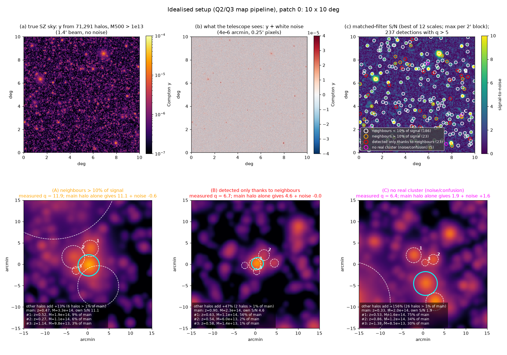
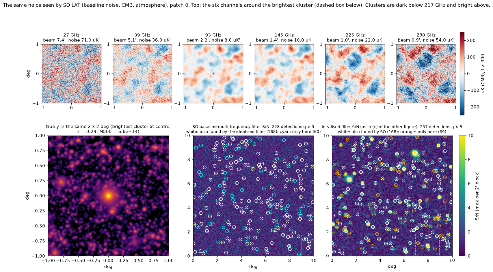
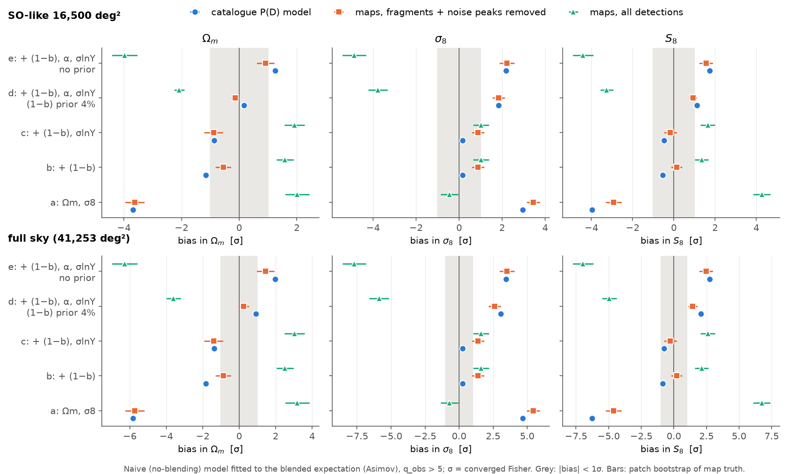
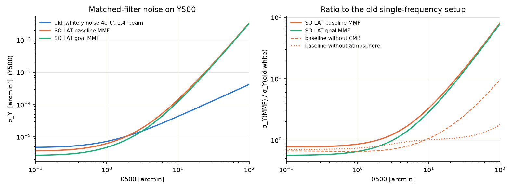
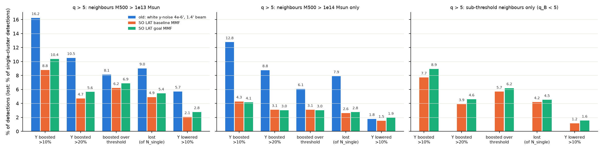
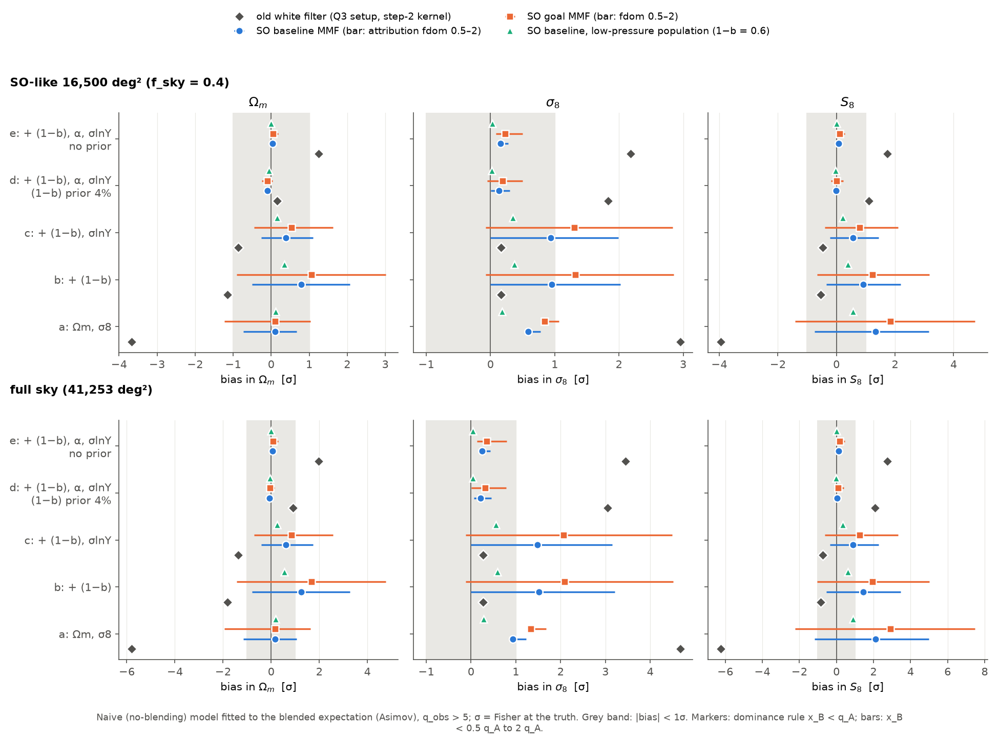

# Progress report (12 November 2026)

This page summarises what has been done so far, what we found and what comes next.
- **Idealised telescope (Q1–Q3):** details in [`REPORT.md`](REPORT.md).
- **Realistic Simons Observatory setup:** details in [`analysis/realistic/step1/RESULTS.md`](analysis/realistic/step1/RESULTS.md) and [`analysis/realistic/step2/RESULTS.md`](analysis/realistic/step2/RESULTS.md).

Every number below comes from a script in this repository. Logs are committed for the realistic setup, the patch pictures and the finder timing test; the Q1–Q3 logs are kept locally. Every Q1–Q3 and step-1 result, and every step-2 result except the arbiter's extra analyst setups and the map check's Poisson realisations, was checked independently before being reported (step 2's RESULTS.md says, claim by claim, which check confirmed it); the patch pictures and the timing test carry only their own internal checks.

## Status

| part | question | status |
|---|---|---|
| Q1 | How likely are two or more clusters inside an aperture? | done, verified |
| Q2 | How often is a detection blended at a signal-to-noise (S/N) threshold? | done, verified |
| Q3 | Does ignoring blending bias cosmology from cluster counts? | done, verified (idealised telescope) |
| Realistic step 1 | Does blending survive with SO's forecast noise, the CMB and a six-channel filter? | done, verified: **yes; Y boosts and losses about halved** |
| Realistic step 2 | Does the cosmology bias survive with the SO filter? | done, verified: **with the default analysis choices, Q3's S8 bias disappears when the Y–M relation is fitted (at most +0.6σ, SO-like, over all choices tried); with the relation fixed, +1.33σ to +1.85σ (SO-like), the opposite sign to Q3** |
| Realistic step 3 | A realistic cluster finder | planned (see the last section) |

---

## What a simulated patch looks like

One 10°×10° patch of the idealised setup used for Q2 and Q3. It contains 71,291 halos above 10¹³ M☉.
- **(a) The true SZ sky.** Most of the "background" is faint halos that are never detected individually.
- **(b) What the telescope sees.** Noise hides almost everything; only the brightest clusters stand out.
- **(c) The matched-filter S/N map,** with 237 detections above q = 5:
  - 186 are clean;
  - 23 pass on their own but get more than 10% of their signal from other halos;
  - 23 are detected only thanks to other halos;
  - 5 are not a real cluster.
- **Bottom: close-ups of three detections.** The cyan circle is the main halo; dashed circles are the other halos that add the most signal.
  - **A** (q = 11.9): other halos add 13% to a z = 0.47 cluster. The largest are neighbours at z = 0.52, 0.27 and 1.14, adding 9%, 6% and 3%.
  - **B** (q = 6.7): the cluster alone (z = 0.90) gives only 4.6, below the threshold. A halo at z = 0.63, almost exactly in front of it, adds 56% of the cluster's own signal; all other halos together add a net 47%. It is a projection, not a physical pair.
  - **C** (q = 6.4): no single halo gives more than S/N 1.9. Twenty-six other halos each add more than 1% of that signal (the largest at z = 0.53, 0.86 and 1.38), plus a noise fluctuation of +1.6. No real cluster is behind this peak.

The same halos seen by the SO large-aperture telescope (baseline noise, lensed CMB, atmosphere).
- **Top:** a 2°×2° close-up of the brightest cluster (z = 0.29) in the six channels.
  - The CMB is the large-scale pattern shared by all six channels. At 27 GHz, and partly at 280 GHz, the instrument noise is larger.
  - The cluster is the dark dot at 93 and 145 GHz and vanishes at 225 GHz, close to the SZ null at 217 GHz. Above the null it should be bright, but at 280 GHz the noise hides it.
- **Bottom:** the SO multi-frequency filter against the idealised filter. They give 228 and 237 detections, 168 in common.
  - The SO filter is better for compact clusters and much worse for large, nearby ones, because the CMB and atmosphere dominate at large scales.
  - Examples: the brightest cluster drops from S/N 47 to 29, and a z = 0.07 cluster from 34 to 9.
- Both S/N maps show the maximum in each 2′ block, so compact peaks stay visible.

Checks:
- The idealised map was rebuilt with the pipeline's own code and noise seed. It gives the same 613 candidate peaks as the stored run, with S/N matching to 3×10⁻⁶.
- The SO filter's noise on this pixel grid matches the library value to better than 10⁻⁴.

Script: [`analysis/visual/v01_patches.py`](analysis/visual/v01_patches.py) (about 20 s; set `PID` to draw another patch). Log: [`v01_patches.log`](analysis/visual/v01_patches.log).

---

## Results so far

### Idealised telescope (Q1–Q3)

**Setup:**
- **Halos:** Tinker08 mass function, Planck18 cosmology, 10¹³–10¹⁶ M☉ and 0.01 < z < 3. That is about 29 million halos on the full sky, placed independently (Poisson).
- **SZ signal:** Planck 2013 Y–M relation with 17% log-normal scatter, Arnaud pressure profile.
- **Telescope:** 1.4′ beam, white y-noise 4×10⁻⁶ arcmin, no CMB or foregrounds.
- **Detection:** matched filter. At q > 5 this gives about 86,000 detections on the full sky.

**Q1, close pairs.**
- Positions are Poisson, so the number of clusters in an aperture follows P(N) = Poisson(Σ πθ²) exactly, also around a detected cluster.
- Only 0.7% of q > 5 detections have another detection within 2′.

**Q2, blending at a threshold.** Blending is a confusion problem, not a pair problem.
- About 15% of detections have their Y inflated by more than 10%.
- About 8% are detected only because of that boost, and about 10% of real clusters are lost.
- Merged pairs, the "pair" effect, are only about 0.5%.
- Most of the extra signal comes from faint halos at *other* redshifts along the line of sight.
- **How to compute it:** use the compound-Poisson distribution of the summed neighbour signal ("P(D)", as for source confusion in radio and far-IR surveys). It agrees with 324 simulated 100 deg² map patches to within about 2 percentage points.
- **Two traps:**
  - not removing the map mean roughly triples every blending fraction;
  - not counting on the detected sample underestimates blending by 1.3–1.5×.

**Q3, cosmology.** We generated the counts a survey would see, binned in redshift and S/N, including blending. We then fitted them with the standard model that ignores blending.
- **Bins:** 16 × 9; the separate analysis behind the last two table rows uses 12 × 10.
- **Fitted parameters:** Ωm, σ8 and up to four Y–M parameters: mass bias (1−b), slope α, redshift evolution β and scatter σlnY.
- **Fits:** maximum likelihood on noiseless data, with Fisher errors.
- **Cross-checks:**
  - MCMC for the SO-like survey (third table row);
  - Poisson realisations of the SO-like counts: 100 each for the first two rows, 50 for the third;
  - resampling of map patches.

| what is fitted | SO-like, 16,500 deg² | full sky |
|---|---|---|
| Ωm, σ8 only (scaling relation fixed) | S8 −4.0σ | S8 −6.3σ |
| + mass bias (1−b) | S8 −0.5σ, Ωm −1.2σ | S8 −0.8σ, Ωm −1.8σ |
| + (1−b) with 4% prior, slope α, scatter σlnY | S8 +1.1σ, σ8 +1.8σ | S8 +2.1σ, σ8 +3.1σ |
| all four relation parameters, Planck-like priors | S8cl +1.1σ | S8cl +2.2σ |
| same, plus 4 free "confusion" parameters | ≤ 0.5σ | ≤ 0.7σ |

*S8 = σ8(Ωm/0.3)^0.5; the separate analysis behind the last two rows uses S8cl = σ8(Ωm/0.3)^0.3.*

- **Silent and unabsorbed:** a goodness-of-fit test flags the problem in only 7–54% of realisations. Freeing nuisance parameters does not absorb the bias; it changes which parameter takes it.
- **It can be modelled exactly and cheaply.**
  - One P(D) table costs 0.5–2.5 minutes.
  - Computing it at the fiducial cosmology and once more at the first best fit leaves ≤ 0.05σ within Planck ±3σ (≤ 0.22σ at the edges of the tested grid).
  - An 81-point emulator leaves ≤ 0.02σ.
- **The detection pipeline matters more.** Peak-finding artefacts (fragments, noise peaks, picking the best filter size) change counts by +4–6%, more than blending itself.
- **Open:** the simulated maps show 0.77 ± 0.11 of the deficit the P(D) model predicts.

### Realistic SO telescope, step 1: does blending survive?

**Setup:**
- **Instrument:** the six SO large-aperture-telescope channels (27–280 GHz), baseline and goal noise including atmosphere (Ade et al. 2019).
- **Sky:** the lensed CMB from CAMB, and the same Poisson halos.
- **Filter:** a multi-frequency matched filter (MMF).
- **Still missing:** CIB, radio, kSZ and Galactic foregrounds.

*Noise of the cluster measurement, σ_Y, versus cluster size θ500.*
- The SO filter beats the idealised one for compact clusters: 0.80× (baseline) and 0.60× (goal) at 0.5′.
- It is much worse for large ones: 3.3× (baseline) and 2.9× (goal) at 10′, because the CMB and atmosphere dominate at large scales.

| q > 5, full sky, neighbours above 10¹³ M☉ | idealised | SO baseline | SO goal |
|---|---|---|---|
| detections without blending | 85,912 | 81,705 | 128,167 |
| Y boosted by > 10% | 16.2% | **8.8%** | **10.4%** |
| Y boosted by > 20% | 10.5% | 4.7% | 5.6% |
| detected only because of the boost | 8.1% | 6.2% | 6.9% |
| lost (of clusters detectable alone) | 9.0% | 4.9% | 5.4% |
| mean Y bias of detections | +3.4% | +2.2% | +2.7% |
| net change in the number of detections | −1.6% | +1.3% | +1.4% |
| change in counts from z < 0.1 to z = 2–3 (P(D) expectation) | −5.3% → +4.0% | +0.7% → +4.8% | +0.8% → +5.0% |
| Y boosted by > 10%, attribution rules f_dom = 0.5–2 (default 1) | 12.5–19.6% | 7.4–10.1% | 8.7–11.9% |

*Blending fractions at q > 5: idealised (blue), SO baseline (orange), SO goal (green).*
- **Left:** all neighbours.
- **Middle:** only massive neighbours (above 10¹⁴ M☉).
- **Right:** only neighbours that are themselves undetectable.

With the SO filter, most of the effect comes from undetectable neighbours.

**What step 1 shows:**
- **As a noise term, faint-halo SZ is small** with the SO filter. The undetectable halos add only 5–8% to σ_Y, in line with Raghunathan et al. (2022), who called it negligible for SO.
- **Per detected cluster, blending is still large.**
  - Y boosts and losses are about half the idealised values (×0.45–0.64).
  - Boosts over the threshold fall by only 15–23%.
  - It changes the redshift shape of the counts.
- **The SO filter needs no mean removal.** It is compensated: it ignores a uniform SZ background.
- **The numbers depend on the attribution rule,** i.e. on which cluster a blended peak is assigned to. We count each peak once, under its brightest contributor. Only a real cluster finder with injected clusters can pin this down (step 3).
- **The fractions are probably upper bounds.** There are no foregrounds yet, and the halo model's SZ power is 2.65× the value SPT measures.
- **Verification:**
  - Two independent checks, a re-derivation with separate code and map simulations, reproduce the headline fractions to within about 0.1 percentage point.
  - An arbitration step tested every disputed claim.
  - Two small offsets remain open, neither of which changes the conclusions: up to 0.13 percentage points between methods, and 0.1–0.5 points in the z = 2–3 bin.

### Realistic SO telescope, step 2: does the cosmology bias survive?

**Setup:**
- **Telescope and sky:** as in step 1 (the SO filter, baseline and goal noise, no foregrounds).
- **Fits:** as in Q3. Counts in 16 redshift × 9 S/N bins above q = 5, for an SO-like survey (16,500 deg²) and the full sky. The standard model, which ignores blending, is fitted to the expected blended counts (maximum likelihood, Fisher errors).
- **Blended counts:** from step 1's P(D) with the SO filter. Each cluster is measured at its true position and size, with the summed signal of all other halos added.

*Bias in Ωm, σ8 and S8 for each set of fitted parameters (a–e, as in the table below), q > 5. Top: SO-like survey; bottom: full sky. Diamonds: the idealised filter (Q3 setup). Circles and squares: SO baseline and goal noise with the default attribution rule and the noise-only σ; the bars span the rules f_dom = 0.5–2 (other noise estimates are not shown). Triangles: SO baseline with a fainter halo population whose SZ power matches SPT's measurement. Grey band: |bias| < 1σ.*

S8 bias, SO-like survey, q > 5, default attribution rule (f_dom = 1), S/N divided by the noise-only σ:

| what is fitted | idealised filter (Q3 setup) | SO baseline | SO goal |
|---|---|---|---|
| a: Ωm, σ8 only (scaling relation fixed) | −3.95σ | **+1.33σ** | **+1.85σ** |
| b: + mass bias (1−b), no prior | −0.53σ | +0.91σ | +1.23σ |
| c: + (1−b) (no prior), scatter σlnY | −0.47σ | +0.57σ | +0.80σ |
| d: + (1−b) with 4% prior, slope α, σlnY | +1.11σ | **−0.01σ** | **+0.01σ** |
| e: as d, without the prior | +1.73σ | +0.07σ | +0.11σ |

*The idealised column is Q3's setup run through the step-2 code (Q3 itself gave −3.97σ in a and +1.11σ in d). Full sky, baseline / goal: d +0.04σ / +0.08σ, a +2.11σ / +2.92σ.*

**What step 2 shows:**
- **Fit the scaling relation (d), and Q3's S8 bias is gone** (−0.01σ / +0.01σ, SO-like, baseline / goal, default choices). The same code with the idealised filter gives +1.11σ (SO-like) and +2.07σ (full sky), as Q3 did. So the change comes from the filter, not from the code.
- **Why.** With the SO filter, the default attribution rule and the noise-only σ, blending raises the counts smoothly: +1.3% (baseline) and +1.4% (goal) in total, growing from +0.7% at z < 0.1 to +4.7% at z = 2–3 (baseline; +4.8% for clusters with q_A ≥ 0.5, as in the step-1 table) and largest near the threshold. A small shift of the slope α (−0.4σ), with Ωm −0.1σ and σ8 +0.1σ, absorbs this, and the Ωm and σ8 shifts cancel in S8. This needs α free: with α fixed (configs b and c) the change is not absorbed. In Q3, config d's bias came from how the count change varied with S/N (a loss at q = 5–7, a gain at q = 15–50); the fit mimicked it by moving the slope and the scatter, which pulled σ8 up. (If the noise level is instead the plain standard deviation of the map, the count change takes back Q3's S/N shape and config d rises to +0.3σ to +0.5σ.)
- **Fix the scaling relation (a), and a bias of the opposite sign appears:** +1.33σ to +1.85σ (SO-like) and +2.11σ to +2.92σ (full sky). Only Ωm and σ8 can absorb the extra counts. Configs b and c keep the slope α fixed at its true value and fit (1−b) without a prior; an analysis that takes the slope from external calibration would be closer to them than to d. With the default choices they give +0.6σ to +1.2σ (SO-like; +0.90σ to +1.95σ on the full sky) and, like config a, they depend strongly on the attribution rule (up to +3.2σ for b, goal, f_dom = 2).
- **The analyst's choices matter a lot when the relation is fixed, and little when it is fitted:**
  - *Attribution rule,* f_dom = 0.5–2 (SO-like survey): config a from −0.75σ to +3.15σ (baseline) and from −1.41σ to +4.72σ (goal).
  - *Noise level measured on the map,* which contains faint-halo signal, instead of the noise-only value: config a changes sign. A robust or clipped width gives −0.3σ to −1.4σ; the plain standard deviation gives −2.9σ (baseline) and −4.4σ (goal) (SO-like survey).
  - *Config d over all 20 combinations computed* of noise estimate, attribution rule and instrument noise (8 of them, including the worst case, checked by the arbiter only): −0.19σ to +0.61σ (SO-like) and −0.14σ to +0.89σ (full sky). The worst case is goal noise with the plain standard deviation and the strict rule f_dom = 0.5. None comes back to Q3's +1.1σ and +2.1σ.
- **A fit would rarely notice.** A goodness-of-fit test has power of at most 0.073 in configs b–e (SO-like survey; 0.05 means no power), and 0.153 even in the worst analyst setup (full sky: 0.12 and 0.43). Config a is easier to catch: up to 0.38 (SO-like) and 0.91 (full sky) over the setups tried.
- **Correcting once works, if the blending model is right.** A correction computed at the fiducial cosmology (SO baseline, default rule) leaves ≤ 0.17σ in S8 when the true S8 is 0.75 or 0.87 (at fixed Ωm); ignoring blending there gives up to 2.8σ.
- **A fainter SZ sky gives less.** With SZ power matching SPT's measurement ((1−b) = 0.6), config a drops to +0.57σ and config d stays at −0.02σ (SO-like, baseline).
- **A higher threshold,** q > 6, lowers config a by about a quarter (+0.98σ / +1.40σ, SO-like, baseline / goal).
- **Poisson noise does not change it.** In 200 noisy realisations (SO-like, baseline, default choices), blending shifts S8 by +1.334 ± 0.007σ in config a and −0.001 ± 0.004σ in config d, the same as the noiseless fits.

**Verification:**
- **Catalogue check,** with its own code (11 fresh full skies, direct sums over each cluster's neighbours, its own count model and fitter): config d −0.02σ / +0.00σ, config a +1.31σ / +1.84σ (SO-like, baseline / goal).
- **Map check** (500 fresh 10°×10° patches, 50,000 deg², through the SO filter; plus the Poisson realisations): config d +0.01 ± 0.05σ / +0.02 ± 0.06σ, config a +1.39 ± 0.10σ / +1.90 ± 0.10σ (SO-like, baseline / goal).
- **Arbitration:**
  - The map check found configs c and e 0.1–0.3σ higher (SO-like). The arbiter measured the blending kernel directly on 60 more patches: it agrees with the P(D) kernel within the test's errors of about 10⁻⁴, so the offset was a fluctuation in the map check's sample of clusters.
  - It confirmed σ(S8) in configs c and e to within 1.2%, added the plain-standard-deviation case raised by the map check, and computed the attribution-rule × noise-estimate corners, which only it checked (the worst cases quoted above). No published number changed.
  - The correction off the fiducial was confirmed by the catalogue check only, on fresh skies at the two other S8 values.
- **Open:**
  - which attribution rule and noise estimate a real SO pipeline uses (step 3);
  - freeing the redshift evolution of the Y–M relation in the fit, not yet tried;
  - two small per-bin offsets between methods (z = 1–1.5 and z = 2–3), worth less than 0.1σ in S8 if real;
  - no foregrounds, halo clustering, masks, bandpasses or relativistic SZ; the fiducial sky's SZ power is 2.65× SPT's;
  - the map-measured noise level is assumed known exactly from the fiducial sky;
  - Poisson realisations for one case only; the correction tested only along S8 at fixed Ωm (two truths); the fainter population and the robust width tried only with the default rule.

---

## What we have done

### External codes used
Only general scientific and cosmology libraries; everything SZ-specific is our own code.

| code | used for |
|---|---|
| colossus 1.4 | Planck18 cosmology, distances, Tinker08 mass function (σ(M) from Eisenstein & Hu); Bocquet16 and Despali16 for robustness |
| numpy, scipy | FFTs, Hankel transforms, special functions, likelihood maximisation (L-BFGS-B) |
| numba | fast loops: filter cross-response tables, neighbour sums, painting halos into maps |
| healpy | sky pixelisation (jackknife regions, sampler uniformity tests) and one neighbour search in a catalogue check |
| CAMB 2.0.5 | lensed CMB spectrum for the SO filter |
| CLASS (classy 3.4.2) | independent check of the CMB spectrum |
| emcee 3.1 | MCMC cross-check of the cosmology fits |
| matplotlib, astropy | figures; small use in two checks |

### What we implemented

- **[`szsim/`](szsim/README.md), the core library:**
  - `cosmo_hmf.py`: mass-function tables.
  - `sampler.py`: a full-sky Poisson halo sampler (29 million halos in about 8 s).
  - `signal.py`:
    - the Y–M relation with scatter and the Arnaud profile;
    - the matched-filter noise σ_Y;
    - the cross-response ρ_AB (how much of cluster B's signal enters cluster A's filter);
    - detection probabilities and expected counts.
  - `instrument.py`: the SO noise model, the tSZ spectrum and the multi-frequency matched filter.
- **Blending calculations:**
  - **Catalogue level** ([`analysis/blending/`](analysis/blending/)): the compound-Poisson P(D) by FFT, with mean removal and the attribution rule. The SO version, for a filter whose response goes negative around the cluster, is in [`analysis/realistic/step1/pdlib1.py`](analysis/realistic/step1/pdlib1.py).
  - **Map level** ([`analysis/q2_maps/`](analysis/q2_maps/)): 10°×10° patches with painted halos, a matched filter at 12 sizes (0.5–10′), peak finding, merging within 2′, and an exact split of each detection into the contributions of individual halos.
- **Cosmology** ([`analysis/cosmo/`](analysis/cosmo/)):
  - a binned counts model and blended data from the P(D) and from the maps;
  - maximum-likelihood fits with Fisher errors, Poisson realisations and MCMC;
  - the P(D) correction on an 81-point grid of cosmologies, with an emulator;
  - corrected models (fixed, emulated, iterated) and cheap effective models.
- **Realistic SO, step 1** ([`analysis/realistic/step1/`](analysis/realistic/step1/)):
  - the instrument and filter;
  - noise and confusion versus filter size;
  - the P(D) with the SO filter, and the go/no-go table.
- **Realistic SO, step 2** ([`analysis/realistic/step2/`](analysis/realistic/step2/)):
  - blended detection kernels from the P(D) with the SO filter, for each attribution rule and noise estimate;
  - the counts model with the SO filter's noise;
  - the cosmology fits (configs a–e), a linear split of the main biases into amplitude, redshift-tilt and S/N-shape parts, and the correction tested off the fiducial.
- **Pictures of patches** ([`analysis/visual/`](analysis/visual/)): the two figures at the top of this page.

### How every result is checked
- **One step at a time.** Each step is built once, then checked by two independent re-implementations written without the builder's new code. They reuse only earlier-validated pieces such as the halo sampler, and the map checks deliberately run the build's filter on independently simulated skies. A typical pair:
  - a re-derivation with different numerics;
  - a simulation that measures the same thing on maps or catalogues.
- **Arbitration.** A final pass tests every disputed claim with targeted runs, fixes the bugs it finds and lists what is still open. It writes a results file that says, claim by claim, which check confirmed it.
- **Where the checks live:**
  - `verify/`: Q1 and Q2;
  - `verify_cosmo/`: Q3;
  - `verify_real/`: the realistic setup.
- **Compute:** everything runs on a 10-core laptop with 16 GB of RAM.

---

## Next: a realistic cluster finder (step 3)

So far the realistic numbers measure each cluster at its true position with a filter of its true size, and add the neighbours through the P(D). That isolates the blending every finder suffers. A real finder adds its own effects:
- searching over positions and sizes;
- fragments and noise peaks;
- which cluster a blended peak is assigned to.

In Q3 these effects were larger than blending. Step 1 showed that the blending fractions depend on the assignment. Step 2 showed that the cosmology bias depends on it and on how the noise level is measured: over the cases computed, from −6.2σ to +4.7σ in S8 when the scaling relation is fixed (SO goal, SO-like survey), but only −0.2σ to +0.6σ when it is fitted. Measuring these effects needs a real finder on realistic maps, with injected clusters.

**Plan:**
- **A lean finder.** Reimplement, for our periodic simulated patches, the iterative multi-frequency matched filter of SZiFi (Zubeldia et al. 2023a,b), the finder being tested for SO. It will copy SZiFi's choices wherever they matter for blending:
  - the noise covariance estimated from the data, so faint-halo SZ enters the noise model;
  - one iteration that masks detected clusters;
  - peaks that are maxima in both position and size;
  - the same merging rule.
- **Why a reimplementation:** SZiFi is built for real data (sky tiling, masks, inpainting, power-spectrum decoupling, foreground deprojection), which our simulations do not need. In a timing test on a 10°×10°, six-channel tile with 12 filter sizes:
  - applying the filter the way SZiFi's `get_mmf_q_map` does (per channel, by zero-padded convolution) took 11.4 s;
  - the same algebra in Fourier space, with the channel combination done once for all sizes, took 0.3 s;
  - after a one-pixel registration shift, the two S/N maps agree to 3×10⁻⁶ in the tile interior at the two sizes compared (0.66′ and 4.42′; random test maps);
  - script and log: [`analysis/finder/f00_bench_filtering.py`](analysis/finder/f00_bench_filtering.py), [`.log`](analysis/finder/f00_bench_filtering.log).
- **Checks:**
  - SZiFi itself on a subset of tiles (identical S/N maps when given the same noise model; matching catalogues otherwise);
  - noise-only skies and injected clusters.
- **Science:** run the finder on SO-sized skies, measure attribution and the count changes in (z, q), and redo the cosmology fits.

**After that:**
- foregrounds (CIB, radio, kSZ);
- clustered halos from the Websky simulation;
- the P(D) inside a full cluster-count likelihood code;
- a paper draft.
