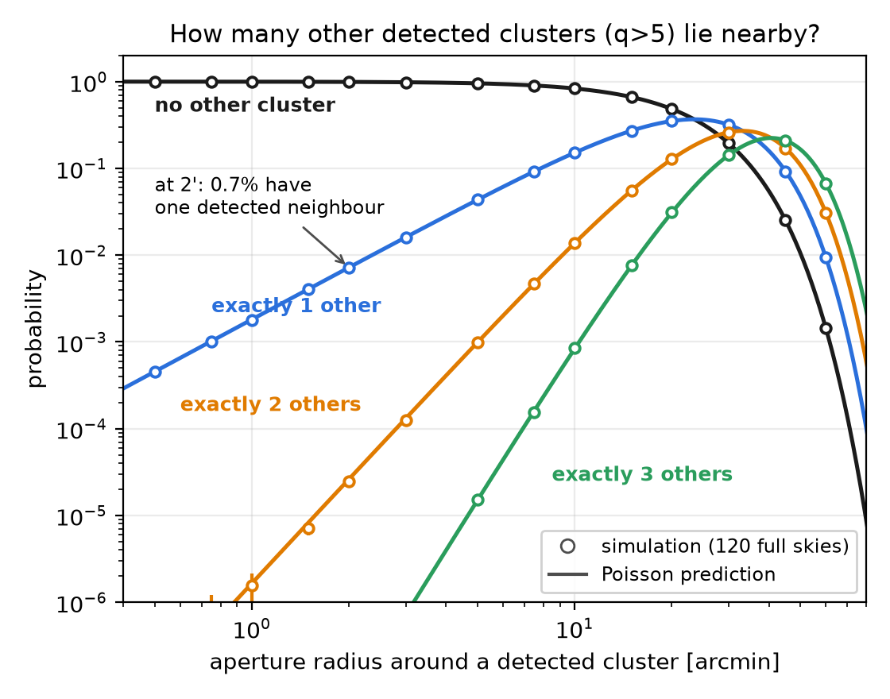
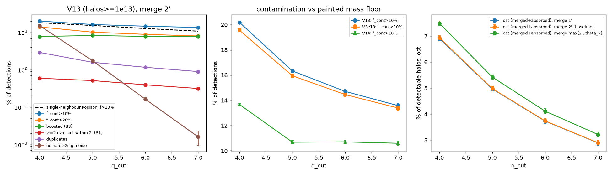
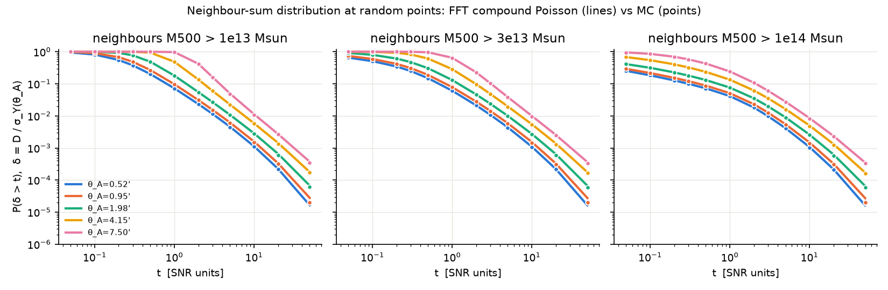
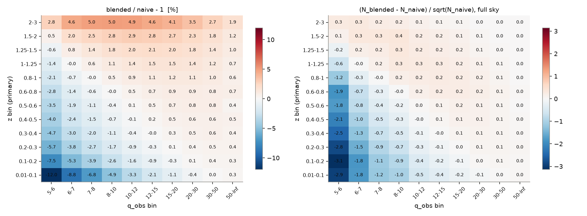
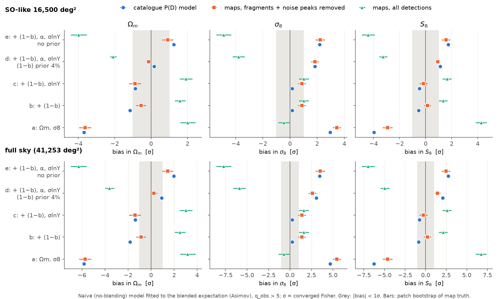
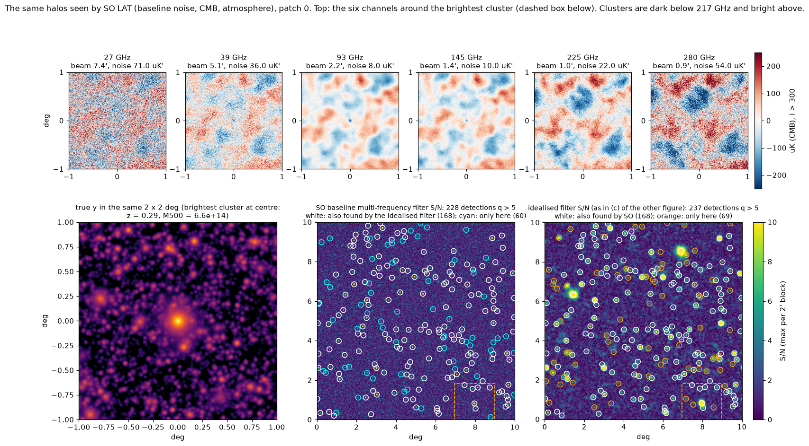

# Close pairs and blending of SZ galaxy clusters

Full-sky Poisson simulations of galaxy clusters seen through the thermal Sunyaev–Zel'dovich (SZ) effect, used to answer three questions:

1. **What is the probability of finding two (or N) clusters within an aperture?**
2. **Given a detection signal-to-noise threshold, how often are detections blended?**
3. **Does ignoring blending bias cosmology from cluster counts, and can a likelihood account for it?**

Every number below was computed by a script in this repository. Each one was also checked by an independent re-implementation, or re-run on fresh random seeds; for the realistic SO steps, [`PROGRESS.md`](PROGRESS.md) lists the few numbers that only one reviewer checked.

📄 **Two-page summary:** [`twopager/twopager.pdf`](twopager/twopager.pdf) · 📘 **Report:** [`REPORT.md`](REPORT.md) · 🔬 **All numbers and tests:** [`REPORT_detailed.md`](REPORT_detailed.md), [`REPORT_cosmo_detailed.md`](REPORT_cosmo_detailed.md)

📈 **Latest: progress report, realistic Simons Observatory setup and next steps:** [`PROGRESS.md`](PROGRESS.md)

🧭 **Current conclusions:** [`CONCLUSIONS.md`](CONCLUSIONS.md) · 🔍 **Review of the SZiFi cluster finder (possible bugs and improvements):** [`SZIFI_REVIEW.md`](SZIFI_REVIEW.md)

---

## Key results

Q1–Q3 use an *idealised telescope*: one map of the SZ signal itself (Compton y) with a 1.4′ beam and uniform white noise, and nothing else on the sky, so no CMB, atmospheric noise or foregrounds ([the model](#the-model)). The realistic Simons Observatory steps are [further down](#towards-a-realistic-so-analysis-in-progress).

- **Close pairs follow Poisson statistics exactly.** The number of clusters in an aperture depends only on the number of clusters per square degree and on the aperture's area. The same law holds around a detected cluster.
- **Detected clusters rarely sit together.** At signal-to-noise q > 5, only **0.7%** of detections have another detection within 2′.
- **Blending is common anyway.** About **15%** of detections have their SZ signal inflated by more than 10%. About **8%** are detected only because of that boost, and about **10%** of real clusters are lost. The cause is mostly faint, undetectable halos at *other redshifts* along the line of sight.
- **So blending is a confusion problem, not a pair problem.** It has to be computed from the summed signal of all faint neighbours (a "P(D)" calculation), not from pairs within a radius.
- **Ignoring blending biases cosmology (idealised telescope).** A cluster-count fit that ignores it shifts S8 by about **1σ** for an SO-like survey and **2σ** on the full sky. It usually passes goodness-of-fit, and mass-calibration nuisances do not absorb it. Modelling it exactly is cheap: about one minute per P(D) table, and it does not need recomputing at every step.
  - *With SO's realistic six-channel filter this changes* ([step 2](#towards-a-realistic-so-analysis-in-progress)): with the default analysis choices, if the Y–M normalisation, slope and scatter are fitted, the S8 bias disappears (at most +0.6σ for an SO-like survey over all choices tried); if the relation is fixed, a bias of +1.33σ to +1.85σ appears for an SO-like survey (+2.11σ to +2.92σ on the full sky), opposite in sign to the idealised telescope's −4.0σ (−6.3σ on the full sky).
  - *A SZiFi-like cluster finder does not make step 2's default choices (f_dom = 1, noise-only σ)* ([step 3a](#towards-a-realistic-so-analysis-in-progress)): it credits each blended peak to its brighter cluster, and its noise level includes part of the SZ of other halos. The step-2 cases that match its count change gave an S8 bias of +0.1σ to +0.4σ with the relation fitted and −0.6σ to −3.7σ with it fixed (SO-like survey; a preview read off step 2's table, not yet a fit; with SZiFi's default masking settings the count change goes beyond step 2's table).
  - *Fitting the finder's own catalogue* ([step 3b](#towards-a-realistic-so-analysis-in-progress)): the finder credits 1.5% (baseline) and 2.1% (goal) fewer clusters at q > 5 than a no-blending analysis expects, even one that knows the finder's noise level and how it selects isolated clusters. S8 is then off by +0.32σ / +0.68σ with the relation fitted and −2.3σ / −4.2σ with it fixed (SO-like survey), and a goodness-of-fit test would rarely notice.
- **Two traps.**
  - Not removing the map's mean SZ signal roughly *triples* every blending fraction.
  - Not computing fractions on the *detected* sample underestimates blending by 1.3–1.5×.

---

## The model

| ingredient | choice |
|---|---|
| Halo abundance | Tinker08 mass function (M500c), Planck18 cosmology |
| Range | 10¹³–10¹⁶ M☉, 0 < z < 3, full sky (≈ 29 million halos) |
| Positions | independent and uniform on the sphere (Poisson) |
| SZ signal | Planck 2013 Y500–M500 relation, 17% log-normal scatter, Arnaud pressure profile |
| Telescope ("idealised") | one map of Compton y instead of maps at several frequencies. 1.4′ beam (as SO's 145 GHz channel), uniform white y-noise of 4×10⁻⁶ arcmin (11 μK′ at 145 GHz, close to SO baseline's 10 μK′ there), no CMB, atmospheric noise or foregrounds. Its depth is close to our SO baseline model's, but its map noise is white: it does not rise on large scales as SO's does ([step 1](PROGRESS.md#realistic-so-telescope-step-1-does-blending-survive)) |
| Detection | matched filter; detected if signal-to-noise q > q_cut (4–7) |

| q_cut | 4 | 5 | 6 | 7 |
|---|---|---|---|---|
| detections, full sky | 132,000 | 86,000 | 62,000 | 47,000 |
| per square degree | 3.2 | 2.1 | 1.5 | 1.1 |

---

## Question 1: two or more clusters in an aperture

Positions are independent, so any subset of clusters is also Poisson: detected clusters, massive halos, or a redshift slice. The number N inside an aperture of radius θ is

$$P(N=n)=\frac{e^{-\mu}\mu^n}{n!},\qquad \mu=\Sigma\times\pi\theta^2 ,$$

where Σ is the number of clusters of that kind per unit area. Use the exact cap area 2π(1 − cos θ) above a few degrees.

- **Around a detected cluster** the same law gives the number of *other* clusters. The chance of at least one neighbour is 1 − e^(−μ) ≈ μ.
- **Over the whole sky** the expected number of pairs closer than θ is N_total·μ/2.

<p align="center"></p>

**How to read the plot:**
- Draw a circle of radius θ around a detected cluster. Each curve is the probability that it holds exactly n *other* detected clusters.
- Dots are 120 simulated full skies; lines are the Poisson formula, with nothing fitted.
- Small circles are almost always empty.
- The chance of one neighbour grows as θ².
- Near 23′ there is one neighbour on average.

**Chance that a detected cluster (q > 5) has at least one neighbour:**

| neighbour within | 1′ | 2′ | 5′ | 10′ |
|---|---|---|---|---|
| another detected cluster | 0.2% | 0.7% | 4% | 17% |
| any halo > 10¹⁴ M☉ | 0.8% | 3% | 19% | 57% |
| any halo > 3×10¹³ M☉ | 9% | 32% | 91% | ~100% |
| close pairs of detections, full sky | 78 | 312 | 1,950 | 7,800 |

*Caveat:* real clusters are clustered. Using halo bias and the Limber approximation, this raises close-pair probabilities by about 15–25% at 1–5′. Multiply μ by (1 + w̄(θ)), where w̄ is the angular correlation function averaged over the aperture.

---

## Question 2: blending at a detection threshold

| type | what happens |
|---|---|
| **Merged pair** | two clusters that would each be detected are so close the pipeline sees one |
| **Contaminated** | a real detection whose signal (and so mass) is inflated by neighbours |
| **Boosted** | too faint to be detected alone; pushed over the threshold by neighbours |
| **Lost** | detectable alone but missed: swallowed by a brighter peak, or pulled below threshold |

These were measured in two independent ways:
- **Catalogue calculation:** the compound-Poisson P(D) method below, checked against direct sums over 60 simulated skies.
- **Simulated maps:** 32,000 deg² with every halo painted in, noise added and a multi-scale matched filter run. These are the ground truth.

| q_cut | merged pairs | contaminated >10% | contaminated >20% | boosted | lost |
|---|---|---|---|---|---|
| 4 | 0.6% | 14–19% | 8–12% | 8–9% | 11–12% |
| 5 | 0.5% | 14–16% | 8–11% | 8% | 9–10% |
| 6 | 0.4% | 14–15% | 8–9% | 8% | 8–9% |
| 7 | 0.3% | 13% | 7–8% | 7–8% | 7–8% |

Ranges span the catalogue calculation and the maps. Lost is a percentage of clusters that would be detectable on their own; the other columns are percentages of detections.

<p align="center"></p>

**Why pairs are the wrong picture.**
- Each cluster sits on a background of many faint halos. Each is too faint to detect, but together they add a sizeable, fluctuating signal.
- Most of this signal comes from halos of 10¹⁴ M☉ and above at other redshifts.
- No single "blending radius" describes it: the radius you would need grows from 8′ to 12′ as the threshold rises.

**How to compute it (P(D), as in radio source confusion):**
1. Every halo near the cluster adds signal, weighted by the filter's response at its distance.
2. The halos are Poisson, so the total added signal has a compound-Poisson distribution, computable from the mass function with one FFT.
3. Remove the map mean, add the noise, apply the threshold, and count fractions *on the detected sample*.

This reproduces the simulated maps to within about 2 percentage points.

<p align="center"></p>

---

## Question 3: impact on cosmology

We put blending into a binned (z, q) Poisson count likelihood and fitted the usual *no-blending* model to blended data.

**What blending does to the counts.**
- Nearby, faint detections are lost: down to −12% at z < 0.1.
- Distant ones gain 2–5%.
- The total changes by only −1.6%, but the tilt in redshift looks like a change of cosmology.

<p align="center"></p>

<p align="center"></p>

**What this figure shows.** It answers one question: *if you analyse cluster counts with the standard model, which ignores blending, how wrong are the cosmological parameters you get?*

**The experiment.**
- We generate the counts that a real survey would see, which *do* include blending.
- We then fit them with the standard model that assumes no blending.
- The data are the exact expected counts, with no random noise. So any offset between the fit and the true cosmology is a systematic bias caused only by ignoring blending.

**Layout.**
- **Two blocks.** The top block is an SO-like survey covering 40% of the sky (16,500 deg²). The bottom block is the full sky. Same experiment; the bigger survey has smaller error bars, so the same offset counts for more σ.
- **Three columns**, one per parameter: Ωm, σ8, and S8 = σ8 (Ωm/0.3)^0.5.
- **x-axis:** the bias, best fit minus truth, in units of the statistical error σ. Zero means no bias. The grey band marks |bias| < 1σ, where the error is smaller than the statistical uncertainty. Points outside it are significant biases.
- **Five rows, a–e.** Each row lets more parameters of the mass–SZ (Y–M) scaling relation float in the fit. Parameters not listed are fixed at their true values.
  - **a:** only Ωm and σ8 are fitted. The scaling relation is assumed perfectly known.
  - **b:** also fit the mass bias (1−b), with no prior.
  - **c:** also fit (1−b) and the scatter σlnY.
  - **d:** also fit (1−b), the slope α and σlnY, with a 4% prior on (1−b). This is the most realistic case, like a weak-lensing mass calibration.
  - **e:** same as d, but with no prior on (1−b).

**Three versions of the "data".**
- **Blue dots:** counts predicted by our blending (P(D)) model.
- **Orange squares:** counts measured in simulated maps, with spurious detections (cluster fragments and noise peaks) removed. The error bars come from resampling map patches.
- **Green triangles:** the same maps, keeping every detection. This mixes blending with defects of the detection pipeline.

**How to read it.**
- Orange sits close to blue in every row, so the blending model captures what the maps show. Orange is about 20–30% smaller.
- **Row a:** S8 comes out low by about 4σ (SO-like) or 6σ (full sky). The fit can only adjust cosmology, so it bends cosmology to mimic blending.
- **Rows b and c:** freeing the mass bias brings S8 back into the grey band. However, Ωm is still off by 1–2σ.
- **Rows d and e:** once the slope α is also free, the fit tilts the scaling relation to imitate blending. This pushes σ8 and S8 *high*, by about 1–2σ (SO-like) and 2–3σ (full sky).
- So freeing nuisance parameters does not remove the bias; it changes which parameter absorbs it, and in which direction.
- **Green** points are often far off, in either direction. They show that the detection pipeline itself (fragments, noise peaks) must be calibrated on simulations, and that this is a bigger effect than blending.

**Bottom line.** With the idealised telescope, if blending is ignored, an SO-like analysis with the most realistic fit (row d) gets S8 too high by about 1σ, and a full-sky one by about 2σ. With SO's realistic filter and the default analysis choices, this row-d bias drops to −0.01σ to +0.08σ; other attribution rules and noise estimates leave at most +0.6σ (SO-like) and +0.9σ (full sky) ([step 2](#towards-a-realistic-so-analysis-in-progress)). Our SZiFi-like cluster finder matches step-2 cases with a row-d bias of +0.1σ to +0.4σ (SO-like; step 3a, a preview read off step 2's table; with SZiFi's default masking settings the count change goes beyond that table).

| fitted | SO-like 16,500 deg² | full sky |
|---|---|---|
| Ωm, σ8 (Y–M fixed) | S8 −4.0σ | S8 −6.3σ |
| + (1−b) | S8 −0.5σ, Ωm −1.2σ | S8 −0.8σ, Ωm −1.8σ |
| + (1−b) 4% prior, α, σlnY | S8 +1.1σ, σ8 +1.8σ | S8 +2.1σ, σ8 +3.1σ |
| all Y–M params, Planck-like priors | S8cl +1.1σ | S8cl +2.2σ |
| same + 4 free confusion params | ≤ 0.5σ | ≤ 0.7σ |

*S8 = σ8(Ωm/0.3)^0.5; the analysis behind the last two rows uses S8cl = σ8(Ωm/0.3)^0.3.*

**How to handle it.**
- **Exact:** convolve the selection kernel with the compound-Poisson P(D). Remove the map mean and count each peak once.
  - Compute it at the fiducial cosmology, then once more at the first best fit. This leaves ≤ 0.05σ.
  - Alternatively, use an 81-point emulator, which leaves ≤ 0.02σ.
- **Cheap:** use a Gaussian offset plus scatter that depends on angular size, with 4 free parameters.
- **Not enough:** a constant extra scatter, or a shifted (1−b) prior.
- **Bigger than blending:** peak-finding artefacts (fragments, noise peaks, scale maximisation) change counts by +4–6%. Calibrate the pipeline with injected maps.

**Open points.**
- Maps show 0.77 ± 0.11 of the predicted blending deficit, so the biases may be about 20% smaller.
- There is no CMB, foreground or mask, and no weak-lensing calibration. See [`REPORT.md`](REPORT.md) §6.

---

## Towards a realistic SO analysis (in progress)

Q1–Q3 above use the [idealised telescope](#the-model): one y map with white noise and nothing else on the sky. We are now repeating them with a realistic model of the Simons Observatory (SO) large-aperture telescope: six frequency channels, atmospheric noise, the CMB and a multi-frequency matched filter. The full summary is in [`PROGRESS.md`](PROGRESS.md).

<p align="center"></p>

*The same simulated halos seen in SO's six channels (top), and the S/N maps of the SO filter and the idealised filter (bottom).*

- **Step 1 (done, independently verified): blending is about halved but does not go away.**
  - At q > 5, 8.8% (baseline noise) and 10.4% (goal noise) of detections have their Y boosted by more than 10%, against 16.2% for the idealised telescope.
  - As a noise term, faint-halo SZ adds only 5–8% to the SO filter noise, in line with Raghunathan et al. (2022).
  - Details: [`analysis/realistic/step1/RESULTS.md`](analysis/realistic/step1/RESULTS.md).
- **Step 2 (done, independently verified): with the default analysis choices, Q3's S8 bias disappears when the scaling relation (normalisation, slope and scatter) is fitted.**
  - When (1−b) (4% prior), the slope α and the scatter are fitted along with Ωm and σ8, the S8 bias is −0.01σ (baseline) and +0.01σ (goal) for an SO-like survey with the default analysis choices, and −0.19σ to +0.61σ over all attribution rules and noise estimates tried, against +1.1σ for the idealised telescope.
  - With the scaling relation fixed, a bias of +1.33σ to +1.85σ appears instead, of the opposite sign to Q3's −4.0σ. It depends strongly on which cluster a blended peak is assigned to and on how the noise level is measured.
  - All step-2 numbers measure each cluster at its true position and size, with the neighbours added through the P(D), and fit noiseless expected counts; foregrounds, halo clustering and a real cluster finder (step 3) are not yet included.
  - Details: [`analysis/realistic/step2/RESULTS.md`](analysis/realistic/step2/RESULTS.md).
- **Step 3a (done; checked twice and arbitrated; the count-change preview by the arbiter only): a real cluster finder makes its own choices, and they matter.**
  - Our lean version of SZiFi's iterative matched filter ([`szsim/finder.py`](szsim/finder.py)) ran on 324 simulated SO tiles per noise level (32,400 deg²). Up to its masking step, which differs from SZiFi's, it gives the same catalogue as an emulation of SZiFi written from its source code, and as SZiFi itself, run later (99.97–99.99% matched).
  - It credits each blended peak to its brighter cluster, like step 2's attribution rule with f_dom ≈ 0.7 (a peak is credited to a cluster only if no single neighbour adds more than 0.7 of its S/N). After masking its detections, its noise level sits about 0.7 of the way from the noise-only value to step 2's noise estimate (i), which adds the scatter from halos below the detection threshold.
  - Searching over position and size adds blending: at q > 5, 10.6% (baseline) and 12.0% (goal) of real, non-fragment detections have Y boosted by more than 10%, against 8.3% and 9.3% with the same filter at the true positions (step 1: 8.8% and 10.4%).
  - Count change at q > 5 (a preview): −0.8% (baseline) and −1.5% (goal), or −1.6% / −2.7% with the selection calibrated on noise-only tiles. The step-2 cases that match its total count and redshift shape (f_dom = 0.5–1, noise estimate (i)) gave an S8 bias of +0.12σ to +0.40σ with the relation fitted and −0.64σ to −3.66σ with it fixed (SO-like).
  - Our re-implementation of SZiFi's default masking settings (set for Planck) overestimates the noise at SO resolution, even on maps without halos. With it the count change would be −4.7% / −5.8%. SZiFi itself gives the same noise level once a round-off problem in SZiFi is avoided and the masked discs at our test tiles' edges are filled periodically (below).
  - Details: [`analysis/realistic/step3/RESULTS.md`](analysis/realistic/step3/RESULTS.md).
- **Step 3b (done; checked twice and arbitrated; the final pooled headline by the arbiter, refitted with the fits check's code; the SO-script fits by the builder only): fitting the finder's own catalogue biases S8 even with the scaling relation fitted.**
  - The analyst models every cluster as isolated, knowing the finder's noise level and its selection of isolated clusters. That selection is measured with 1.3 million virtual clusters on the same tiles without halos, and checked against sparse clusters painted into the same maps and found end to end.
  - On 2,348 (baseline) and 1,948 (goal) tiles of 100 deg², the finder credits 1.46 ± 0.05% and 2.10 ± 0.05% fewer clusters at q > 5 than this analyst expects, almost all at q = 5–7.3.
  - S8 bias for an SO-like survey: **+0.32σ (baseline) and +0.68σ (goal) with (1−b) (4% prior), α and σlnY fitted** (config d), +0.50σ / +1.06σ on the full sky. The fit steepens α to absorb the S/N-shaped loss, which drags σ8 up. With the relation fixed (config a): −2.33σ / −4.23σ. A goodness-of-fit test would rarely notice either (power ≤ 0.21 for an SO-like survey).
  - The masked-noise estimate matters, most at goal depth: config d +0.68σ with our finder, +0.90σ and +1.02σ with our re-implementation of SZiFi's masking (its SO-script and default settings). Merging detections within 10′ (SZiFi's Planck scripts) would push config d to about +2.6σ to +2.8σ at goal.
  - An analytic selection function Φ(√(q′² + k) − 5), with q′ a cluster's true Y over the finder's noise level, sees almost the same blending. But for k = 0 and k = 3 its own error is larger: +15.6σ and −6.3σ in config a at baseline.
  - Details: [`analysis/realistic/step3b/RESULTS.md`](analysis/realistic/step3b/RESULTS.md).
- **SZiFi itself (done; checked twice and arbitrated; the runs with periodic edge filling by the arbiter only, recomputed for the report; the re-implementation's counts on the same tiles computed for the report only): once a round-off problem in SZiFi is avoided, SZiFi's own code confirms step 3a's re-implementation.**
  - SZiFi's unchanged code ran on 30 of step 3a's tiles per noise level, plus noise-only tiles, in a separate environment. Before masking it finds the same objects as our finder (99.97–99.99% matched within 1′).
  - With its default masking settings, on 12 of these tiles per noise level, it ends within 0.01 of step 3a's re-implementation in r. With the masked discs at our test tiles' edges also filled periodically, it finds 22% (baseline) and 24% (goal) fewer q > 5 clusters than our finder; the re-implementation finds 20% / 24% fewer on the same tiles (whole tiles).
  - This holds once the round-off problem is avoided, either with an ℓ range that leaves none of SZiFi's spectral bins wholly outside it or by setting SZiFi's inverse covariance to zero outside step 3a's ℓ range (same r to 3×10⁻⁴). Otherwise, with step 3a's ℓ range (100–20000), SZiFi amplifies round-off in the modes left out and masks spurious large-scale detections, and its noise level ends 2–3% higher at the smallest filter size.
  - With the SO example script's ℓ_sep = 12000, SZiFi counts the same q > 5 clusters as our finder within 2%. The SO example's own covariance ('mixed_gaussian') breaks down on our test tiles. With an isotropic covariance the example works and finds 3.5% / 7.7% fewer q > 5 clusters than our finder.
  - So SZiFi itself supports the masked noise levels behind step 3b's two SZiFi variants (within 0.006 in r with the default settings and within 0.012 with ℓ_sep = 12000, once the round-off problem is avoided and the edges are filled periodically). The count change and the S8 fits were not recomputed with SZiFi itself.
  - Details: [`analysis/realistic/step3_szifi_real/RESULTS.md`](analysis/realistic/step3_szifi_real/RESULTS.md). The problems found in SZiFi, with code locations, suggested fixes and a speed profile: [`SZIFI_REVIEW.md`](SZIFI_REVIEW.md).
- **Next:** foregrounds, clustered halos and a full likelihood.

---

## Robustness

| change | effect on contamination / boosting |
|---|---|
| noise ×0.5 / ×2 | ×1.3 / ×0.7 |
| 5′ beam instead of 1.4′ | ×1.4 |
| different mass function (Bocquet16, Despali16) | ×0.95 |
| Y–M scatter 0 or 0.3 | no change |
| clustering (2-halo term) | ×1.1 |
| neighbour mass floor 10¹³ vs 3×10¹³ M☉ | converged |

- **Close pairs stay exactly Poisson** in every configuration; only Σ_det changes.
- **3D overlap is negligible.** Physically overlapping halos are about 0.1% of close pairs, so blending is a projection effect.
- **Not modelled:** CMB, foregrounds, compensated filters, deblending.

---

## Recipe for another survey

1. **Count detections:** Σ_det = ∫ HMF × completeness, per unit area.
2. **Close pairs:** P(N) = Poisson(Σ_det πθ²), times about 1.2 for clustering at arcminute scales.
3. **Merged pairs:** 1 − exp(−Σ_det π θ_b²), with θ_b ≈ the filter scale. This is small.
4. **Contamination and boosting:**
   - Compute the compound-Poisson P(D) from all halos down to about 10¹³ M☉, using your filter's response.
   - Remove the map mean.
   - Apply the cut and count on the detected sample.
5. **Calibrate once:** inject into maps and run your own pipeline, since absorption by bright neighbours depends on the peak finder.

---

## Repository layout

```
szsim/        library: mass function tables, full-sky Poisson sampler, SZ signal, matched-filter noise (see szsim/README.md)
analysis/     analysis scripts and logs, one folder per topic (build, q1_aperture, blending, q2_maps, robustness, cosmo,
              realistic = SO setup, visual = patch pictures, finder = cluster-finder work)
verify/       independent verification scripts (two lenses per topic: derivation, reproduction); verify_cosmo/ for Q3;
              verify_real/ for the realistic SO setup
figures/      all figures
twopager/     two-page PDF summary and LaTeX source
REPORT.md     readable report;  REPORT_detailed.md: every number, test and open disagreement
PROGRESS.md   progress report: results so far, methods, next steps
CONCLUSIONS.md   current conclusions;  SZIFI_REVIEW.md: review of the SZiFi cluster finder (bugs, improvements, speed)
```

Simulated catalogues and maps (`data/`, ~7 GB, `data_cosmo/`, ~0.5 GB, and `data_real/`, ~2 GB) are not included. Regenerate them with `szsim` and the scripts in `analysis/`; each figure's script is listed in `REPORT.md`.

**Requirements:** Python 3.12 with numpy, scipy, colossus, numba, healpy, matplotlib, astropy, camb (for the SO setup) and emcee (for the MCMC).

```bash
uv venv --python 3.12 .venv
uv pip install --python .venv/bin/python numpy scipy colossus numba healpy matplotlib astropy camb emcee
```
