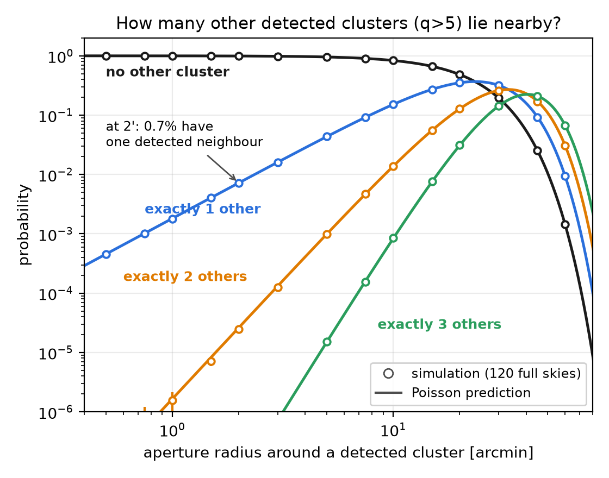

# Close pairs and blending of SZ clusters on a Poisson sky

We simulated a full sky of galaxy clusters to answer two questions:

1. How likely is it to find two (or N) clusters inside a given aperture?
2. For a given detection threshold, how often are detections blended?

## In short

- **Close pairs follow simple Poisson counting.** The number of clusters in an aperture depends only on how many clusters there are per square degree and on the aperture's area. The same holds around a detected cluster. The simulations confirm this exactly.
- **Close pairs of detected clusters are rare.** At a signal-to-noise cut of 5, only 0.7% of detections have another detection within 2 arcmin.
- **Blending is common anyway.** About 15% of detections have their SZ signal inflated by more than 10%. The cause is mostly faint, undetectable clusters along the same line of sight at other redshifts.
- **So blending is a confusion problem, not a pair problem.** It has to be computed from the summed signal of all faint neighbours. A "two clusters within some radius" picture misses it.
- **Two traps can triple the answer.** Forgetting to remove the mean SZ signal of the map does this. Ignoring that a signal-to-noise cut prefers boosted objects also biases the answer low.

---

## 1. What we simulated

| ingredient | choice |
|---|---|
| Halo abundance | Tinker08 mass function, Planck18 cosmology |
| Halo range | masses 10¹³–10¹⁶ M☉, redshift 0–3 |
| Positions | random on the full sky, independent of each other (Poisson) |
| SZ signal | Planck 2013 Y–M relation, 17% scatter, Arnaud pressure profile |
| Telescope | 1.4′ beam, uniform white noise (roughly SO-like), no CMB |
| Detection | matched filter; a cluster is detected if its signal-to-noise q exceeds q_cut = 4–7 |

The full sky holds about 29 million halos above 10¹³ M☉. Of these, 86,000 are detected at q > 5, or about 2 per square degree.

| q_cut | 4 | 5 | 6 | 7 |
|---|---|---|---|---|
| detections, full sky | 132,000 | 86,000 | 62,000 | 47,000 |
| per square degree | 3.2 | 2.1 | 1.5 | 1.1 |

---

## 2. Question 1: two or more clusters in one aperture

### The answer

Halos are placed independently, so any subset is also placed independently. That holds whether the subset is "detected clusters", "halos above 10¹⁴" or "clusters at z > 1". The number N in an aperture of radius θ then follows a Poisson law:

$$P(N=n)=\frac{e^{-\mu}\mu^n}{n!},\qquad \mu=\Sigma\times\text{aperture area}$$

Here Σ is the number per unit area of the population you care about. On the sphere, the area is 2π(1 − cos θ). For apertures under a few degrees, πθ² is fine.

Three practical points:

- **Around a detected cluster the law is the same.** Count only the *other* objects. Knowing there is a cluster at the centre tells you nothing about its neighbours when positions are independent.
- **The probability of at least one neighbour is 1 − e^(−μ).** For small μ this is ≈ μ.
- **For the whole sky, the expected number of close pairs is N_total × μ / 2.** The chance that at least one such pair exists anywhere is 1 − e^(−expected number).

### The numbers (q > 5 detection at the centre)

| neighbour type | within 1′ | 2′ | 5′ | 10′ |
|---|---|---|---|---|
| another detected cluster | 0.18% | 0.72% | 4.4% | 17% |
| any halo above 10¹⁴ M☉ | 0.8% | 3.3% | 19% | 57% |
| any halo above 3×10¹³ M☉ | 9% | 32% | 91% | ~100% |
| two or more other detections | 0.0002% | 0.003% | 0.1% | 1.5% |
| close pairs of detections on the full sky | 78 | 312 | 1,952 | 7,807 |

So a detected cluster rarely has a detected neighbour nearby. It very often has a group-sized halo nearby, almost always at a different redshift.

### Did the simulations agree?

Yes. We ran 120 full-sky realisations, plus thousands of extra skies for rare configurations. Every probability above matched the formula within the statistical noise.

How to read the figure:
- Draw a circle of radius θ around a detected cluster.
- Each curve gives the probability that the circle holds exactly n *other* detected clusters.
- Dots are the simulations; lines are the Poisson formula, with nothing fitted.
- Small circles are almost always empty (black curve ≈ 1). The chance of one neighbour grows as θ² (blue): 0.7% at 2′.
- Near 23′ the circle holds one other cluster on average, and beyond that several neighbours become typical.

### Caveat

Real clusters are clustered, and our simulated ones are not. Using the measured clustering strength of massive halos, close-pair probabilities go up by about 15–25% at 1–5′. To include it, multiply μ by (1 + w̄), where w̄ is the angular correlation function averaged over the aperture.

---

## 3. Question 2: blending at a detection threshold

### Four ways a detection can be blended

| name | what happens |
|---|---|
| **Merged pair** | two clusters that would each be detected sit so close that the pipeline sees one |
| **Contaminated** | the detection is real, but neighbours add to its signal, so its Y (and inferred mass) is too high |
| **Boosted** | the cluster would be below threshold on its own; neighbours push it over |
| **Lost** | the cluster would be detected on its own, but is not: it is swallowed by a brighter neighbour's peak, or pushed down by the mean subtraction |

### How big each effect is

We measured these in two independent ways:
- **Catalogue calculation:** a formula, explained below, checked against direct sums over simulated catalogues.
- **Simulated maps:** 32,000 deg² of maps with every halo painted in, noise added and a real detection pipeline run. These are the "ground truth".

| q_cut | merged pairs | contaminated by >10% | contaminated by >20% | boosted | lost |
|---|---|---|---|---|---|
| 4 | 0.6% | 14–19% | 8–12% | 8–9% | 11–12% |
| 5 | 0.5% | 14–16% | 8–11% | 8% | 9–10% |
| 6 | 0.4% | 14–15% | 8–9% | 8% | 8–9% |
| 7 | 0.3% | 13% | 7–8% | 7–8% | 7–8% |

Each range spans the catalogue calculation and the maps. Contamination, boosting and loss are percentages of detections. Loss is a percentage of clusters that would be detectable on their own.

What this shows:

- **Merged pairs are a small effect** (about 0.5%). They follow the Q1 formula.
- **Contamination, boosting and loss are 15–30 times larger.** They hardly drop as the threshold rises.
- **The catalogue calculation agrees with the maps** to within about 2 percentage points.

### Why the pair picture fails

A cluster sits on a background of many faint halos. Each is too faint to detect, but together they add a sizeable, fluctuating signal. Most of this extra signal comes from halos of 10¹⁴ M☉ and above at different redshifts. There is no single radius that captures it: the radius you would need grows from about 8′ to 12′ as the threshold rises. The pair formula does describe one thing: clusters lost by being swallowed by a brighter neighbour, with an effective radius of about 5–8′ that depends on the peak finder.

### How to compute it: sum over all neighbours

The right tool is the one used for source confusion in radio and far-IR surveys, often called **P(D)**. The idea:

1. Every halo near the cluster adds a little signal, weighted by how the filter responds at that distance.
2. The halos are Poisson-distributed, so the total added signal has a known distribution (a "compound Poisson" distribution). It can be computed with one Fourier transform from the halo mass function.
3. Add the noise, apply the threshold, and count how often the added signal exceeds 10% (contaminated), or makes the difference between passing and failing (boosted or lost).

The distribution computed this way matched direct sums over 60 simulated skies across its full range, including the rare bright tail.

### Two traps

- **Remove the mean SZ signal of the map.** The faint halos give the whole sky a small mean y (about 6×10⁻⁷). A plain matched filter is not insensitive to a constant offset, so it reads this mean as signal: +0.4σ for small clusters, up to +3σ for large ones. If you do not subtract the mean, every blending fraction roughly triples and never converges as you add fainter halos. Real pipelines remove it implicitly, through filtering or CMB-like large-scale power; a simulation has to do it explicitly.
- **Compute fractions on the detected sample.** Clusters with extra signal from neighbours are more likely to pass the cut. So blending among detected clusters is higher than among all clusters: by about ×1.3 at q > 5 and ×1.5 at q > 7. Formulas that ignore this underestimate blending.

---

## 4. How robust are these numbers?

| change | effect on blending (contamination, boosting) |
|---|---|
| noise halved | ×1.3 more |
| noise doubled | ×0.7 |
| beam 5′ instead of 1.4′ | ×1.4 more |
| Planck-like (7′ beam, more noise) | ×0.8–1.0 |
| different mass function | ×0.95 |
| more or less Y–M scatter | no change |
| only halos up to z = 1 | ×0.9 |
| clustering included | ×1.1 more |
| halo floor 10¹³ vs 3×10¹³ M☉ | no change (converged) |

Question 1 stays exactly Poisson in every configuration; only the number of detections per square degree changes.

Two more checks:
- **Physical overlap is negligible.** Clusters overlapping in 3D are about 0.1% of close pairs. Blending is a projection effect.
- **The detected catalogue itself is not Poisson.** Because neighbours boost each other over the threshold, detected clusters at 2–5′ separation are 1.5–2.7× more common than Poisson. Very close pairs (under about half a beam) are suppressed because they merge.

The figure re-runs the simulation in 13 configurations. Each configuration changes one thing (noise, beam, neighbour mass floor, maximum redshift, Y–M scatter or mass function) and uses 40 full skies. Each point is one configuration.

**Top left: close pairs follow the same Poisson curve in every setup.**
- The x-axis is λ = Σ_det × aperture area, the expected number of other detections in the circle for that configuration. The y-axis is how often the simulations find at least 1 (circles) or at least 2 (squares) other detections.
- The lines are the Poisson predictions, 1 − e^(−λ) and 1 − e^(−λ)(1 + λ). At small λ these become λ and λ²/2, so they have slopes 1 and 2.
- All configurations lie on the lines (χ² = 124 for 124 points). Noise, beam, scatter and mass function only change Σ_det, which moves a point along the curve.
- To answer question 1 for any survey, you only need Σ_det.

**Top right: what sets the number of detections.**
- This panel shows detections per deg² at q > 5 when the noise (blue) or the beam (orange) is scaled relative to the baseline (black dot, 2.08 deg⁻²). Lines are analytic; points are simulations.
- Noise matters most. Counts scale as noise^(−1.6 to −1.7) near the baseline: halving the noise gives about three times more detections.
- The beam matters less. Counts scale as beam^(−0.3 to −1.1), because typical detected clusters (about 2′) are as large as the 1.4′ beam or larger.
- The red star is a Planck-like setup: a 7.3′ beam and about three times more noise give 0.094 deg⁻². That is about 20 times fewer detections, so close-pair probabilities are about 20 times smaller.

**Bottom left: blending fractions are fairly stable.**
- At q_cut = 5, the panel shows contaminated detections (Y inflated by more than 10%) and boosted detections. Circles and squares have the map mean removed (the physical case); triangles are the raw map.
- With the mean removed, contamination stays at 11–22% and boosting at 6–11%, even though the number of detections changes about 60-fold.
- More sensitive surveys blend more (×1.3 at half the noise), because they detect fainter clusters, closer to the confusion background.
- A larger beam blends more (×1.4 at 5′), because the filter collects more neighbours.
- Scatter and the choice of mass function hardly matter.
- On the raw map the fractions are 2–5 times higher and unstable, up to 90% at a 5′ beam. This is the mean-y trap.

**Bottom right: the mean boost is exactly predictable.**
- The y-axis is the average extra signal-to-noise that neighbours add to a detection on the raw map, from the simulations.
- The x-axis is the analytic prediction: mean sky y × the filter's response to a uniform background, in noise units (Campbell's theorem for Poisson sums).
- All configurations lie on the 1:1 line. The boost runs from 0.4σ (neighbour floor 10¹⁴) to 2σ (5′ beam), and is about 1σ at baseline.
- This is the offset that mean removal subtracts. Because it can be computed analytically, you can correct for it without simulations, or remove it with a compensated filter.

---

## 5. Recipe for another survey

1. **Count your detections.** Integrate the mass function times the probability of detection to get detections per square degree, Σ_det.
2. **Close pairs (Q1).** Use Poisson with μ = Σ × area. Multiply by about 1.15–1.25 for clustering at arcminute scales.
3. **Merged pairs.** 1 − exp(−Σ_det π θ_b²), with θ_b about the filter size. This is a small effect.
4. **Contamination and boosting.**
   - Compute the summed-neighbour distribution (P(D)) from all halos down to about 10¹³ M☉, using your filter's response.
   - Remove the map mean.
   - Apply the threshold and count on the detected sample.
5. **Check once against maps.** Inject clusters into maps and run your own pipeline, because the number of clusters swallowed by brighter ones depends on the peak finder.

---

## 6. Things not fully settled

- At q > 7 the boosted fraction from maps is 7.2–7.9%, depending on the run (a 2–3σ spread).
- The "pushed below threshold" loss fraction at q > 5 is 4.8% in one run and 5.2% in another.
- Not modelled: CMB, foregrounds, compensated filters and deblending. CMB and compensated filters would reduce the mean-signal effect.

---

## Appendix: files and validation

- **Code:** library `szsim/` (mass function, sampler, signal model); analyses in `analysis/`; independent checks in `verify/`. Python: `.venv/bin/python`.
- **Detailed technical report:** every number, test statistic and verifier disagreement is in `REPORT_detailed.md`.
- **Two-page summary:** `twopager/twopager.pdf`.
- **Validation:** each analysis was checked by two independent re-implementations, and disputed numbers were re-run on fresh random seeds.

| figure | script |
|---|---|
| figures/build/dNdz_Nabove.png | analysis/build/validate_sampler.py |
| figures/q1_aperture/PN_readable.png | analysis/q1_aperture/q1_twopager_figure.py |
| figures/blending/PD_ccdf_random_points.png | analysis/blending/b06_figures.py |
| figures/q2_maps/blending_fractions_ALL.png | analysis/q2_maps/analysis_blend.py (PIDS=0:324 TAG=_ALL) |
| figures/robustness/robustness_scaling.png | analysis/robustness/aggregate.py |
