# Poisson SZ clusters: neighbours in an aperture and blending at a detection threshold

Every number below was printed by a script that was run (paths in §7). Each number was either confirmed by two independent verifiers or re-established in a repair round on fresh seeds. Where verifiers and analysts still disagree, §6 says so.

## Key findings

**Q1: N clusters inside an aperture**
- Any population defined by marks (mass floor, $q_{\rm obs}$ cut, z slice) is a Poisson process. The count inside a cap of radius $\theta$ is $N\sim{\rm Pois}(\mu)$ with $\mu=\bar N(1-\cos\theta)/2=\Sigma\,2\pi(1-\cos\theta)\simeq\Sigma\pi\theta^2$.
- The same law holds around a **detected cluster**, provided the centre itself is not counted (Slivnyak–Mecke). It also holds for neighbours from **any other population** $B$, using $\mu_B$, and does not depend on the centre's z or q. The k-th neighbour distance follows $P(d_k\le\theta)=P({\rm Pois}(\mu)\ge k)$.
- Baseline, $q_{\rm cut}=5$ ($\Sigma_{\rm det}=2.083\,{\rm deg^{-2}}$): $P(\ge1$ other detection$)$ = 0.18% / 0.72% / 4.4% / 16.6% within 1′ / 2′ / 5′ / 10′. $P(\ge1$ halo with $M>3\times10^{13})$ = 9.3% within 1′ and 32% within 2′.
- Survey-wide: $E[\text{pairs}<\theta]=\bar N\mu/2$ and ${\rm Var}=E(1+2\mu)$; triples $\bar N\mu^2p_3/6$ with $p_3=1-3\sqrt3/4\pi$; $P(\text{at least one})\simeq1-e^{-E}$. Full sky at $q>5$: 78 pairs closer than 1′, 1952 closer than 5′.
- Validation: 120 full skies (2.9e7 halos each), 2×1000 floor skies and 20,000 rare-object skies. With calibrated tests (sky bootstrap, Hotelling $T^2$) the global $p$ is 0.40. Every 3–3.6σ outlier was re-run on fresh seeds and none replicated. Flat-sky $\pi\theta^2$ is off by $\theta^2/12$, which only matters above about 5°.

**Q2: blending at $q_{\rm cut}$** (catalogue analytic results and map ground truth agree in order of magnitude; definitions in §3.1)
- Resolved pairs of *detectable* clusters (B1) are rare and exactly Poisson: $f=1-e^{-\Sigma_{\rm det}A(\theta_b)}$. In maps, 0.52% of $q>5$ detections have two $q>5$ halos within 2′.
- The dominant effect is unresolved, mostly undetectable neighbours at other redshifts that bias Y. Map, $q>5$: 14.5% of real detections get more than 10% of Y from other halos and 8.4% more than 20%; 8.3% exist only because of the boost (B3); 5.0% of detectable halos are absorbed into a brighter peak and 4.75% fade below threshold.
- Catalogue analytic (compound Poisson P(D), map mean removed), $q>5$: B2(>10%) 16.2%, B2(>20%) 10.5%, B3 8.1%, lost 9.0%, satellites 0.60%. The MC confirms these (363 tests, rms z 0.98).
- The white-noise matched filter is **not compensated**, so it must see a mean-subtracted map. Otherwise the mean y ($\bar y=6.4\times10^{-7}$) shifts every q by 0.41σ (0.5′ filter) to 3.1σ (10′ filter) and raw-sky blending fractions triple (B2 52%, B3 26%) without converging in the mass floor.
- Effective blending scale: for lost/absorbed halos, $\theta_b\approx5.2'$ (fit of $1-e^{-\Sigma_{\rm det}\pi\theta_b^2}$) or $7.7'$ (brighter-neighbour model) with max-SNR peak finding; 2.9′ / 4.9′ with per-scale peak finding. B2 and B3 would need a $\theta_b$ of 7–12′ that grows with $q_{\rm cut}$, so they are **not** a pair effect. Treat them as confusion through the compound-Poisson P(D).
- The single-neighbour Poisson formula $1-e^{-\lambda}$ is exact for an *unselected* sample (within 0.9σ). It underestimates SNR-selected detections by about ×1.34 at $q>5$ (×1.5 at $q>7$), because selection favours positively contaminated objects.
- Blending fractions fall only slowly with $q_{\rm cut}$ (B2(>10%) 18.5% at q>4 down to 13.1% at q>7). They scale with noise and beam: ×1.32 for noise ×0.5 and ×1.38 for a 5′ beam. Y-scatter has no effect.
- Beyond Poisson: 2-halo clustering raises the close-pair probability by 13–27% at 1–5′ and blending fractions by about ×1.08–1.13. Halo exclusion is negligible: 1.2e-3 of detected pairs within 2′ overlap physically, and overlapping neighbours bias Y by more than 10% in only 2e-4 of detections.

Report path (intended): /Users/boris/GitHub/sz-poisson-blending/REPORT.md

---

## 1. Setup

**Baseline model** (library `szsim/`, see `szsim/README.md`)
- Cosmology colossus `planck18` (h = 0.6766). HMF Tinker08, $M_{500c}\in[10^{13},10^{16}]\,M_\odot$ (h-free), $z\in[0.01,3]$, full sky.
- Positions: independent and isotropic on the sphere, so a Poisson point process with independent marks.
- $Y_{500}$–$M_{500}$ from Planck 2013 XX with $(1-b)=0.8$ (median Y) and lognormal scatter $\sigma_{\ln Y}=0.173$. Arnaud+10 GNFW profile truncated at $5R_{500}$, **normalised so that the spherical $Y(<R_{500})=Y_{500}$**. The template therefore integrates to $Y_{5R500}/Y_{500}=1.79644$.
- Instrument: Gaussian beam with FWHM 1.4′, white y-noise of $4\times10^{-6}$ arcmin, no CMB or foregrounds.
- Detection: single-cluster matched filter at the cluster's own $\theta_{500}$, $\sigma_Y^{-2}=\frac{1}{2\pi}\int dl\,l\,B_l^2g(l\theta_{500})^2/N_w$, with $q=Y_{500}/\sigma_Y$ and $q_{\rm obs}=q+\mathcal N(0,1)$. The point-source limit is $\sigma_Y=4.69\times10^{-6}$ arcmin².

**Counts** (analytic; reproduced to ≤1e-4 by two independent integrations and by MC)

| population | $\bar N$ full sky | $\Sigma$ [deg⁻²] |
|---|---|---|
| $M>10^{13}$ | 29,295,487 | 710 |
| $M>3\times10^{13}$ | 4,598,090 | 111.46 |
| $M>10^{14}$ | 396,387 | 9.609 |
| $M>3\times10^{14}$ | 21,840.5 | – |
| detected $q_{\rm obs}>4$ / 5 / 6 / 7 | 132,125 / 85,912 / 61,630 / 46,575 | 3.203 / 2.083 / 1.494 / 1.129 |
| det5, z ∈ [0.01,0.5] / [0.5,1] / [1,3] | 43,338 / 32,702 / 9,872 | – |

- Detections from $M<10^{14}$ halos make up 6.18% of the sample at $q>4$, 2.14% at $q>5$ and 1.37% at $q>6$.
- Halos with true $q<0.5$ add pure-noise catalogue detections: 15.6 per sky at $q>5$, analytic, against an MC value of 13.0±2.1.

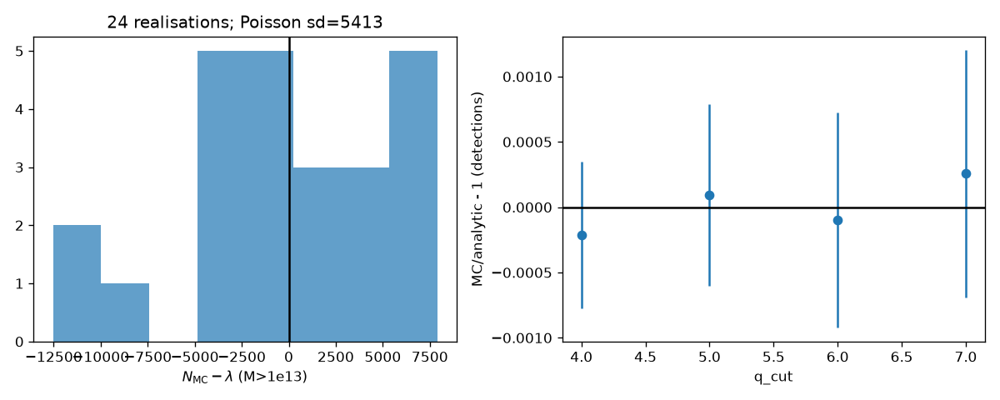
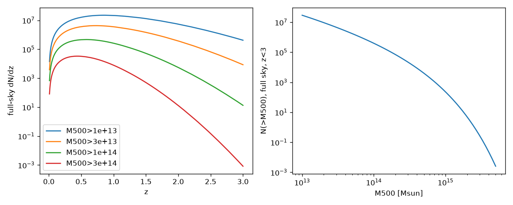
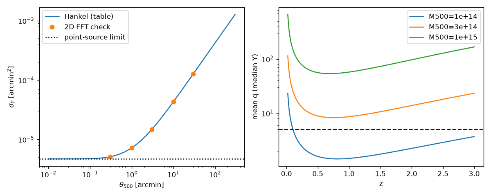

---

## 2. Q1: probability of N clusters within an aperture

### 2.1 Formulas and when they apply

| situation | law | notes |
|---|---|---|
| (i) random aperture | $P(N=n)=e^{-\mu}\mu^n/n!$, $\mu=\bar N(1-\cos\theta)/2$ | any population thinned by marks (mass, $q_{\rm obs}$, z) |
| (ii) aperture centred on a member | same ${\rm Pois}(\mu)$ for the *others* | Slivnyak–Mecke. **Exclude the centre**; counting it shifts N by +1 (at 10′, $q>5$: $P(N=1)$ would read 0.8338 instead of 0.1515) |
| (iii) centre from population A, neighbours from population B | ${\rm Pois}(\mu_B)$, $\mu_B=\Sigma_B A(\theta)$ | independent of the centre's z or q; exclude the centre if it also belongs to B (forgetting this gave errors of thousands of σ) |
| k-th neighbour distance | $P(d_k\le\theta)={\rm gammainc}(k,\mu)$ | within one sky the law is binomial in the realised $N$: $1-(1-p)^{N-1}$ |
| (iv) survey-wide pairs closer than $\theta$ | $E[P]=\bar N\mu/2$, ${\rm Var}[P]=E[P](1+2\mu)$ | the $2\mu$ term is the fluctuation of $N$; it exceeds the shot term only for $\mu>0.5$ (det5: $\theta>16.6'$). It adds 9% at 5′ and 36% at 10′ |
| (iv) triples with all separations $<\theta$ | $E[T]=\bar N\mu^2p_3/6$, $p_3=1-\frac{3\sqrt3}{4\pi}=0.5865$ | flat-sky constant |
| (iv) objects with $\ge n$ neighbours | $\bar N\,P({\rm Pois}(\mu)\ge n)$ | |
| (iv) "look-elsewhere": does any such configuration exist? | $P\simeq1-e^{-E}$ | mild clumping for triples at $E\sim1$–5 (χ² p = 0.02–0.03) |
| geometry | flat-sky $\pi\theta^2$ vs cap $2\pi(1-\cos\theta)$: error $\theta^2/12$ | 2.5e-5 at 1°, 1% at 19.8°; detectable in full-sky MC from about 5° |

### 2.2 $\mu(\theta)$ for the populations used

| population | $\mu(1')$ | $\mu(5')$ | $\mu(10')$ | $\mu(60')$ |
|---|---|---|---|---|
| detected q>4 | 2.80e-3 | 6.99e-2 | 0.280 | 10.06 |
| detected q>5 | 1.82e-3 | 4.54e-2 | 0.182 | 6.54 |
| detected q>6 | 1.30e-3 | 3.26e-2 | 0.130 | 4.69 |
| det5, z>1 | 2.09e-4 | 5.22e-3 | 0.0209 | 0.752 |
| M>1e14 | 8.39e-3 | 0.210 | 0.839 | 30.19 |
| M>1e14, $q_{\rm obs}\le5$ | 6.61e-3 | 0.165 | 0.661 | 23.78 |
| M>3e13 | 9.73e-2 | 2.43 | 9.73 | 350.2 |

### 2.3 Reference table: a detected cluster has ≥1 (≥2) neighbours within $\theta$

Analytic values below were confirmed independently by both verifiers. Neighbours are (a) other detections at the same $q_{\rm cut}$, (b) any halo with $M>10^{14}$, (c) any halo with $M>3\times10^{13}$. The (b) and (c) values do not depend on $q_{\rm cut}$.

| neighbours | θ | q>4 P(≥1) | q>5 P(≥1) | q>6 P(≥1) | q>4 P(≥2) | q>5 P(≥2) | q>6 P(≥2) |
|---|---|---|---|---|---|---|---|
| (a) | 1′ | 2.791e-3 | 1.816e-3 | 1.303e-3 | 3.9e-6 | 1.65e-6 | 8.5e-7 |
| (a) | 2′ | 1.112e-2 | 7.243e-3 | 5.201e-3 | 6.20e-5 | 2.63e-5 | 1.36e-5 |
| (a) | 5′ | 6.749e-2 | 4.442e-2 | 3.207e-2 | 2.330e-3 | 1.001e-3 | 5.197e-4 |
| (a) | 10′ | 0.2438 | 0.1662 | 0.1222 | 3.249e-2 | 1.464e-2 | 7.795e-3 |
| (b) | 1′ / 2′ / 5′ / 10′ | 8.350e-3 / 3.298e-2 / 0.1891 / 0.5676 | | | 3.50e-5 / 5.50e-4 / 1.913e-2 / 0.2051 | | |
| (c) | 1′ / 2′ / 5′ / 10′ | 9.269e-2 / 0.3223 / 0.9121 / 0.99994 | | | 4.435e-3 / 5.865e-2 / 0.6984 / 0.9994 | | |

MC check for a $q>5$ centre (120 full skies):

| θ | (a) P(≥1) MC | (b) P(≥1) MC | (c) P(≥1) MC | (a) P(≥2) MC |
|---|---|---|---|---|
| 1′ | 1.790e-3 ± 1.9e-5 | 8.345e-3 ± 3.0e-5 | 9.269e-2 ± 9.0e-5 | 1.56e-6 ± 6.0e-7 |
| 2′ | 7.210e-3 ± 3.7e-5 | 3.299e-2 ± 6.1e-5 | 0.3224 ± 1.5e-4 | 2.49e-5 ± 2.2e-6 |
| 5′ | 4.452e-2 ± 9.9e-5 | 0.1892 ± 1.4e-4 | 0.9122 ± 8.8e-5 | 1.002e-3 ± 1.3e-5 |
| 10′ | 0.1661 ± 1.6e-4 | 0.5677 ± 1.5e-4 | 0.99994 | 1.474e-2 ± 5.2e-5 |

Over the 72 table entries: $P(\ge1)$ has rms z 0.77 (max 1.75), and $P(\ge2)$ has rms z 1.16 (max 3.22). The largest $P(\ge2)$ residuals are the (c) entries at 10′, where $1-P\approx6\times10^{-4}$. That tail fluctuation did not replicate on 200 independent floor-3e13 skies ($z=-0.77$).

### 2.4 Survey-wide configurations, $q>5$

| | 0.5′ | 1′ | 2′ | 5′ | 10′ |
|---|---|---|---|---|---|
| pairs $E=\bar N\mu/2$ | 19.5 | 78.1 | 312.3 | 1951.7 | 7806.8 |
| triples (all separations $<\theta$) | – | 0.028 | 0.444 | 17.34 | 277.4 |
| triples, MC (120 skies) | – | 0.033 ± 0.016 | 0.400 ± 0.053 | 17.23 ± 0.36 | 279.6 ± 1.7 |

- Rare objects, $M>3\times10^{14}$ ($\bar N$ = 21,840.5, 20,000 skies): the probability that some pair on the sky is closer than 0.5′ is $1-e^{-E}=0.7167$, against MC 0.7198 ± 0.0032. Across 23 such "exists" tests, rms z is 1.22.
- Pair-count variance, det5 within $M>10^{14}$, 1000 skies at 10′: ${\rm Var}/[E(1+2\mu)]=0.937\pm0.045$ (replication 0.970), while the naive ${\rm Var}/E=1.27$.

### 2.5 Numerical validation

- 120 full skies: $P(N=n)$ for $n=0..5$ and $\ge6$, at 14 radii from 0.5′ to 60′, for 30 centre/neighbour combinations.
- Bins are strongly correlated ($\mathrm{corr}(P_0,P_1)=-0.999$ at 1′), so naive χ² p-values are not calibrated. With a centred sky bootstrap the global p is 0.398. No combination has a Hotelling $T^2$ $p<0.05$ (minimum 0.051).
- Palm law around detected centres, 2 × 1000 independent floor skies: joint Hotelling p is 0.083 and 0.935. A 2σ deficit at 10′ in the first 40 skies did not replicate.
- kNN distances: 72 pooled KS tests, and the uniformity of their p-values gives 0.999. Random-aperture var/mean = 1 to within 0.3%.
- Exact cap vs flat sky (200 skies): with the cap, |z| ≤ 0.78 for every θ up to 179.99°. With flat sky, z = −4.1 at 5° and −21 at 10°.

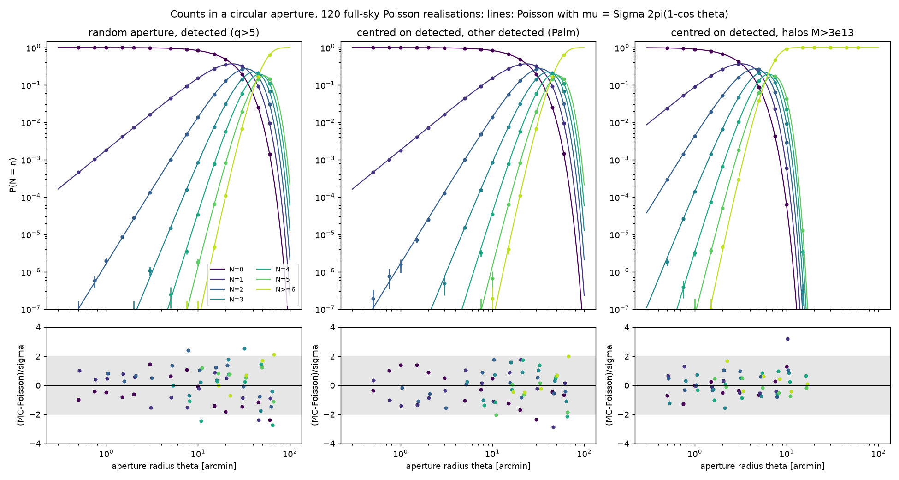
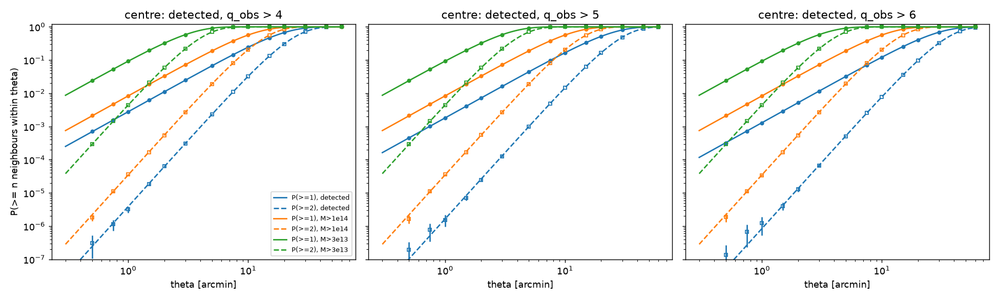
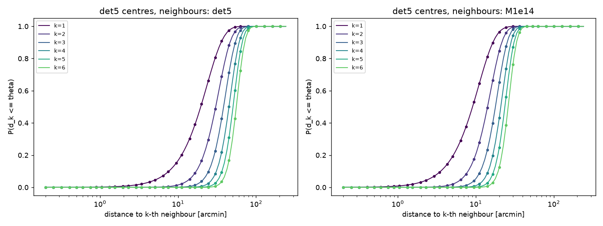
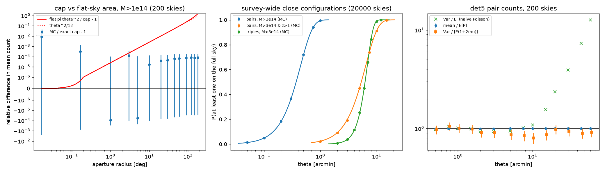
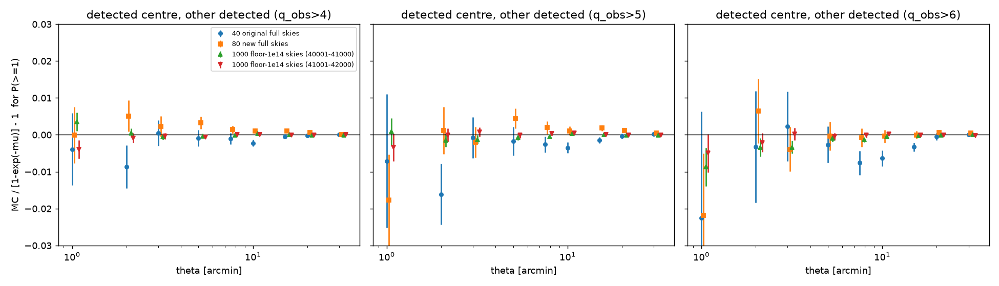

---

## 3. Q2: blending

### 3.1 Definitions

Primary A has true SNR $q_A$ and noise $n_A$. Each neighbour B adds $x_B=\rho(\theta_A,\theta_B,s_{AB})Y_B/\sigma_Y(\theta_A)$ to A's matched-filter SNR. Here $\rho$ is the cross-response, with $\rho(\theta,\theta,0)=1$. The blended SNR is $q_b=q_A+n_A+\delta_A-c\mu_A$ with $\delta_A=\sum_Bx_B$.

- **c = 1, "map mean removed"** is the physical convention. **c = 0, raw sky**, is shown only as a warning.
- **B1, resolved pair:** two single-cluster detections closer than $\theta_b$, or closer than $s_{\rm infl}(A)+s_{\rm infl}(B)$, the sum of the inflection radii of the filtered profiles.
- **B2(ε), contamination:** a detection whose Y is over-estimated by more than ε because of other halos. **B2neg** is the same with Y under-estimated (less neighbour flux than the subtracted mean).
- **B3, boosting:** a detection that would fall below $q_{\rm cut}$ without the other halos.
- **Lost:** a halo detectable in isolation but not detected. It is *absorbed* into a brighter neighbour's peak or *fades* through negative net confusion. A **satellite** is a would-be detection dominated by a brighter neighbour ($x_B>q_A$).
- Catalogue level: the filter sits on the true position at the true $\theta_{500}$, and "one detection per peak" is the dominance rule. Map level: real 10°×10° maps, a 12-scale matched filter (0.5′–10′), local maxima of the maximum-over-scales SNR ("maxQ"), and greedy merging within 2′. Each peak is decomposed exactly into per-halo contributions; the decomposition matches the map to rms ≤ 2.3e-3σ.

### 3.2 Analytic characterisation

- **Pair merge (B1):** detections are an independent thinning of the halo process, so
  $f_{\ge k}(\theta_b)=1-\sum_{j<k}e^{-\lambda}\lambda^j/j!$ with $\lambda=\Sigma_{\rm det}2\pi(1-\cos\theta_b)$. This is the §2 formula.
- **Mean boost (Campbell):** $E[\delta_A]=\mu_A=\bar y\,\sigma_A\,{\rm RATIO}/N_w$. The white-noise filter's DC response is $\sigma_A^2{\rm RATIO}^2/N_w$ = 10.54, 43.05, 374.4 and 3256 arcmin² at $\theta_A$ = 1′, 3′, 10′, 30′. With $\bar y(M>10^{13})=6.448\times10^{-7}$ this gives $\mu$ = 0.414 / 0.548 / 0.864 / 1.387 / 2.731 / 5.613 at $\theta_A$ = 0.52′ / 1.10′ / 2.30′ / 4.15′ / 8.70′ / 18.2′.
- **Contamination P(D), compound Poisson:**
  $\phi(k)=\exp\!\left[\int R(x)(e^{ikx}-1)\,dx\right]$, with $R(x)=\int dz\,d\ln M\,d\ln Y\,\frac{d^2N}{d\Omega}\int d^2s\,\delta_D(x-\rho Y/\sigma_A)$.
  By Slivnyak the same law holds around a halo as around a random point. Dominance: $P({\rm dom})=e^{-\Lambda(x\ge q_A)}$. Then
  $P({\rm det}_b,{\rm B2}\,|\,\theta_A,q_A)=e^{-\Lambda(>q_A)}\int p_{\rm tr}(\delta)\,\mathbf 1[\delta-c\mu>\varepsilon q_A]\,\Phi(q_A+\delta-c\mu-q_{\rm cut})\,d\delta$,
  and each fraction is $\int dN_A\,P(\cdot|A)\,/\int dN_A\,P({\rm det}_b|A)$.
- **Who causes it:** the mean shift is spread across mass (at 1.1′: 25% from $10^{13}$–$3\times10^{13}$, 34% from $3\times10^{13}$–$10^{14}$, 42% from $>10^{14}$). The variance is 93.6% from $M>10^{14}$ (exact ${\rm Var}(\delta)=1.108$ of 1.184 at 1.1′). Neighbours with $x>1$ occur 0.063 times per filter at 1.1′ and 0.138 at 4.15′; 84–86% of them have $M>10^{14}$. With the mean removed, $M>10^{14}$ neighbours supply about 83% of B2(>20%) and of B3.
- **Validation:** fine-grid P(D) medians agree with 60 independent skies to ≤0.1% (24 tests, rms z 0.63). The bright tail $P(\delta>t)$, t = 1–50, has rms z 0.93. B1 tests: 87 z-scores, rms 0.93. B2/B3 fractions: 363 primary-level tests with errors max(jackknife, between-sky), rms z 0.98.

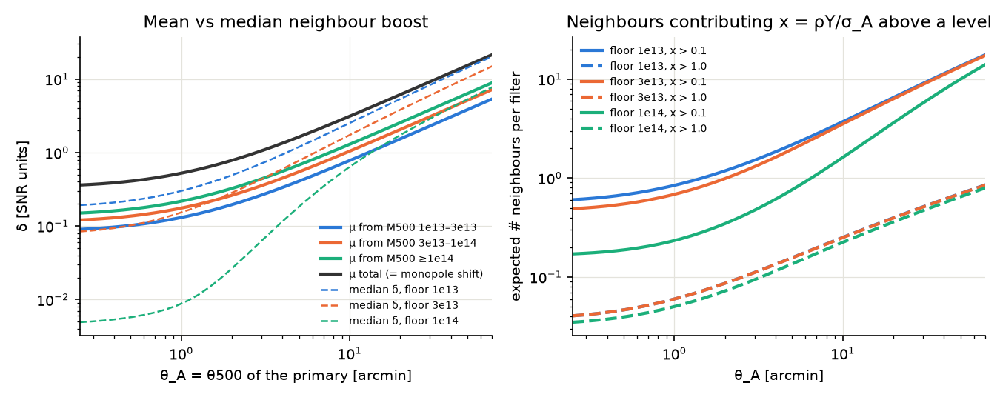
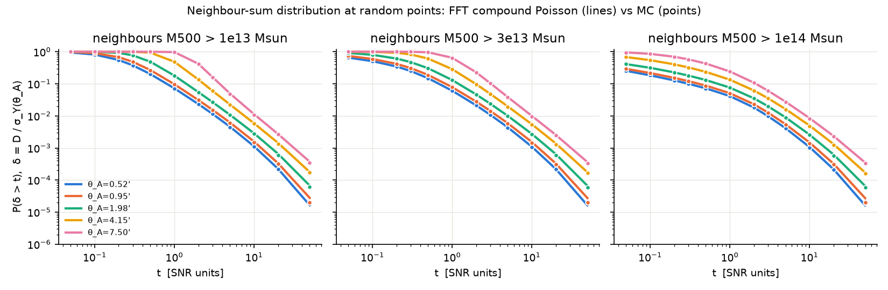
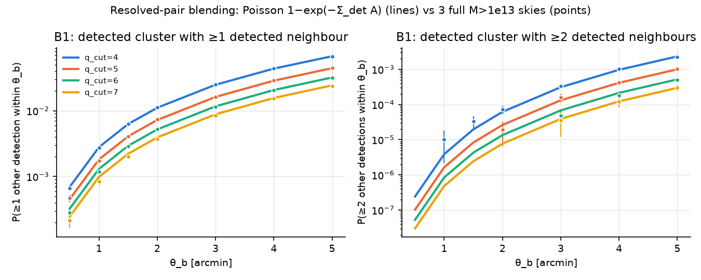

### 3.3 Catalogue-level blending fractions vs $q_{\rm cut}$

Analytic values, neighbours with $M>10^{13}$, primaries with $q_A>0.5$. B2 and B3 are fractions of blended detections; lost and satellites are fractions of single-cluster detections.

| $q_{\rm cut}$ | conv. | $N_{\rm det,b}/N_{\rm single}$ | B2 >10% | B2 >20% | B2 >50% | B2neg <−10% | B3 | B3 (boost >1σ) | lost | satellites | B1 (size-aware) |
|---|---|---|---|---|---|---|---|---|---|---|---|
| 4 | mean removed | 0.965 | 0.185 | 0.124 | 0.051 | 0.115 | 0.087 | 0.047 | 0.109 | 0.0095 | 0.0277 |
| 5 | mean removed | 0.984 | 0.162 | 0.105 | 0.041 | 0.057 | 0.081 | 0.052 | 0.090 | 0.0060 | 0.0204 |
| 6 | mean removed | 0.992 | 0.145 | 0.091 | 0.035 | 0.029 | 0.076 | 0.052 | 0.079 | 0.0044 | 0.0161 |
| 7 | mean removed | 0.996 | 0.131 | 0.081 | 0.030 | 0.016 | 0.071 | 0.051 | 0.071 | 0.0034 | 0.0132 |
| 5 | raw | 1.342 | 0.516 | 0.288 | 0.108 | 0 | 0.259 | 0.147 | 0 | 0.0060 | – |

- Convergence in the neighbour mass floor ($q_{\rm cut}=5$, mean removed), floors $10^{14}\to3\times10^{13}\to10^{13}$:
  - B2(>20%): 8.76 → 10.40 → 10.51%; B3(>1σ): 4.28 → 5.13 → 5.19%; lost: 7.91 → 8.97 → 9.03%. These are converged.
  - **B2neg is not converged:** 1.80 → 5.04 → 5.73%.
  - In the raw convention nothing converges: B2(>20%) goes 12.0 → 21.2 → 28.8%.
- B2(>10%) falls steeply with the primary's own SNR: 0.788 / 0.385 / 0.141 / 0.067 / 0.035 / 0.017 for $q_A$ in 0.5–3 / 3–5 / 5–7 / 10–15 / 20–40 / 40–100.

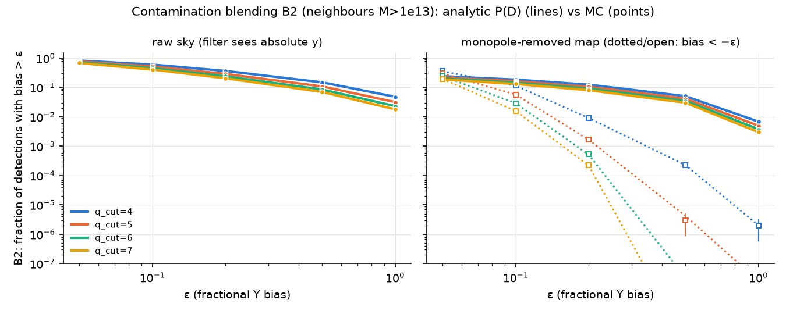
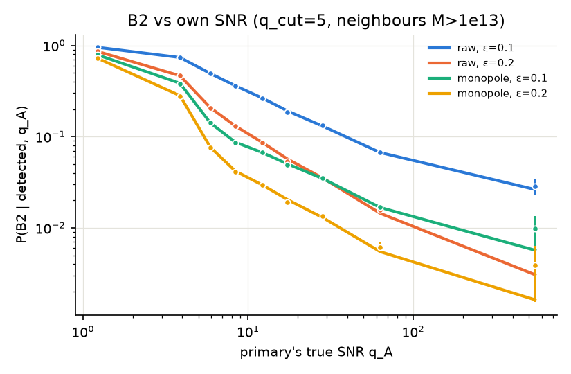
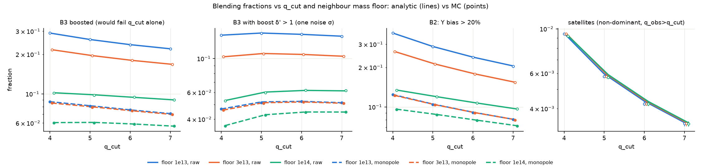

### 3.4 Map-level ground truth

324 patches of 10°×10° (32,400 deg², 9 independent skies), maxQ, 2′ merge, all halos $M\ge10^{13}$ painted, l = 0 mode removed. Errors are a patch bootstrap; the per-sky χ² is 0.96 per dof.

| metric | q>4 | q>5 | q>6 | q>7 |
|---|---|---|---|---|
| detections per deg² (map) | 3.784 ± 0.010 | 2.207 ± 0.008 | 1.541 ± 0.007 | 1.152 ± 0.006 |
| single-cluster $\sum\Phi(q_i-q_{\rm cut})$ per deg² | 3.202 | 2.083 | 1.493 | 1.126 |
| pure-noise false detections per deg² | 0.365 ± 0.003 | 5.8e-3 | 3e-5 | 0 |
| real detections, f_cont > 10% | 13.71 ± 0.11% | 14.49 ± 0.13% | 13.82 ± 0.15% | 12.92 ± 0.17% |
| real detections, f_cont > 20% | 7.77% | 8.44% | 8.05% | 7.42% |
| real detections, f_cont < −10% | 15.00% | 7.85% | 3.78% | 1.90% |
| boosted (B3), all detections | 7.80 ± 0.08% | 8.28 ± 0.11% | 7.84 ± 0.12% | 7.85 ± 0.14% (see §6) |
| B1: ≥2 halos with $q_{\rm true}>q_{\rm cut}$ within 2′ | 0.59% | 0.52% | 0.40% | 0.32% |
| duplicates (fragments) | 2.92% | 1.59% | 1.17% | 0.90% |
| noise-dominated (no halo >2σ) | 15.27% | 1.75% | 0.16% | 0.02% |
| detectable halos lost: absorbed | 6.90% | 4.96% | 3.72% | 2.89% |
| detectable halos lost: faded | 4.93% | 4.75% | 4.80% | 4.58% |
| detectable halos lost: removed by the merge rule | 0.04% | 0.02% | 0.01% | 0.01% |

- The catalogue-level and map-level fractions use different definitions: catalogue B2 counts the neighbour-induced bias relative to $q_A$ for all blended detections, while the map $f_{\rm cont}$ uses the noise-free filtered signal at the peak, for real detections with primary ≥2σ. Their magnitudes still match: at q>5, B3 is 8.1% (catalogue) vs 8.3% (map), and Y contamination above 10% is 16.2% vs 14.5%.
- **Unresolved y-confusion as extra noise:** faint halos with $q_{\rm true}<2$ raise the effective noise to $\sigma_{\rm eff}/\sigma$ = 1.026 (0.5′) to 1.082 (10′); halos with $q_{\rm true}<5$ raise it to 1.058–1.209. Both match the analytic one-halo variance $\int\frac{dN}{d\Omega}\langle Y^2\mathbf 1(Y<q_{\rm thr}\sigma)\rangle W_k$ within 1σ. Halos below $10^{13}$ add only 0.0008–0.0024σ². Treating confusion as Gaussian noise reproduces boosting at q>5 (8.00% vs map 8.28%) but not at q>7 (5.71% vs 7.85%), because of the non-Gaussian tail.
- Map noise: measured $\sigma_Y$ equals the Hankel $\sigma_Y$ to ≤3e-4. Noise-peak counts match an exact Kac–Rice calculation once peak heights are refined to sub-pixel accuracy; nearest-pixel heights on a 0.25′ grid lose 8–10% of 0.5′-scale peaks at ν ≥ 4.

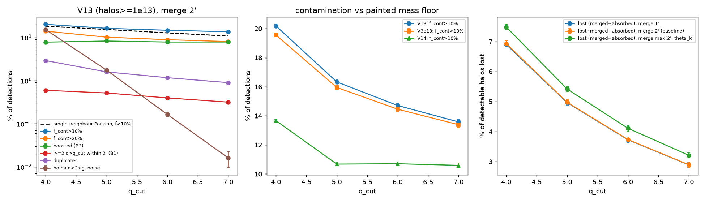
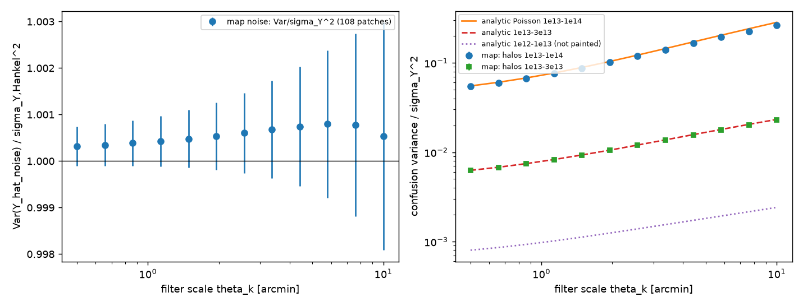

### 3.5 Effective blending scale

| quantity | q>4 | q>5 | q>6 | q>7 |
|---|---|---|---|---|
| absorbed halos, fit $1-e^{-\Sigma_{\rm det}\pi\theta_b^2}$ (maxQ) | 4.67′ | 5.15′ | 5.32′ | 5.41′ |
| absorbed halos, brighter-neighbour model (maxQ) | 7.53′ | 7.71′ | 7.79′ | 7.86′ |
| same two fits, per-scale peak finding | 2.64 / 5.01′ | 2.88 / 4.92′ | 3.01 / 4.89′ | 3.15 / 4.97′ |
| $\theta_b$ that would reproduce B2 (f_cont >10%) | 8.26′ | 9.62′ | 10.88′ | 12.05′ |
| $\theta_b$ that would reproduce B3 | 4.96′ | 6.70′ | 7.79′ | 9.02′ |

- Reference scales: beam 1.4′; median filter scale of q>5 detections 1.95′; median $\theta_{500}$ of their primaries 2.18′; $s_{\rm infl}$ = 0.90′ for a point source, 1.10′ at $\theta_{500}=1'$, 1.64′ at 3′ and 3.73′ at 10′.
- A single $\theta_b$ describes **loss by absorption** reasonably well: the brighter-neighbour version is nearly independent of $q_{\rm cut}$, but it depends on the pipeline (about 7.7′ for maxQ, about 4.9′ per-scale). It does **not** describe contamination or boosting, whose implied $\theta_b$ grows with $q_{\rm cut}$. Use P(D) for those.
- Slivnyak check in maps: for detections whose primary has $q_{\rm true}>q_{\rm cut}$, the fraction with another $q_{\rm true}>q_{\rm cut}$ halo within 2′ matches $1-e^{-\Sigma\pi r^2}$ within 1σ at every $q_{\rm cut}$. At 3′ there is an absorption deficit (−3.7σ to −9.6σ). At 1′ there is a small excess, significant only at q>4 (+3.4σ).
- Single-neighbour Poisson model, $P=1-e^{-\lambda}$ with $\lambda=\sum_bn_b\pi r_b^{*2}$ and $Y_bR_k(r_b^*)=f\,c_P$: for unselected halos it gives 12.52% against 12.65% measured (q>5, f = 0.1). For SNR-selected map detections the measurement is 20.58% against 15.37% predicted. A catalogue-level calculation that applies the same SNR selection gives 21.18%.

### 3.6 Pipeline dependence (q>5)

| pipeline | duplicates | removed by merge rule | absorbed |
|---|---|---|---|
| maxQ, merge 1′ | 1.74% | 0.01% | 4.96% |
| maxQ, merge 2′ | 1.59% | 0.02% | 4.96% |
| maxQ, merge max(2′, θ_k) | 1.14% | 0.46% | – |
| per-scale, merge 2′ | 20.4 ± 0.9% | 1.17% | 0.90% |
| per-scale, merge max(2′, θ_k) | 10.4 ± 0.7% | 2.46% | – |

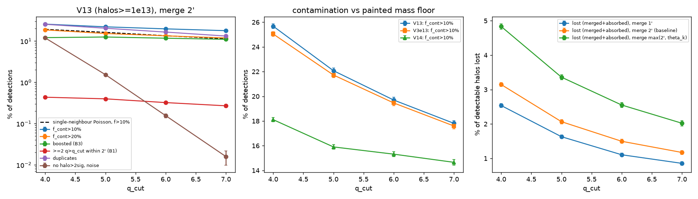

---

## 4. Robustness and what the Poisson assumption misses

**Q1 is robust in form.** In 11 configurations × 40 independent skies, $P(\ge k\,|\,\theta)$ is the Poisson CCDF with each configuration's own analytic $\Sigma_{\rm det}$: 124 tests, χ²/dof = 124.4/124. Only $\Sigma_{\rm det}$ changes:
- $\Sigma_{\rm det}(q>5)$ runs from 0.094 deg⁻² (Planck-like: 7.3′ beam, y-noise 1.164e-5 arcmin, no CMB) to 6.04 deg⁻² (noise ×0.5).
- $N_{\rm det}\propto{\rm noise}^{-s}$ with $s$ from 1.36 to 1.96, about 1.6–1.7 near baseline; $\propto{\rm FWHM}^{-s}$ with $s$ from 0.33 (0.7′) to 1.10 (8.5′).

**Blending fractions depend on the setup** ($q_{\rm cut}=5$, mean removed; baseline B2(>10%) = 0.163, B3 = 0.081):

| change | B2(>10%) ratio | B3 ratio |
|---|---|---|
| noise ×0.5 / ×2 | 1.319 / 0.677 | 1.170 / 0.764 |
| beam 5′ | 1.380 | 1.313 |
| Planck-like | 0.825 | 0.983 |
| neighbour floor 1e14 / 3e13 | 0.786 / 0.985 | 0.746 / 0.985 |
| zmax 1 / 2 | 0.899 / 0.994 | 0.859 / 0.992 |
| HMF bocquet16 / despali16 | 0.949 / 0.934 | 0.979 / 0.942 |
| scatter 0 / 0.3 | 1.001 / 1.000 | 1.008 / 0.996 |

- The mean neighbour boost matches $\bar y\sigma_A{\rm RATIO}/N_w$ in all 13 configurations, within −0.38σ to +1.10σ (relative offsets −0.34% to +0.42%).
- The *blended* catalogue is not Poisson. Close pairs at 2–5′ come out at 1.5–2.7× the Poisson rate, because each cluster boosts the other across the threshold. Below about 0.35 FWHM there are fewer pairs (baseline at 0.5′: ×0.51), because the fainter member loses dominance.

**2-halo clustering** (linear Tinker10 bias, Limber; the step-exclusion variant gives the lower end):
- Effective bias of $q>5$ detections: 2.8 at z = 0.1, 5.0 at 0.5, 7.5 at 1 and 13.5 at 2.
- $1+\bar w$ = 1.13–1.27 (1′), 1.15–1.20 (5′), 1.14–1.15 (10′), 1.08 (30′). The pair probability $P(\ge1)$ is ×1.13–1.27 at 1–5′, ×1.12–1.14 at 10′ and ×1.03 at 30′. Use $P=1-\exp[-\Sigma A(1+\bar w)]$.
- Clustered SZ neighbours raise the mean boost by $\langle W\rangle$ = 0.085–0.119, a mean shift of 0.085–0.115 in SNR. As a result B2(>10%) rises ×1.08–1.11, B3 ×1.09–1.13 and $N_{\rm det,b}$ ×1.025–1.036 (mean-field calculation, 6 paired skies).
- Caveat: linear bias is used at sub-Mpc scales; this is a bracket, not a halo-model result.

**Halo exclusion** is negligible:
- Detected pairs that overlap in 3D: 1.28e-3 of pairs within 1′, 1.22e-3 within 2′, 7.5e-4 within 5′.
- $P$(a detection has an overlapping halo with $M>10^{13}$) = 2.17e-3, and the MC gives 2.180e-3 ± 0.059e-3.
- Overlapping neighbours alone cause a Y bias above 10% in 2.0e-4 of detections, compared with B2 = 0.163. Blending is line-of-sight projection at different redshifts.

**Not modelled:** CMB and foregrounds, or a compensated filter (both would suppress the l ≈ 0 response); correlated noise in the catalogue model; deblending or iterative subtraction; subhalos; the non-linear 1-halo term.

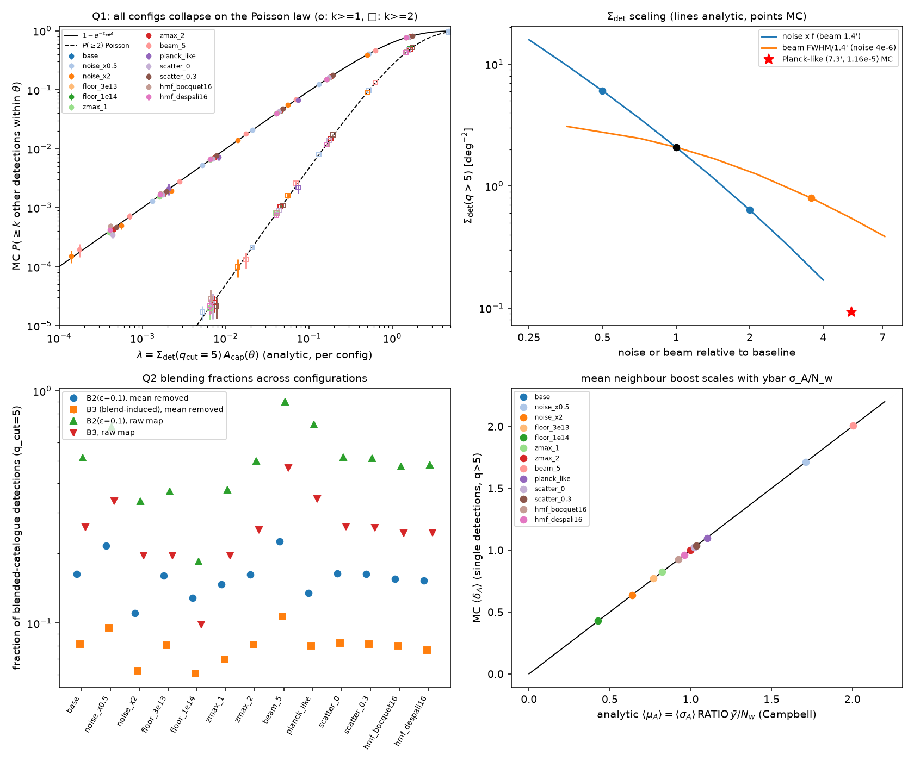
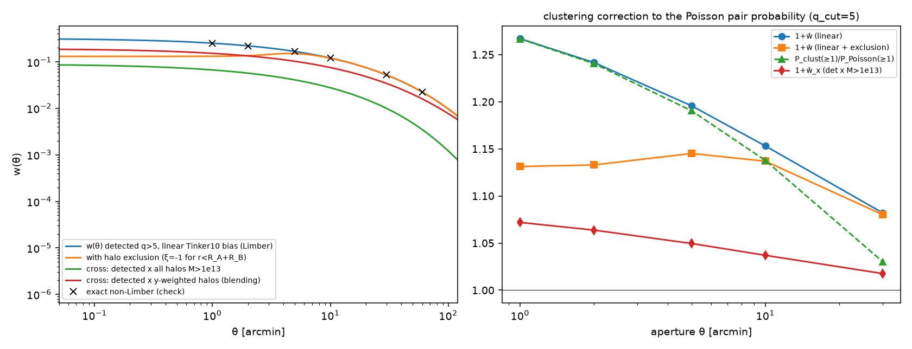

---

## 5. Recipe for any survey

1. **Selection.** Compute $\bar N_{\rm det}(q_{\rm cut})=\int dz\,dM\,\frac{d^2N}{dz\,dM}\int d\ln Y\,p(\ln Y)\,\Phi(Y/\sigma_Y(\theta_{500})-q_{\rm cut})$ and $\Sigma_{\rm det}=\bar N_{\rm det}/4\pi$. Do the same for any neighbour population B: a mass floor, the undetected halos, or a z slice.
2. **Neighbour probabilities (Q1).** $\mu=\Sigma\,2\pi(1-\cos\theta)$. Around a random point or a detected cluster (centre excluded): $P(N=n)={\rm Pois}(n;\mu)$. For the k-th neighbour: ${\rm gammainc}(k,\mu)$.
3. **Survey-wide.** Pairs: $\bar N\mu/2$, with ${\rm Var}=E(1+2\mu)$. Triples: $\bar N\mu^2p_3/6$. Probability that some configuration exists: $1-e^{-E}$.
4. **Clustering.** Multiply $\mu$ by $1+\bar w(\theta)$ for the selected sample: a factor of about 1.13–1.27 at 1–5′ in the baseline.
5. **Resolved blends (B1).** Choose $\theta_b$ from the filtered profiles, for example $s_{\rm infl}(A)+s_{\rm infl}(B)$, or calibrate it on simulations ($\theta_b\approx$ 5–8′ for absorption with maxQ). Then $f_{\rm B1}=1-e^{-\Sigma_{\rm det}\pi\theta_b^2}$.
6. **Unresolved blends (B2/B3/lost).** Do not use a pair radius.
   - Remove the map mean, or use a compensated filter. Otherwise add $\mu_A=\bar y\,\sigma_A{\rm RATIO}/N_w$.
   - Build the cross-response $\rho(\theta_A,\theta_B,s)$ and the neighbour rate $R(x)$ for halos down to about $10^{13}\,M_\odot$, which is converged for B2, B3 and lost.
   - Compute the compound-Poisson P(D) by FFT, with a fine CDF grid (the coarse grid biased small medians by 2–4%).
   - Convolve with unit noise and apply the cut and the dominance rule.
7. **Selection effect.** Evaluate the fractions *on the selected sample*. Unselected single-neighbour formulas underestimate contamination by ×1.3–1.5.
8. **Check against the pipeline.** Inject into maps once. Absorbed and fragmented fractions depend on the peak finder: maxQ gives 5.0% absorbed and 1.6% duplicates; per-scale gives 0.9% and 20%.

---

## 6. Open points and unresolved disagreements

- **Map boosting at q>7.** Pooled maps give 7.85 ± 0.14% (original set 8.21, new set 7.68). Two independent verifier runs give 7.18 ± 0.22% and 7.28–7.52%, 2–3σ lower. Treat it as 7.5–7.9% ± 0.4; "constant with $q_{\rm cut}$" is not established at q>7.
- **Map "faded" fraction at q>5.** Pooled 4.75 ± 0.09% against the verifier's 5.18 ± 0.16% (2.4σ). It depends on the proxy used for "detectable in isolation".
- **Pure-noise false rate at q>4.** Pooled 0.365 ± 0.003 deg⁻² against the verifier's 0.351 ± 0.005 (2.2σ); attributed to sample variance but not settled.
- **Map per-scale pipeline numbers (§3.6 rows 4–5) and the catalogue-level selected B2 (21.18%)** were reproduced only by the analysts on more patches, not independently by a verifier.
- **Map confusion variance for $q_{\rm true}<2$ and $<5$** rests on the original 40-patch run; only the $[10^{13},10^{14})$ slice was rechecked on 324 patches.
- **Blended-catalogue pairs at 1′, noise ×0.5.** The analysts' 4.38e-3 ± 6.4e-5 and the verifier's 3.54e-3 ± 2.4e-4 differ by 3.4σ; both are deficits. The small-separation statistic is sensitive to the dominance rule and to the response table.
- **Catalogue level:**
  - Fine-grid P(D) medians for floors $10^{13}$ and $3\times10^{13}$ sit up to 0.4% above the 8-sky MC (3–4σ with between-sky errors). That is consistent with those skies being low in bright clusters but has no independent check.
  - B2neg at ε = 0.05, $q_{\rm cut}=7$, stays at +3.5σ.
  - The fix for neighbours with $\theta_B>80'$ (0.21 per sky) was not propagated into the stored arrays; the expected effect is ≪0.1%.
- **Limber accuracy.** The analysts quote Limber/exact ≤ 2e-4. The verifier, using colossus ξ, gets ≤ 1.3e-3. Either way it is negligible.
- **Shared-seed $N_{\rm det}$ tests** in the robustness passes show −2.4σ to +2.9σ offsets, correlated through seeds 2001–2005. The independent 40-sky runs agree within −1.47σ to +0.76σ.

---

## 7. Reproduction: figures and scripts

Python: `.venv/bin/python`. Library: `szsim/`. Logs sit next to each script.

| figure | script |
|---|---|
| figures/build/count_validation.png, dNdz_Nabove.png | analysis/build/validate_sampler.py |
| figures/build/sigmaY_and_q.png | analysis/build/validate_sigmaY.py |
| figures/q1_aperture/PN_vs_theta.png, knn_cdf.png, neighbour_prob_table.png | analysis/q1_aperture/q1_compare_fullsky.py (data from q1_mc_fullsky.py, 120 skies) |
| figures/q1_aperture/caps_pairs_rare.png | analysis/q1_aperture/q1_compare_floor_rare.py (data from q1_floor_caps_pairs.py, q1_rare_configs.py) |
| figures/q1_aperture/palm_check_new_seeds.png | analysis/q1_aperture/q1_palm_figure.py (data from q1_palm_tension.py) |
| figures/blending/*.png (6 figures) | analysis/blending/b06_figures.py (inputs: b01_rho_table.py, b02_mc_neighbours.py, b03_analytic.py, b04_B1_pairs.py, b05_compare.py, r02_pd_fine.py) |
| figures/q2_maps/blending_fractions_ALL.png, blending_fractions_ps_ALL.png | analysis/q2_maps/analysis_blend.py with PIDS=0:324 TAG=_ALL (maps from run_patches.py; patches from extract_patches.py and repair/extract_patches_set2.py) |
| figures/q2_maps/noise_and_confusion.png | analysis/q2_maps/analysis_noise.py |
| figures/robustness/robustness_scaling.png, clustering_correction.png | analysis/robustness/aggregate.py (inputs: run_pass.py, q1_configs_floor.py, clustering_limber.py) |

Scripts behind the main numbers without a figure:
- Q1 calibrated tests: q1_calibrated_tests.py, q1_calibrated_conditional.py, q1_palm_hotelling.py, q1_void_tail*.py, q1_analytic.py.
- Catalogue blending repairs: r03_variance_exact.py, r04_sky_scatter.py, r05b_kernel_fractions.py, r06_median_floor14.py.
- Map-level models: catalog_level.py, b2model.py, gaussian_conf_model.py, confusion_qsplit.py, repair/split_check.py, repair/repair_noise.py.
- Clustering on blending: clustering_shift_mc.py.