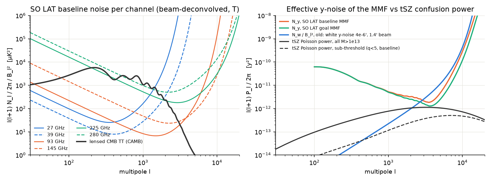
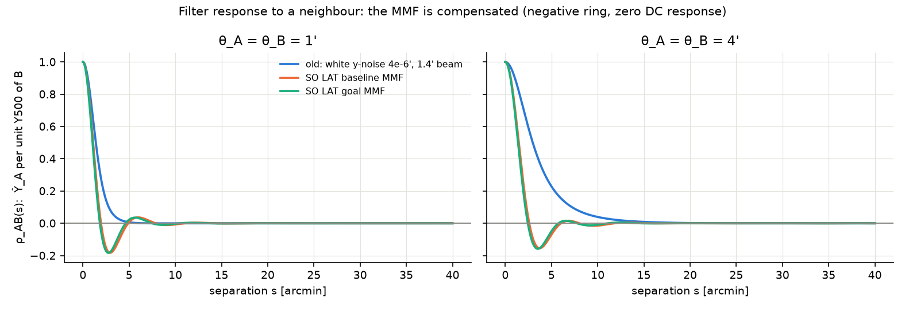
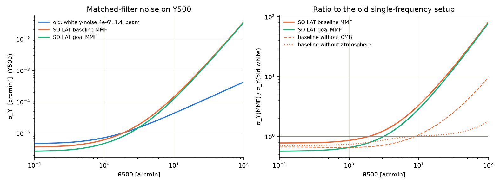
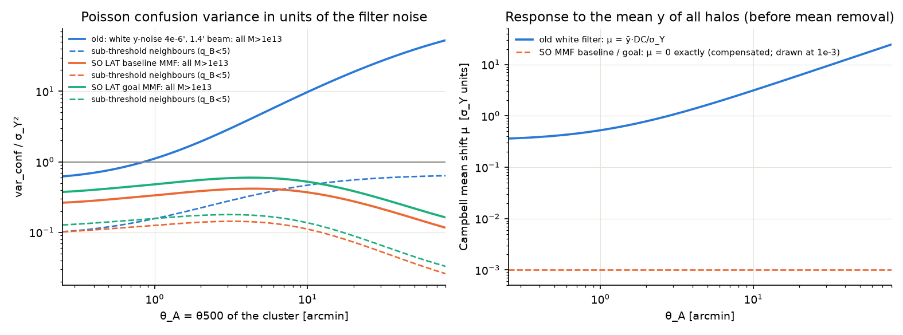
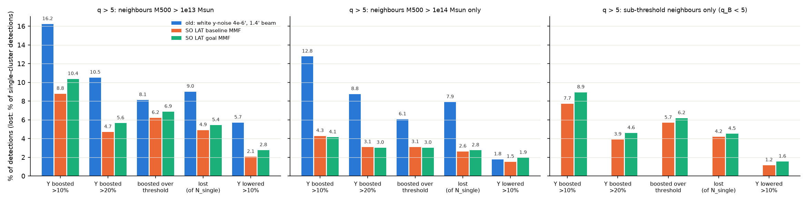

# Realistic SO LAT setup, step 1: instrument, multi-frequency matched filter, go/no-go

**Status: final (2026-11-11), after two independent verifications and an arbitration.**
- **Derivation** (`verify_real/step1_derivation/`): every number re-derived without importing this code.
- **Simulation** (`verify_real/step1_maps/`): six-channel sky maps with painted halos, run through the build's filter.
- **Arbiter** (`s09`–`s12` in this folder): targeted tests of every claim either check marked partial or disputed, plus fixes.
- Section 0 lists what changed. Section 8 gives, claim by claim, the evidence and what verified it. Section 9 lists what is still open.

**Setup**
- Old: white y-noise 4×10⁻⁶ arcmin, 1.4′ beam, one frequency, no CMB.
- New: the six SO LAT temperature channels with white and atmospheric noise, the lensed primary CMB, and a multi-frequency matched filter (MMF).
- Both: temperature only, flat sky, ℓ = 100–20000, Poisson halos M500 > 10¹³ M☉ (no clustering), no CIB, radio, kSZ or Galaxy.
- Scripts and logs: this folder. Data: `data_real/`. Figures: `figures/realistic/step1_*.png`. Library: `szsim/instrument.py`.

## Go / no-go: **GO** for SO baseline and SO goal

| q > 5, full sky, neighbours M500 > 10¹³, detected sample | old idealised | SO baseline MMF | SO goal MMF | verified by |
|---|---|---|---|---|
| detections without blending | 85,912 | 81,705 | 128,167 | both |
| Y boosted by > 10% by neighbours | 16.2% | **8.8%** | **10.4%** | both |
| Y boosted by > 20% | 10.5% | 4.7% | 5.6% | both |
| boosted over the threshold | 8.1% | 6.2% | 6.9% | both |
| lost (of single-cluster detections) | 9.0% | 4.9% | 5.4% | both |
| mean Y bias of detections | +3.4% | +2.2% | +2.7% | both |
| net change in detections | −1.6% | +1.3% | +1.4% | both |
| same, only sub-threshold neighbours (q_B < 5): Y > 10% / boosted / lost | – | 7.7 / 5.7 / 4.2% | 8.9 / 6.2 / 4.5% | both |
| Y boosted by > 10% for attribution rules x_B < (0.5–2)·q_A (default 1) | 12.5%–19.6% | 7.4%–10.1% | 8.7%–11.9% | arbiter (s09); no-rule values: simulation |
| ΔN/N from z < 0.1 to z = 2–3 (P(D) expectation) | −5.3% → +4.0% | +0.7% → +4.8% | +0.8% → +5.0% | both |
| confusion variance / σ_Y² at θ_A = 1–4′: all / sub-threshold | 1.1–4.0 / 0.15–0.33 | 0.33–0.42 / 0.12–0.14 | 0.47–0.60 / 0.16–0.18 | both |
| robust (16–84%) half-width of noise + confusion, θ_A = 1–16′ | 1.10–1.69 | 1.05–1.08 | 1.07–1.10 | both |

"both" = confirmed by the derivation and by the simulation check (section 8 has the numbers).

**Verdict**
- **As a noise term, faint-halo tSZ is small with the MMF.**
  - All halos M500 > 10¹³ add a confusion variance of 0.3–0.4 σ_Y² (baseline) and 0.4–0.6 σ_Y² (goal), but 81–90% of it comes from rare M500 > 10¹⁴ neighbours.
  - The sub-threshold part is 0.11–0.18 σ_Y², i.e. σ_Y +5–8% if treated as noise. The robust width of noise plus confusion grows by only 5–10%.
  - In Raghunathan 2022's survey-limit metric this is negligible, as they found.
- **Per object, blending is still large.** Relative to the old setup it is about halved for Y boosts and losses (×0.45–0.64), but only cut by 15–23% for boosts over the threshold.
  - Y boosted by > 10%: 8.8% (baseline) and 10.4% (goal) of q > 5 detections, against 16.2% before.
  - Boosted over the threshold: 6.2% and 6.9% (8.1% before). Lost: 4.9% and 5.4% (9.0% before).
  - Most of it comes from neighbours that are themselves undetectable, so masking detected clusters removes only 9–17% of it.
  - Goal is worse than baseline: the same confusion sits on a lower noise.
- **Why GO.** A ~10% per-object effect near the threshold is too large to ignore in a precision count analysis, and it changes the redshift shape of the counts. The old low-z loss disappears, but the counts still rise by about 4 pp from z < 0.1 to z = 2–3 (9 pp for the old filter). Step 2 must recompute the S8 bias with this MMF P(D).
- **Caveats.**
  - No CIB, radio or kSZ residuals, and the population has 2.65× the measured tSZ power. Both make these fractions upper bounds.
  - The per-object fractions depend on how a blended peak is attributed to halos (row "attribution rules" and table F).
    - For Y boosted by > 10% the ratio to the old setup stays at 0.5–0.7 under every rule tested.
    - For boosts over the threshold it ranges from 0.5 (no rule) to 1.0 (strict rule).
    - With no rule at all, peaks are counted several times: the boost fractions double and the mean Y bias reaches +50–150%.

## 0. What the arbitration changed

| # | claim | issue raised | arbiter test | result | who was right |
|---|---|---|---|---|---|
| 1 | noise model vs SO code | "≤ 2.8%" was tested only up to ℓ = 8000 (derivation) | s02 now scans ℓ = 2–20000 and every N_ij; analytic white-noise limit | max 2.86% (baseline 225 GHz, ℓ = 20000) = (22/22.32 μK′)² − 1; goal 2.22% | derivation |
| 2 | CAMB lensed CMB | "converged" vs CLASS 5% off at ℓ = 6000, 14–32% at ℓ ≥ 8000 (derivation) | s10 (C): CAMB with halofit-Takahashi; CLASS-halofit; CMB cut or scaled | CAMB is numerically converged; the gap is mostly the non-linear lensing model (HMcode-2020 vs halofit: +3.7% at ℓ = 6000), plus CLASS noise beyond ℓ ≈ 8000. σ_Y moves ≤ 8×10⁻⁴ | both, in different senses; wording fixed |
| 3 | white-filter reproduction | stored "white" σ_Y was `SZModel` output, so it did not document the MMF code (derivation); only partly re-run (simulation) | s03 stores `white_mmf`; s10 (A) exact quadrature | MMF code exact to 1.4×10⁻⁶; the 1.4×10⁻⁴ difference is `SZModel`'s own trapezoid at θ500 ≥ 50′ | derivation (file); claim holds |
| 4 | σ_Y table | labelled 2, 5, 20′ but evaluated at 1.995, 5.012, 19.95′ (simulation) | s03 prints exact θ500 | ≤ 0.6% change, e.g. 6.59×10⁻⁴ (not 6.55×10⁻⁴) at 20′ | simulation; the derivation's "independent values" were also at the grid nodes |
| 5 | tSZ power vs SPT | 2.5× compared 145 GHz with SPT's 143 GHz (derivation) | s10 (B): HMF integral and direct sum over a stored sky | D_3000 = 9.07 μK² at 143 GHz = **2.65×** SPT (2.53× at 145 GHz); the two routes agree to 0.07% | derivation |
| 6 | redshift tilt | quoted end bins differ by 0.5–1.1 pp from the P(D) and the maps; s06d's errors too small (simulation) | s09: P(D) per z bin and predicted per-sky scatter; s11, s12: 12 fresh skies counted directly | P(D) expectation: baseline +0.74 … +4.84%, goal +0.78 … +5.03%, old −5.28 … +3.96% (z = 0.01–0.1 … 2–3). Direct counts on 12 fresh skies agree within 2.2σ in every bin of the old filter and at z = 1.5–2 for the MMF; at z = 2–3 they give +4.73 ± 0.24% (baseline) and +4.55 ± 0.14% (goal), 0.1–0.5 pp below the P(D) (section 9). The quoted end bins (+5.5%, +5.0%) were 3-sky values whose errors were too small by up to ~10× | simulation |
| 7 | headline fractions | depend on the dominance (attribution) rule (simulation) | s09: rule x_B < fdom·q_A with fdom = 0.5, 1, 2 and no rule | Y > 10% for fdom = 0.5–2: 12.5%–19.6% (old), 7.4%–10.1% (baseline), 8.7%–11.9% (goal); lost unchanged. The simulation's no-rule numbers are reproduced exactly (baseline 15.3%, mean bias +48.8%); that variant counts peaks several times | simulation; now quantified |
| 8 | b03 file written with the pre-fix kernel | checked by neither | s10 (D): pre-fix kernel re-implemented, own rate loop; file provenance | variance and cap rate reproduced to ≤ 1×10⁻⁹. The 20:39 date of the file is a partial re-save by `r02_pd_fine.py` (QUANT, CCDF only); the rate arrays date from the b03 run at 18:48, before the fix | builder's conclusion; its explanation corrected (s06e docstring) |
| 9 | direct check of the FFT P(D) | s06d used the FFT's own ρ tables (derivation) | – | the derivation check's kernel-independent direct count closes the gap (≤ 0.10 pp) | derivation |
| 10 | extra Gaussian variance in s06b/s06c/s09 | found by the arbiter | s10 (E): node tables recomputed without it | spurious term (≤ 0.04 σ²) at θ_A nodes outside 0.25–80′; changes every fraction by ≤ 3.4×10⁻⁸; code fixed, outputs not re-run | – (new) |
| 11 | compute budget | s06d peaked at a 5.22 GB memory footprint (RSS 4.34 GB), above the 5 GB budget (derivation) | – | true. The arbiter's s11 repeats this per-sky work at 3.2 GB | derivation |

Everything else in both reports was confirmed. The headline numbers of the go/no-go table are unchanged by the arbitration.

## 1. Instrument model

Source: The Simons Observatory Collaboration (Ade et al. 2019), arXiv:1808.07445. The PDF was fetched and its text extracted:

- Table 1 (LAT, f_sky = 0.4) gives frequencies, beams and white noise.
- Table 2 and Eq. (1) give the LAT temperature red noise: N_ℓ = N_red (ℓ/ℓ_knee)^α + N_white, with ℓ_knee = 1000 and α = −3.5.
- Sec. 2.2 gives the survey and the atmospheric correlation: 5 years, 20% of time used, ×0.85 for discarded map edges, and a correlation of 0.9 between the two bands of one optics tube.

The red-noise conversion is N_ℓ,red [μK² sr] = N_red · (4π f_sky) / t_eff, with t_eff = 5 yr × 0.2 × 0.85. It comes from the public SO code released with the paper (`simonsobs/so_noise_models`, `SO_Noise_Calculator_Public_v3_0_0.py`), which was read but not executed.

| ν [GHz] | FWHM [′] | white, baseline [μK′] | white, goal [μK′] | N_red [μK² s] | ℓ where red = white (baseline / goal) | tSZ g(ν) | ΔT per unit y [μK] |
|---|---|---|---|---|---|---|---|
| 27 | 7.4 | 71 | 52 | 100 | 409 / 489 | −1.9625 | −5.35×10⁶ |
| 39 | 5.1 | 36 | 27 | 39 | 461 / 544 | −1.9220 | −5.24×10⁶ |
| 93 | 2.2 | 8.0 | 5.8 | 230 | 1809 / 2174 | −1.5718 | −4.28×10⁶ |
| 145 | 1.4 | 10 | 6.3 | 1500 | 2721 / 3543 | −1.0158 | −2.77×10⁶ |
| 225 | 1.0 | 22 | 15 | 17000 | 3469 / 4318 | +0.1156 | +0.32×10⁶ |
| 280 | 0.9 | 54 | 37 | 31000 | 2466 / 3060 | +1.0022 | +2.73×10⁶ |

**Choices**
- The tSZ SED is non-relativistic and monochromatic at the band centres, with T_CMB = 2.7255 K. There is no bandpass integration.
- The atmospheric correlation of 0.9 within each tube is included. Setting it to 0 changes σ_Y by −2% at θ500 ≤ 5′ (s03).
- Footnote 7 of the paper says its forecasts used 4 instead of 39 μK² s at 39 GHz by mistake; we use 39.
- The primary CMB is the lensed TT spectrum from CAMB 2.0.5 at the project cosmology: colossus planck18, h = 0.6766, Ω_m = 0.3111, Ω_b = 0.049, n_s = 0.9665, σ8 = 0.8102. It uses one massive neutrino of 0.06 eV inside Ω_m, τ = 0.0544, and non-linear lensing with CAMB's default HMcode-2020 (`halofit_version = 'mead2020'`). It is computed directly to ℓ = 26000, so no extrapolation is used below ℓ = 22000.

**Checks**
- **Noise against the SO code's algorithm.** The noise model built from the paper's tables was compared with an independent re-implementation of the SO code, which starts from detector NETs and tube counts (`s02_noise_check.log`).
  - Every white level agrees within the paper's rounding (≤1.5%).
  - Every N_ij(ℓ) agrees within ≤ 2.9% over the whole filter range ℓ = 2–20000 (maximum 2.86%: baseline, 225 GHz, ℓ = 20000; goal 2.22%). At high ℓ the white term dominates, so the deviation tends to (22/22.32 μK′)² − 1 = −2.87%: the paper rounds the white levels, and N_red 38.5 → 39 and 225 → 230. *[Corrected: the first check scanned ℓ ≤ 8000 only and quoted ≤ 2.8%.]*
  - There are no cross-tube terms in either.
- **SED.**
  - The closed form agrees with the Kompaneets intensity form converted by a numerical dB/dT to ≤3×10⁻⁸.
  - The null falls at 217.51 GHz.
- **CAMB convergence.** The stored run was compared with a more accurate run (`s01_camb_cmb.log`). They agree to 2×10⁻³ at ℓ ≤ 6000 and to 3.6% at ℓ = 20000. Relative to the beam-deconvolved noise of the quietest channel, the CMB is 1.6–2.7 at ℓ = 3000, 4–9×10⁻³ at ℓ = 6000 and below 10⁻⁷ at ℓ = 20000 (`s02_noise_check.log` (1b)), so the residual uncertainty of the lensed tail is irrelevant.
- **Lensed-tail model uncertainty** (`s10_arbiter_checks.log` (C)). Numerical convergence is not model accuracy. With halofit-Takahashi instead of HMcode-2020, CAMB's lensed C_ℓ changes by +1.2% at ℓ = 4000 and +3–4% at ℓ = 5000–8000. CLASS-halofit (derivation check) agrees with CAMB-Takahashi to ≤ 1.6% up to ℓ = 6000 and oscillates by ±2–18% beyond ℓ ≈ 8000 (not converged there). So the 5% CAMB–CLASS gap at ℓ = 6000 is mostly the non-linear lensing model. It does not matter: σ_Y changes by ≤ 6×10⁻⁴ (Takahashi) and ≤ 8×10⁻⁴ (CLASS); zeroing the CMB above ℓ = 6000 changes it by ≤ 4.4×10⁻⁴, and scaling it by 1.3 above ℓ = 4000 by ≤ 4×10⁻³.
- **First CAMB attempt rejected.** It used lmax = 12000/14000, and its two runs differed by 4–42% at ℓ = 5000–11000 (lensed tail not converged near lmax). Its output is kept at the top of the log.

*Left: beam-deconvolved noise per channel and the lensed CMB. Right: the MMF's effective y-noise N_y(ℓ) for SO baseline and goal and the old white setup, compared with the Poisson tSZ power of the halo population (solid: all M500 > 10¹³ M☉; dashed: only halos below q = 5).*

## 2. The multi-frequency matched filter

**Algebra (Herranz+2002, Melin+2006 form).** With a_i = B_i f_i and C_ij = B_i B_j C_ℓ^CMB + N_ij(ℓ), the MMF reduces exactly to the old single-map filter with N_w/B_ℓ² replaced by one effective y-noise power:

N_y(ℓ) = 1 / (aᵀ C⁻¹ a)

So:

- σ_Y⁻² = (1/2π) ∫ dℓ ℓ g(ℓθ500)² / N_y(ℓ).
- ρ_AB(s) = σ_A² (1/2π) ∫ dℓ ℓ g_A g_B J0(ℓs) / N_y(ℓ).
- The response to a uniform y background is σ_A² RATIO² / N_y(0).

The template g is the existing unit-Y500 Arnaud Hankel template, truncated at 5R500 (∫ = RATIO_5R500 = 1.796). The filter therefore estimates Y500 with exactly the conventions of `SZModel.sigma_Y`. `MMFModel` subclasses `SZModel`, so `q_mean`, `p_det` and `expected_detections` use the MMF σ_Y unchanged.

**Compensation.** The MMF has zero response to a uniform y background.
- The k = 0 term is excluded by ℓ_min = 100.
- It would vanish even with ℓ_min = 0, because 1/N_y ∝ ℓ^3.3 → 0: atmosphere and CMB dominate at low ℓ (s03, part 5).
- So the Campbell mean shift is μ = 0 and no mean removal is needed.
- The old white filter had a DC response of 10.5, 69 and 937 arcmin² at θ500 = 1′, 4′, 16′ (`s03_sigmaY_counts.log` (5)). That gave μ = 0.5σ to 5σ, which had to be removed explicitly.
- The cost is a negative ring in ρ, at s ≈ 2–4′ for θ = 1′ (figure below).

**Verification:**

| test | result | log |
|---|---|---|
| MMF code with a white single-channel "instrument" vs the existing `SZModel` | σ_Y to 1.4×10⁻⁴ over θ500 = 0.1–100′; point-source limit identical; ρ to 1.6×10⁻⁷ (6 (θ_A, θ_B) pairs × 50 separations). Against an exact quadrature of the same template, the MMF code is right to 1.4×10⁻⁶ and `SZModel` to 1.4×10⁻⁴ (its 20,000-point trapezoid at θ500 ≥ 50′), so the 1.4×10⁻⁴ is `SZModel`'s. `data_real/sigmaY_mmf.npz` now stores both (`white` = `SZModel`, `white_mmf` = MMF code) | `s03_sigmaY_counts.log` (1); `s10_arbiter_checks.log` (A) |
| N_y algebra: `np.linalg.solve` vs eigendecomposition vs Sherman–Morrison | ≤ 6×10⁻¹⁴ | `s02_noise_check.log` (3) |
| Map Monte Carlo: 6-channel 1024² patches at 0.5′, each component simulated separately (CMB, 3 tubes of correlated atmosphere, white noise); explicit Melin Ψ filter with per-mode 6×6 inversion; 400 skies per setup | filtered-map variance vs Hankel σ_Y: ≤ 5×10⁻⁴ at θ500 = 1–16′, baseline and goal; injected Y = 20σ clusters unbiased (≤ 1.6σ) with unit scatter (0.975–1.053; expected 1 ± 0.035) | `s04_mc_maps.log` |
| 2D FFT-grid cross-response (sub-pixel offsets, phase factors) vs library Hankel ρ | max \|Δρ\| = 1.2×10⁻⁶ (10 configurations, s = 0–80′); uniform y → Ŷ = 0 | `s04_mc_maps.log` (c) |
| Independent maps (simulation check, `verify_real/step1_maps/`) | painted Arnaud clusters through the build's MMF: response 1 within 4×10⁻⁴; empirical filtered noise = σ_Y within 4×10⁻⁴ at θ500 = 0.5–20′; injected-cluster bias ≤ 1.5σ (\|mean\| ≤ 0.021σ); painted-pair ρ = Hankel ρ within 1.2×10⁻⁴ | `v03`, `v04` logs there |
| Convergence | dℓ = 0.5 vs 1: 1.4×10⁻⁴; ℓ_max 30000 vs 20000: 1.7×10⁻⁴ (2.6×10⁻⁵ for θ500 ≥ 0.5′); ℓ_min 36 vs 100: identical at the printed 4 digits for θ500 ≤ 20′ and −0.2% at 50′; ℓ_min 0 vs 100: ≤ 2×10⁻⁵ for θ500 ≤ 16′ and −0.2% at 50′ | `s03_sigmaY_counts.log` (2), (3), (5) |

## 3. σ_Y: SO MMF vs the old white-noise filter

σ_Y in arcmin² (Y500), with ℓ = 100–20000, at exact θ500 (`s03_sigmaY_counts.log`, `s08_tables.log`). *[Corrected: the first table showed the nearest grid nodes, 1.995, 5.012 and 19.95′, under the labels 2, 5 and 20′; σ_Y differs by up to 0.6%.]*

| θ500 [′] | 0.25 | 0.5 | 1 | 2 | 3.2 | 5 | 10 | 20 | 50 |
|---|---|---|---|---|---|---|---|---|---|
| old white (4×10⁻⁶′, 1.4′) | 4.98e-6 | 5.63e-6 | 7.23e-6 | 1.08e-5 | 1.54e-5 | 2.25e-5 | 4.31e-5 | 8.49e-5 | 2.11e-4 |
| SO baseline MMF | 3.90e-6 | 4.51e-6 | 6.21e-6 | 1.10e-5 | 1.93e-5 | 3.84e-5 | 1.43e-4 | 6.59e-4 | 5.96e-3 |
| SO goal MMF | 2.86e-6 | 3.36e-6 | 4.72e-6 | 8.61e-6 | 1.56e-5 | 3.17e-5 | 1.24e-4 | 5.98e-4 | 5.66e-3 |
| ratio baseline / white | 0.78 | 0.80 | 0.86 | 1.02 | 1.26 | 1.70 | 3.32 | 7.76 | 28.2 |
| ratio goal / white | 0.57 | 0.60 | 0.65 | 0.80 | 1.01 | 1.41 | 2.87 | 7.04 | 26.8 |
| equivalent white y-noise, baseline [arcmin] | 3.1e-6 | 3.2e-6 | 3.4e-6 | 4.1e-6 | 5.0e-6 | 6.8e-6 | 1.3e-5 | 3.1e-5 | 1.1e-4 |
| equivalent white y-noise, goal [arcmin] | 2.3e-6 | 2.4e-6 | 2.6e-6 | 3.2e-6 | 4.0e-6 | 5.6e-6 | 1.1e-5 | 2.8e-5 | 1.1e-4 |

Independent checks: the map simulation measures the filtered noise at exactly 0.5, 1, 2, 5, 10 and 20′ (baseline 4.511e-6, 6.213e-6, 1.097e-5, 3.836e-5, 1.429e-4, 6.587e-4; ≤ 4×10⁻⁴ from this table); the derivation check's two 2D-grid routes agree with the grid-node values to ≤ 6×10⁻⁴ (θ ≤ 50′).

The "equivalent white y-noise" is the white level a 1.4′ single-frequency map would need to give the same σ_Y. It equals 4×10⁻⁶ × ratio.

- **Compact clusters (θ500 ≲ 2′)**, the bulk of the high-z sample: the SO MMF is about as good as the old setup, or up to 1.7× better for goal. The main reason is that 93 GHz (8 μK′, |g| = 1.57) and 145 GHz together reach a lower y-noise at ℓ ≳ 3000 than the old 4×10⁻⁶′ map. With 93+145 GHz alone the ratio is already 0.81 at 0.25′; at ℓ = 5000 these two channels carry 97.5% of the MMF's y response, Σ_i w_i B_i f_i = 1 (`s02_noise_check.log`).
- **Extended clusters (θ500 ≳ 3′):**
  - The atmosphere, with its effective knee at ℓ ≈ 2700 at 145 GHz, and the CMB make the SO MMF much noisier: ×3.3 at 10′ and ×7.8 at 20′.
  - Without the CMB the ratio at 10′ would be 1.06; without the atmosphere it would be 1.02.
  - With 145 GHz alone it would be ×7.5 at 10′. With 93+145 GHz only it would be ×3.8 (variants in s03).

## 4. Expected full-sky detections (no blending)

Population: M500 > 10¹³, 0.01 < z < 3, Tinker08, Planck 2013 Y–M with (1−b) = 0.8, σ_lnY = 0.173.

| setup | q > 4 | q > 5 | q > 6 | q > 7 | q > 5, f_sky = 0.4 |
|---|---|---|---|---|---|
| old white (reproduces szsim/README exactly) | 132,125 | 85,912 | 61,630 | 46,575 | 34,365 |
| SO baseline MMF | 133,127 | 81,705 | 55,657 | 40,063 | 32,682 |
| SO goal MMF | 203,773 | 128,167 | 88,810 | 64,882 | 51,267 |

- **Check against the catalogues.** For M > 10¹⁴, q > 5, the analytic counts match 5 stored catalogues with fresh noise: baseline 81,428.5 vs 81,383.6 ± 65.7 (−0.35σ); goal 126,740.4 vs 126,750.0 ± 83.1 (+0.06σ).
- **ℓ_min = 36 instead of 100** changes no count by ≥ 0.1.
- **Comparison with Raghunathan 2022 (Table 3; S/N ≥ 5, f_sky = 0.4):** SO-Baseline 14,424 and SO-Goal 26,445, which is 2.3× and 1.9× fewer than here. Their maps add CIB, radio and kSZ residuals, which dominate their ILC noise at SO depth, and they use a different Y–M relation (σ_logY = 0.127). Our step-1 noise is therefore optimistic, and so are our counts.

## 5. Confusion from halos M500 > 10¹³ M☉: Campbell variance and mean

**Variance.** For a filter of size θ_A, the Poisson neighbours add to Ŷ_A a variance

var_conf = Σ_B n_B Y_B² ∫ d²s ρ_AB² = σ_A⁴ (1/2π) ∫ dℓ ℓ g_A² C_ℓ^yy,P / N_y² (Parseval)

where C_ℓ^yy,P is the Poisson (1-halo) y power of the population.

**Mean.** The mean shift (Campbell's first cumulant) is μ = ȳ · DC response / σ_A.

The table gives var_conf / σ_Y², i.e. in units of the filter's own noise variance (`s05_confusion.log`). "Sub-threshold" counts only neighbours whose own mean q_B < 5 in the same instrument, i.e. with detected clusters masked.

| θ_A = θ500 [′] | 0.52 | 0.95 | 1.98 | 4.15 | 7.5 | 15.7 | 32.9 |
|---|---|---|---|---|---|---|---|
| old white: all M > 10¹³ | 0.774 | 1.07 | 1.92 | 3.97 | 7.32 | 15.1 | 28.7 |
| old white: sub-threshold | 0.121 | 0.152 | 0.221 | 0.326 | 0.422 | 0.526 | 0.595 |
| old white: mean μ [σ] (removed by hand) | 0.41 | 0.51 | 0.78 | 1.39 | 2.37 | 4.85 | 10.1 |
| **SO baseline: all M > 10¹³** | 0.294 | 0.330 | 0.384 | 0.416 | 0.396 | 0.310 | 0.206 |
| SO baseline: from M > 10¹⁴ only | 0.242 | 0.273 | 0.320 | 0.353 | 0.341 | 0.273 | 0.185 |
| SO baseline: sub-threshold | 0.113 | 0.124 | 0.139 | 0.142 | 0.125 | 0.086 | 0.050 |
| **SO goal: all M > 10¹³** | 0.421 | 0.473 | 0.552 | 0.596 | 0.563 | 0.434 | 0.285 |
| SO goal: from M > 10¹⁴ only | 0.340 | 0.385 | 0.455 | 0.499 | 0.480 | 0.379 | 0.253 |
| SO goal: sub-threshold | 0.141 | 0.155 | 0.174 | 0.176 | 0.154 | 0.105 | 0.061 |
| SO MMF (both): mean μ | 0 | 0 | 0 | 0 | 0 | 0 | 0 |

What this shows:

- **The MMF cuts the confusion variance a lot, but not to zero.**
  - Relative to the old filter the cut is ×2.6 at θ_A = 0.5′ and ×9.5 at 4′.
  - The MMF gives almost no weight to ℓ ≲ 1000, where large and bright halos put most of their power.
  - In noise units the confusion variance is still 0.3–0.6 for θ_A = 0.5–8′. It is largest near θ_A ≈ 4′ and is higher for goal than for baseline: the same sky over a lower noise.
- **It is mostly a heavy tail.** 81–90% of the variance comes from M > 10¹⁴ neighbours, i.e. from rare bright objects.
- **The sub-threshold (Gaussian-like) part is 0.11–0.14 (baseline) and 0.14–0.18 (goal) for θ_A ≤ 4′.** That is equivalent to σ_Y × √(1+v) = +5–7% (baseline) and +7–8% (goal).
  - Independent check: a filter whose noise model *includes* the sub-threshold tSZ power (N_y → N_y + C_ℓ^yy) has σ_Y larger by 5.3–6.7% (baseline) and 6.5–8.2% (goal) for θ_A = 0.5–4′. That agrees with √(1+v).
  - With all halos in the filter's noise model, σ_Y grows by 12–18% (baseline) and 17–25% (goal) for θ_A = 0.5–8′.
- **No mean shift with the MMF.** μ = 0 exactly, because the MMF is compensated (section 2). The old trap of a non-zero mean (μ = 0.4–10σ, which had to be removed by hand) does not exist with a realistic multi-frequency filter.

**Checks on the variance**

- **Method 2, real space (`s05_confusion.log`).** ∫2πs ρ² ds was integrated from the Hankel ρ(s) out to 900′ beyond the profiles and summed over 30 θ_B bins. It agrees with Parseval to (3–14)×10⁻⁵ at θ_A = 1, 4, 16′, for both "all" and "sub-threshold".
- **The binned C_ℓ^yy** (1200 ln θ_B bins) agrees with an unbinned direct sum to < 10⁻⁵.
- **Old b03 numbers.** For the old white filter, Parseval reproduces the b03 real-space rate-histogram variances of the 10¹³–3×10¹³ and 3×10¹³–10¹⁴ classes at all six θ_A that b03 printed. They agree to b03's 2–3 printed digits (`s05_confusion.log` against `analysis/blending/b03_analytic.log`).
- **The P(D) rate histograms of s06b** (sum of w x² including the caps) agree with Parseval to 0.2–0.7% (white) and to ≤ 0.15% (MMF baseline and goal, all neighbours, M > 10¹⁴ only, and sub-threshold only).
- **Independent checks.** Derivation: catalogue sums of Y_B² ∫ρ² over a fresh sky (own ρ) agree within 2.6% (one-sky scatter) and, for the heavy M > 10¹⁴ class, within 0.2–0.3% over 300 skies; the sub-threshold variances within 0.4%. Simulation: the variance of the confusion signal measured in 400 painted map patches agrees with Parseval within +0.3% to +1.6% (all neighbours) and 0.2% (sub-threshold).

**Caveat on the amplitude.** The Poisson tSZ power of this population is 10¹² ℓ(ℓ+1)C_ℓ^yy/2π = 1.128 at ℓ = 3000 (a direct sum over the halos of a stored sky gives 1.129; the derivation check 1.121, the maps 1.111 ± 0.022). At SPT's 143 GHz that is D_3000 = 9.07 μK² (8.65 at 145 GHz, 7.62 at 150 GHz; `s10_arbiter_checks.log` (B)). The SPT measurement is 3.42 ± 0.54 μK² at 143 GHz (Reichardt et al. 2021, arXiv:2002.06197). So this population (Planck-2013 Y–M with 1−b = 0.8, Arnaud profile) has **2.65×** the observed tSZ power at the same frequency, as Raghunathan 2022 also noted for theirs. *[Corrected: the first version compared 145 GHz with SPT's 143 GHz and quoted 2.5×.]* All confusion numbers here scale roughly with that power, so they are likely pessimistic by a similar factor in variance.

### Comparison with Raghunathan 2022 (arXiv:2112.07656)

**What R22 states.** "For other experiments [than CMB-HD and partly S4-Ultra deep], the effect is negligible as the noise in the tSZ map is dominated by residual foregrounds or experimental noise." Their Fig. 5 shows the SO-Baseline and SO-Goal limiting-mass curves without tSZ, with Poisson tSZ and with Gaussian tSZ lying on top of each other.

**Why the two answers differ.** The questions and the definitions are not the same:

1. **What is measured.**
   - R22 measure the *survey sensitivity*: the limiting mass at S/N ≥ 5, with S/N set by the 16th–84th percentile width of the fitted y over 500 simulations. That robust width is by construction insensitive to the heavy tail.
   - We measure *per-object* effects on the detected sample: the full compound-Poisson distribution, how often Y is boosted by more than 10% or 20%, how often a cluster is boosted over the threshold, and how often one is lost.
   - The *variance* above is dominated (81–90%) by rare bright neighbours, which a robust width ignores.
   - The per-object fractions, however, turn out to be driven mostly by the near-Gaussian sub-threshold part (section 6). That part does show up in a robust width, as a 3–7% broadening.
   - The two metrics differ because 5% more scatter is negligible for the limiting mass but not for objects within about ±1σ of the threshold.
   - The robust half-width of P(n + δ) is computed in section 6 to put both on the same footing.
2. **Noise level.**
   - R22 include CIB, radio and kSZ residuals, which they state dominate SO's ILC y-map noise.
   - Step 1 has none, so our N_y is lower and every ratio to it is higher. Their SO-Baseline count, 14,424 at f_sky = 0.4, is 2.3× below our 32,682.
3. **Their three tSZ cases in our language.**
   - **R22's "Gaussian-tSZ"** puts the full tSZ power of all M ≥ 10¹³ halos into Gaussian noise. In our setup that is the tSZ-aware filter with all halos: σ_Y +12–25%.
   - **Their "Poisson-tSZ"**, scored with a robust width, corresponds to our robust half-widths: +5–10%.
   - **After masking detected clusters**, the residual corresponds to our sub-threshold numbers: +3–7% in robust width, or +5–8% in σ_Y if the sub-threshold power is put into the filter (θ_A ≤ 4′).
   - Their CIB, radio and kSZ residuals dilute all three further. Their finding of "indistinguishable from no tSZ" for SO is therefore plausible at the survey-limit level, while the per-object effects of section 6 remain.
4. **Mean removal.** It is not an issue for either: both multi-frequency filters are compensated (μ = 0 here).
5. **Low-mass floor.** The same: M500 ≥ 10¹³ (R22: z ∈ [0.1, 4]; here z ∈ [0.01, 3]).
6. **Population.** Both populations over-predict the measured tSZ power (R22 say so for theirs; here 2.65× at 143 GHz).

## 6. Blending fractions with the MMF (catalogue-level P(D))

**Method.** It is the same as REPORT.md sec. 3 / `analysis/blending/b03_analytic.py`, rewritten for a kernel of either sign (`pdlib1.py`, `s06b_pd_fractions.py`).

- **Neighbour sum.** δ_A = Σ_B ρ_AB Y_B / σ_A is compound Poisson, built from a rate histogram in signed log|x| bins. The FFT handles negative contributions, which come from the MMF's negative ring.
- **Detection.** q_b = q_A + n + δ_A − μ > q_cut, with μ the mean of δ (≈ 0 for the MMF). A must also be dominant: x_B < q_A for every neighbour, i.e. a truncated compound Poisson.
- **Counting.** All fractions are counted on the detected (blended) sample.
- **Neighbours.** M500 > 10¹³ (and > 10¹⁴ only); primaries have q_A > 0.5.

**ρ tables** (`s06a_rho_tables.log`):
- 96 θ nodes from 0.1′ to 150′, 401 s-nodes, support 5θ_A + 5θ_B + 150′.
- Trilinear interpolation against exact ρ: 95th percentile 5.2×10⁻³ ρ(0), maximum 6.4×10⁻³. The old white table had 9.6×10⁻³ and 1.2×10⁻².
- ∫ρ² against Parseval: ≤ 6×10⁻³.
- A first 48-node table was rejected because of θ-interpolation errors up to 3.3%; its log is kept at the top of the file.

**Checks of the P(D) machinery**

1. **Old white results reproduced.** The new code was run with the old white ρ table (`s06b_pd_fractions_white.log`) and reproduces the b03 numbers to ≤ 10⁻⁴ absolute in every fraction. At q > 5, floor 10¹³:

   | | contaminated > 10% | contaminated > 20% | boosted | lost | N_det,blended |
   |---|---|---|---|---|---|
   | new code | 16.237% | 10.518% | 8.125% | 9.020% | 84,506 |
   | b03 | 16.230% | 10.514% | 8.122% | 9.028% | 84,494 |

   The floor-10¹⁴ fractions agree as well.
2. **Moments of the MMF rate histograms against the exact values** (`s06b_pd_fractions_{baseline,goal}.log`):
   - mean: |μ_hist| ≤ 4×10⁻⁴ σ, against the exact 0;
   - variance, including caps: within ≤ 0.15% of Parseval (s05), so nothing is missing beyond the 150′ support and the Gaussian correction term is 0;
   - contributions below −60σ, which would wrap around the FFT box, have a rate ≤ 2×10⁻¹⁰.
3. **FFT P(D) against direct neighbour sums** over the three stored M500 > 10¹³ skies at 60,000 random points (`s06d_mc_check.log`): 
   - **Random points.** At θ_A = 1.0, 4.0 and 16.1′, for baseline and goal, there are 102 comparisons: mean, variance, five quantiles, and P(δ > t) for t = 0.1–5 and P(δ < −t) for t = 0.1–1. The errors come from 60 sky blocks. 97 of the 102 agree within 2σ; the pull rms is 1.15 and the maximum 2.9. The largest pulls are in the rare negative tail at θ_A = 16′, where P(δ < −0.5) of 2–4% differs by ≤ 7% relative. The map simulation, which uses no ρ tables, finds no tension there: P(δ < −0.5) at 16′ = 0.02213 ± 0.00016 against the FFT's 0.02204, so these were fluctuations of the direct sums.
   - **The fractions themselves, counted directly on the realised primaries.** Each sky has about 2.3 million (baseline) or 3.3 million (goal) primaries with q_A > 0.5, each with about 15,800 neighbours. Noise is marginalised exactly per object and dominance is taken from the actual brightest neighbour. No rate histogram, FFT or HMF integral is involved. These reproduce the FFT P(D) to ≤ 0.1 percentage point for the MMF and ≤ 0.15 for the old white control, at every q_cut (4–7) and for both neighbour floors. The single-cluster counts of the three realised skies are 0.1–0.2% below the HMF integral, i.e. within 1σ of the sky-to-sky scatter. At q > 5 (mean of 3 skies ± standard error, then FFT):

     | | Y boosted > 10% | boosted | lost | mean Y bias | ΔN/N |
     |---|---|---|---|---|---|
     | baseline, direct | 8.84 ± 0.08% | 6.26% | 4.92% | +2.26% | +1.31% |
     | baseline, FFT | 8.79% | 6.22% | 4.91% | +2.23% | +1.29% |
     | goal, direct | 10.43% | 6.92% | 5.43% | | |
     | goal, FFT | 10.37% | 6.87% | 5.44% | | |
     | old white control, direct | 16.36% | 8.20% | 8.97% | | |
     | old white control, FFT | 16.24% | 8.12% | 9.02% | | |

   - *These direct sums use the same ρ tables as the FFT, so they are not independent of the kernel.* The derivation check repeated them with its own σ_Y, ρ table and neighbour search on 2 fresh skies: baseline 8.88 / 6.25 / 4.89%, goal 10.43 / 6.90 / 5.42%, white 16.22 / 8.12 / 8.95% (≤ 0.10 pp from the FFT for the MMF). The map simulation, which uses no ρ table at all, gives 8.75 / 6.21 / 4.89% (baseline) and 10.33 / 6.86 / 5.43% (goal).
   - The 3-sky errors of s06d (std of three values) are unreliable; for the redshift bins they are replaced by table G.
4. **Single-cluster counts on the grid** against `expected_detections`: ≤ 2×10⁻⁴ at q > 5–7. At q > 4 the grid is low by 0.8–1.2% because of the primary cut q_A > 0.5, the same as in b03.

**Results** at q > 5, full sky, map mean removed (μ ≈ 0 for the MMF anyway). The full tables, for q_cut = 4–7, are in `s08_tables.log` and below.

**A. All neighbours M500 > 10¹³ M☉** (`s08_tables.log`)

| setup | q_cut | N_single | N_det,blended (change) | Y boosted >10% | Y boosted >20% | boosted over threshold | lost (of N_single) | Y lowered >10% | mean (δ−μ)/q_A of detections | satellites (of N_single) |
|---|---|---|---|---|---|---|---|---|---|---|
| old white (b03 log) | 5 | 85,898 | 84,494 (−1.63%) | 16.23% | 10.51% | 8.12% | 9.03% | 5.73% | – | 0.60% |
| old white (new signed code) | 4 | 130,656 | 126,151 (-3.45%) | 18.48% | 12.43% | 8.73% | 10.93% | 11.47% | +3.69% | 0.95% |
| old white (new signed code) | 5 | 85,898 | 84,506 (-1.62%) | 16.24% | 10.52% | 8.12% | 9.02% | 5.71% | +3.38% | 0.59% |
| old white (new signed code) | 6 | 61,630 | 61,126 (-0.82%) | 14.51% | 9.12% | 7.56% | 7.88% | 2.89% | +3.02% | 0.43% |
| old white (new signed code) | 7 | 46,575 | 46,401 (-0.37%) | 13.13% | 8.06% | 7.08% | 7.09% | 1.57% | +2.73% | 0.34% |
| SO baseline MMF | 4 | 131,571 | 133,299 (+1.31%) | 12.11% | 6.79% | 7.48% | 6.04% | 3.69% | +3.13% | 0.22% |
| SO baseline MMF | 5 | 81,690 | 82,741 (+1.29%) | 8.79% | 4.70% | 6.22% | 4.91% | 2.06% | +2.23% | 0.11% |
| SO baseline MMF | 6 | 55,659 | 56,301 (+1.15%) | 6.88% | 3.59% | 5.40% | 4.24% | 1.32% | +1.74% | 0.07% |
| SO baseline MMF | 7 | 40,064 | 40,481 (+1.04%) | 5.64% | 2.90% | 4.82% | 3.78% | 0.91% | +1.43% | 0.05% |
| SO goal MMF | 4 | 202,092 | 204,828 (+1.35%) | 13.96% | 7.99% | 8.19% | 6.66% | 4.62% | +3.68% | 0.29% |
| SO goal MMF | 5 | 128,152 | 129,923 (+1.38%) | 10.37% | 5.65% | 6.87% | 5.44% | 2.77% | +2.66% | 0.15% |
| SO goal MMF | 6 | 88,813 | 89,935 (+1.26%) | 8.23% | 4.36% | 5.99% | 4.71% | 1.85% | +2.09% | 0.09% |
| SO goal MMF | 7 | 64,884 | 65,633 (+1.15%) | 6.80% | 3.54% | 5.37% | 4.21% | 1.32% | +1.72% | 0.06% |

**B. Only neighbours M500 > 10¹⁴ M☉**

| setup | q_cut | N_single | N_det,blended (change) | Y boosted >10% | Y boosted >20% | boosted over threshold | lost (of N_single) | Y lowered >10% | mean (δ−μ)/q_A of detections | satellites (of N_single) |
|---|---|---|---|---|---|---|---|---|---|---|
| old white (new signed code) | 4 | 130,656 | 124,458 (-4.74%) | 13.58% | 9.61% | 6.05% | 9.58% | 5.21% | +1.86% | 0.92% |
| old white (new signed code) | 5 | 85,898 | 83,683 (-2.58%) | 12.77% | 8.76% | 6.07% | 7.90% | 1.79% | +2.23% | 0.59% |
| old white (new signed code) | 6 | 61,630 | 60,686 (-1.53%) | 11.91% | 7.92% | 5.89% | 6.90% | 0.85% | +2.23% | 0.43% |
| old white (new signed code) | 7 | 46,575 | 46,141 (-0.93%) | 11.11% | 7.19% | 5.68% | 6.22% | 0.50% | +2.14% | 0.34% |
| SO baseline MMF | 4 | 131,571 | 131,468 (-0.08%) | 4.79% | 3.39% | 3.33% | 3.20% | 2.38% | +1.49% | 0.21% |
| SO baseline MMF | 5 | 81,690 | 81,992 (+0.37%) | 4.29% | 3.08% | 3.10% | 2.63% | 1.53% | +1.36% | 0.11% |
| SO baseline MMF | 6 | 55,659 | 55,954 (+0.53%) | 3.94% | 2.76% | 2.88% | 2.29% | 1.05% | +1.20% | 0.07% |
| SO baseline MMF | 7 | 40,064 | 40,298 (+0.58%) | 3.63% | 2.44% | 2.67% | 2.06% | 0.76% | +1.05% | 0.05% |
| SO goal MMF | 4 | 202,092 | 201,290 (-0.40%) | 4.62% | 3.21% | 3.20% | 3.32% | 2.78% | +1.43% | 0.27% |
| SO goal MMF | 5 | 128,152 | 128,309 (+0.12%) | 4.14% | 3.03% | 3.02% | 2.75% | 1.95% | +1.36% | 0.15% |
| SO goal MMF | 6 | 88,813 | 89,148 (+0.38%) | 3.89% | 2.84% | 2.87% | 2.41% | 1.41% | +1.27% | 0.09% |
| SO goal MMF | 7 | 64,884 | 65,207 (+0.50%) | 3.67% | 2.63% | 2.72% | 2.17% | 1.06% | +1.15% | 0.06% |

**C. Only sub-threshold neighbours (own q_B < 5)**

| setup | q_cut | N_single | N_det,blended (change) | Y boosted >10% | Y boosted >20% | boosted over threshold | lost (of N_single) | Y lowered >10% | mean (δ−μ)/q_A of detections | satellites (of N_single) |
|---|---|---|---|---|---|---|---|---|---|---|
| SO baseline MMF | 4 | 131,571 | 133,932 (+1.79%) | 10.96% | 5.98% | 6.96% | 5.23% | 2.73% | +2.77% | 0.06% |
| SO baseline MMF | 5 | 81,690 | 82,984 (+1.58%) | 7.72% | 3.91% | 5.69% | 4.19% | 1.16% | +1.87% | 0.01% |
| SO baseline MMF | 6 | 55,659 | 56,381 (+1.30%) | 5.82% | 2.76% | 4.83% | 3.59% | 0.53% | +1.35% | 0.00% |
| SO baseline MMF | 7 | 40,064 | 40,489 (+1.06%) | 4.55% | 2.02% | 4.20% | 3.18% | 0.25% | +1.01% | 0.00% |
| SO goal MMF | 4 | 202,092 | 206,089 (+1.98%) | 12.42% | 6.90% | 7.51% | 5.61% | 3.37% | +3.18% | 0.07% |
| SO goal MMF | 5 | 128,152 | 130,432 (+1.78%) | 8.94% | 4.59% | 6.19% | 4.51% | 1.55% | +2.18% | 0.01% |
| SO goal MMF | 6 | 88,813 | 90,119 (+1.47%) | 6.82% | 3.27% | 5.26% | 3.87% | 0.76% | +1.58% | 0.00% |
| SO goal MMF | 7 | 64,884 | 65,666 (+1.21%) | 5.38% | 2.41% | 4.58% | 3.43% | 0.37% | +1.18% | 0.00% |

**D. Robust half-width (84th − 16th percentile)/2 of n + δ − μ, untruncated P(D); noise alone = 1**

| setup | neighbours | θ_A≈0.5′ | θ_A≈1′ | θ_A≈2′ | θ_A≈4′ | θ_A≈8′ | θ_A≈16′ | θ_A≈32′ |
|---|---|---|---|---|---|---|---|---|
| old white (new signed code) | M>1e13 | 1.078 (0.52′) | 1.097 (0.95′) | 1.146 (1.98′) | 1.246 (4.15′) | 1.389 (7.50′) | 1.689 (15.72′) | 2.149 (32.94′) |
| old white (new signed code) | M>1e14 | 1.053 (0.52′) | 1.066 (0.95′) | 1.100 (1.98′) | 1.177 (4.15′) | 1.298 (7.50′) | 1.575 (15.72′) | 2.021 (32.94′) |
| SO baseline MMF | M>1e13 | 1.061 (0.47′) | 1.068 (1.01′) | 1.074 (1.86′) | 1.076 (4.02′) | 1.069 (7.45′) | 1.051 (16.09′) | 1.038 (29.79′) |
| SO baseline MMF | M>1e14 | 1.037 (0.47′) | 1.041 (1.01′) | 1.045 (1.86′) | 1.047 (4.02′) | 1.044 (7.45′) | 1.035 (16.09′) | 1.027 (29.79′) |
| SO baseline MMF | sub-threshold | 1.042 (0.47′) | 1.048 (1.01′) | 1.052 (1.86′) | 1.053 (4.02′) | 1.047 (7.45′) | 1.034 (16.09′) | 1.023 (29.79′) |
| SO goal MMF | M>1e13 | 1.079 (0.47′) | 1.088 (1.01′) | 1.096 (1.86′) | 1.099 (4.02′) | 1.090 (7.45′) | 1.066 (16.09′) | 1.048 (29.79′) |
| SO goal MMF | M>1e14 | 1.044 (0.47′) | 1.049 (1.01′) | 1.054 (1.86′) | 1.056 (4.02′) | 1.052 (7.45′) | 1.041 (16.09′) | 1.032 (29.79′) |
| SO goal MMF | sub-threshold | 1.053 (0.47′) | 1.059 (1.01′) | 1.064 (1.86′) | 1.066 (4.02′) | 1.058 (7.45′) | 1.041 (16.09′) | 1.028 (29.79′) |

**E. P(D) counts vs a Gaussian-equivalent selection** (σ_Y → σ_Y √(1 + var_conf(θ)), i.e. the confusion variance treated as extra Gaussian noise)

| setup | neighbours | q_cut | N_single | N_det,blended | N_gauss | (N_det,blended − N_single)/N_single | (N_gauss − N_single)/N_single | (N_det,blended − N_gauss)/N_gauss |
|---|---|---|---|---|---|---|---|---|
| old white (new signed code) | M>1e13 | 4 | 130,656 | 126,151 | 181,913 | -3.45% | +39.23% | -30.65% |
| old white (new signed code) | M>1e13 | 5 | 85,898 | 84,506 | 108,542 | -1.62% | +26.36% | -22.14% |
| old white (new signed code) | M>1e13 | 6 | 61,630 | 61,126 | 72,599 | -0.82% | +17.80% | -15.80% |
| old white (new signed code) | M>1e13 | 7 | 46,575 | 46,401 | 52,632 | -0.37% | +13.00% | -11.84% |
| SO baseline MMF | M>1e13 | 4 | 131,571 | 133,299 | 143,875 | +1.31% | +9.35% | -7.35% |
| SO baseline MMF | M>1e13 | 5 | 81,690 | 82,741 | 85,988 | +1.29% | +5.26% | -3.78% |
| SO baseline MMF | M>1e13 | 6 | 55,659 | 56,301 | 57,574 | +1.15% | +3.44% | -2.21% |
| SO baseline MMF | M>1e13 | 7 | 40,064 | 40,481 | 41,081 | +1.04% | +2.54% | -1.46% |
| SO baseline MMF | sub-threshold | 4 | 131,571 | 133,932 | 135,800 | +1.79% | +3.21% | -1.38% |
| SO baseline MMF | sub-threshold | 5 | 81,690 | 82,984 | 83,170 | +1.58% | +1.81% | -0.22% |
| SO baseline MMF | sub-threshold | 6 | 55,659 | 56,381 | 56,332 | +1.30% | +1.21% | +0.09% |
| SO baseline MMF | sub-threshold | 7 | 40,064 | 40,489 | 40,424 | +1.06% | +0.90% | +0.16% |
| SO goal MMF | M>1e13 | 4 | 202,092 | 204,828 | 227,707 | +1.35% | +12.67% | -10.05% |
| SO goal MMF | M>1e13 | 5 | 128,152 | 129,923 | 137,304 | +1.38% | +7.14% | -5.38% |
| SO goal MMF | M>1e13 | 6 | 88,813 | 89,935 | 92,901 | +1.26% | +4.60% | -3.19% |
| SO goal MMF | M>1e13 | 7 | 64,884 | 65,633 | 67,065 | +1.15% | +3.36% | -2.14% |
| SO goal MMF | sub-threshold | 4 | 202,092 | 206,089 | 209,604 | +1.98% | +3.72% | -1.68% |
| SO goal MMF | sub-threshold | 5 | 128,152 | 130,432 | 130,832 | +1.78% | +2.09% | -0.31% |
| SO goal MMF | sub-threshold | 6 | 88,813 | 90,119 | 90,048 | +1.47% | +1.39% | +0.08% |
| SO goal MMF | sub-threshold | 7 | 64,884 | 65,666 | 65,553 | +1.21% | +1.03% | +0.17% |

**F. Dependence on the attribution (dominance) rule** (`s09_pd_tables_ztilt_*.log`; `s08_tables.log`)

A blended peak is attributed to cluster A only if no single neighbour adds more than fdom·q_A to A's filtered signal. The default is fdom = 1, as in b03 and REPORT sec. 3. "No rule" counts every halo whose own filter position passes the cut, so the peak of a bright cluster is also counted for every faint halo near it.

q > 5, neighbours M500 > 10¹³, full sky:

| setup | rule | N_det,blended (change) | Y boosted >10% | Y boosted >20% | boosted over threshold | lost | mean Y bias | not counted (1 − P_dom) |
|---|---|---|---|---|---|---|---|---|
| old white | x_B < 0.5·q_A | 80,878 (−5.84%) | 12.48% | 6.51% | 5.24% | 9.02% | +0.28% | 1.76% |
| old white | x_B < 1·q_A (default) | 84,506 (−1.62%) | 16.24% | 10.52% | 8.12% | 9.02% | +3.38% | 0.59% |
| old white | x_B < 2·q_A | 88,061 (+2.52%) | 19.62% | 14.13% | 11.42% | 9.02% | +9.34% | 0.18% |
| old white | none | 104,404 (+21.54%) | 32.20% | 27.57% | 25.15% | 9.02% | +149.76% | 0.00% |
| SO baseline | x_B < 0.5·q_A | 81,477 (−0.26%) | 7.37% | 3.23% | 5.07% | 4.91% | +1.11% | 0.41% |
| SO baseline | x_B < 1·q_A (default) | 82,741 (+1.29%) | 8.79% | 4.70% | 6.22% | 4.91% | +2.23% | 0.11% |
| SO baseline | x_B < 2·q_A | 83,946 (+2.76%) | 10.10% | 6.07% | 7.49% | 4.91% | +4.38% | 0.02% |
| SO baseline | none | 89,093 (+9.06%) | 15.30% | 11.50% | 12.81% | 4.91% | +48.78% | 0.00% |
| SO goal | x_B < 0.5·q_A | 127,527 (−0.49%) | 8.69% | 3.88% | 5.51% | 5.44% | +1.30% | 0.53% |
| SO goal | x_B < 1·q_A (default) | 129,923 (+1.38%) | 10.37% | 5.65% | 6.87% | 5.44% | +2.66% | 0.15% |
| SO goal | x_B < 2·q_A | 132,219 (+3.17%) | 11.93% | 7.29% | 8.38% | 5.44% | +5.27% | 0.03% |
| SO goal | none | 142,132 (+10.91%) | 18.08% | 13.75% | 14.74% | 5.44% | +60.35% | 0.00% |

- **"Lost" does not depend on the rule.** A cluster pulled below the threshold has no dominant neighbour.
- **Y boosted by > 10% stays at 0.5–0.7 of the old value under every rule.** The MMF/old ratio is 0.59, 0.54, 0.51, 0.48 (baseline) and 0.70, 0.64, 0.61, 0.56 (goal) for fdom = 0.5, 1, 2 and no rule.
- **"Boosted over the threshold" is less robust.** The ratio is 0.97, 0.77, 0.66, 0.51 (baseline) and 1.05, 0.85, 0.73, 0.59 (goal): a strict rule removes the old filter's bright-neighbour boosts, but not the MMF's many small ones.
- **"No rule" is double counting, not an alternative.** The mean Y bias becomes +48.8% (baseline), +60.4% (goal) and +149.8% (old filter), because faint halos on top of bright clusters are "detected" with the bright cluster's Y. It is listed only because the simulation check quoted it.
- The realistic range is fdom ≈ 0.5–2. A real peak finder sets its own attribution (section 9).

**G. Redshift tilt of the count change**, ΔN/N = N_det,blended/N_single − 1 at q > 5 per z bin (`s09_pd_tables_ztilt_*.log`, `s11_ztilt_direct_summary.log`, `s12_ztilt_perobject.log`)

*[Corrected. The first version quoted the 3-sky direct count of s06d, e.g. +5.5 ± 0.05% for baseline at z = 2–3. Those errors were the standard deviation of three values. The P(D) expectation below is reproduced by the map simulation to 0.01 pp in every bin, and checked by direct counts on 12 fresh skies.]*

| ΔN/N at q > 5 | z 0.01–0.1 | z 0.1–0.25 | z 0.25–0.5 | z 0.5–1 | z 1–1.5 | z 1.5–2 | z 2–3 |
|---|---|---|---|---|---|---|---|
| N_single, SO baseline (full sky) | 727 | 7,557 | 23,305 | 36,321 | 11,251 | 2,177 | 352 |
| **old white, P(D)** (per-sky std) | **−5.28%** (±0.44) | **−3.12%** (±0.19) | **−1.97%** (±0.12) | **−1.00%** (±0.11) | **+0.17%** (±0.23) | **+1.64%** (±0.61) | **+3.96%** (±1.80) |
| old white, direct, 12 fresh skies | −5.21 ± 0.17 | −3.19 ± 0.08 | −1.89 ± 0.07 | −0.99 ± 0.05 | +0.20 ± 0.06 | +2.02 ± 0.17 | +4.33 ± 0.38 |
| *old white, s06d (3 stored skies; superseded)* | *−4.94* | *−2.96* | *−1.85* | *−0.79* | *+0.11* | *+1.48* | *+4.99* |
| **SO baseline, P(D)** (per-sky std) | **+0.74%** (±0.50) | **+0.77%** (±0.16) | **+0.91%** (±0.09) | **+1.28%** (±0.08) | **+2.01%** (±0.15) | **+3.09%** (±0.37) | **+4.84%** (±1.01) |
| SO baseline, direct, 12 fresh skies | – | – | – | – | – | +3.16 ± 0.14 (P(D) for the same truncation +3.06) | +4.73 ± 0.24 (all primaries) |
| *SO baseline, s06d (3 stored skies; superseded)* | *+0.58* | *+0.89* | *+0.96* | *+1.28* | *+2.01* | *+3.10* | *+5.46* |
| **SO goal, P(D)** (per-sky std) | **+0.78%** (±0.50) | **+0.80%** (±0.15) | **+0.94%** (±0.08) | **+1.32%** (±0.07) | **+2.08%** (±0.12) | **+3.21%** (±0.28) | **+5.03%** (±0.72) |
| SO goal, direct, 12 fresh skies | – | – | – | – | – | +3.20 ± 0.13 (P(D) for the same truncation +3.18) | +4.55 ± 0.14 (all primaries) |
| *SO goal, s06d (3 stored skies; superseded)* | *+0.64* | *+0.94* | *+1.01* | *+1.33* | *+2.23* | *+3.40* | *+4.83* |

- Bold: P(D) expectation (s09, s06b resolution); in brackets the expected full-sky scatter of one sky.
- Direct: mean ± error of the mean over 12 fresh full skies (the build's neighbour sums and ρ tables). Old filter: s11, all bins. MMF: z = 1.5–2 from s11 (neighbour sums for q_A > 1, compared with the P(D) for the same truncation); z = 2–3 from s12 (all primaries q_A > 0.5, same skies).
- s06d: the values quoted before the arbitration; their quoted errors (±0.05% at z = 2–3) were the scatter of three numbers.

- **The MMF removes the low-z loss of the old filter.** At z < 0.1 the change goes from −5.3% (old) to +0.7% (baseline) and +0.8% (goal).
- **A rise towards high redshift remains.** From z < 0.1 to z = 2–3 the change rises by 4.1 (baseline) and 4.2 (goal) pp, against 9.2 pp for the old filter, so the tilt roughly halves. Above z ≈ 0.25 the rise is 3.9 (baseline) and 4.1 (goal) pp, against 5.9 pp before.
- **The last bins are small.** z > 1.5 holds 3–4% of the detections, and one full sky scatters by 0.7–1.8% in the z = 2–3 bin. At that level its exact value is irrelevant for any survey; the remaining 0.1–0.5 pp direct-vs-P(D) offset there is listed in section 9.

What the numbers say:

- **Blending is roughly halved by the realistic MMF, not removed.**
  - Old idealised setup: 16.2% of q > 5 detections had Y boosted by > 10% and 10.5% by > 20%; 8.1% were boosted over the threshold and 9.0% of single-cluster detections were lost.
  - SO baseline MMF: 8.8%, 4.7%, 6.2% and 4.9%.
  - SO goal MMF: 10.4%, 5.6%, 6.9% and 5.4%.
  - Relative to the old filter: Y boosted > 10% ×0.54 (baseline) and ×0.64 (goal), lost ×0.54 and ×0.60, but boosted over the threshold only ×0.77 and ×0.85.
  - Goal is worse than baseline because the same confusion sits on top of a lower noise.
- **The mean Y bias of the detected sample** is +2.2% (baseline) and +2.7% (goal), against +3.4% before.
- **The net count change flips sign.** It is now +1.3% (baseline) and +1.4% (goal) at q > 5, against −1.6% before. With a compensated filter there is no map mean to subtract, so large nearby clusters are no longer pushed down. The boosted gains now exceed the losses.
  - This changes the redshift tilt that produced the old S8 bias (table G). Its effect on S8 is a step-2 task.
- **The share from M500 < 10¹⁴ halos grows.** With only M > 10¹⁴ neighbours, contaminated > 10% falls to 4.3% (baseline) and 4.1% (goal). So about half of the MMF blending comes from 10¹³–10¹⁴ M☉ halos; for the old filter it was a fifth (12.8% of 16.2%). The MMF suppresses the large-scale signal of big, nearby halos but keeps its full high-ℓ response to compact, faint ones.
- **Robust width, the quantity that sets the survey limit (R22's metric).** The 16th–84th percentile half-width of n + δ is only 1.05–1.08 (baseline) and 1.07–1.10 (goal) at θ_A = 1–16′. The old filter had 1.10–1.69. In that sense the confusion is a small noise term at SO depth, consistent with Raghunathan 2022. It is the tails, which are invisible in a robust width, that produce the per-object boosts, the boosted-over-threshold detections and the losses.

**Sub-threshold neighbours only** (`s06c_pd_subthreshold_{baseline,goal}.log`). Here every neighbour that would itself be detected (own q_B ≥ 5) is removed. That is the most that masking or deblending the detected clusters could achieve, and it is the setting of R22's "remove the detected clusters and re-run".

At q > 5:

| | Y boosted > 10% | boosted over threshold | lost |
|---|---|---|---|
| SO baseline | 7.7% (all neighbours: 8.8%) | 5.7% | 4.2% |
| SO goal | 8.9% (all neighbours: 10.4%) | 6.2% | 4.5% |

The robust half-width is 1.03–1.05 (baseline) and 1.04–1.07 (goal).

- **Masking the detected clusters removes only 9–17% of the MMF blending**, depending on the fraction. The rest comes from halos that are individually undetectable.
- **This part is close to Gaussian:** variance 0.11–0.18 σ², with no x < −1 contributions.
- **It still matters at q ≈ 5–6**, because 10% of Y is only 0.5σ there. A confusion scatter of 0.33–0.42σ (√ of the variance at θ_A = 0.5–8′), combined with the selection of upward fluctuations, is enough. Such a term can be put into the selection function as an extra θ-dependent scatter, as the cheap fallback of REPORT sec. 6 does.

## 7. Not modelled (and the expected direction)

- **No CIB, radio or kSZ residuals, and no Galactic foregrounds.**
  - These would raise N_y, mostly at high ℓ. That lowers the counts (R22 find 2.3× fewer at SO-Baseline) and lowers every confusion ratio.
  - So the blending fractions here are probably upper bounds for SO. The exception is that CIB-correlated tSZ, and CIB from the cluster members themselves, are not considered at all.
- **The population over-predicts the tSZ power by 2.65×** compared with SPT at 143 GHz (section 5). If the real Y–M normalisation is lower, both the counts and the confusion drop.
- **Further omissions:**
  - Halo clustering (2-halo term): raises close-pair rates by 15–25% at 1–5′ (README).
  - Relativistic SZ and bandpasses.
  - Polarisation.
  - Inhomogeneous depth and masks.
  - The real SO detection pipeline: multi-scale peak finding, which in the old maps changed counts by +4–6%.
- **The MMF uses the true cluster size θ500.** That is fine for catalogue-level P(D) (as before) but not for a blind search.

## 8. Claims, evidence and verification

Paths are relative to `analysis/realistic/step1/` unless stated. "Derivation" = `verify_real/step1_derivation/`, "simulation" = `verify_real/step1_maps/`, "arbiter" = `s09`–`s12` here.

| # | claim (final value) | evidence | verified by |
|---|---|---|---|
| 1 | SO LAT numbers: 27/39/93/145/225/280 GHz; FWHM 7.4/5.1/2.2/1.4/1.0/0.9′; white baseline 71/36/8.0/10/22/54 and goal 52/27/5.8/6.3/15/37 μK′; N_red 100/39/230/1500/17000/31000 μK² s; ℓ_knee = 1000, α = −3.5; correlation 0.9 within a tube; t_eff = 5 yr × 0.2 × 0.85 (arXiv:1808.07445 Tables 1–2, Sec. 2.2; SO v3 code) | `szsim/instrument.py` docstring; `s02_noise_check.log` | both (both re-read the paper; derivation also the SO code) |
| 2 | Paper-table noise = NET-based re-implementation of the SO code: white ≤ 1.5%, every N_ij(ℓ) ≤ 2.9% over ℓ = 2–20000 (max 2.86%); no cross-tube terms | `s02_noise_check.log` (1) | both (bound corrected, section 0) |
| 3 | tSZ SED: g = −1.9625, −1.9220, −1.5718, −1.0158, +0.1156, +1.0022; null 217.51 GHz; closed form = Kompaneets route to 3×10⁻⁸ | `s02_noise_check.log` (2) | both |
| 4 | Lensed CMB (CAMB 2.0.5, HMcode-2020 lensing): σ8 = 0.81025, first peak ℓ = 220 (5757.5 μK²); numerically converged to 2×10⁻³ (ℓ ≤ 6000); lensing-model spread +3–4% at ℓ = 5000–8000; effect on σ_Y ≤ 8×10⁻⁴ | `s01_camb_cmb.log`; `s10_arbiter_checks.log` (C) | both (simulation: own CAMB agrees to 0.3% up to ℓ = 9000; derivation: CLASS; arbiter: halofit variant) |
| 5 | MMF code configured as the old white filter reproduces `SZModel`: σ_Y to 1.4×10⁻⁴ (`SZModel`'s quadrature; MMF code exact to 1.4×10⁻⁶), ρ to 1.6×10⁻⁷, point-source limit identical | `s03_sigmaY_counts.log` (1); `s10_arbiter_checks.log` (A) | both (simulation: maps with the build's white filter, response 1 − 3×10⁻⁵, ρ ≤ 3×10⁻⁵; derivation: own white σ_Y ≤ 3.5×10⁻⁴ of `SZModel`) |
| 6 | MMF σ_Y at exact θ500 = 0.5, 1, 2, 5, 10, 20′: baseline 4.51e-6, 6.21e-6, 1.10e-5, 3.84e-5, 1.43e-4, 6.59e-4; goal 3.36e-6, 4.72e-6, 8.61e-6, 3.17e-5, 1.24e-4, 5.98e-4 arcmin²; ratio to the old filter 0.80 → 3.32 at 10′ | `s03_sigmaY_counts.log`; `s08_tables.log`; `data_real/sigmaY_mmf.npz` | both |
| 7 | Map Monte Carlo of the MMF: variance = σ_Y to ≤ 5×10⁻⁴; injected clusters unbiased (≤ 1.6σ) with unit scatter; 2D-grid ρ = Hankel ρ to 1.2×10⁻⁶; uniform y → Ŷ = 0 | `s04_mc_maps.log` | both (simulation: independent maps; derivation: the underlying quantities, not the MC itself) |
| 8 | Compensation: MMF response to a uniform y is 0 (also for ℓ_min = 0, 1/N_y ∝ ℓ^3.3); old white filter 10.5, 69, 937 arcmin² at θ500 = 1, 4, 16′ | `s03_sigmaY_counts.log` (5); `s06b` logs | both |
| 9 | Detections without blending, q > 4/5/6/7: white 132,125 / 85,912 / 61,630 / 46,575; baseline 133,127 / 81,705 / 55,657 / 40,063; goal 203,773 / 128,167 / 88,810 / 64,882 | `s03_sigmaY_counts.log` (4); `data_real/expected_detections.json` | both |
| 10 | Confusion variance / σ_Y² at θ_A = 0.5–16′: white 0.77–15.1; baseline 0.29–0.42; goal 0.42–0.60; sub-threshold 0.11–0.14 (baseline), 0.14–0.18 (goal); 81–90% of the MMF variance from M > 10¹⁴ | `s05_confusion.log`; `data_real/confusion_var.npz` | both |
| 11 | Parseval = real-space ∫ρ² to ≤ 1.4×10⁻⁴; b03 class variances reproduced; tSZ-aware filter σ_Y +5.3–8.2% (≈ √(1+v)) | `s05_confusion.log` | both for the variance (simulation: map variance); derivation only for the b03 classes and the tSZ-aware filter |
| 12 | Poisson tSZ power: 10¹² ℓ(ℓ+1)C_ℓ/2π = 1.128 at ℓ = 3000; D_3000 = 9.07 μK² at 143 GHz = 2.65× SPT (3.42 ± 0.54 μK²) | `s05_confusion.log`; `s10_arbiter_checks.log` (B) | both (corrected from 2.5×) |
| 13 | MMF ρ tables (96 θ nodes, 401 s nodes, margin 150′): interpolation error 95th percentile 5.2×10⁻³ ρ(0), max 6.4×10⁻³; ∫ρ² ≤ 6×10⁻³ of Parseval | `s06a_rho_tables.log` | both (derivation directly; simulation indirectly, maps without tables agree with the FFT) |
| 14 | New signed P(D) code reproduces the old b03 fractions to ≤ 10⁻⁴; s09 reproduces s06b to 10⁻¹² | `s06b_pd_fractions_white.log` vs `analysis/blending/b03_analytic.log`; `s09_pd_tables_ztilt_*.log` (check) | both |
| 15 | Headline fractions at q > 5 (go/no-go table; all of tables A–C) | `s06b_pd_fractions_*.log`; `s08_tables.log`; `data_real/pd_fractions_*.npz` | both (derivation: 8.88 / 6.25 / 4.89%; simulation: 8.75 / 6.21 / 4.89% for baseline Y > 10% / boosted / lost) |
| 16 | FFT P(D) = direct neighbour sums (fractions ≤ 0.1 pp; random-point distributions) | `s06d_mc_check.log` | both (s06d itself shares the ρ tables; the derivation's direct count is kernel-independent; the maps resolve the 16′ negative-tail pulls as MC noise) |
| 17 | Sub-threshold neighbours only: Y > 10% / boosted / lost = 7.7 / 5.7 / 4.2% (baseline), 8.9 / 6.2 / 4.5% (goal); masking removes 9–17% | `s06c_pd_subthreshold_*.log` | both |
| 18 | Redshift tilt ΔN/N at q > 5 (table G): old −5.3% (z < 0.1) → +4.0% (z = 2–3); baseline +0.7% → +4.8%; goal +0.8% → +5.0% | `s09_pd_tables_ztilt_*.log`; `s11_ztilt_direct_summary.log`; `s12_ztilt_perobject.log` | both (simulation: maps = P(D) to 0.01 pp per bin; derivation: 2 fresh skies; arbiter: 12 fresh skies). Unresolved at z = 2–3: direct counts 0.1–0.5 pp lower (section 9) |
| 19 | Gaussian-equivalent selection: sub-threshold −0.3% to +0.2% at q > 5–7 (−1.4% to −1.7% at q > 4); all neighbours −3.8% (baseline), −5.4% (goal) at q > 5 | `s08_tables.log` (table E) | both |
| 20 | Robust half-width of n + δ at θ_A = 1–16′: baseline 1.05–1.08, goal 1.07–1.10, old white 1.10–1.69 | `s06b` logs; `s08_tables.log` (table D) | both |
| 21 | Dependence on the attribution rule (table F): q > 5, Y boosted > 10% for x_B < (0.5, 1, 2)·q_A: old 12.5% / 16.2% / 19.6%; baseline 7.4% / 8.8% / 10.1%; goal 8.7% / 10.4% / 11.9%; lost independent of the rule; no rule: 15.3% (baseline), mean Y bias +48.8% | `s09_pd_tables_ztilt_*.log`; `s08_tables.log` | simulation (its no-rule numbers) + arbiter (s09) |
| 22 | Raghunathan 2022: "for other experiments, the effect is negligible as the noise in the tSZ map is dominated by residual foregrounds or experimental noise"; SO limiting-mass curves with and without tSZ coincide (Fig. 5); Table 3 counts 14,424 (SO-Baseline) and 26,445 (SO-Goal), 2.3× and 1.9× below ours | arXiv:2112.07656 | derivation (paper re-read; the arbiter re-read the abstract) |
| 23 | `data/blending/analytic.npz` holds rate histograms made with the pre-fix `rho_at` kernel (variance +1.4–1.9%, fractions unaffected at 10⁻⁴) | `s06e_b03_variance_note.log`; `s10_arbiter_checks.log` (D) | derivation (arbiter: independent pre-fix kernel to ≤ 1×10⁻⁹, and file provenance) |

## 9. Unresolved

1. **Up to 0.13 pp spread between methods in the headline fractions.**
   - Direct per-object counts sit 0.05–0.10 pp above the FFT P(D) in Y > 10%, Y > 20% and the mean bias. That holds for the build's s06d (3 stored skies, shared ρ tables) and for the derivation check (2 fresh skies, its own kernel).
   - The map simulation sits 0.04 pp below.
   - Each method is within its stated tolerance, and the spread is ≤ 1.5% of the fractions. The cause, a fluctuation or a small discretisation effect, was not identified.
   - It does not affect the go/no-go.
2. **Last redshift bin (z = 2–3): direct counts sit 0.1–0.5 pp below the P(D).** (`s12_ztilt_perobject.log`)
   - On 12 fresh skies, counting every primary q_A > 0.5:
     - q > 5: +4.73 ± 0.24% (baseline) and +4.55 ± 0.14% (goal), against the P(D)'s +4.84% and +5.03%;
     - q > 4: 0.4 pp low for both.
   - Per sky, the goal offset is −4.0 ± 1.3 objects. That is −2.3σ with the predicted scatter and −3.1σ with the empirical one.
   - Adding the 5 earlier direct skies (s06d, derivation check), the offset is −0.3 pp (−1.8σ) for goal and +0.1 pp for baseline.
   - No cause was found:
     - The realised primaries match the HMF population: the P(D) on the same objects equals the P(D) with H to ≤ 0.12 pp.
     - The map simulation reproduces the P(D) in this bin.
     - The offset is spread over q_A = 2–6, and its sign changes with q_cut (baseline q > 6 and q > 7: +0.45 and +0.85 pp).
   - It concerns 0.4–0.6% of the detections and changes no conclusion. A larger direct run (≳ 50 skies) would settle it.
3. **Attribution of blended peaks.**
   - The per-object fractions depend on the dominance rule (table F).
   - A real SO pipeline, with multi-scale peak finding and deblending, defines its own attribution. Only injections into simulated maps run through that pipeline can pin it down.
   - Until then, quote the fdom = 0.5–2 range.
4. **SO noise code not executed.**
   - The build and the derivation check both re-implemented its algorithm from the source code; the simulation check used the paper's tables.
   - They agree within the paper's rounding.
5. **Raghunathan 2022, Table 3 counts.** Only the derivation check verified them. The arbiter re-read the abstract quote only.
6. **Model of the per-sky scatter.** The predicted per-sky scatter of the binned counts (s09) neglects correlations through shared neighbours and, for the old filter, the fluctuation of the sky's mean y. Empirical per-sky scatter over the 12 fresh skies / predicted: white 0.7–1.9; baseline 0.8–1.3; goal 0.7–1.6 (bins z > 1.5 for the MMF). For the old filter the excess at low z is the sky-to-sky fluctuation of the mean y (0.50% over the 12 skies, 0.54% expected), which the uncompensated filter subtracts: ΔN/N at z < 0.1 correlates with it (r = −0.81, about −1 pp per 1% in mean y), and without that trend the scatter is 0.7–1.3× the prediction (`s11_ztilt_direct_summary.log`). The compensated MMF is immune to it. Correlations through shared neighbours are not visible at this precision.
7. **Stored outputs and one fixed bug.**
   - s06b, s06c and s09 gave θ_A nodes outside s05's 0.25–80′ range a spurious extra Gaussian variance of up to 0.04 σ², from a clamped extrapolation.
   - Those nodes hold 2–4×10⁻⁶ of the detections, and removing the term changes every fraction by ≤ 3.4×10⁻⁸ (`s10_arbiter_checks.log` (E)).
   - The code is fixed. The stored npz files and logs predate the fix and were not re-run.
   - The per-node tables of the sub-threshold variant (s06c) are still not stored; step 2 may need them.
8. **Physics not in step 1** (section 7): CIB, radio and kSZ residuals, halo clustering, bandpasses and the real detection pipeline. These are the step-2 agenda, not verification problems.

**Compute budget** (shared machine: 4 cores, 5 GB)
- Arbiter runs:
  - s09: 3 numba threads plus a 3-process pool, ≤ 1.2 GB.
  - s10: 1 thread, ≤ 2.4 GB (CAMB).
  - s11: 1 thread while s09 ran, then 4. Peak 3.2 GB. A first version peaked at 4.1 GB (4.5 GB together with s09) and was restructured; it gives bit-identical results.
  - s12: 3 threads, 3.0 GB; s10 (E) alongside it on 1 thread, 0.24 GB.
- Build: s06d reached a 5.22 GB memory footprint (RSS 4.34 GB), above the budget.
- The verification runs report brief overruns of their own:
  - derivation: CLASS at ℓ_max = 24000–26000 used 6–21 GB and was aborted; two later runs used 7–8 GB RSS;
  - classy 3.4.2 was installed into the project venv by that check.
