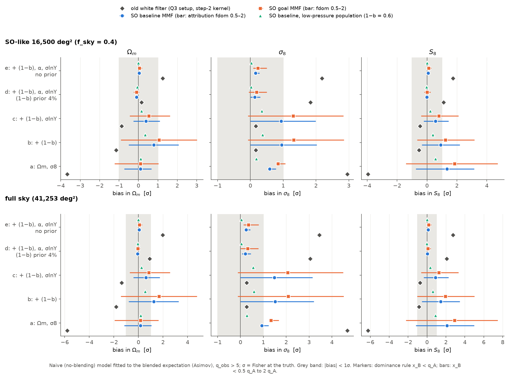
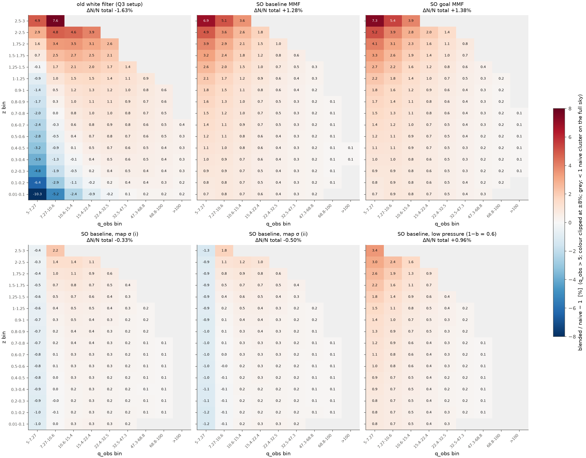
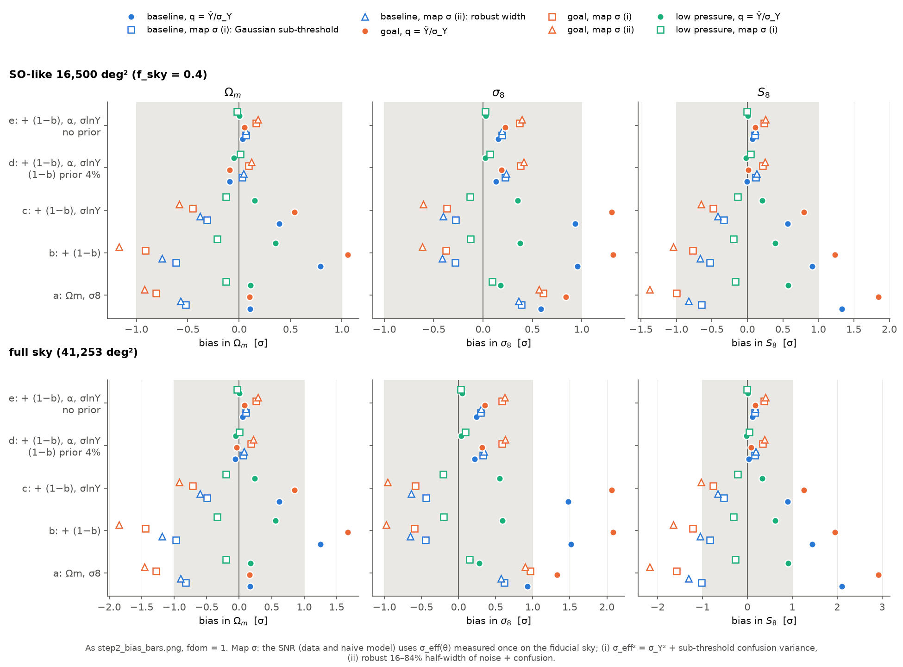

# Realistic SO LAT setup, step 2: cosmology bias from ignoring blending

**Status: final, 2026-11-12. Built, checked twice independently, then arbitrated.**
- **Catalogue check** (`verify_real/step2_catalogue/`): 11 fresh full skies, direct per-object neighbour sums, its own count model and fitter. It imports nothing from the build.
- **Map check** (`verify_real/step2_maps/`): 500 fresh painted 10°×10° patches through the build's MMF, and 200 Poisson realisations of the data.
- **Arbiter** (`a01`–`a07` in this folder): targeted tests of the one claim marked "partially" (C5) and of every issue the two checks raised.
- Section 0 lists what the arbitration changed. Section 11 gives every claim with its evidence and who verified it. Section 12 lists what is still open.

**Question.** A cluster-count analysis of SO uses the realistic six-channel matched filter (MMF) of step 1 and ignores blending. How far off are Ωm, σ8 and S8? How does that depend on what the analyst does? Does the ~1σ S8 bias of the old idealised setup (Q3, REPORT.md sec. 6) survive?

- Scripts and logs: this folder. Build: `p01`–`p10` and `s2lib.py`. Arbiter: `a01`–`a07`. Data: `data_real/step2/`. Figures: `figures/realistic/step2_*.png`.
- Every number below is printed in a log next to its script, or in a verifier's log (named where used).

## The answer in short

- **Fit the scaling relation, and the ~1σ S8 bias of Q3 is gone (config d).**
  - Config d fits Ωm and σ8 plus the Y–M relation: its normalisation (1−b) with a 4% prior, its slope α and its scatter σlnY.
  - Ignoring blending then biases S8 by −0.01σ (SO baseline) and +0.01σ (SO goal) for an SO-like survey (f_sky = 0.4, "SO40"). On the full sky: +0.04σ and +0.08σ.
  - The same code on the old setup gives +1.11σ (SO40) and +2.07σ (full sky), as Q3 did.
  - Both checks reproduce this (catalogue: −0.02 / +0.00σ; maps: +0.01 / +0.02σ at SO40).
- **Fix the scaling relation, and a bias of the opposite sign appears (config a).**
  - Config a (only Ωm and σ8 free): S8 +1.33σ (baseline) and +1.85σ (goal) at SO40; +2.11σ and +2.92σ on the full sky. Q3 had −3.97σ and −6.27σ.
  - Partly free relations sit in between: config b +0.91σ / +1.23σ, config c +0.57σ / +0.80σ (SO40, baseline / goal).
- **What the analyst does moves config a a lot and config d a little.**
  - *Attribution rule* (how a blended peak is assigned to a cluster, fdom = 0.5–2): config a −0.75σ to +3.15σ (baseline), −1.41σ to +4.72σ (goal), SO40.
  - *Noise level measured on the map* instead of the noise-only σ_Y: the sign of config a flips. A robust or clipped width gives −0.3σ to −1.4σ (SO40). The plain standard deviation of the filtered map gives −2.86σ (baseline) and −4.36σ (goal).
  - *Config d over every choice computed* (3 attribution rules × 4 noise normalisations, both instruments): −0.19σ to +0.61σ at SO40 and −0.14σ to +0.89σ on the full sky. The largest values come from the plain standard deviation combined with the strict rule fdom = 0.5 (SO goal). No choice brings config d back to Q3's +1.1σ at SO40. On the full sky the worst choice gives +0.89σ (config e +0.96σ), against +2.07σ for the old filter.
- **A fit would rarely notice.** With σ_Y, the power of a goodness-of-fit test in configs b–e is at most 0.07 (SO40) and 0.12 (full sky); 0.05 means no power. Over every analyst choice computed it reaches 0.15 at SO40 (0.10 in configs d and e) and 0.43 on the full sky.
- **Correcting once works.** A blending correction computed at the fiducial cosmology (r02's fixed-correction model) leaves ≤ 0.17σ in S8 when the true S8 is 0.75 or 0.87. Ignoring blending there gives up to 2.79σ.
- **A fainter tSZ sky (as SPT measures) halves the config-a bias** (+0.57σ SO40, +0.91σ full) and leaves config d at ≤ 0.03σ.
- **Poisson noise does not change this** (map check, 200 realisations, SO40, baseline, fdom 1): the mean S8 shift from blending is +1.334 ± 0.007σ (config a) and −0.001 ± 0.004σ (config d), equal to the Asimov values.

*Bias in Ωm, σ8, S8 for each fit configuration, q_obs > 5. Grey: |bias| < 1σ. Diamonds: old white filter (Q3 setup). Circles and squares: SO baseline and goal MMF with the default attribution rule; the bars span the rules fdom = 0.5–2. Triangles: low-pressure population.*

## 0. What the arbitration changed

| # | claim or issue | raised by | arbiter test | result | who was right |
|---|---|---|---|---|---|
| 1 | C5, configs b and c (SO40): on the maps, config c is 0.14σ (baseline) and 0.28σ (goal) higher. The build's own kernel evaluated on the map's primaries leaves +0.25 ± 0.11σ for goal config c (2.2σ) | maps ("partially") | a01: per-patch breakdown of the map check's stored arrays. a02: the blended detection kernel measured directly on 60 fresh painted patches at 2.4 million random points per θ node (19 nodes, 0.29–4.7′), then put through the build's count model | a01: the offset comes only from z ≥ 1.5 (+0.25 ± 0.09σ). Its per-patch distribution is skewed (+0.8). A 10-group jackknife gives ±0.14σ (1.7σ). It is the largest of 60 correlated comparisons. a02: map kernel = P(D) kernel within 0.7×10⁻⁴ at every node. Implied shift of goal config c: −0.001 ± 0.009σ (SO40), −0.001 ± 0.014σ (full sky) | build and catalogue check. The map check's offset is a statistical fluctuation of its primaries |
| 2 | C7, C10: config-e upper ends maybe 0.1–0.15σ low; an excess at z = 1.5–3 and θ500 = 0.5–1′ | maps | a02 | config-e shift 0.000 ± 0.003σ (SO40). Count shift −0.010 ± 0.025% (z = 1.5–2) and −0.011 ± 0.034% (z = 2–3) of N, against the maps' +0.48 ± 0.27% and +1.39 ± 0.70% | build |
| 3 | C27: σ(S8) of configs c and e uncertain by ±5%, because colossus rounds Δ_m to an integer in Tinker08 | catalogue | a03: the count model with colossus called directly at each (Ωm, σ8); Tinker08 with and without the rounding; Ωm steps 0.001–0.0125 | Without rounding, σ(S8) does not depend on the step (≤ 0.2%) and is 0.7–0.9% below the build's (MMF; 1.2% for the old filter). The MMF linearised biases change by ≤ 0.003σ. With rounding, direct derivatives scatter by up to 7.5% with the step: that was the ±5% | build, to ≤ 1.2% |
| 4 | C10: the map-sigma conclusion depends on the noise estimator. A plain standard deviation gives config a −2.8 / −4.3σ | maps | a04: new variant (iii), σ_eff = plain standard deviation = √(σ_Y² + all-halo variance), through the build's kernel route. a04b: every attribution rule × variants (i) and (iii) | (iii): config a −2.86 / −4.36σ, config d +0.27 / +0.48σ (SO40; the map check, linearised: −2.76 / −4.26σ and +0.27 / +0.48σ). Corners (a04b, `a06_final_tables.log`): over all 20 MMF analyst setups, config d spans −0.19σ to +0.61σ (SO40) and −0.14σ to +0.89σ (full sky). The worst corner is goal, fdom 0.5, plain std: config d +0.61 / +0.89σ, config e +0.60 / +0.96σ, config a −6.23 / −9.86σ | map check. Now in the headline |
| 5 | Caveat "Asimov fits only" | build | – (map check w05/w06) | 200 Poisson realisations, SO40, baseline, fdom 1: mean S8 bias +1.37 ± 0.07σ (a) and +0.05 ± 0.08σ (d; the same +0.05 without blending). Paired blended − unblended: +1.334 ± 0.007σ and −0.001 ± 0.004σ. Scatter / Fisher σ = 0.93 and 1.06 | caveat narrowed |
| 6 | C23–C25 were checked by neither verifier | – | a05 | (1) the stored kernels equal step 1's node tables to ≤ 1.3×10⁻⁷. (2) Refining the kernel to 95 θ nodes (cubic midpoints) changes Δ by ≤ 0.0006 Poisson σ per bin (MMF) and 0.003 (old filter). (3) Step-1 and step-2 count changes agree to ≤ 0.0017 pp (MMF) and 0.0036 pp (old filter) | build |
| 7 | Open per-redshift offsets: step 1's direct counts 0.1–0.5 pp low at z = 2–3; the catalogue check 0.07–0.10 pp high at z = 1–1.5 | catalogue, step 1 | a02 (kernel at the θ nodes of these clusters), a05 (4) (bias sensitivity) | a02 finds no kernel offset there. If real, a −0.3 pp change at z = 2–3 would move S8 by ≤ 0.05σ (config c, goal, full sky) and config d by ≤ 0.014σ. A +0.1 pp change at z = 1–1.5 would move it by ≤ 0.043σ (config e) and config d by ≤ 0.031σ | open but harmless (section 12) |

- Numbers that changed: none of the build's published biases or counts. Added: variant (iii) and the fdom × noise-level corners (a04, a04b), the Poisson-realisation result, and the precision of σ(S8) in configs c and e.
- Everything else in both checks was confirmed.

## Terms

- **Blending.** The filtered signal at cluster A also contains the signal of all other halos ("neighbours"), weighted by the filter's response ρ to them.
- **q_A.** The true signal-to-noise of A: its Y500 over the filter noise σ_Y. q_obs is what the survey measures.
- **P(D).** The probability distribution of the summed neighbour signal at A (compound Poisson), from step 1's code.
- **Attribution (dominance) rule.** A blended peak is counted as cluster A only if no single neighbour adds more than fdom × q_A to A's signal. fdom = 1 is the default. 0.5 and 2 bracket plausible peak finders (step-1 RESULTS, table F).
- **Kernel.** K(θ_A, q_A; e) = probability that A is dominant and q_obs > e, for a cluster of size θ_A = θ500.
- **Naive model.** The standard count model without blending: q_obs = q + unit Gaussian noise, with lognormal Y scatter.
- **Asimov data.** The exact expected counts, without Poisson noise. Fitting them gives the bias directly.
- **Bias in σ.** (best fit − truth) / Fisher error at the truth. 1σ is the statistical error of the survey.
- **Fit configurations.** a: Ωm, σ8. b: + (1−b). c: + (1−b), σlnY. d: + (1−b), α, σlnY with a 4% Gaussian prior on (1−b) (d3, d5: 3%, 5%). e: as d without a prior. Everything else is fixed at the truth.
- **Surveys.** SO40 (SO-like, f_sky = 0.4, 16,500 deg²) and full sky. Bins: 16 in z (0.01–3) × 9 in q_obs from q_cut = 5 (or 6) to ∞.
- **Noise normalisation.** What the SNR is divided by. Default: σ_Y, the noise-only filter noise (as if the noise were known from signal-free maps). The "map-sigma" variants use a level measured once on the data map, σ_eff(θ) = r(θ) σ_Y, in both the data (q_obs = Ŷ/σ_eff) and the naive model (q = Y/σ_eff, unit noise):
  - (i) σ_eff² = σ_Y² + variance of the sub-threshold confusion (halos whose own q < 5); r = 1.009–1.069 (baseline). Close to a 3σ-clipped standard deviation of the map (map check w03: 0.3–1.0% lower).
  - (ii) robust (16–84%) half-width of noise plus all-halo confusion; r = 1.018–1.077 (baseline).
  - (iii) plain standard deviation of the filtered map, σ_eff² = σ_Y² + all-halo variance; r = 1.042–1.190 (baseline), 1.059–1.263 (goal). Added by the arbiter (a04).
- **Low-pressure population.** (1−b) = 0.6 instead of 0.8 for every halo (neighbours and primaries); every Y500 is 0.75^1.79 = 0.598 times smaller. Its fit truth and prior centre are (1−b) = 0.6 ± 0.024.
- **Power.** Probability that a 95% goodness-of-fit test flags the misfit. 0.05 means no power.
- **Verified by.** "both" = confirmed by the catalogue check and the map check; "catalogue" or "maps" = by one of them; "arbiter" = by a targeted arbiter test (a01–a07); "unresolved" = open (section 12).

## Headline numbers and who verified them

S8 bias in Fisher σ, q_obs > 5, default attribution rule (fdom = 1), SNR normalised by σ_Y unless stated.

| quantity | SO baseline | SO goal | verified by |
|---|---|---|---|
| config d, SO40 | −0.01 | +0.01 | both (catalogue −0.02 ± 0.01 / +0.00 ± 0.02; maps +0.01 ± 0.05 / +0.02 ± 0.06) |
| config d, full sky | +0.04 | +0.08 | both (catalogue +0.02 / +0.07 ± 0.03; maps +0.12 ± 0.09 / +0.20 ± 0.11) |
| config a, SO40 | +1.33 | +1.85 | both (catalogue +1.31 / +1.84; maps +1.39 / +1.90 ± 0.10) |
| config a, full sky | +2.11 | +2.92 | both (catalogue +2.07 / +2.91; maps +2.20 / +3.00) |
| config b / c, SO40 | +0.91 / +0.57 | +1.23 / +0.80 | catalogue (+0.94 / +0.58; +1.27 / +0.83) + arbiter (a02: map kernel shift −0.001 ± 0.009σ in goal c); maps' higher c values were a fluctuation |
| config e, SO40 / full | +0.07 / +0.12 | +0.11 / +0.17 | catalogue + arbiter (a02); maps 0.1–0.25σ higher, a fluctuation |
| old white filter, config d, SO40 / full (Q3: +1.11 / +2.08) | +1.11 / +2.07 | – | both |
| old white filter, config a, SO40 / full (Q3: −3.97 / −6.27) | −3.95 / −6.24 | – | both |
| attribution fdom 0.5–2, config a, SO40 | −0.75 to +3.15 | −1.41 to +4.72 | both |
| attribution fdom 0.5–2, configs d and e, SO40 / full | −0.13 to +0.14 / −0.08 to +0.22 | −0.19 to +0.29 / −0.14 to +0.46 | both |
| map sigma (i) / (ii), config a, SO40 | −0.64 / −0.83 | −1.00 / −1.38 | both |
| map sigma (i) / (ii), configs d–e, SO40 / full | +0.11 to +0.13 / +0.17 to +0.19 | +0.22 to +0.26 / +0.34 to +0.41 | both |
| map sigma (iii) plain std, config a, SO40 / full | −2.86 / −4.52 | −4.36 / −6.89 | arbiter (a04) + maps (ML on its maps: −2.79 / −4.40; −4.31 / −6.81) |
| map sigma (iii) plain std, config d, SO40 / full | +0.27 / +0.36 | +0.48 / +0.69 | arbiter (a04) + maps (ML on its maps: +0.28 / +0.42; +0.51 / +0.83) |
| config d, every analyst choice computed (fdom 0.5, 1, 2 × σ_Y, (i), (ii), (iii)), SO40 / full | −0.13 to +0.35 / −0.08 to +0.46 | −0.19 to +0.61 / −0.14 to +0.89 | arbiter (a04b, a06). The σ_Y rows and the fdom-1 rows (i), (ii) are also confirmed by both checks; the fdom-1 row (iii) by the map check |
| config e, same, SO40 / full | +0.06 to +0.26 / +0.09 to +0.41 | +0.03 to +0.60 / +0.05 to +0.96 | same |
| config a, same, SO40 | −4.21 to +3.15 | −6.23 to +4.72 | same |
| q_cut 6, config a, SO40 | +0.98 | +1.40 | both |
| low pressure, config a, SO40 / full | +0.57 / +0.91 | – | both |
| fixed correction, residual S8 at truths S8 = 0.75, 0.87 (config a / b–e) | ≤ 0.17 / ≤ 0.08 | – | catalogue |
| Poisson realisations (200), SO40: mean shift from blending, config a / d | +1.334 ± 0.007 / −0.001 ± 0.004 | – | maps (w06) |

## Headline tables

Bias in σ, written S8 / Ωm / σ8, q_cut = 5, Asimov fit of the naive model to the blended expectation (`p09_tables.log`, from `p06_fits.log`). Verified by both checks (section 11), except the plain-std rows in the analyst table below.

**SO-like survey, f_sky = 0.4**

| setup | a: Om, s8 | b: + (1-b) | c: + (1-b), slnY | d: + (1-b) 4% prior, alpha, slnY | e: as d, no prior |
|---|---|---|---|---|---|
| Q3 data vector (c11), Q3 code | -4.0 / -3.7 / +3.0 | -0.5 / -1.2 / +0.2 | -0.5 / -0.9 / +0.2 | +1.1 / +0.2 / +1.8 | +1.7 / +1.3 / +2.2 |
| old white filter (step-2 kernel) | -3.9 / -3.7 / +3.0 | -0.5 / -1.1 / +0.2 | -0.5 / -0.9 / +0.2 | +1.1 / +0.2 / +1.8 | +1.7 / +1.3 / +2.2 |
| old white filter, pre-fix b03 rates | -4.0 / -3.7 / +3.0 | -0.5 / -1.2 / +0.2 | -0.5 / -0.9 / +0.2 | +1.1 / +0.2 / +1.8 | +1.7 / +1.3 / +2.2 |
| SO baseline, fdom 1 | +1.3 / +0.1 / +0.6 | +0.9 / +0.8 / +1.0 | +0.6 / +0.4 / +0.9 | -0.0 / -0.1 / +0.1 | +0.1 / +0.0 / +0.2 |
| SO baseline, fdom 0.5 | -0.7 / -0.7 / +0.6 | -0.3 / -0.5 / -0.0 | -0.2 / -0.3 / -0.0 | +0.1 / -0.0 / +0.3 | +0.1 / +0.1 / +0.3 |
| SO baseline, fdom 2 | +3.1 / +0.7 / +0.8 | +2.2 / +2.1 / +2.0 | +1.4 / +1.1 / +2.0 | -0.1 / -0.2 / +0.0 | +0.1 / +0.0 / +0.1 |
| SO goal, fdom 1 | +1.8 / +0.1 / +0.8 | +1.2 / +1.1 / +1.3 | +0.8 / +0.5 / +1.3 | +0.0 / -0.1 / +0.2 | +0.1 / +0.1 / +0.2 |
| SO goal, fdom 0.5 | -1.4 / -1.2 / +1.0 | -0.7 / -0.9 / -0.1 | -0.4 / -0.4 / -0.1 | +0.2 / +0.0 / +0.5 | +0.3 / +0.2 / +0.5 |
| SO goal, fdom 2 | +4.7 / +1.0 / +1.1 | +3.2 / +3.0 / +2.9 | +2.1 / +1.6 / +2.8 | -0.2 / -0.2 / -0.0 | +0.0 / +0.0 / +0.1 |
| SO baseline, map-sigma (i) | -0.6 / -0.5 / +0.4 | -0.5 / -0.6 / -0.3 | -0.3 / -0.3 / -0.3 | +0.1 / +0.0 / +0.2 | +0.1 / +0.1 / +0.2 |
| SO baseline, map-sigma (ii) | -0.8 / -0.6 / +0.4 | -0.7 / -0.7 / -0.4 | -0.4 / -0.4 / -0.4 | +0.1 / +0.0 / +0.2 | +0.1 / +0.1 / +0.2 |
| SO goal, map-sigma (i) | -1.0 / -0.8 / +0.6 | -0.8 / -0.9 / -0.4 | -0.5 / -0.5 / -0.4 | +0.2 / +0.1 / +0.4 | +0.2 / +0.2 / +0.4 |
| SO goal, map-sigma (ii) | -1.4 / -0.9 / +0.6 | -1.0 / -1.2 / -0.6 | -0.7 / -0.6 / -0.6 | +0.2 / +0.1 / +0.4 | +0.3 / +0.2 / +0.4 |
| low pressure (1-b)=0.6, baseline | +0.6 / +0.1 / +0.2 | +0.4 / +0.4 / +0.4 | +0.2 / +0.2 / +0.3 | -0.0 / -0.1 / +0.0 | +0.0 / +0.0 / +0.0 |
| low pressure, baseline, map-sigma (i) | -0.2 / -0.1 / +0.1 | -0.2 / -0.2 / -0.1 | -0.1 / -0.1 / -0.1 | +0.0 / +0.0 / +0.1 | -0.0 / -0.0 / +0.0 |

**Full sky**

| setup | a: Om, s8 | b: + (1-b) | c: + (1-b), slnY | d: + (1-b) 4% prior, alpha, slnY | e: as d, no prior |
|---|---|---|---|---|---|
| Q3 data vector (c11), Q3 code | -6.3 / -5.8 / +4.7 | -0.8 / -1.8 / +0.3 | -0.7 / -1.4 / +0.3 | +2.1 / +0.9 / +3.1 | +2.7 / +2.0 / +3.5 |
| old white filter (step-2 kernel) | -6.2 / -5.8 / +4.7 | -0.8 / -1.8 / +0.3 | -0.7 / -1.4 / +0.3 | +2.1 / +0.9 / +3.1 | +2.7 / +2.0 / +3.4 |
| old white filter, pre-fix b03 rates | -6.3 / -5.8 / +4.7 | -0.8 / -1.8 / +0.3 | -0.7 / -1.4 / +0.3 | +2.1 / +0.9 / +3.1 | +2.7 / +2.0 / +3.5 |
| SO baseline, fdom 1 | +2.1 / +0.2 / +0.9 | +1.4 / +1.3 / +1.5 | +0.9 / +0.6 / +1.5 | +0.0 / -0.1 / +0.2 | +0.1 / +0.1 / +0.2 |
| SO baseline, fdom 0.5 | -1.2 / -1.2 / +1.0 | -0.5 / -0.8 / -0.0 | -0.3 / -0.4 / -0.0 | +0.2 / +0.0 / +0.4 | +0.2 / +0.1 / +0.4 |
| SO baseline, fdom 2 | +5.0 / +1.1 / +1.2 | +3.5 / +3.3 / +3.2 | +2.3 / +1.7 / +3.1 | -0.1 / -0.2 / +0.1 | +0.1 / +0.1 / +0.2 |
| SO goal, fdom 1 | +2.9 / +0.2 / +1.3 | +2.0 / +1.7 / +2.1 | +1.3 / +0.9 / +2.1 | +0.1 / -0.0 / +0.3 | +0.2 / +0.1 / +0.4 |
| SO goal, fdom 0.5 | -2.2 / -1.9 / +1.5 | -1.0 / -1.4 / -0.1 | -0.6 / -0.7 / -0.1 | +0.4 / +0.2 / +0.8 | +0.5 / +0.3 / +0.8 |
| SO goal, fdom 2 | +7.5 / +1.6 / +1.7 | +5.0 / +4.8 / +4.5 | +3.3 / +2.6 / +4.5 | -0.1 / -0.2 / +0.0 | +0.0 / +0.0 / +0.1 |
| SO baseline, map-sigma (i) | -1.0 / -0.8 / +0.6 | -0.8 / -1.0 / -0.4 | -0.5 / -0.5 / -0.4 | +0.2 / +0.1 / +0.3 | +0.2 / +0.1 / +0.3 |
| SO baseline, map-sigma (ii) | -1.3 / -0.9 / +0.6 | -1.1 / -1.2 / -0.6 | -0.7 / -0.6 / -0.6 | +0.2 / +0.1 / +0.3 | +0.2 / +0.1 / +0.3 |
| SO goal, map-sigma (i) | -1.6 / -1.3 / +1.0 | -1.2 / -1.4 / -0.6 | -0.8 / -0.7 / -0.6 | +0.3 / +0.2 / +0.6 | +0.4 / +0.3 / +0.6 |
| SO goal, map-sigma (ii) | -2.2 / -1.5 / +0.9 | -1.6 / -1.9 / -1.0 | -1.0 / -0.9 / -1.0 | +0.4 / +0.2 / +0.6 | +0.4 / +0.3 / +0.6 |
| low pressure (1-b)=0.6, baseline | +0.9 / +0.2 / +0.3 | +0.6 / +0.6 / +0.6 | +0.3 / +0.2 / +0.6 | -0.0 / -0.1 / +0.0 | +0.0 / +0.0 / +0.0 |
| low pressure, baseline, map-sigma (i) | -0.3 / -0.2 / +0.1 | -0.3 / -0.3 / -0.2 | -0.2 / -0.2 / -0.2 | +0.0 / +0.0 / +0.1 | -0.0 / -0.0 / +0.0 |

- Rows "Q3 data vector" and "old white filter" are the regression to Q3 (section 5). "pre-fix b03 rates" feeds Q3's own neighbour rates through the step-2 code.
- Configs d3 and d5 (3% and 5% priors) agree with d to ≤ 0.09σ in S8 for every MMF setup, survey and cut (`p09_tables.log`, summary numbers; appendix A).
- q_cut = 6 and every configuration: section 6 and appendix A.

### What the analyst does: every attribution rule × noise normalisation computed

S8 bias in σ, q_cut = 5, SO40 | full sky (`a06_final_tables.log`; build fits from `p06_fits.log`, arbiter fits from `a04_mapsigma_plainstd.log` and `a04b_mapsigma_fdom.log`). Verified by: both checks for the σ_Y and (i), (ii) rows at fdom 1 and the σ_Y rows at fdom 0.5 and 2; arbiter + maps for (iii) at fdom 1; arbiter only for the other (i) and (iii) rows.

| instrument | attribution rule | SNR normalised by | a | d | e |
|---|---|---|---|---|---|
| SO baseline | fdom 0.5 | sigma_Y (no confusion) | -0.75 \| -1.18 | +0.11 \| +0.18 | +0.14 \| +0.22 |
| SO baseline | fdom 0.5 | map sigma (i): sigma_Y (+) sub-threshold confusion | -2.39 \| -3.79 | +0.22 \| +0.30 | +0.18 \| +0.28 |
| SO baseline | fdom 0.5 | map sigma (iii): plain std | -4.21 \| -6.65 | +0.35 \| +0.46 | +0.26 \| +0.41 |
| SO baseline | fdom 1 | sigma_Y (no confusion) | +1.33 \| +2.11 | -0.01 \| +0.04 | +0.07 \| +0.12 |
| SO baseline | fdom 1 | map sigma (i): sigma_Y (+) sub-threshold confusion | -0.64 \| -1.02 | +0.12 \| +0.17 | +0.11 \| +0.17 |
| SO baseline | fdom 1 | map sigma (ii): robust width | -0.83 \| -1.31 | +0.13 \| +0.19 | +0.11 \| +0.18 |
| SO baseline | fdom 1 | map sigma (iii): plain std | -2.86 \| -4.52 | +0.27 \| +0.36 | +0.20 \| +0.31 |
| SO baseline | fdom 2 | sigma_Y (no confusion) | +3.15 \| +4.98 | -0.13 \| -0.08 | +0.06 \| +0.09 |
| SO baseline | fdom 2 | map sigma (i): sigma_Y (+) sub-threshold confusion | +0.88 \| +1.39 | +0.01 \| +0.06 | +0.09 \| +0.14 |
| SO baseline | fdom 2 | map sigma (iii): plain std | -1.69 \| -2.67 | +0.18 \| +0.26 | +0.18 \| +0.29 |
| SO goal | fdom 0.5 | sigma_Y (no confusion) | -1.41 \| -2.23 | +0.23 \| +0.39 | +0.29 \| +0.46 |
| SO goal | fdom 0.5 | map sigma (i): sigma_Y (+) sub-threshold confusion | -3.66 \| -5.79 | +0.40 \| +0.61 | +0.41 \| +0.65 |
| SO goal | fdom 0.5 | map sigma (iii): plain std | -6.23 \| -9.86 | +0.61 \| +0.89 | +0.60 \| +0.96 |
| SO goal | fdom 1 | sigma_Y (no confusion) | +1.85 \| +2.92 | +0.01 \| +0.08 | +0.11 \| +0.17 |
| SO goal | fdom 1 | map sigma (i): sigma_Y (+) sub-threshold confusion | -1.00 \| -1.58 | +0.22 \| +0.34 | +0.24 \| +0.38 |
| SO goal | fdom 1 | map sigma (ii): robust width | -1.38 \| -2.17 | +0.25 \| +0.38 | +0.26 \| +0.41 |
| SO goal | fdom 1 | map sigma (iii): plain std | -4.36 \| -6.89 | +0.48 \| +0.69 | +0.46 \| +0.73 |
| SO goal | fdom 2 | sigma_Y (no confusion) | +4.72 \| +7.47 | -0.19 \| -0.14 | +0.03 \| +0.05 |
| SO goal | fdom 2 | map sigma (i): sigma_Y (+) sub-threshold confusion | +1.35 \| +2.13 | +0.04 \| +0.14 | +0.16 \| +0.25 |
| SO goal | fdom 2 | map sigma (iii): plain std | -2.71 \| -4.29 | +0.34 \| +0.54 | +0.40 \| +0.63 |

Envelope over all MMF setups computed (S8 bias, lowest to highest; `a06_final_tables.log` (3)). Setup names: instrument, attribution rule, noise normalisation (no suffix = σ_Y; effi, effiii = map sigma (i), (iii)).

- config a SO40 q>5: S8 bias -6.23 (goal_f0.5_effiii) to +4.72 (goal_f2) over 20 setups; max goodness-of-fit power 0.376
- config a full q>5: S8 bias -9.86 (goal_f0.5_effiii) to +7.47 (goal_f2) over 20 setups; max goodness-of-fit power 0.909
- config b SO40 q>5: S8 bias -4.17 (goal_f0.5_effiii) to +3.17 (goal_f2) over 20 setups; max goodness-of-fit power 0.153
- config b full q>5: S8 bias -6.59 (goal_f0.5_effiii) to +5.01 (goal_f2) over 20 setups; max goodness-of-fit power 0.427
- config c SO40 q>5: S8 bias -2.49 (goal_f0.5_effiii) to +2.11 (goal_f2) over 20 setups; max goodness-of-fit power 0.153
- config c full q>5: S8 bias -3.94 (goal_f0.5_effiii) to +3.34 (goal_f2) over 20 setups; max goodness-of-fit power 0.426
- config d SO40 q>5: S8 bias -0.19 (goal_f2) to +0.61 (goal_f0.5_effiii) over 20 setups; max goodness-of-fit power 0.104
- config d full q>5: S8 bias -0.14 (goal_f2) to +0.89 (goal_f0.5_effiii) over 20 setups; max goodness-of-fit power 0.234
- config e SO40 q>5: S8 bias +0.03 (goal_f2) to +0.60 (goal_f0.5_effiii) over 20 setups; max goodness-of-fit power 0.103
- config e full q>5: S8 bias +0.05 (goal_f2) to +0.96 (goal_f0.5_effiii) over 20 setups; max goodness-of-fit power 0.233
- configs d, d3, d5, e (q>5): largest |S8 bias| 0.96; fits with a parameter at a bound: 0 of 160

## 1. What was computed

1. **Kernels** (`p01`, `p02`, `p03`). For each θ_A node, K(θ_A, q_A; e) for the 19 bin edges e of `data_cosmo/kernel_catalogue.npz`.
   - Step 1's signed P(D) (`pdlib1`): convention c = 1 (q_b = q_A + n + δ − μ), neighbours M500 > 10¹³ at the fiducial, the attribution rule above.
   - Rates: the stored s09 rate histograms (48 θ_A nodes, 0.1–139′, for the MMF; 40 nodes, 0.25–80′, for the old filter).
   - q_A grid: c03's 1065 nodes (step 0.05 up to 30, then 466 log-spaced to 3000).
   - The unit noise and the variance beyond the kernel support (Parseval minus histogram, set to 0 outside 0.25–80′ as fixed by the step-1 arbiter; it is 0 at every node here) are added inside the FFT.
   - Map-sigma kernels: K′(θ, q′; e) = P(dominant at q_A = r q′, q_A + n + δ − μ > r e), tabulated on q′ = Y/σ_eff.
   - Low-pressure kernels: the fiducial rates with every contribution x → 0.598 x (exact, because ρ and σ_Y do not change).
2. **Naive MMF model** (`s2lib.SmoothModelS`, checks in `p04`). cosmolib2's converged count model with σ_Y(θ500) replaced by step 1's MMF σ_Y (or σ_eff).
3. **Truth data vectors** (`p05`). Δ(z, q) = N_b − N_n exactly as c11: the blended and the naive kernels are interpolated the same way, so interpolation errors cancel. Data = μ_naive(truth) + Δ.
4. **Fits** (`p06`). As c12_fits_v2 (Fisher scoring plus bounded L-BFGS-B polish), configs a, b, c, d, d3, d5, e; SO40 and full sky; q_cut 5 and 6; the blended data ('cat') and the naive model's own expectation ('self'). 690 fits.
5. **Fixed correction** (`p02`, `p03`, `p05`, `p07`). P(D) recomputed for truths S8 = 0.75 and 0.87 at fixed Ωm = 0.3111 (σ8 = 0.7365 and 0.8543; neighbours and primaries change, ρ tables do not), baseline, fdom = 1.
6. **Low-pressure population** (`p01`, `p03`, `p05`, `p06`). Its tSZ power by step 1's method (s10 part B), then the same kernels, data and fits.
7. **Arbiter additions** (`a02`–`a04b`).
   - The kernel measured directly on 60 fresh painted patches at random points, compared with the P(D) kernel and put through the same count model (`a02`, `a02b`, `a02c`).
   - σ(S8) and the linearised biases with colossus called directly, with and without its rounding of Δ_m (`a03`).
   - Map-sigma variant (iii), the plain standard deviation, and the corners attribution rule × noise level: kernels, data vectors and 184 fits as above (`a04`, `a04b`).

## 2. Blended detection kernels

Setups and their kernels (`p03_kernels.log`):

| setup | rates | θ_A nodes | attribution | normalisation |
|---|---|---|---|---|
| old white filter | s09 white (fixed ρ kernel) | 40, 0.25–80′ | fdom 1 | σ_Y |
| old white filter, pre-fix | b03 `data/blending/analytic.npz` (as c03) | 40 | fdom 1 | σ_Y |
| SO baseline / goal | s09 baseline / goal | 48, 0.1–139′ | fdom 1, 0.5, 2 | σ_Y |
| SO baseline / goal, map-sigma (i), (ii) | s09 | 48 | fdom 1 | σ_eff |
| low pressure, baseline | s09 baseline × 0.598 | 48 | fdom 1 | σ_Y and σ_eff (i) |
| truths S8 = 0.75, 0.87, baseline | new (p02) | 48 | fdom 1 | σ_Y |
| SO baseline / goal, map-sigma (iii) plain std (arbiter, `a04`) | s09 | 48 | fdom 1 | σ_eff |
| SO baseline / goal, fdom 0.5 and 2 × map-sigma (i), (iii) (arbiter, `a04b`) | s09 | 48 | fdom 0.5, 2 | σ_eff |

**Checks**
- **Against step 1's own per-node selection tables** (`p03_kernels_checks.log` (1)). At s09's q nodes and q_cut = 4–7, the step-2 kernel equals s09's stored P(dominant and q_obs > q_cut) to ≤ 1.8×10⁻⁸ (relative ≤ 8×10⁻⁷), for baseline (fdom 0.5, 1, 2), goal and the old filter.
- **Against c03's kernel** (`p03_kernels_checks.log` (2)). With the same pre-fix rates, |K − K_c03| ≤ 5.1×10⁻⁵. This is c03's coarser FFT (N = 2¹⁶, dd = 0.01).
- **Monotonic.** K never decreases with q_A and never increases with e (by more than 2×10⁻¹³).
- **q_A grid converged** (`p05_truth.log` (B)). Production vs a 2× finer grid (2130 nodes): Δ changes by ≤ 0.0003 Poisson σ per bin (full sky) and by 0.14 counts in total. Half the grid: ≤ 0.005σ.
- **θ grid converged** (`p05_truth.log` (C)). Every other node (24 instead of 48) changes Δ by ≤ 0.004σ per bin; the error of the full grid is about 4 times smaller. Old filter (20 vs 40 nodes): ≤ 0.016σ. Arbiter check (`a05_quick_checks.log` (2)): refining the kernel to 95 nodes by cubic interpolation changes Δ by ≤ 0.0006σ per bin (MMF) and ≤ 0.003σ (old filter).
- **Map-sigma ratios** (`p01_inputs.log`). r_i reproduces step 1's sub-threshold variances exactly (Parseval at s05's nodes: identical to `confusion_var.npz`). r_ii reproduces step 1's robust widths (table D) to ≤ 7×10⁻⁶ at the nodes inside 0.25–80′; outside, s06b had the spurious extra variance.
- **Against painted maps at random points** (arbiter, `a02_map_kernel_sim_*.log`, `a02b_map_kernel_compare.log`). 60 fresh 10°×10° patches (6,000 deg²) were painted and filtered with the map check's code, and the kernel was measured at 40,000 random points per patch and θ node. In a Poisson sky the neighbours of a halo look like those of a random point, so this measures K directly, with 2.4 million samples per node.
  - 19 nodes θ_A = 0.29–4.7′, both instruments, fdom 1. At e = 5 and q_A = 2–8, K_map − K_build ≤ 0.7×10⁻⁴ in size at every node, each within its error (about 1×10⁻⁴).
  - The variance of the neighbour sum at random points equals the rate-histogram variance to +0.6% to +0.9%, ± 2.2–2.8%.
  - Put through the build's count model, the kernel difference changes the counts by −0.004 ± 0.015% (baseline) and −0.006 ± 0.015% (goal) of N, and every S8 bias by at most 0.014 ± 0.040σ (all configs, both surveys and cuts).
- **Rates for the off-fiducial truths** (`p02_rates_truths.log`). The abundance factor f_T08(sσ)/f_T08(σ) equals direct colossus mass functions at the new σ8 to 4×10⁻¹⁴. The rate code reproduces s09's stored fiducial rates to ≤ 5×10⁻¹². Histogram variance = Parseval to ≤ 7.5×10⁻⁴.

## 3. Naive model with the MMF

`p04_naive_model.log`:

| model | q > 5 (full sky) | reference | difference |
|---|---|---|---|
| old white filter (`SmoothModelS` with SZModel σ_Y) | 85,906.6 | cosmolib2 N0 85,906.6 | 0 (identical per bin) |
| same | 85,906.6 | expected_detections 85,912.3 | −6.6×10⁻⁵ |
| SO baseline MMF | 81,703.9 | expected_detections 81,704.5 | −7.5×10⁻⁶ |
| SO goal MMF | 128,165.7 | expected_detections 128,166.7 | −7.7×10⁻⁶ |
| low pressure, baseline | 29,844.1 | MMFModel(one_minus_b = 0.6).expected_detections 29,844.3 | −5.6×10⁻⁶ |

- **No range difference.** The cosmology bins cover the same range as expected_detections: z = 0.01–3, M500 = 10¹³–10¹⁶, all q above the cut (the last bin is q > 100).
- **The small difference is the integration.** cosmolib's HMF grid (colossus at 21 × 21 (Ωm, σ8) nodes, splined) and its smooth scatter convolution, against szsim's 1201 × 1201 table and a 48-point Gauss–Hermite scatter. Per z bin it is ≤ 2.7×10⁻⁴, except at z = 0.01–0.1 (+4.2×10⁻³ for baseline, +4.5×10⁻³ for goal; 730 and 940 clusters).
- **q > 6:** baseline 55,656.6 vs 55,657.0; goal 88,809.2 vs 88,809.8.
- **Step 1's s09 grid** gives 81,690.2 (+1.7×10⁻⁴): it drops primaries with q_A < 0.5 and uses a coarser primary grid.
- **Map-sigma models count fewer clusters** at the same cut, because σ_eff > σ_Y: −11.0% (i) and −12.2% (ii) for baseline, −12.8% and −14.7% for goal, −6.7% for the low-pressure (i) model (q > 5). The plain-std variant (iii) counts −25.7% (baseline, 60,716) and −31.9% (goal, 87,341) (`a04_mapsigma_plainstd.log`).

## 4. Truth data vectors: what blending does to the counts

`p05_truth.log`, summarised in `p09_tables.log`. Δ/N at q > 5 by redshift and signal-to-noise:

| setup | N_naive (full sky) | Delta total | z 0.01-0.1 | 0.1-0.5 | 0.5-1 | 1-1.5 | 1.5-2 | 2-3 | q 5-7.3 | q 7.3-10.6 | q > 47 |
|---|---|---|---|---|---|---|---|---|---|---|---|
| old white filter (step-2 kernel) | 85,907 | -1,402 (-1.63%) | -5.27% | -2.34% | -1.01% | +0.13% | +1.51% | +3.48% | -3.01% | -0.83% | +0.40% |
| old white filter, pre-fix b03 rates | 85,907 | -1,413 (-1.65%) | -5.29% | -2.36% | -1.02% | +0.12% | +1.50% | +3.47% | -3.03% | -0.85% | +0.40% |
| SO baseline, fdom 1 | 81,704 | +1,046 (+1.28%) | +0.74% | +0.88% | +1.27% | +1.99% | +3.05% | +4.71% | +1.50% | +1.20% | +0.19% |
| SO baseline, fdom 0.5 | 81,704 | -222 (-0.27%) | -0.77% | -0.49% | -0.25% | +0.07% | +0.50% | +1.09% | -0.60% | +0.04% | +0.14% |
| SO baseline, fdom 2 | 81,704 | +2,258 (+2.76%) | +2.14% | +2.08% | +2.70% | +4.02% | +6.10% | +9.75% | +3.52% | +2.30% | +0.22% |
| SO goal, fdom 1 | 128,166 | +1,768 (+1.38%) | +0.78% | +0.91% | +1.32% | +2.07% | +3.19% | +4.98% | +1.60% | +1.33% | +0.23% |
| SO goal, fdom 0.5 | 128,166 | -635 (-0.50%) | -1.09% | -0.74% | -0.49% | -0.17% | +0.27% | +0.95% | -0.96% | -0.12% | +0.16% |
| SO goal, fdom 2 | 128,166 | +4,075 (+3.18%) | +2.55% | +2.37% | +3.01% | +4.41% | +6.60% | +10.45% | +4.07% | +2.71% | +0.28% |
| SO baseline, map-sigma (i) | 72,688 | -241 (-0.33%) | -0.46% | -0.41% | -0.32% | -0.21% | -0.07% | +0.05% | -0.77% | +0.14% | +0.12% |
| SO baseline, map-sigma (ii) | 71,761 | -358 (-0.50%) | -0.62% | -0.54% | -0.48% | -0.45% | -0.42% | -0.48% | -1.01% | +0.03% | +0.12% |
| SO goal, map-sigma (i) | 111,734 | -464 (-0.41%) | -0.60% | -0.51% | -0.41% | -0.29% | -0.11% | +0.16% | -0.97% | +0.13% | +0.16% |
| SO goal, map-sigma (ii) | 109,283 | -744 (-0.68%) | -0.86% | -0.72% | -0.67% | -0.64% | -0.61% | -0.58% | -1.35% | -0.05% | +0.14% |
| low pressure (1-b)=0.6, baseline | 29,844 | +285 (+0.96%) | +0.71% | +0.74% | +0.98% | +1.45% | +2.11% | +2.91% | +1.12% | +0.83% | +0.10% |
| low pressure, baseline, map-sigma (i) | 27,846 | -41 (-0.15%) | -0.14% | -0.17% | -0.13% | -0.11% | -0.17% | -0.75% | -0.36% | +0.15% | +0.06% |
| S8_0.75_f1 | 36,729 | +366 (+1.00%) | +0.71% | +0.77% | +1.06% | +1.63% | +2.48% | +3.72% | +1.18% | +0.87% | +0.11% |
| S8_0.87_f1 | 122,626 | +1,733 (+1.41%) | +0.66% | +0.88% | +1.34% | +2.14% | +3.30% | +5.16% | +1.63% | +1.38% | +0.24% |

*Blended / naive − 1 in each (z, q_obs) bin, q > 5. Grey: bins with fewer than one naive cluster on the full sky (32 bins holding 7 clusters in total).*

- **SO MMF, default rule: +1.28% (baseline) and +1.38% (goal).** The excess grows towards high redshift (+0.7% → +4.7%) and towards the threshold (+1.5% at q = 5–7, +0.1% at q > 100).
  - Verified: the catalogue check finds +1.283 ± 0.016% and +1.388 ± 0.014% on 11 fresh skies (`vc04_delta.log`); the map check +1.365 ± 0.054% and +1.450 ± 0.047%, against the build's +1.288% and +1.384% for its primaries (`w07_claims.log`). The arbiter's random-point map test puts the true map − kernel difference at −0.004 ± 0.015% and −0.006 ± 0.015% (`a02b_map_kernel_compare.log`).
- **This is step 1's result, recomputed in the cosmology bins.** Restricted to primaries with q_A ≥ 0.5 as in step 1, the totals agree with s09 to ≤ 0.002 pp for every MMF rule (baseline +1.2877% vs +1.2863%) and 0.004 pp for the old filter, and the redshift tilt to ≤ 0.01 pp in every bin (`p05_truth.log` (E)).
- **The attribution rule sets the amplitude.** fdom = 0.5 gives −0.27% (baseline), fdom = 2 gives +2.76%. The rise from z < 0.1 to z = 2–3 scales with it: 1.9, 4.0 and 7.6 pp for fdom = 0.5, 1, 2.
- **Measuring σ on the map removes most of the tilt.** Map-sigma (i): −0.33%, nearly flat in z (−0.46% → +0.05%). (ii): −0.50%, flat. What is left is a deficit at q = 5–7 (−0.8% to −1.0%).
- **Unless σ is the plain standard deviation of the map** (variant (iii), arbiter, `a04_mapsigma_plainstd.log`). Then Δ/N = −2.44% (baseline) and −3.05% (goal): a loss of −3.6% and −4.6% at q = 5–7 that grows towards high z (−2.4% → −5.5% from z < 0.1 to z = 2–3, baseline). The map check measured −2.33 ± 0.06% and −2.99 ± 0.05% on its maps.
- **Old white filter:** −1.63% with the low-z loss (−5.3% at z < 0.1). That is Q3's pattern.
- **The signal is weak in the MMF case.** Σ Δ²/N over all bins is 16.4 (baseline) and 30.3 (goal) on the full sky, against 64.1 for the old filter. At SO40 multiply by 0.4.
- **Primaries below q_A = 0.5** (dropped in step 1, kept here as in c11; below q_A = 0.05 the kernel at 0.05 is used, as in c03): they add ≤ 16 counts to Δ (≤ 3.4×10⁻⁴ of N) and ≤ 2.7 counts to any bin (`p05_truth.log` (D)).

## 5. Regression to Q3 (old white filter)

`p05_truth.log` (A), `p03_kernels_checks.log` (2), `p06_fits.log`.

- **Data vector.** The step-2 kernel reproduces Q3's `truth_catalogue_v2.npz`:
  - q > 5: total Δ = −1,402.1 counts vs Q3's −1,412.6 (difference +10.5 = 1.2×10⁻⁴ of N). Per bin ≤ 0.007 Poisson σ at f_sky = 0.4 (≤ 0.011σ full sky); ≤ 1.4% of Δ in bins with |Δ| > 20.
  - q > 6: −502.9 vs −509.7; per bin ≤ 0.006σ.
- **The difference is Q3's pre-fix ρ kernel** (step-1 RESULTS item 23).
  - Q3 used b03's rate histograms. They were made before a fix for neighbours larger than the ρ table (θ_B > 80′). Their variance (|x| < 500) is 1.0–1.9% higher (θ_A = 80′–4′) and their rate of x ≥ 500 is 1.2–3.1 times higher (`p01_inputs.log`).
  - Fed the same pre-fix rates, the step-2 code gives −1,413.3 (difference −0.7 counts = 8×10⁻⁶ of N), ≤ 0.001σ per bin. So the step-2 code reproduces Q3, and the 10.5-count difference is the old kernel bug.
- **Biases.** The step-2 white data vector reproduces Q3's biases to ≤ 0.04σ in Ωm, σ8 and S8, for every configuration, survey and cut (`p09_tables.log`). Q3's own data vector through the step-2 fitting code reproduces `c12_fits_v2_q5/q6.log` to 0.000σ in S8 for every configuration, survey and cut (`p06_fits.log`).
- **Verified by both checks.** Catalogue: config d +1.11 / +2.09σ, config a −3.99σ (SO40); Q3's own vector through its fitter +1.11 / +2.09σ. Maps: config d +1.09 ± 0.08 / +1.95 ± 0.14σ (ML +1.14 / +2.13σ), config a −3.75 ± 0.15σ (SO40) (`vc08_report.log` (A), (E); `w07_claims.log`).
- **σlnY at its bound.** As in c12, the old-filter fits in configs d, d3, d5 (q_cut = 5) push σlnY to its lower bound 0.001. No MMF fit reaches a bound.

## 6. Cosmology bias

### S8 for every configuration

`p09_tables.log`; S8 bias in σ, SO40 | full sky.

**q_cut = 5**

| setup | a | b | c | d | d3 | d5 | e |
|---|---|---|---|---|---|---|---|
| Q3 data vector (c11), Q3 code | -4.0 \| -6.3 | -0.5 \| -0.8 | -0.5 \| -0.7 | +1.1 \| +2.1 | +1.1 \| +1.9 | +1.2 \| +2.3 | +1.7 \| +2.7 |
| old white filter (step-2 kernel) | -3.9 \| -6.2 | -0.5 \| -0.8 | -0.5 \| -0.7 | +1.1 \| +2.1 | +1.1 \| +1.9 | +1.2 \| +2.2 | +1.7 \| +2.7 |
| old white filter, pre-fix b03 rates | -4.0 \| -6.3 | -0.5 \| -0.8 | -0.5 \| -0.7 | +1.1 \| +2.1 | +1.1 \| +1.9 | +1.2 \| +2.3 | +1.7 \| +2.7 |
| SO baseline, fdom 1 | +1.3 \| +2.1 | +0.9 \| +1.4 | +0.6 \| +0.9 | -0.0 \| +0.0 | -0.0 \| +0.0 | +0.0 \| +0.1 | +0.1 \| +0.1 |
| SO baseline, fdom 0.5 | -0.7 \| -1.2 | -0.3 \| -0.5 | -0.2 \| -0.3 | +0.1 \| +0.2 | +0.1 \| +0.2 | +0.1 \| +0.2 | +0.1 \| +0.2 |
| SO baseline, fdom 2 | +3.1 \| +5.0 | +2.2 \| +3.5 | +1.4 \| +2.3 | -0.1 \| -0.1 | -0.2 \| -0.2 | -0.1 \| -0.0 | +0.1 \| +0.1 |
| SO goal, fdom 1 | +1.8 \| +2.9 | +1.2 \| +2.0 | +0.8 \| +1.3 | +0.0 \| +0.1 | -0.0 \| +0.0 | +0.0 \| +0.1 | +0.1 \| +0.2 |
| SO goal, fdom 0.5 | -1.4 \| -2.2 | -0.7 \| -1.0 | -0.4 \| -0.6 | +0.2 \| +0.4 | +0.2 \| +0.4 | +0.2 \| +0.4 | +0.3 \| +0.5 |
| SO goal, fdom 2 | +4.7 \| +7.5 | +3.2 \| +5.0 | +2.1 \| +3.3 | -0.2 \| -0.1 | -0.3 \| -0.2 | -0.1 \| -0.1 | +0.0 \| +0.0 |
| SO baseline, map-sigma (i) | -0.6 \| -1.0 | -0.5 \| -0.8 | -0.3 \| -0.5 | +0.1 \| +0.2 | +0.1 \| +0.2 | +0.1 \| +0.2 | +0.1 \| +0.2 |
| SO baseline, map-sigma (ii) | -0.8 \| -1.3 | -0.7 \| -1.1 | -0.4 \| -0.7 | +0.1 \| +0.2 | +0.1 \| +0.2 | +0.1 \| +0.2 | +0.1 \| +0.2 |
| SO goal, map-sigma (i) | -1.0 \| -1.6 | -0.8 \| -1.2 | -0.5 \| -0.8 | +0.2 \| +0.3 | +0.2 \| +0.3 | +0.2 \| +0.3 | +0.2 \| +0.4 |
| SO goal, map-sigma (ii) | -1.4 \| -2.2 | -1.0 \| -1.6 | -0.7 \| -1.0 | +0.2 \| +0.4 | +0.3 \| +0.4 | +0.2 \| +0.4 | +0.3 \| +0.4 |
| low pressure (1-b)=0.6, baseline | +0.6 \| +0.9 | +0.4 \| +0.6 | +0.2 \| +0.3 | -0.0 \| -0.0 | -0.0 \| -0.0 | -0.0 \| -0.0 | +0.0 \| +0.0 |
| low pressure, baseline, map-sigma (i) | -0.2 \| -0.3 | -0.2 \| -0.3 | -0.1 \| -0.2 | +0.0 \| +0.0 | +0.1 \| +0.1 | +0.0 \| +0.0 | -0.0 \| -0.0 |

**q_cut = 6**

| setup | a | b | c | d | d3 | d5 | e |
|---|---|---|---|---|---|---|---|
| Q3 data vector (c11), Q3 code | -2.1 \| -3.3 | -0.1 \| -0.2 | -0.1 \| -0.2 | +0.6 \| +1.2 | +0.6 \| +1.1 | +0.7 \| +1.3 | +1.1 \| +1.8 |
| old white filter (step-2 kernel) | -2.1 \| -3.3 | -0.1 \| -0.2 | -0.1 \| -0.2 | +0.6 \| +1.2 | +0.6 \| +1.1 | +0.7 \| +1.3 | +1.1 \| +1.8 |
| old white filter, pre-fix b03 rates | -2.1 \| -3.3 | -0.1 \| -0.2 | -0.1 \| -0.2 | +0.6 \| +1.2 | +0.6 \| +1.1 | +0.7 \| +1.3 | +1.1 \| +1.8 |
| SO baseline, fdom 1 | +1.0 \| +1.5 | +0.7 \| +1.1 | +0.4 \| +0.6 | -0.0 \| +0.0 | -0.0 \| -0.0 | -0.0 \| +0.0 | +0.0 \| +0.1 |
| SO baseline, fdom 0.5 | -0.3 \| -0.4 | -0.1 \| -0.2 | -0.1 \| -0.1 | +0.0 \| +0.1 | +0.0 \| +0.1 | +0.0 \| +0.1 | +0.1 \| +0.1 |
| SO baseline, fdom 2 | +2.1 \| +3.3 | +1.4 \| +2.3 | +0.9 \| +1.5 | -0.1 \| -0.1 | -0.1 \| -0.1 | -0.1 \| -0.0 | +0.0 \| +0.1 |
| SO goal, fdom 1 | +1.4 \| +2.2 | +0.9 \| +1.5 | +0.6 \| +0.9 | -0.0 \| +0.0 | -0.0 \| -0.0 | -0.0 \| +0.0 | +0.0 \| +0.1 |
| SO goal, fdom 0.5 | -0.6 \| -1.0 | -0.3 \| -0.4 | -0.2 \| -0.2 | +0.1 \| +0.2 | +0.1 \| +0.2 | +0.1 \| +0.2 | +0.1 \| +0.2 |
| SO goal, fdom 2 | +3.2 \| +5.0 | +2.1 \| +3.4 | +1.4 \| +2.2 | -0.1 \| -0.1 | -0.2 \| -0.2 | -0.1 \| -0.1 | +0.0 \| +0.0 |
| SO baseline, map-sigma (i) | -0.1 \| -0.2 | -0.1 \| -0.2 | -0.1 \| -0.1 | +0.0 \| +0.1 | +0.0 \| +0.1 | +0.0 \| +0.1 | +0.0 \| +0.1 |
| SO baseline, map-sigma (ii) | -0.2 \| -0.4 | -0.2 \| -0.3 | -0.1 \| -0.2 | +0.0 \| +0.1 | +0.0 \| +0.1 | +0.0 \| +0.1 | +0.0 \| +0.1 |
| SO goal, map-sigma (i) | -0.2 \| -0.4 | -0.2 \| -0.3 | -0.1 \| -0.2 | +0.1 \| +0.1 | +0.1 \| +0.1 | +0.1 \| +0.1 | +0.1 \| +0.2 |
| SO goal, map-sigma (ii) | -0.4 \| -0.7 | -0.3 \| -0.6 | -0.2 \| -0.3 | +0.1 \| +0.2 | +0.1 \| +0.2 | +0.1 \| +0.2 | +0.1 \| +0.2 |
| low pressure (1-b)=0.6, baseline | +0.4 \| +0.6 | +0.3 \| +0.4 | +0.1 \| +0.2 | -0.0 \| -0.0 | -0.0 \| -0.0 | -0.0 \| -0.0 | +0.0 \| +0.0 |
| low pressure, baseline, map-sigma (i) | -0.0 \| -0.0 | -0.0 \| -0.0 | -0.0 \| -0.0 | +0.0 \| +0.0 | +0.0 \| +0.0 | +0.0 \| +0.0 | +0.0 \| +0.0 |

*As the first figure, attribution fdom = 1, for the three ways of normalising the SNR: by σ_Y (filled circles), by σ_eff (i) (open squares) and by σ_eff (ii) (open triangles).*

### Why the bias vanishes when the scaling relation is free (SNR divided by σ_Y)

`p06b_decompose.log`. The linearised Fisher estimator is linear in Δ, so the bias splits into three parts. "Amplitude" is a uniform count change, "z tilt" the redshift dependence at fixed q shape, "q shape" the rest. S8 bias in σ, SO40, q_cut = 5:

| setup | config | amplitude | z tilt | q shape | sum (linear) | ML fit |
|---|---|---|---|---|---|---|
| old white filter | a | −2.62 | −1.05 | −0.23 | −3.90 | −3.95 |
| old white filter | d | −0.09 | +0.20 | +0.95 | +1.07 | +1.11 |
| SO baseline | a | +1.79 | −0.55 | +0.09 | +1.34 | +1.33 |
| SO baseline | b | +0.25 | +0.31 | +0.36 | +0.92 | +0.91 |
| SO baseline | d | +0.09 | −0.09 | −0.02 | −0.01 | −0.01 |
| SO goal | a | +2.49 | −0.75 | +0.11 | +1.85 | +1.85 |
| SO goal | d | +0.10 | −0.08 | −0.01 | +0.01 | +0.01 |
| baseline, map-sigma (i) | a | −0.43 | −0.09 | −0.12 | −0.64 | −0.64 |
| low pressure | a | +0.73 | −0.21 | +0.05 | +0.57 | +0.57 |

- **Config a.** Only Ωm and σ8 can absorb the +1.3% excess, so S8 goes up. In Q3 the overall loss (−1.6%) pushed it down.
- **Config d, old filter.** Q3's bias came from the q shape of Δ: a loss at q = 5–7 and a gain at q = 15–50. α rose by 2.3σ and σlnY hit its bound to mimic it, which dragged σ8 up.
- **Config d, MMF.** Every part is ≤ 0.1σ: with α, σlnY and (1−b) free, the S8 direction hardly responds to a count change of this smooth shape. The fit absorbs Δ with small shifts of all free parameters (fdom = 1, SO40, baseline: Ωm −0.1σ, σ8 +0.1σ, (1−b) −0.0σ, α −0.4σ, σlnY 0.0σ; goal: α −0.5σ). The Ωm and σ8 shifts cancel in S8. With fdom = 2, α moves by −1.2σ (baseline) and −1.6σ (goal).
- **Linear regime.** The ML fit and the linearised estimator agree to ≤ 0.26σ over all 336 MMF fits. The largest gap is for one of the largest biases: σ8 for goal, fdom = 2, config c, full sky (ML +4.49σ, linearised +4.74σ).

### Nuisance parameters and goodness of fit, config d

| setup | SO40: (1-b) / alpha / slnY | SO40 chi2_min, power | full: (1-b) / alpha / slnY | full chi2_min, power | at a bound |
|---|---|---|---|---|---|
| Q3 data vector (c11), Q3 code | -0.7 / +2.3 / -1.9 | 4.7, 0.09 | -1.5 / +3.8 / -3.0 | 9.8, 0.15 | slnY |
| old white filter (step-2 kernel) | -0.7 / +2.3 / -1.9 | 4.6, 0.09 | -1.5 / +3.8 / -3.0 | 9.7, 0.15 | slnY |
| old white filter, pre-fix b03 rates | -0.7 / +2.3 / -1.9 | 4.7, 0.09 | -1.5 / +3.8 / -3.0 | 9.8, 0.15 | slnY |
| SO baseline, fdom 1 | -0.0 / -0.4 / -0.0 | 0.1, 0.05 | -0.1 / -0.6 / +0.0 | 0.3, 0.05 | – |
| SO baseline, fdom 0.5 | -0.0 / +0.3 / -0.1 | 0.2, 0.05 | -0.1 / +0.5 / -0.1 | 0.6, 0.05 | – |
| SO baseline, fdom 2 | -0.1 / -1.2 / +0.2 | 0.8, 0.06 | -0.2 / -1.7 / +0.3 | 2.0, 0.06 | – |
| SO goal, fdom 1 | -0.1 / -0.5 / +0.0 | 0.2, 0.05 | -0.2 / -0.7 / +0.0 | 0.6, 0.05 | – |
| SO goal, fdom 0.5 | -0.1 / +0.6 / -0.2 | 0.7, 0.05 | -0.3 / +0.9 / -0.2 | 1.6, 0.06 | – |
| SO goal, fdom 2 | -0.1 / -1.6 / +0.2 | 1.6, 0.06 | -0.3 / -2.3 / +0.4 | 4.1, 0.08 | – |
| SO baseline, map-sigma (i) | -0.0 / +0.4 / -0.1 | 0.4, 0.05 | -0.1 / +0.6 / -0.1 | 0.9, 0.06 | – |
| SO baseline, map-sigma (ii) | -0.0 / +0.5 / -0.1 | 0.4, 0.05 | -0.1 / +0.7 / -0.2 | 1.1, 0.06 | – |
| SO goal, map-sigma (i) | -0.1 / +0.6 / -0.2 | 0.8, 0.06 | -0.2 / +0.9 / -0.2 | 2.1, 0.06 | – |
| SO goal, map-sigma (ii) | -0.1 / +0.8 / -0.2 | 1.1, 0.06 | -0.2 / +1.1 / -0.3 | 2.7, 0.07 | – |
| low pressure (1-b)=0.6, baseline | -0.0 / -0.2 / -0.0 | 0.0, 0.05 | -0.0 / -0.3 / +0.0 | 0.0, 0.05 | – |
| low pressure, baseline, map-sigma (i) | +0.0 / +0.1 / -0.0 | 0.0, 0.05 | +0.0 / +0.2 / -0.1 | 0.1, 0.05 | – |
| SO baseline, map-sigma (iii) plain std (arbiter, `a04`) | -0.0 / +1.3 / -0.2 | 1.8, 0.06 | -0.1 / +1.9 / -0.4 | 4.5, 0.09 | – |
| SO goal, map-sigma (iii) plain std (arbiter, `a04`) | -0.1 / +1.9 / -0.4 | 4.0, 0.08 | -0.2 / +2.8 / -0.7 | 10.0, 0.15 | – |

- **Power** = probability that a 95% goodness-of-fit test flags the misfit; 0.05 means none.
- Over all configurations (`p09_tables.log`, summary numbers): the MMF fits reach power 0.16 at most at SO40 (config a, goal, fdom = 2) and 0.45 on the full sky (same case). In configs b–e it is ≤ 0.07 (SO40) and ≤ 0.12 (full sky).
- Including the arbiter's setups (plain std and the corners; `a06_final_tables.log`): configs b–e ≤ 0.15 (SO40) and ≤ 0.43 (full sky); configs d–e ≤ 0.10 and ≤ 0.23; config a up to 0.38 and 0.91. The largest values are in the corner goal, fdom 0.5, plain std

### Statistical errors

Fisher σ(S8) at the truth, SO40 | full sky:

| model | a | b | c | d | d3 | d5 | e |
|---|---|---|---|---|---|---|---|
| old white filter (step-2 kernel) | 0.0009 \| 0.0006 | 0.0200 \| 0.0127 | 0.0219 \| 0.0138 | 0.0160 \| 0.0135 | 0.0132 \| 0.0113 | 0.0185 \| 0.0152 | 0.0342 \| 0.0216 |
| SO baseline, fdom 1 | 0.0010 \| 0.0007 | 0.0118 \| 0.0075 | 0.0187 \| 0.0118 | 0.0179 \| 0.0148 | 0.0150 \| 0.0126 | 0.0205 \| 0.0164 | 0.0350 \| 0.0222 |
| SO goal, fdom 1 | 0.0008 \| 0.0005 | 0.0095 \| 0.0060 | 0.0144 \| 0.0091 | 0.0168 \| 0.0133 | 0.0142 \| 0.0116 | 0.0189 \| 0.0144 | 0.0280 \| 0.0177 |
| SO baseline, map-sigma (i) | 0.0011 \| 0.0007 | 0.0125 \| 0.0079 | 0.0199 \| 0.0126 | 0.0185 \| 0.0153 | 0.0155 \| 0.0130 | 0.0212 \| 0.0171 | 0.0379 \| 0.0240 |
| low pressure (1-b)=0.6, baseline | 0.0018 \| 0.0011 | 0.0179 \| 0.0113 | 0.0326 \| 0.0206 | 0.0223 \| 0.0185 | 0.0193 \| 0.0155 | 0.0253 \| 0.0211 | 0.0582 \| 0.0368 |

- In config a the error is tiny (0.001 at SO40), so a 0.0014 shift in S8 is already 1.3σ.
- **Precision of configs c and e** (arbiter, `a03_fisher_rounding.log`). colossus rounds Δ_m = 500 ρ_c/ρ_m to an integer inside Tinker08, so the derivative in Ωm has small steps. The catalogue check saw σ(S8) change by ±5% with the Ωm step.
  - With the rounding removed, σ(S8) is the same for every step from 0.001 to 0.0125 (within 0.2%). It is 0.7–0.9% below the build's values in configs c and e (MMF; 1.2% for the old filter), and within 0.2% in a, b and d.
  - The MMF linearised biases change by ≤ 0.003σ (old filter, config c: 0.015σ).
  - So the build's Ωm grid (nodes 0.0125 apart, splined) smooths the steps. The ±5% applies to small direct steps, not to the build's numbers.

## 7. What the analyst can do

### Measure the noise on the map (map-sigma variants)

- **What it does to the counts.**
  - Robust or clipped width ((i), (ii)): Δ/N becomes −0.3% to −0.7% and nearly flat in z (section 4). Most of the redshift tilt came from extra, nearly Gaussian scatter, which the σ_eff model now contains.
  - Plain standard deviation ((iii), `a04_mapsigma_plainstd.log`): σ_eff is 4–19% (baseline) and 6–26% (goal) above σ_Y, because rare bright neighbours inflate it. The naive model then predicts too many clusters: Δ/N = −2.44% (baseline) and −3.05% (goal). The loss is largest near the threshold (−3.6% and −4.6% at q = 5–7) and at high z (−2.4% → −5.5% from z < 0.1 to z = 2–3, baseline).
- **What it does to the biases** (S8, SO40 | full sky, q_cut 5):
  - (i), (ii): config a −0.64 to −1.38 (SO40) and −1.02 to −2.17 (full sky); configs d–e +0.11 to +0.26 | +0.17 to +0.41.
  - 3σ-clipped standard deviation measured on the map check's maps (`w07b_power.log`, ML): config a −0.30 | −0.47 (baseline), −0.79 | −1.24 (goal); config d +0.13 | +0.24 and +0.22 | +0.45.
  - (iii) plain standard deviation (`a04`): config a −2.86 | −4.52 (baseline), −4.36 | −6.89 (goal); config d +0.27 | +0.36 and +0.48 | +0.69; config e +0.20 | +0.31 and +0.46 | +0.73. The map check measured the same on its own maps: config a −2.79 | −4.40 and −4.31 | −6.81; config d +0.28 | +0.42 and +0.51 | +0.83 (ML, `w07b_power.log`). Its measured plain std is 0.1–0.3% above r_iii, which explains the small differences.
  - Why config d moves with (iii): the loss is q-shaped (−3.6% at q = 5–7, +0.03% above q = 47), like the old filter's. The fit mimics it by raising α (+1.3σ to +2.8σ), which drags σ8 up. That is Q3's mechanism, at half the strength.
  - At q_cut = 6, (i) and (ii) shrink config a to −0.1 to −0.4 (SO40).
- **Corners: attribution rule × noise level** (`a04b_mapsigma_fdom.log`, `a06_final_tables.log`). 
  - Config d is largest when both choices push the same way: a strict rule (fdom 0.5) and a plain standard deviation. Then config d is +0.35σ / +0.46σ (baseline) and +0.61σ / +0.89σ (goal), SO40 / full sky; config e +0.60σ / +0.96σ (goal).
  - With width (i), close to a clipped standard deviation, config d is +0.22σ / +0.40σ at fdom 0.5 and +0.01σ / +0.04σ at fdom 2 (baseline / goal, SO40).
  - Config a spans −6.23σ (goal, fdom 0.5, plain std) to +4.72σ (goal, fdom 2, σ_Y) at SO40.
  - q_cut 6 halves the corners: config d ≤ +0.27σ (SO40) and ≤ +0.39σ (full sky).
  - None of the 160 fits in configs d, d3, d5, e has a parameter at a bound. The largest goodness-of-fit power in configs d and e is 0.10 (SO40) and 0.23 (full sky).
- **Which case applies depends on the pipeline.** Dividing by a noise-only σ (for example from signal-free difference maps) is the σ_Y case. A clipped or robust width measured on the data map is close to (i) or (ii). A plain standard deviation of the data map is (iii), the worst case.
- **Caveat.** σ_eff is taken as known exactly and measured on the fiducial sky. A real map's σ_eff carries the true sky's confusion, which depends on the true cosmology.

### Fixed correction (r02's model), truth off the fiducial

`p07_fixed_correction.log`; verified by the catalogue check on fresh skies drawn at both truths (`vc09_s8truths.log`: residual ≤ 0.20 ± 0.10σ in config a, ≤ 0.086σ in b–e). Model M(θ) = C_fid(z, q) × N_naive(θ), with C_fid = N_b/N_n of the fiducial (baseline, fdom = 1). Truths S8 = 0.75 and 0.87 at Ωm = 0.3111, with their own P(D). S8 / Ωm / σ8 bias in σ, q_cut = 5:

| truth | config | survey | ignore blending | fixed correction (C at fiducial) | chi2_min ignore / fixed |
|---|---|---|---|---|---|
| fid | a | SO40 | +1.33 / +0.10 / +0.59 | +0.00 / +0.00 / +0.00 | 0.8 / 0.00 |
| fid | a | full | +2.11 / +0.16 / +0.93 | -0.00 / -0.00 / -0.00 | 2.1 / 0.00 |
| fid | b | SO40 | +0.91 / +0.79 / +0.96 | +0.00 / +0.00 / +0.00 | 0.2 / 0.00 |
| fid | b | full | +1.44 / +1.25 / +1.51 | +0.00 / +0.00 / +0.00 | 0.5 / 0.00 |
| fid | c | SO40 | +0.57 / +0.39 / +0.94 | +0.00 / -0.00 / +0.00 | 0.2 / 0.00 |
| fid | c | full | +0.90 / +0.62 / +1.48 | +0.00 / +0.00 / +0.00 | 0.5 / -0.00 |
| fid | d | SO40 | -0.01 / -0.09 / +0.13 | +0.00 / +0.00 / +0.00 | 0.1 / 0.00 |
| fid | d | full | +0.04 / -0.06 / +0.22 | -0.00 / -0.00 / -0.00 | 0.3 / -0.00 |
| fid | e | SO40 | +0.07 / +0.03 / +0.15 | +0.00 / -0.00 / +0.00 | 0.1 / -0.00 |
| fid | e | full | +0.12 / +0.05 / +0.24 | +0.00 / -0.00 / +0.00 | 0.3 / 0.00 |
| S8=0.75 | a | SO40 | +0.71 / +0.10 / +0.22 | -0.10 / +0.04 / -0.11 | 0.2 / 0.00 |
| S8=0.75 | a | full | +1.12 / +0.16 / +0.36 | -0.16 / +0.07 / -0.18 | 0.5 / 0.01 |
| S8=0.75 | b | SO40 | +0.46 / +0.41 / +0.45 | -0.04 / -0.02 / -0.08 | 0.1 / 0.00 |
| S8=0.75 | b | full | +0.72 / +0.65 / +0.71 | -0.07 / -0.03 / -0.12 | 0.1 / 0.01 |
| S8=0.75 | c | SO40 | +0.25 / +0.18 / +0.42 | -0.02 / -0.00 / -0.07 | 0.1 / 0.00 |
| S8=0.75 | c | full | +0.40 / +0.29 / +0.67 | -0.03 / -0.00 / -0.11 | 0.1 / 0.01 |
| S8=0.75 | d | SO40 | -0.03 / -0.08 / +0.05 | -0.01 / +0.01 / -0.05 | 0.0 / 0.00 |
| S8=0.75 | d | full | -0.02 / -0.07 / +0.08 | -0.02 / +0.01 / -0.07 | 0.1 / 0.01 |
| S8=0.75 | e | SO40 | +0.03 / +0.01 / +0.06 | -0.01 / -0.00 / -0.04 | 0.0 / 0.00 |
| S8=0.75 | e | full | +0.04 / +0.01 / +0.10 | -0.02 / -0.01 / -0.06 | 0.1 / 0.01 |
| S8=0.87 | a | SO40 | +1.76 / +0.03 / +0.96 | +0.03 / -0.11 / +0.17 | 1.6 / 0.01 |
| S8=0.87 | a | full | +2.79 / +0.05 / +1.51 | +0.04 / -0.17 / +0.27 | 3.9 / 0.03 |
| S8=0.87 | b | SO40 | +1.26 / +1.06 / +1.38 | +0.01 / -0.03 / +0.08 | 0.3 / 0.01 |
| S8=0.87 | b | full | +1.99 / +1.67 / +2.18 | +0.02 / -0.04 / +0.12 | 0.8 / 0.03 |
| S8=0.87 | c | SO40 | +0.82 / +0.54 / +1.37 | +0.00 / -0.02 / +0.08 | 0.3 / 0.01 |
| S8=0.87 | c | full | +1.30 / +0.85 / +2.16 | +0.00 / -0.04 / +0.12 | 0.8 / 0.03 |
| S8=0.87 | d | SO40 | +0.04 / -0.08 / +0.24 | +0.04 / +0.01 / +0.08 | 0.3 / 0.01 |
| S8=0.87 | d | full | +0.13 / -0.02 / +0.39 | +0.06 / +0.02 / +0.13 | 0.7 / 0.02 |
| S8=0.87 | e | SO40 | +0.15 / +0.08 / +0.27 | +0.05 / +0.03 / +0.08 | 0.3 / 0.01 |
| S8=0.87 | e | full | +0.23 / +0.12 / +0.43 | +0.07 / +0.05 / +0.13 | 0.6 / 0.02 |

- **At the fiducial truth the model is exact** (max |bias| 3×10⁻⁸σ over 28 fits).
- **Off the fiducial, the residual is small** (`p09_tables.log`, summary numbers). S8: ≤ 0.17σ in config a (full sky, S8 = 0.75, q_cut 6) and ≤ 0.08σ in configs b–e. σ8: ≤ 0.27σ (config a) and ≤ 0.13σ (b–e). Ωm: ≤ 0.17σ and ≤ 0.06σ. Ignoring blending at the same truths gives up to 2.8σ in S8.
- **Why it works.** The blending correction changes little with S8: Δ/N = +1.00%, +1.28%, +1.41% at S8 = 0.75, 0.825, 0.87, and C_truth/C_fid − 1 ≤ 1.0% in every bin with N > 10 (≤ 0.15 Poisson σ per bin on the full sky). Yet the confusion variance changes a lot: 0.15, 0.33, 0.52 σ_Y² at θ_A = 1′ (`p02_rates_truths.log`, `p01_inputs.log`). A likely reason: step 1 found that most per-object blending comes from sub-threshold neighbours, about half of it from 10¹³–10¹⁴ M☉ halos, while 81–90% of the variance comes from M > 10¹⁴ neighbours (step-1 RESULTS sections 5–6). At z = 0.5 the abundance of 10¹³ M☉ halos changes only by ×0.88 / ×1.06 at S8 = 0.75 / 0.87, that of 10¹⁵ M☉ halos by ×0.23 / ×1.98 (`p02_rates_truths.log`).
- q_cut = 6 behaves the same (`p09_tables.log`, q_cut 6 table).
- Only S8 at fixed Ωm was tested. Two truths were computed, as planned.

### Raise the cut

- q_cut = 6 lowers the config-a S8 bias by 24–27%: baseline +1.33σ → +0.98σ, goal +1.85σ → +1.40σ (SO40), the same fractions on the full sky. For the old filter it halves (−3.97σ → −2.09σ), as Q3 found.

## 8. Low-pressure population ((1−b) = 0.6)

`p01_inputs.log` (5)–(6), `p05_truth.log`, `p06_fits.log`.

- **tSZ power, step 1's method (s10 part B).**

  | population | 10¹² ℓ(ℓ+1)C_ℓ/2π at ℓ = 3000: HMF / stored sky 1 | D_3000 at 143 GHz | / SPT (3.42 ± 0.54 μK², Reichardt et al. 2021) |
  |---|---|---|---|
  | (1−b) = 0.8 (fiducial) | 1.1285 / 1.1293 | 9.07 / 9.08 μK² | 2.65 (+10.5σ) |
  | (1−b) = 0.6 | 0.4029 / 0.4032 | 3.24 / 3.24 μK² | 0.95 (−0.3σ) |

  - The power scales exactly as 0.598² = 0.357. The stored sky has 29,298,030 halos; its Y500 were scaled by 0.598.
- **Confusion.** All-halo variance drops by 0.357 (0.33 → 0.12 σ_Y² at θ_A = 1′). The sub-threshold part drops only by half (0.125 → 0.062), because halos that were detectable become sub-threshold. r_i = 1.005–1.035.
- **Counts and blending.** 29,844 clusters at q > 5 on the full sky (11,938 at SO40), 2.7 times fewer than the fiducial. Δ = +0.96%, rising from +0.7% (z < 0.1) to +2.9% (z = 2–3).
- **Biases.** Config a: S8 +0.6σ (SO40), +0.9σ (full). Configs d, d3, d5, e: −0.03σ to +0.02σ (both surveys, both cuts). With map-sigma (i): config a −0.2σ / −0.3σ.
- **So if the real tSZ sky is as faint as SPT measures, blending biases are about half of the fiducial ones in config a** (+0.57σ vs +1.33σ at SO40), and still negligible in config d.
- **Verified.** The catalogue check finds Δ = +0.94 ± 0.02% and config a +0.57 / +0.90σ (`vc04_delta.log`, `vc08_report.log`). The map check finds +1.105 ± 0.066% against the build's +0.972% on the same primaries (+2.0σ) and config a +0.63 / +1.00σ. The arbiter's random-point map test for this population (`a02c_map_kernel_lowP.log`) finds the build's kernel right: count shift −0.003 ± 0.014% of N, every S8 shift ≤ 0.002 ± 0.014σ. So the map check's +0.14 ± 0.07% was a fluctuation too.

## 9. All checks

| # | check | result | log |
|---|---|---|---|
| 1 | neighbour population code (copy with an abundance factor) = blendlib's | identical arrays | `p01_inputs.log` (0) |
| 2 | bin edges and q_A grid = c03's | identical | `p01_inputs.log` (0) |
| 3 | MMF σ_Y: kernel nodes vs s09; spline vs `sigmaY_mmf.npz` | ≤ 4.1×10⁻⁷; ≤ 1.0×10⁻⁶ | `p01_inputs.log` (1) |
| 4 | Parseval variances (all, sub-threshold) vs `confusion_var.npz` | identical (0.0) | `p01_inputs.log` (2) |
| 5 | histogram variance vs Parseval (inner nodes) | ≤ 7.7×10⁻⁴; extra Gaussian variance 0 | `p01_inputs.log` (3), `p02_rates_truths.log` |
| 6 | robust widths r_ii vs step 1 table D | ≤ 7×10⁻⁶ (inner nodes) | `p01_inputs.log` (4) |
| 7 | low-pressure rates: variance / c² / fiducial − 1 | 3×10⁻¹⁶ | `p01_inputs.log` (5) |
| 8 | abundance factor vs direct colossus at the new σ8 | ≤ 3.6×10⁻¹⁴ | `p02_rates_truths.log` (a) |
| 9 | rate code vs stored s09 rates (2 nodes) | ≤ 5.2×10⁻¹² | `p02_rates_truths.log` (b) |
| 10 | kernel vs s09 node tables (q_cut 4–7, fdom 0.5/1/2, baseline, goal, white) | ≤ 1.8×10⁻⁸ | `p03_kernels_checks.log` (1) |
| 11 | kernel vs c03 (same pre-fix rates) | ≤ 5.1×10⁻⁵ | `p03_kernels_checks.log` (2) |
| 12 | kernel monotonic in q_A and e | violations ≤ 2.2×10⁻¹³ | `p03_kernels.log` |
| 13 | naive white model = cosmolib2 N0 | identical | `p04_naive_model.log` (1) |
| 14 | MMF naive totals vs expected_detections (q > 5, 6) | ≤ 7.7×10⁻⁶ | `p04_naive_model.log` (2) |
| 15 | low-pressure naive totals vs MMFModel(one_minus_b = 0.6) | ≤ 5.6×10⁻⁶ | `p04_naive_model.log` (3) |
| 16 | naive model through the kernel grid vs smooth model | totals ≤ 8.6×10⁻⁵, bins ≤ 5.5×10⁻⁴ (N > 10) | `p05_truth.log` |
| 17 | white Δ vs Q3 (c11) | ≤ 0.007σ per bin (40% sky); total 1.2×10⁻⁴ of N | `p05_truth.log` (A) |
| 18 | white Δ with pre-fix rates vs Q3 | ≤ 0.001σ per bin; total 8×10⁻⁶ of N | `p05_truth.log` (A) |
| 19 | q_A grid: production vs 2× finer | ≤ 0.0003σ per bin | `p05_truth.log` (B) |
| 20 | θ grid: 24 vs 48 nodes | ≤ 0.004σ per bin | `p05_truth.log` (C) |
| 21 | step-2 totals and z tilt vs step 1 (s09) | totals ≤ 0.002 pp (MMF), 0.004 pp (old filter); z bins ≤ 0.01 pp | `p05_truth.log` (E) |
| 22 | self route: naive model on its own expectation (270 fits, 18 started 2σ off) | max \|bias\| 2.2×10⁻⁷σ | `p06_fits.log`, `p09_tables.log` |
| 23 | Q3 data through the step-2 fit code vs c12_fits_v2 logs | 0.000σ in S8 (all configs, surveys, cuts) | `p06_fits.log` |
| 24 | optimiser: L-BFGS-B polish after Fisher scoring | lnL gain ≤ 2×10⁻⁵, shift ≤ 0.004σ | `p06_fits.log` |
| 25 | parameters at a bound | only σlnY for the old filter (d, d3, d5, q_cut 5), as in c12 | `p06_fits.log` |
| 26 | ML vs linearised bias (MMF) | ≤ 0.26σ | `p09_tables.log` |
| 27 | linear decomposition sums to the linearised bias | by construction; ML within 0.2σ | `p06b_decompose.log` |
| 28 | fixed correction at the fiducial truth | ≤ 3×10⁻⁸σ | `p07_fixed_correction.log` |
| 29 | parent memory of p03 with the fixed loader | 0.46 GB (was 12.6 GB) | `p03b_memcheck.log` |
| 30 | kernel measured on painted maps at random points (60 fresh patches, 19 nodes θ_A = 0.29–4.7′, both instruments, fdom 1) vs the P(D) kernel | \|ΔK\| ≤ 0.7×10⁻⁴ at e = 5, q_A = 2–8, each within its error (~1×10⁻⁴); counts −0.004 ± 0.015% (baseline), −0.006 ± 0.015% (goal) of N; every S8 bias ≤ 0.014 ± 0.040σ | `a02b_map_kernel_compare.log` |
| 31 | variance of the neighbour sum at random points vs the rate histograms | +0.6% to +0.9%, ± 2.2–2.8% | `a02b_map_kernel_compare.log` |
| 32 | σ(S8) with Tinker08 unrounded, Ωm steps 0.001–0.0125, vs the build's grid | configs c, e −0.7% to −1.2%; a, b, d within 0.2%; step spread ≤ 0.2%; MMF linearised biases ≤ 0.003σ | `a03_fisher_rounding.log` |
| 33 | map-sigma (iii) kernels: monotonic; self route of its naive model | violations ≤ 1.4×10⁻¹³; ≤ 2×10⁻⁹σ (16 fits, 4 started 2σ off) | `a04_mapsigma_plainstd.log` |
| 34 | r_iii = √(1 + all-halo variance) vs the plain std measured on the map check's maps | ratio 1.0013–1.0033 (0.25–40.5′) | `a04_mapsigma_plainstd.log` |
| 35 | stored production kernels vs step 1's node tables (inner nodes, q_cut 5–7) | ≤ 1.3×10⁻⁷ (fdom 2), ≤ 1.9×10⁻⁸ (fdom 0.5 and 1, old filter) | `a05_quick_checks.log` (1) |
| 36 | θ interpolation: kernel refined to 95 nodes (cubic midpoints) vs the 48 production nodes | Δ changes by ≤ 0.0006 Poisson σ per bin (MMF) and 0.003 (old filter); totals by ≤ 0.26 and 1.9 counts | `a05_quick_checks.log` (2) |
| 37 | step 1 (s09) vs step 2 count change, q_A ≥ 0.5 | ≤ 0.0017 pp (MMF), 0.0036 pp (old filter) | `a05_quick_checks.log` (3) |

## 10. Caveats

- **Asimov fits, with one Poisson check.** The biases are those of the exact expected data. The map check fitted 200 Poisson realisations (SO40, baseline, fdom 1, configs a and d; `w06_poisson_summary.log`).
  - Mean S8 bias +1.37 ± 0.07σ (config a) and +0.05 ± 0.08σ (config d). The paired difference blended − unblended is +1.334 ± 0.007σ and −0.001 ± 0.004σ, equal to the Asimov biases (+1.333σ, −0.007σ).
  - Without blending, config d already sits at +0.05 ± 0.08σ: the non-linearity of a 5-parameter fit, with 18–22 of 200 fits at a bound. For Q3, 50 realisations gave +0.25σ (`analysis/cosmo/bias/c13_poisson_v2_d.log`).
- **The absorption in config d needs a free α and σlnY.** An analysis that fixes the slope (e.g. from external calibration) is closer to configs b–c: +0.6σ to +1.2σ in S8 (SO40, fdom 1). Redshift evolution of the scaling relation was not freed.
- **Attribution is set by the real peak finder.** Configs a–c depend strongly on fdom. Only injections into simulated maps run through the SO pipeline can fix it (step-1 RESULTS section 9).
- **The noise level the SNR is divided by** decides the sign of config a. Together with the attribution rule it moves config d by up to +0.61σ (SO40) and +0.89σ (full sky) in the worst corner (section 7).
- **Physics still missing:** CIB, radio and kSZ residuals, halo clustering, bandpasses, relativistic SZ, masks, the real multi-scale pipeline. The fiducial population has 2.65 times SPT's tSZ power; section 8 brackets that.
- **Map sigma** assumes σ_eff is known exactly and fixed on the fiducial sky.
- **Fixed correction** tested only along S8 at fixed Ωm, baseline, fdom = 1.
- **Kernel range.** Clusters outside θ500 = 0.1–139′ (MMF) or 0.25–80′ (old filter) use the end node; primaries below q_A = 0.05 use the kernel at 0.05 (as c03). Both hold ≪ 10⁻⁴ of the detections (≤ 16 counts in Δ).
- **Memory budget exceeded once, by the build.** p03's parent process peaked at a 12.6 GB memory footprint (5.1 GB resident), above the 8 GB budget. Cause: each `npz[key][i]` read the whole array again, and the node views kept every copy alive (the map check hit the same trap in a test). The kernels are not affected. The loader was fixed (`s2lib.rates_from_npz`): 0.46 GB (`p03b_memcheck.log`). The arbiter's runs stayed within the budget (section 13).

## 11. Claims, evidence and verification

The ids are those of the build's claim list, which both checks used. Paths are relative to this folder; "catalogue" = `verify_real/step2_catalogue/`, "maps" = `verify_real/step2_maps/`. "pp" = percentage points.

| id | claim | final value | evidence | verified by |
|---|---|---|---|---|
| C1 | config d, q > 5, SO40: S8 bias, baseline / goal (fdom 1) | −0.01σ / +0.01σ | `p06_fits.log`, `p09_tables.log` | both (catalogue −0.02 ± 0.01 / +0.00 ± 0.02σ, `vc08_report.log` (A); maps +0.01 ± 0.05 / +0.02 ± 0.06σ, `w07_claims.log`) |
| C2 | config d, full sky: baseline / goal | +0.04σ / +0.08σ | `p09_tables.log` | both (catalogue +0.02 / +0.07 ± 0.03σ; maps +0.12 ± 0.09 / +0.20 ± 0.11σ) |
| C3 | Q3 regression: old white filter through the step-2 code, config d, SO40 / full (Q3 c12: +1.11 / +2.08) | +1.11σ / +2.07σ | `p06_fits.log`, `p06b_decompose.log` | both (catalogue +1.11 / +2.09σ; maps +1.09 ± 0.08 / +1.95 ± 0.14σ, ML +1.14 / +2.13σ) |
| C4 | config a, q > 5: baseline / goal, SO40; full sky (Q3: −3.97 / −6.27) | +1.33 / +1.85σ; +2.11 / +2.92σ | `p09_tables.log` | both (catalogue +1.31 / +1.84σ, +2.07 / +2.91σ; maps +1.39 / +1.90σ, +2.20 / +3.00σ) |
| C5 | configs b and c, SO40: baseline; goal | b +0.91, c +0.57σ; b +1.23, c +0.80σ | `p06_fits.log`, `p09_tables.log` | catalogue (b +0.94, c +0.58; b +1.27, c +0.83σ) + arbiter (`a01`, `a02b`). The maps' higher config c (+0.71 / +1.08σ) is a fluctuation (section 0, item 1) |
| C6 | fdom 0.5–2, config a: SO40 baseline; goal; full sky | −0.75 to +3.15σ; −1.41 to +4.72σ; −1.18 to +4.98σ and −2.23 to +7.47σ | `p09_tables.log` (fdom range) | both |
| C7 | fdom 0.5–2, configs d and e | SO40 −0.19 to +0.29σ; full sky up to +0.46σ | `p09_tables.log` (fdom range) | both + arbiter (`a02b`: the maps' higher config e was a fluctuation) |
| C8 | blended − naive counts at q > 5, fdom 1: baseline / goal; z tilt z < 0.1 → z = 2–3; q shape q = 5–7.3 → q > 47 (baseline) | +1.28% / +1.38%; +0.74% → +4.71%; +1.50% → +0.19% | `p05_truth.log`, `p09_tables.log` | both |
| C9 | count change for fdom 0.5 / 2 (baseline) | −0.27% / +2.76% | `p05_truth.log` | both |
| C10 | map sigma (i) / (ii): count change (baseline); config a SO40 (baseline i, ii; goal i, ii); configs d–e SO40 / full | −0.33% / −0.50%; −0.64, −0.83, −1.00, −1.38σ; +0.11 to +0.26σ / +0.17 to +0.41σ | `p05_truth.log`, `p06_fits.log`, `p09_tables.log` | both. Extended by the arbiter: the answer depends on the noise estimator (variant (iii), `a04`, `a04b`) |
| C11 | map-sigma ratios r over the 48 nodes, baseline (i) / (ii); goal maxima | 1.009–1.069 / 1.018–1.077; 1.086 / 1.100 | `p01_inputs.log` | both |
| C12 | linear decomposition, SO40: old filter config d q-shape part; MMF config d parts | +0.95 of +1.07σ; each ≤ 0.10σ | `p06b_decompose.log` | both |
| C13 | config d nuisance shifts, baseline, fdom 1, SO40: Ωm / σ8 / (1−b) / α / σlnY; χ²_min | −0.1 / +0.1 / −0.0 / −0.4 / −0.0σ; 0.1 | `p06_fits.log`, `p09_tables.log` | both |
| C14 | largest goodness-of-fit power, MMF (fdom and σ_Y / (i) / (ii) setups): SO40 configs b–e / a; full sky b–e / a | 0.073 / 0.159; 0.120 / 0.447 | `p09_tables.log` | both. Over all arbiter setups too: configs b–e ≤ 0.15 (SO40) and ≤ 0.43 (full sky); configs d–e ≤ 0.10 and ≤ 0.23; config a up to 0.38 and 0.91. The largest values are in the corner goal, fdom 0.5, plain std (`a06_final_tables.log`) |
| C15 | q_cut 6, config a, SO40: baseline / goal (change vs q_cut 5); old filter | +0.98 / +1.40σ (−27% / −24%); −3.97 → −2.09σ | `p09_tables.log` | both |
| C16 | fixed correction C_fid × N_naive at truths S8 = 0.75, 0.87: largest residual S8 bias, config a / b–e; ignoring blending at the same truths | 0.167 / 0.077σ; up to 2.787σ | `p07_fixed_correction.log`, `p09_tables.log` | catalogue (≤ 0.20 ± 0.10σ / 0.086σ; up to 2.84 ± 0.10σ) |
| C17 | Δ/N at q > 5 for S8 = 0.75 / 0.825 / 0.87; confusion variance at θ_A = 1′ | +1.00% / +1.28% / +1.41%; 0.147 / 0.334 / 0.522 σ_Y² | `p05_truth.log`, `p02_rates_truths.log`, `p01_inputs.log` | catalogue (maps: fiducial values only) |
| C18 | low-pressure tSZ power: D_3000 at 143 GHz (HMF / stored sky); fiducial | 3.24 / 3.24 μK² = 0.95 × SPT; 9.07 / 9.08 μK² = 2.65 × SPT | `p01_inputs.log` (6) | both (catalogue 9.07 / 3.24; maps 9.22 ± 0.13 / 3.29 ± 0.05 μK²) |
| C19 | low pressure: naive counts q > 5 (full sky); Δ; config a SO40 / full; configs d–e | 29,844; +0.96%; +0.57 / +0.91σ; −0.03 to +0.02σ | `p04_naive_model.log`, `p05_truth.log`, `p09_tables.log` | both |
| C20 | white-filter data vector vs Q3 (q > 5); per bin; with the pre-fix rates | −1,402.1 vs −1,412.6 counts, ≤ 0.007 Poisson σ per bin (SO40); −1,413.3, ≤ 0.001σ | `p05_truth.log` (A), `p03_kernels_checks.log` (2) | both (maps at its lower precision, −1,311 ± 70) |
| C21 | Q3's data vector through the step-2 fit code vs `c12_fits_v2` logs | max \|ΔS8 bias\| 0.000σ | `p06_fits.log` | catalogue |
| C22 | MMF naive totals q > 5 vs step 1: baseline; goal | 81,703.9 vs 81,704.5; 128,165.7 vs 128,166.7 | `p04_naive_model.log` | both (catalogue to 3×10⁻⁵; maps to 0.2–0.3%) |
| C23 | step-2 kernel vs step 1's per-node selection tables | ≤ 1.8×10⁻⁸ (recomputed) | `p03_kernels_checks.log` (1) | arbiter (`a05` (1), the stored files); catalogue and arbiter (`a02b`) check the kernel itself against direct sums |
| C24 | convergence of Δ: q_A grid 2× finer; θ grid | ≤ 0.0003 and ≤ 0.004 Poisson σ per bin | `p05_truth.log` (B), (C) | arbiter (`a05` (2)) |
| C25 | step-2 count change and z tilt vs step 1 (q_A ≥ 0.5) | totals ≤ 0.002 pp (MMF), 0.004 pp (old filter) | `p05_truth.log` (E) | arbiter (`a05` (3)) |
| C26 | self route (naive model on its own expectation, 270 fits) | ≤ 2.2×10⁻⁷σ | `p06_fits.log`, `p09_tables.log` | catalogue |
| C27 | Fisher σ(S8) at the truth, baseline, SO40: config a / d | 0.0010 / 0.0179 | `p09_tables.log` | both for a and d (maps: Poisson scatter / Fisher σ = 0.93 ± 0.05 and 1.06 ± 0.05). Configs c and e: arbiter (`a03`, within 1.2%) |
| C28 | compute: wall; CPU | 70.5 min; 6.80 CPU-hours (build only; arbiter in section 13) | `p10_compute.log` | catalogue (arithmetic only) |
| C29 | memory: p03 parent peak; after the loader fix | 12.6 GB footprint (5.1 GB RSS); 0.46 GB | `p03_kernels.log`, `p03b_memcheck.log` | catalogue (log lines); maps (hit the same trap) |
| A1 | painted-map kernel at random points vs the P(D) kernel, 19 nodes θ = 0.29–4.7′, fdom 1 | \|ΔK\| ≤ 0.7×10⁻⁴ at e = 5, q_A = 2–8 (errors ~1×10⁻⁴); implied S8 shift ≤ 0.014 ± 0.040σ (all configs) | `a02b_map_kernel_compare.log` | arbiter |
| A2 | σ(S8) with a smooth (unrounded) Tinker08 vs the build | configs c, e: −0.7% to −1.2%; a, b, d: ≤ 0.2% | `a03_fisher_rounding.log` | arbiter |
| A3 | plain-std normalisation (iii), SO40 / full: config a baseline, goal; config d | −2.86 / −4.52σ, −4.36 / −6.89σ; +0.27 / +0.36σ, +0.48 / +0.69σ | `a04_mapsigma_plainstd.log` | arbiter + maps (`w07b_power.log`) |
| A4 | corners fdom 0.5 / 2 × normalisation (i) / (iii) | config d −0.19 to +0.61σ (SO40), −0.14 to +0.89σ (full) over 20 MMF setups; worst corner goal, fdom 0.5, plain std; config e up to +0.60 / +0.96σ; config a −6.23 to +4.72σ (SO40) | `a04b_mapsigma_fdom.log`, `a06_final_tables.log` | arbiter |
| A5 | 200 Poisson realisations, SO40, baseline, fdom 1 | mean S8 bias +1.37 ± 0.07σ (a), +0.05 ± 0.08σ (d); paired blended − unblended +1.334 ± 0.007σ, −0.001 ± 0.004σ | `w06_poisson_summary.log` (maps) | maps |
| A6 | sensitivity of the S8 bias to the open per-redshift offsets | z = 2–3, −0.3 pp: \|ΔS8\| ≤ 0.046σ (config c, goal, full sky), config d ≤ 0.014σ; −0.5 pp: ≤ 0.077σ. z = 1–1.5, +0.1 pp: ≤ 0.043σ (config e), config d ≤ 0.031σ | `a05_quick_checks.log` (4) | arbiter |
| U1 | Δ/N at z = 2–3, q > 5: P(D) vs direct per-object counts | step 1 (12 skies): +4.73 ± 0.24% and +4.55 ± 0.14% against its P(D) +4.84% and +5.03% (baseline, goal); catalogue (11 skies): +4.68 ± 0.25% and +4.89 ± 0.18% against +4.71% and +4.98%; arbiter map-kernel test: −0.011 ± 0.034% (goal) | step-1 `s12_ztilt_perobject.log`; `vc04_delta.log`; `a02b_map_kernel_compare.log` | unresolved (effect on S8 ≤ 0.05σ, section 12) |
| U2 | catalogue check's Δ/N offset at z = 1–1.5 | +0.07 to +0.10 pp (2.3–3 MC σ) above the build; not seen by the arbiter's map-kernel test (−0.006 ± 0.019%) | `vc04_delta.log`, `vc04b_pulls.log`; `a02b_map_kernel_compare.log` | unresolved (effect on S8 ≤ 0.04σ, section 12) |

## 12. Unresolved

1. **The attribution rule of the real SO pipeline.** Configs a–c move by several σ with fdom (config a: −1.41σ to +4.72σ, goal, SO40). Configs d and e stay within ±0.3σ (SO40) when the SNR is divided by σ_Y; combined with a plain-std noise level they reach +0.61σ (item 2). Only injections into simulated maps run through the SO pipeline can fix fdom.
2. **The noise level the pipeline divides by.** Config a changes sign with it: +1.85σ (σ_Y), −0.8σ to −1.4σ (clipped or robust width), −4.36σ (plain standard deviation; goal, SO40). Config d moves by up to +0.61σ (SO40) and +0.89σ (full sky). The real pipeline's choice decides which applies.
3. **σ_eff is assumed known exactly and measured on the fiducial sky.** A real map's σ_eff carries the true sky's confusion, which depends on the true cosmology.
4. **Last redshift bin (z = 2–3), step 1's unresolved item 2.** Step 1's direct per-object counts (12 skies) sat 0.1–0.5 pp below the P(D). The catalogue check (11 more skies) agrees with the P(D) there (+4.68 ± 0.25% vs +4.71%, baseline; +4.89 ± 0.18% vs +4.98%, goal). The arbiter's kernel test on painted maps finds no offset at the θ nodes of these clusters (count shift −0.011 ± 0.034%, goal). If a −0.3 pp deficit were real, S8 would move by ≤ 0.05σ (config c, goal, full sky) and config d by ≤ 0.014σ (`a05_quick_checks.log` (4)).
5. **The catalogue check's z = 1–1.5 offset.** Its direct Δ/N is 0.07–0.10 pp above the build there, in every MMF variant (2.3–3 Monte Carlo σ, correlated because the variants share skies). It sits mostly in single near-threshold bins (baseline, z = 1.00–1.25, q = 5–7.3: +106.8 ± 3.2 vs +97.9 counts; goal, z = 0.5–0.6, q = 5–7.3: +103.2 ± 4.2 vs +90.1; each ≤ 0.1 SO40 Poisson σ; `vc04b_pulls.log`). The arbiter's kernel test does not see it (−0.006 ± 0.019% for baseline at z = 1–1.5). Effect if real: ≤ 0.043σ in config e and ≤ 0.031σ in config d (goal, full sky). Cause not found.
6. **Fixed slope or evolving Y–M relation.** Config d needs α and σlnY free. An analysis that fixes the slope (e.g. from external mass calibration) is closer to configs b–c: +0.6σ to +1.2σ in S8 (SO40, fdom 1). Redshift evolution of the Y–M relation was not freed.
7. **Poisson realisations exist only for SO40, baseline, fdom 1, configs a and d.** There the mean equals the Asimov bias. Q3 found a +0.25σ non-linear offset in config d even without blending; here the map check finds +0.05 ± 0.08σ with and without blending.
8. **Fixed correction** tested only along S8 at fixed Ωm (two truths), baseline, fdom 1.
9. **Physics not modelled.** CIB, radio and kSZ residuals, halo clustering, bandpasses, relativistic SZ, masks and the real multi-scale pipeline. The fiducial population has 2.65 × SPT's tSZ power; the low-pressure run (0.95 × SPT) brackets it.
10. **Untested combinations.** Low pressure × fdom ≠ 1; map sigma (ii) × fdom ≠ 1; the corners only at the fiducial truth.

## 13. Compute used

Machine: Apple M1 Pro, shared. Budget: ≤ 6 cores, ≤ 8 GB for the build and the arbiter. Each log ends with the output of `/usr/bin/time -l`; `p10_compute.log` (build) and `a07_compute.log` (arbiter) collect them.

**Build**

| script | what | wall | CPU (user) | parallelism | peak memory |
|---|---|---|---|---|---|
| p01_inputs | populations, Parseval, r, tSZ power | 10 s | 9 s | numpy | 3.2 GB (stored sky read) |
| p02_rates_truths | rates for S8 = 0.75, 0.87 (96 nodes) | 1,168 s | 6,896 s | 6 numba threads | 1.5 GB |
| p03_kernels | 800 node kernels, 17 setups | 2,030 s | 12,048 s | 6 processes | **parent: 12.6 GB peak footprint; max RSS of any process 5.1 GB. Over budget, see section 10** |
| p03_kernels (checks) | kernel checks | 28 s | 28 s | 1 | 0.24 GB |
| p03b_memcheck | loader fix | 1 s | 1 s | 1 | 0.46 GB |
| p04_naive_model | naive-model checks | 52 s | 52 s | numpy | 0.86 GB |
| p05_truth | 17 truth vectors and checks | 13 s | 13 s | numpy | 0.97 GB |
| p06_fits | 690 fits | 660 s | 3,923 s | 6 processes | ≤ 0.95 GB per process (max RSS), so ≤ 5.8 GB for 6 workers and the parent |
| p06b_decompose | linear decomposition | 11 s | 12 s | numpy | 0.85 GB |
| p07_fixed_correction | 168 fits | 255 s | 1,487 s | 6 processes | ≤ 0.96 GB per process (max RSS), so ≤ 5.9 GB in total |
| p08_figures, p09_tables | figures, tables | 3 s | 3 s | 1 | 0.2 GB |
| **total** | | **70.5 min** | **6.80 CPU-hours** | | |

**Arbiter** (`a07_compute.log`)

| script | what | wall | CPU (user) | parallelism | peak memory |
|---|---|---|---|---|---|
| a01_maps_excess_diag | per-patch breakdown of the map check's arrays | 12 s | 13 s | numpy | 0.94 GB |
| a02_map_kernel_sim (2 runs at once) | 60 painted patches, kernel inputs at random points | 2 × 480 s | 2,670 s | 2 processes × 3 threads | 1.86 GB each, 3.7 GB together |
| a02b_map_kernel_compare | map kernel vs P(D) kernel, propagation | 103 s | 102 s | numpy (≈ 1 core) | 1.07 GB |
| a02c_map_kernel_lowP | the same, low pressure | 44 s | 44 s | numpy (≈ 1 core) | 1.06 GB |
| a03_fisher_rounding | Fisher errors with colossus called directly (ran beside a02b) | 9 s | 9 s | 1 core | 0.91 GB |
| a04_mapsigma_plainstd | 96 node kernels, 2 data vectors, 72 fits | 304 s | 1,770 s | 6 processes | ≤ 0.98 GB per process |
| a04b_mapsigma_fdom | 384 node kernels, 8 data vectors, 112 fits | 1,201 s | 7,097 s | 6 processes | ≤ 1.18 GB per process; all python processes together ≤ 3.69 GB during the fits (`a04b_memsample.log`) |
| a05_quick_checks, a06_final_tables, a07_compute | checks, tables | 7 s | 7 s | numpy | 1.14 GB |
| **total** | | **36.0 min** | **3.25 CPU-hours** | | |

- The arbiter stayed within 6 cores and 8 GB throughout.

## Appendix A. One table per setup

Bias in σ; "fixed" = parameter not fitted; χ²_min = Asimov deviance at the best fit; in brackets the goodness-of-fit power. From `p09_tables.log`.

### Q3 data vector (c11), Q3 code

| q_cut | config | SO40: S8 / Om / s8 | SO40: (1-b) / alpha / slnY | SO40: chi2_min (power) | full: S8 / Om / s8 | full: (1-b) / alpha / slnY | full: chi2_min (power) |
|---|---|---|---|---|---|---|---|
| 5 | a | -4.0 / -3.7 / +3.0 | fixed / fixed / fixed | 9.9 (0.15) | -6.3 / -5.8 / +4.7 | fixed / fixed / fixed | 24.8 (0.40) |
| 5 | b | -0.5 / -1.2 / +0.2 | +0.4 / fixed / fixed | 9.8 (0.15) | -0.8 / -1.8 / +0.3 | +0.6 / fixed / fixed | 24.5 (0.40) |
| 5 | c | -0.5 / -0.9 / +0.2 | +0.3 / fixed / +0.1 | 9.8 (0.15) | -0.7 / -1.4 / +0.3 | +0.4 / fixed / +0.1 | 24.4 (0.40) |
| 5 | d | +1.1 / +0.2 / +1.8 | -0.7 / +2.3 / -1.9 | 4.7 (0.09) | +2.1 / +0.9 / +3.1 | -1.5 / +3.8 / -3.0 | 9.8 (0.15) |
| 5 | d3 | +1.1 / -0.1 / +1.8 | -0.5 / +2.2 / -1.9 | 5.3 (0.09) | +1.9 / +0.5 / +2.9 | -1.2 / +3.7 / -3.0 | 11.1 (0.16) |
| 5 | d5 | +1.2 / +0.4 / +1.9 | -0.8 / +2.3 / -1.9 | 4.4 (0.09) | +2.3 / +1.2 / +3.2 | -1.7 / +3.9 / -3.0 | 8.8 (0.13) |
| 5 | e | +1.7 / +1.3 / +2.2 | -1.3 / +2.7 / -1.4 | 3.0 (0.07) | +2.7 / +2.0 / +3.5 | -2.1 / +4.2 / -2.2 | 7.4 (0.12) |
| 6 | a | -2.1 / -2.3 / +2.0 | fixed / fixed / fixed | 3.4 (0.08) | -3.3 / -3.6 / +3.2 | fixed / fixed / fixed | 8.4 (0.13) |
| 6 | b | -0.1 / -0.5 / +0.3 | +0.0 / fixed / fixed | 3.4 (0.08) | -0.2 / -0.8 / +0.5 | +0.0 / fixed / fixed | 8.4 (0.13) |
| 6 | c | -0.1 / -0.4 / +0.3 | +0.1 / fixed / -0.1 | 3.4 (0.08) | -0.2 / -0.7 / +0.5 | +0.1 / fixed / -0.1 | 8.4 (0.13) |
| 6 | d | +0.6 / -0.1 / +1.2 | -0.4 / +1.2 / -1.0 | 1.7 (0.06) | +1.2 / +0.3 / +1.9 | -0.8 / +2.1 / -1.4 | 3.8 (0.08) |
| 6 | d3 | +0.6 / -0.3 / +1.2 | -0.3 / +1.2 / -1.0 | 1.8 (0.06) | +1.1 / +0.0 / +1.9 | -0.7 / +2.0 / -1.5 | 4.2 (0.08) |
| 6 | d5 | +0.7 / +0.1 / +1.2 | -0.4 / +1.3 / -0.9 | 1.6 (0.06) | +1.3 / +0.5 / +2.0 | -1.0 / +2.1 / -1.4 | 3.5 (0.08) |
| 6 | e | +1.1 / +0.8 / +1.4 | -0.9 / +1.6 / -0.7 | 1.0 (0.06) | +1.8 / +1.3 / +2.2 | -1.4 / +2.5 / -1.1 | 2.6 (0.07) |

### old white filter (step-2 kernel)

| q_cut | config | SO40: S8 / Om / s8 | SO40: (1-b) / alpha / slnY | SO40: chi2_min (power) | full: S8 / Om / s8 | full: (1-b) / alpha / slnY | full: chi2_min (power) |
|---|---|---|---|---|---|---|---|
| 5 | a | -3.9 / -3.7 / +3.0 | fixed / fixed / fixed | 9.9 (0.15) | -6.2 / -5.8 / +4.7 | fixed / fixed / fixed | 24.6 (0.40) |
| 5 | b | -0.5 / -1.1 / +0.2 | +0.4 / fixed / fixed | 9.7 (0.15) | -0.8 / -1.8 / +0.3 | +0.6 / fixed / fixed | 24.3 (0.40) |
| 5 | c | -0.5 / -0.9 / +0.2 | +0.3 / fixed / +0.1 | 9.7 (0.15) | -0.7 / -1.4 / +0.3 | +0.4 / fixed / +0.1 | 24.3 (0.40) |
| 5 | d | +1.1 / +0.2 / +1.8 | -0.7 / +2.3 / -1.9 | 4.6 (0.09) | +2.1 / +0.9 / +3.1 | -1.5 / +3.8 / -3.0 | 9.7 (0.15) |
| 5 | d3 | +1.1 / -0.1 / +1.8 | -0.5 / +2.2 / -1.9 | 5.3 (0.09) | +1.9 / +0.5 / +2.9 | -1.2 / +3.6 / -3.0 | 11.0 (0.16) |
| 5 | d5 | +1.2 / +0.4 / +1.9 | -0.8 / +2.3 / -1.9 | 4.4 (0.08) | +2.2 / +1.2 / +3.2 | -1.7 / +3.9 / -3.0 | 8.8 (0.13) |
| 5 | e | +1.7 / +1.3 / +2.2 | -1.3 / +2.7 / -1.4 | 3.0 (0.07) | +2.7 / +2.0 / +3.4 | -2.1 / +4.2 / -2.2 | 7.4 (0.12) |
| 6 | a | -2.1 / -2.3 / +2.0 | fixed / fixed / fixed | 3.4 (0.08) | -3.3 / -3.6 / +3.2 | fixed / fixed / fixed | 8.4 (0.13) |
| 6 | b | -0.1 / -0.5 / +0.3 | +0.0 / fixed / fixed | 3.4 (0.08) | -0.2 / -0.8 / +0.5 | +0.0 / fixed / fixed | 8.4 (0.13) |
| 6 | c | -0.1 / -0.4 / +0.3 | +0.0 / fixed / -0.1 | 3.3 (0.08) | -0.2 / -0.7 / +0.5 | +0.1 / fixed / -0.1 | 8.4 (0.13) |
| 6 | d | +0.6 / -0.1 / +1.2 | -0.4 / +1.2 / -1.0 | 1.7 (0.06) | +1.2 / +0.3 / +1.9 | -0.8 / +2.0 / -1.4 | 3.8 (0.08) |
| 6 | d3 | +0.6 / -0.3 / +1.2 | -0.3 / +1.2 / -1.0 | 1.8 (0.06) | +1.1 / +0.0 / +1.9 | -0.7 / +2.0 / -1.5 | 4.2 (0.08) |
| 6 | d5 | +0.7 / +0.1 / +1.2 | -0.4 / +1.3 / -0.9 | 1.6 (0.06) | +1.3 / +0.5 / +2.0 | -1.0 / +2.1 / -1.4 | 3.5 (0.08) |
| 6 | e | +1.1 / +0.8 / +1.4 | -0.9 / +1.6 / -0.7 | 1.0 (0.06) | +1.8 / +1.3 / +2.2 | -1.4 / +2.5 / -1.1 | 2.6 (0.07) |

### old white filter, pre-fix b03 rates

| q_cut | config | SO40: S8 / Om / s8 | SO40: (1-b) / alpha / slnY | SO40: chi2_min (power) | full: S8 / Om / s8 | full: (1-b) / alpha / slnY | full: chi2_min (power) |
|---|---|---|---|---|---|---|---|
| 5 | a | -4.0 / -3.7 / +3.0 | fixed / fixed / fixed | 9.9 (0.15) | -6.3 / -5.8 / +4.7 | fixed / fixed / fixed | 24.8 (0.40) |
| 5 | b | -0.5 / -1.2 / +0.2 | +0.4 / fixed / fixed | 9.8 (0.15) | -0.8 / -1.8 / +0.3 | +0.6 / fixed / fixed | 24.5 (0.40) |
| 5 | c | -0.5 / -0.9 / +0.2 | +0.3 / fixed / +0.1 | 9.8 (0.15) | -0.7 / -1.4 / +0.3 | +0.4 / fixed / +0.1 | 24.5 (0.40) |
| 5 | d | +1.1 / +0.2 / +1.8 | -0.7 / +2.3 / -1.9 | 4.7 (0.09) | +2.1 / +0.9 / +3.1 | -1.5 / +3.8 / -3.0 | 9.8 (0.15) |
| 5 | d3 | +1.1 / -0.1 / +1.8 | -0.5 / +2.2 / -1.9 | 5.3 (0.09) | +1.9 / +0.5 / +2.9 | -1.2 / +3.7 / -3.0 | 11.1 (0.16) |
| 5 | d5 | +1.2 / +0.4 / +1.9 | -0.8 / +2.3 / -1.9 | 4.4 (0.09) | +2.3 / +1.2 / +3.2 | -1.7 / +3.9 / -3.0 | 8.8 (0.13) |
| 5 | e | +1.7 / +1.3 / +2.2 | -1.3 / +2.7 / -1.4 | 3.0 (0.07) | +2.7 / +2.0 / +3.5 | -2.1 / +4.2 / -2.2 | 7.4 (0.12) |
| 6 | a | -2.1 / -2.3 / +2.0 | fixed / fixed / fixed | 3.4 (0.08) | -3.3 / -3.6 / +3.2 | fixed / fixed / fixed | 8.4 (0.13) |
| 6 | b | -0.1 / -0.5 / +0.3 | +0.0 / fixed / fixed | 3.4 (0.08) | -0.2 / -0.8 / +0.5 | +0.0 / fixed / fixed | 8.4 (0.13) |
| 6 | c | -0.1 / -0.4 / +0.3 | +0.1 / fixed / -0.1 | 3.4 (0.08) | -0.2 / -0.7 / +0.5 | +0.1 / fixed / -0.1 | 8.4 (0.13) |
| 6 | d | +0.6 / -0.1 / +1.2 | -0.4 / +1.2 / -1.0 | 1.7 (0.06) | +1.2 / +0.3 / +1.9 | -0.8 / +2.1 / -1.4 | 3.8 (0.08) |
| 6 | d3 | +0.6 / -0.3 / +1.2 | -0.3 / +1.2 / -1.0 | 1.8 (0.06) | +1.1 / +0.0 / +1.9 | -0.7 / +2.0 / -1.5 | 4.2 (0.08) |
| 6 | d5 | +0.7 / +0.1 / +1.2 | -0.4 / +1.3 / -0.9 | 1.6 (0.06) | +1.3 / +0.5 / +2.0 | -1.0 / +2.1 / -1.4 | 3.5 (0.08) |
| 6 | e | +1.1 / +0.8 / +1.4 | -0.9 / +1.6 / -0.7 | 1.0 (0.06) | +1.8 / +1.3 / +2.2 | -1.4 / +2.5 / -1.1 | 2.6 (0.07) |

### SO baseline, fdom 1

| q_cut | config | SO40: S8 / Om / s8 | SO40: (1-b) / alpha / slnY | SO40: chi2_min (power) | full: S8 / Om / s8 | full: (1-b) / alpha / slnY | full: chi2_min (power) |
|---|---|---|---|---|---|---|---|
| 5 | a | +1.3 / +0.1 / +0.6 | fixed / fixed / fixed | 0.8 (0.06) | +2.1 / +0.2 / +0.9 | fixed / fixed / fixed | 2.1 (0.06) |
| 5 | b | +0.9 / +0.8 / +1.0 | -0.8 / fixed / fixed | 0.2 (0.05) | +1.4 / +1.3 / +1.5 | -1.2 / fixed / fixed | 0.5 (0.05) |
| 5 | c | +0.6 / +0.4 / +0.9 | -0.4 / fixed / -0.0 | 0.2 (0.05) | +0.9 / +0.6 / +1.5 | -0.6 / fixed / -0.0 | 0.5 (0.05) |
| 5 | d | -0.0 / -0.1 / +0.1 | -0.0 / -0.4 / -0.0 | 0.1 (0.05) | +0.0 / -0.1 / +0.2 | -0.1 / -0.6 / +0.0 | 0.3 (0.05) |
| 5 | d3 | -0.0 / -0.1 / +0.1 | -0.0 / -0.4 / -0.0 | 0.1 (0.05) | +0.0 / -0.1 / +0.2 | -0.1 / -0.6 / +0.0 | 0.3 (0.05) |
| 5 | d5 | +0.0 / -0.1 / +0.1 | -0.1 / -0.4 / +0.0 | 0.1 (0.05) | +0.1 / -0.0 / +0.2 | -0.1 / -0.5 / +0.0 | 0.3 (0.05) |
| 5 | e | +0.1 / +0.0 / +0.2 | -0.1 / -0.3 / +0.0 | 0.1 (0.05) | +0.1 / +0.1 / +0.2 | -0.2 / -0.4 / +0.1 | 0.3 (0.05) |
| 6 | a | +1.0 / +0.1 / +0.4 | fixed / fixed / fixed | 0.4 (0.05) | +1.5 / +0.2 / +0.6 | fixed / fixed / fixed | 1.1 (0.06) |
| 6 | b | +0.7 / +0.6 / +0.7 | -0.6 / fixed / fixed | 0.1 (0.05) | +1.1 / +0.9 / +1.1 | -0.9 / fixed / fixed | 0.3 (0.05) |
| 6 | c | +0.4 / +0.3 / +0.6 | -0.3 / fixed / +0.0 | 0.1 (0.05) | +0.6 / +0.5 / +1.0 | -0.5 / fixed / +0.0 | 0.3 (0.05) |
| 6 | d | -0.0 / -0.1 / +0.1 | -0.0 / -0.3 / +0.0 | 0.1 (0.05) | +0.0 / -0.1 / +0.1 | -0.0 / -0.5 / +0.0 | 0.2 (0.05) |
| 6 | d3 | -0.0 / -0.1 / +0.1 | -0.0 / -0.3 / +0.0 | 0.1 (0.05) | -0.0 / -0.1 / +0.1 | -0.0 / -0.5 / +0.0 | 0.2 (0.05) |
| 6 | d5 | -0.0 / -0.1 / +0.1 | -0.0 / -0.3 / +0.0 | 0.1 (0.05) | +0.0 / -0.0 / +0.1 | -0.1 / -0.4 / +0.0 | 0.2 (0.05) |
| 6 | e | +0.0 / +0.0 / +0.1 | -0.1 / -0.2 / +0.0 | 0.1 (0.05) | +0.1 / +0.0 / +0.1 | -0.1 / -0.3 / +0.0 | 0.1 (0.05) |

### SO baseline, fdom 0.5

| q_cut | config | SO40: S8 / Om / s8 | SO40: (1-b) / alpha / slnY | SO40: chi2_min (power) | full: S8 / Om / s8 | full: (1-b) / alpha / slnY | full: chi2_min (power) |
|---|---|---|---|---|---|---|---|
| 5 | a | -0.7 / -0.7 / +0.6 | fixed / fixed / fixed | 0.4 (0.05) | -1.2 / -1.2 / +1.0 | fixed / fixed / fixed | 1.0 (0.06) |
| 5 | b | -0.3 / -0.5 / -0.0 | +0.3 / fixed / fixed | 0.3 (0.05) | -0.5 / -0.8 / -0.0 | +0.4 / fixed / fixed | 0.8 (0.06) |
| 5 | c | -0.2 / -0.3 / -0.0 | +0.1 / fixed / +0.0 | 0.3 (0.05) | -0.3 / -0.4 / -0.0 | +0.2 / fixed / +0.0 | 0.8 (0.06) |
| 5 | d | +0.1 / -0.0 / +0.3 | -0.0 / +0.3 / -0.1 | 0.2 (0.05) | +0.2 / +0.0 / +0.4 | -0.1 / +0.5 / -0.1 | 0.6 (0.05) |
| 5 | d3 | +0.1 / -0.1 / +0.3 | -0.0 / +0.3 / -0.1 | 0.2 (0.05) | +0.2 / -0.0 / +0.5 | -0.1 / +0.5 / -0.2 | 0.6 (0.05) |
| 5 | d5 | +0.1 / -0.0 / +0.3 | -0.1 / +0.3 / -0.1 | 0.2 (0.05) | +0.2 / +0.0 / +0.4 | -0.1 / +0.5 / -0.1 | 0.6 (0.05) |
| 5 | e | +0.1 / +0.1 / +0.3 | -0.1 / +0.3 / -0.1 | 0.2 (0.05) | +0.2 / +0.1 / +0.4 | -0.2 / +0.5 / -0.1 | 0.6 (0.05) |
| 6 | a | -0.3 / -0.4 / +0.4 | fixed / fixed / fixed | 0.1 (0.05) | -0.4 / -0.6 / +0.6 | fixed / fixed / fixed | 0.2 (0.05) |
| 6 | b | -0.1 / -0.2 / +0.1 | +0.1 / fixed / fixed | 0.1 (0.05) | -0.2 / -0.3 / +0.1 | +0.1 / fixed / fixed | 0.2 (0.05) |
| 6 | c | -0.1 / -0.1 / +0.1 | +0.0 / fixed / -0.0 | 0.1 (0.05) | -0.1 / -0.2 / +0.1 | +0.1 / fixed / -0.0 | 0.2 (0.05) |
| 6 | d | +0.0 / -0.0 / +0.2 | -0.0 / +0.1 / -0.0 | 0.1 (0.05) | +0.1 / -0.0 / +0.2 | -0.0 / +0.2 / -0.1 | 0.2 (0.05) |
| 6 | d3 | +0.0 / -0.1 / +0.2 | -0.0 / +0.1 / -0.1 | 0.1 (0.05) | +0.1 / -0.1 / +0.3 | -0.0 / +0.2 / -0.1 | 0.2 (0.05) |
| 6 | d5 | +0.0 / -0.0 / +0.2 | -0.0 / +0.1 / -0.0 | 0.1 (0.05) | +0.1 / -0.0 / +0.2 | -0.1 / +0.2 / -0.1 | 0.2 (0.05) |
| 6 | e | +0.1 / +0.0 / +0.1 | -0.1 / +0.1 / -0.0 | 0.1 (0.05) | +0.1 / +0.0 / +0.2 | -0.1 / +0.2 / -0.0 | 0.2 (0.05) |

### SO baseline, fdom 2

| q_cut | config | SO40: S8 / Om / s8 | SO40: (1-b) / alpha / slnY | SO40: chi2_min (power) | full: S8 / Om / s8 | full: (1-b) / alpha / slnY | full: chi2_min (power) |
|---|---|---|---|---|---|---|---|
| 5 | a | +3.1 / +0.7 / +0.8 | fixed / fixed / fixed | 5.2 (0.09) | +5.0 / +1.1 / +1.2 | fixed / fixed / fixed | 12.9 (0.19) |
| 5 | b | +2.2 / +2.1 / +2.0 | -1.8 / fixed / fixed | 1.4 (0.06) | +3.5 / +3.3 / +3.2 | -2.9 / fixed / fixed | 3.6 (0.08) |
| 5 | c | +1.4 / +1.1 / +2.0 | -1.0 / fixed / +0.1 | 1.4 (0.06) | +2.3 / +1.7 / +3.1 | -1.6 / fixed / +0.1 | 3.6 (0.08) |
| 5 | d | -0.1 / -0.2 / +0.0 | -0.1 / -1.2 / +0.2 | 0.8 (0.06) | -0.1 / -0.2 / +0.1 | -0.2 / -1.7 / +0.3 | 2.0 (0.06) |
| 5 | d3 | -0.2 / -0.3 / -0.0 | -0.1 / -1.2 / +0.1 | 0.8 (0.06) | -0.2 / -0.3 / +0.0 | -0.2 / -1.8 / +0.2 | 2.0 (0.06) |
| 5 | d5 | -0.1 / -0.1 / +0.0 | -0.1 / -1.1 / +0.2 | 0.8 (0.06) | -0.0 / -0.1 / +0.1 | -0.2 / -1.6 / +0.3 | 1.9 (0.06) |
| 5 | e | +0.1 / +0.0 / +0.1 | -0.2 / -0.8 / +0.2 | 0.8 (0.06) | +0.1 / +0.1 / +0.2 | -0.3 / -1.3 / +0.3 | 1.9 (0.06) |
| 6 | a | +2.1 / +0.5 / +0.5 | fixed / fixed / fixed | 2.2 (0.07) | +3.3 / +0.8 / +0.8 | fixed / fixed / fixed | 5.5 (0.10) |
| 6 | b | +1.4 / +1.4 / +1.3 | -1.2 / fixed / fixed | 0.6 (0.05) | +2.3 / +2.2 / +2.1 | -1.9 / fixed / fixed | 1.5 (0.06) |
| 6 | c | +0.9 / +0.7 / +1.3 | -0.7 / fixed / +0.1 | 0.6 (0.05) | +1.5 / +1.1 / +2.0 | -1.0 / fixed / +0.1 | 1.5 (0.06) |
| 6 | d | -0.1 / -0.1 / -0.0 | -0.0 / -0.8 / +0.1 | 0.3 (0.05) | -0.1 / -0.1 / +0.0 | -0.1 / -1.1 / +0.2 | 0.8 (0.06) |
| 6 | d3 | -0.1 / -0.2 / -0.0 | -0.0 / -0.8 / +0.1 | 0.3 (0.05) | -0.1 / -0.2 / -0.0 | -0.1 / -1.2 / +0.2 | 0.8 (0.06) |
| 6 | d5 | -0.1 / -0.1 / -0.0 | -0.0 / -0.8 / +0.1 | 0.3 (0.05) | -0.0 / -0.1 / +0.0 | -0.1 / -1.1 / +0.2 | 0.8 (0.06) |
| 6 | e | +0.0 / +0.0 / +0.1 | -0.1 / -0.5 / +0.1 | 0.3 (0.05) | +0.1 / +0.0 / +0.1 | -0.2 / -0.9 / +0.2 | 0.8 (0.06) |

### SO goal, fdom 1

| q_cut | config | SO40: S8 / Om / s8 | SO40: (1-b) / alpha / slnY | SO40: chi2_min (power) | full: S8 / Om / s8 | full: (1-b) / alpha / slnY | full: chi2_min (power) |
|---|---|---|---|---|---|---|---|
| 5 | a | +1.8 / +0.1 / +0.8 | fixed / fixed / fixed | 1.5 (0.06) | +2.9 / +0.2 / +1.3 | fixed / fixed / fixed | 3.8 (0.08) |
| 5 | b | +1.2 / +1.1 / +1.3 | -1.1 / fixed / fixed | 0.3 (0.05) | +2.0 / +1.7 / +2.1 | -1.7 / fixed / fixed | 0.9 (0.06) |
| 5 | c | +0.8 / +0.5 / +1.3 | -0.6 / fixed / -0.0 | 0.3 (0.05) | +1.3 / +0.9 / +2.1 | -0.9 / fixed / -0.0 | 0.9 (0.06) |
| 5 | d | +0.0 / -0.1 / +0.2 | -0.1 / -0.5 / +0.0 | 0.2 (0.05) | +0.1 / -0.0 / +0.3 | -0.2 / -0.7 / +0.0 | 0.6 (0.05) |
| 5 | d3 | -0.0 / -0.1 / +0.2 | -0.1 / -0.6 / +0.0 | 0.3 (0.05) | +0.0 / -0.1 / +0.3 | -0.2 / -0.8 / +0.0 | 0.6 (0.05) |
| 5 | d5 | +0.0 / -0.1 / +0.2 | -0.1 / -0.5 / +0.0 | 0.2 (0.05) | +0.1 / -0.0 / +0.3 | -0.2 / -0.7 / +0.0 | 0.6 (0.05) |
| 5 | e | +0.1 / +0.1 / +0.2 | -0.2 / -0.3 / +0.1 | 0.2 (0.05) | +0.2 / +0.1 / +0.4 | -0.2 / -0.5 / +0.1 | 0.6 (0.05) |
| 6 | a | +1.4 / +0.2 / +0.5 | fixed / fixed / fixed | 0.8 (0.06) | +2.2 / +0.3 / +0.8 | fixed / fixed / fixed | 2.1 (0.07) |
| 6 | b | +0.9 / +0.8 / +0.9 | -0.8 / fixed / fixed | 0.2 (0.05) | +1.5 / +1.3 / +1.5 | -1.2 / fixed / fixed | 0.5 (0.05) |
| 6 | c | +0.6 / +0.4 / +0.9 | -0.4 / fixed / -0.0 | 0.2 (0.05) | +0.9 / +0.6 / +1.5 | -0.6 / fixed / -0.0 | 0.5 (0.05) |
| 6 | d | -0.0 / -0.1 / +0.1 | -0.0 / -0.4 / +0.0 | 0.1 (0.05) | +0.0 / -0.1 / +0.1 | -0.1 / -0.6 / +0.0 | 0.3 (0.05) |
| 6 | d3 | -0.0 / -0.1 / +0.1 | -0.0 / -0.4 / +0.0 | 0.1 (0.05) | -0.0 / -0.1 / +0.1 | -0.1 / -0.6 / +0.0 | 0.3 (0.05) |
| 6 | d5 | -0.0 / -0.1 / +0.1 | -0.0 / -0.4 / +0.0 | 0.1 (0.05) | +0.0 / -0.0 / +0.2 | -0.1 / -0.6 / +0.0 | 0.3 (0.05) |
| 6 | e | +0.0 / +0.0 / +0.1 | -0.1 / -0.3 / +0.0 | 0.1 (0.05) | +0.1 / +0.0 / +0.2 | -0.1 / -0.5 / +0.1 | 0.3 (0.05) |

### SO goal, fdom 0.5

| q_cut | config | SO40: S8 / Om / s8 | SO40: (1-b) / alpha / slnY | SO40: chi2_min (power) | full: S8 / Om / s8 | full: (1-b) / alpha / slnY | full: chi2_min (power) |
|---|---|---|---|---|---|---|---|
| 5 | a | -1.4 / -1.2 / +1.0 | fixed / fixed / fixed | 1.2 (0.06) | -2.2 / -1.9 / +1.5 | fixed / fixed / fixed | 3.1 (0.07) |
| 5 | b | -0.7 / -0.9 / -0.1 | +0.5 / fixed / fixed | 1.0 (0.06) | -1.0 / -1.4 / -0.1 | +0.9 / fixed / fixed | 2.4 (0.07) |
| 5 | c | -0.4 / -0.4 / -0.1 | +0.3 / fixed / +0.0 | 1.0 (0.06) | -0.6 / -0.7 / -0.1 | +0.4 / fixed / +0.1 | 2.4 (0.07) |
| 5 | d | +0.2 / +0.0 / +0.5 | -0.1 / +0.6 / -0.2 | 0.7 (0.05) | +0.4 / +0.2 / +0.8 | -0.3 / +0.9 / -0.2 | 1.6 (0.06) |
| 5 | d3 | +0.2 / +0.0 / +0.5 | -0.1 / +0.6 / -0.2 | 0.7 (0.05) | +0.4 / +0.1 / +0.8 | -0.2 / +0.9 / -0.3 | 1.7 (0.06) |
| 5 | d5 | +0.2 / +0.1 / +0.5 | -0.1 / +0.6 / -0.2 | 0.7 (0.05) | +0.4 / +0.2 / +0.8 | -0.3 / +0.9 / -0.2 | 1.6 (0.06) |
| 5 | e | +0.3 / +0.2 / +0.5 | -0.2 / +0.6 / -0.1 | 0.6 (0.05) | +0.5 / +0.3 / +0.8 | -0.4 / +0.9 / -0.2 | 1.6 (0.06) |
| 6 | a | -0.6 / -0.7 / +0.6 | fixed / fixed / fixed | 0.3 (0.05) | -1.0 / -1.1 / +1.0 | fixed / fixed / fixed | 0.7 (0.06) |
| 6 | b | -0.3 / -0.4 / +0.1 | +0.2 / fixed / fixed | 0.3 (0.05) | -0.4 / -0.7 / +0.1 | +0.3 / fixed / fixed | 0.6 (0.05) |
| 6 | c | -0.2 / -0.2 / +0.1 | +0.1 / fixed / +0.0 | 0.3 (0.05) | -0.2 / -0.3 / +0.1 | +0.2 / fixed / +0.0 | 0.6 (0.05) |
| 6 | d | +0.1 / -0.0 / +0.3 | -0.1 / +0.2 / -0.1 | 0.2 (0.05) | +0.2 / +0.0 / +0.4 | -0.1 / +0.4 / -0.1 | 0.5 (0.05) |
| 6 | d3 | +0.1 / -0.1 / +0.3 | -0.0 / +0.2 / -0.1 | 0.2 (0.05) | +0.2 / -0.0 / +0.4 | -0.1 / +0.4 / -0.1 | 0.5 (0.05) |
| 6 | d5 | +0.1 / -0.0 / +0.3 | -0.1 / +0.2 / -0.1 | 0.2 (0.05) | +0.2 / +0.0 / +0.4 | -0.1 / +0.4 / -0.1 | 0.5 (0.05) |
| 6 | e | +0.1 / +0.1 / +0.3 | -0.1 / +0.3 / -0.0 | 0.2 (0.05) | +0.2 / +0.1 / +0.4 | -0.2 / +0.4 / -0.1 | 0.5 (0.05) |

### SO goal, fdom 2

| q_cut | config | SO40: S8 / Om / s8 | SO40: (1-b) / alpha / slnY | SO40: chi2_min (power) | full: S8 / Om / s8 | full: (1-b) / alpha / slnY | full: chi2_min (power) |
|---|---|---|---|---|---|---|---|
| 5 | a | +4.7 / +1.0 / +1.1 | fixed / fixed / fixed | 10.8 (0.16) | +7.5 / +1.6 / +1.7 | fixed / fixed / fixed | 26.9 (0.45) |
| 5 | b | +3.2 / +3.0 / +2.9 | -2.6 / fixed / fixed | 3.1 (0.07) | +5.0 / +4.8 / +4.5 | -4.1 / fixed / fixed | 7.7 (0.12) |
| 5 | c | +2.1 / +1.6 / +2.8 | -1.5 / fixed / +0.0 | 3.1 (0.07) | +3.3 / +2.6 / +4.5 | -2.3 / fixed / +0.0 | 7.6 (0.12) |
| 5 | d | -0.2 / -0.2 / -0.0 | -0.1 / -1.6 / +0.2 | 1.6 (0.06) | -0.1 / -0.2 / +0.0 | -0.3 / -2.3 / +0.4 | 4.1 (0.08) |
| 5 | d3 | -0.3 / -0.4 / -0.1 | -0.1 / -1.7 / +0.2 | 1.7 (0.06) | -0.2 / -0.3 / -0.0 | -0.2 / -2.5 / +0.4 | 4.1 (0.08) |
| 5 | d5 | -0.1 / -0.2 / -0.0 | -0.2 / -1.5 / +0.3 | 1.6 (0.06) | -0.1 / -0.1 / +0.0 | -0.3 / -2.2 / +0.4 | 4.1 (0.08) |
| 5 | e | +0.0 / +0.0 / +0.1 | -0.2 / -1.2 / +0.3 | 1.6 (0.06) | +0.0 / +0.0 / +0.1 | -0.4 / -1.9 / +0.5 | 4.1 (0.08) |
| 6 | a | +3.2 / +0.8 / +0.7 | fixed / fixed / fixed | 4.8 (0.09) | +5.0 / +1.2 / +1.0 | fixed / fixed / fixed | 11.9 (0.17) |
| 6 | b | +2.1 / +2.0 / +1.9 | -1.8 / fixed / fixed | 1.3 (0.06) | +3.4 / +3.2 / +3.0 | -2.8 / fixed / fixed | 3.4 (0.08) |
| 6 | c | +1.4 / +1.1 / +1.9 | -1.0 / fixed / +0.0 | 1.3 (0.06) | +2.2 / +1.7 / +3.0 | -1.5 / fixed / +0.1 | 3.3 (0.08) |
| 6 | d | -0.1 / -0.2 / -0.1 | -0.1 / -1.1 / +0.2 | 0.7 (0.05) | -0.1 / -0.2 / -0.0 | -0.1 / -1.6 / +0.3 | 1.8 (0.06) |
| 6 | d3 | -0.2 / -0.2 / -0.1 | -0.1 / -1.2 / +0.2 | 0.7 (0.05) | -0.2 / -0.2 / -0.1 | -0.1 / -1.7 / +0.3 | 1.8 (0.06) |
| 6 | d5 | -0.1 / -0.1 / -0.0 | -0.1 / -1.1 / +0.2 | 0.7 (0.05) | -0.1 / -0.1 / -0.0 | -0.2 / -1.5 / +0.3 | 1.8 (0.06) |
| 6 | e | +0.0 / +0.0 / +0.0 | -0.1 / -0.8 / +0.2 | 0.7 (0.05) | +0.0 / +0.0 / +0.0 | -0.2 / -1.3 / +0.3 | 1.7 (0.06) |

### SO baseline, map-sigma (i)

| q_cut | config | SO40: S8 / Om / s8 | SO40: (1-b) / alpha / slnY | SO40: chi2_min (power) | full: S8 / Om / s8 | full: (1-b) / alpha / slnY | full: chi2_min (power) |
|---|---|---|---|---|---|---|---|
| 5 | a | -0.6 / -0.5 / +0.4 | fixed / fixed / fixed | 0.7 (0.05) | -1.0 / -0.8 / +0.6 | fixed / fixed / fixed | 1.7 (0.06) |
| 5 | b | -0.5 / -0.6 / -0.3 | +0.5 / fixed / fixed | 0.5 (0.05) | -0.8 / -1.0 / -0.4 | +0.8 / fixed / fixed | 1.2 (0.06) |
| 5 | c | -0.3 / -0.3 / -0.3 | +0.3 / fixed / -0.0 | 0.5 (0.05) | -0.5 / -0.5 / -0.4 | +0.4 / fixed / -0.0 | 1.2 (0.06) |
| 5 | d | +0.1 / +0.0 / +0.2 | -0.0 / +0.4 / -0.1 | 0.4 (0.05) | +0.2 / +0.1 / +0.3 | -0.1 / +0.6 / -0.1 | 0.9 (0.06) |
| 5 | d3 | +0.1 / +0.0 / +0.2 | -0.0 / +0.4 / -0.1 | 0.4 (0.05) | +0.2 / +0.1 / +0.3 | -0.0 / +0.6 / -0.2 | 0.9 (0.06) |
| 5 | d5 | +0.1 / +0.0 / +0.2 | -0.0 / +0.4 / -0.1 | 0.4 (0.05) | +0.2 / +0.1 / +0.3 | -0.1 / +0.6 / -0.1 | 0.9 (0.06) |
| 5 | e | +0.1 / +0.1 / +0.2 | -0.1 / +0.3 / -0.1 | 0.4 (0.05) | +0.2 / +0.1 / +0.3 | -0.1 / +0.5 / -0.1 | 0.9 (0.06) |
| 6 | a | -0.1 / -0.2 / +0.3 | fixed / fixed / fixed | 0.1 (0.05) | -0.2 / -0.4 / +0.4 | fixed / fixed / fixed | 0.2 (0.05) |
| 6 | b | -0.1 / -0.2 / +0.0 | +0.1 / fixed / fixed | 0.1 (0.05) | -0.2 / -0.3 / +0.0 | +0.2 / fixed / fixed | 0.2 (0.05) |
| 6 | c | -0.1 / -0.1 / +0.0 | +0.0 / fixed / +0.0 | 0.1 (0.05) | -0.1 / -0.1 / +0.0 | +0.1 / fixed / +0.0 | 0.2 (0.05) |
| 6 | d | +0.0 / -0.0 / +0.1 | -0.0 / +0.1 / -0.0 | 0.1 (0.05) | +0.1 / -0.0 / +0.2 | -0.0 / +0.2 / -0.0 | 0.2 (0.05) |
| 6 | d3 | +0.0 / -0.0 / +0.1 | -0.0 / +0.1 / -0.0 | 0.1 (0.05) | +0.1 / -0.0 / +0.2 | -0.0 / +0.2 / -0.0 | 0.2 (0.05) |
| 6 | d5 | +0.0 / -0.0 / +0.1 | -0.0 / +0.1 / -0.0 | 0.1 (0.05) | +0.1 / +0.0 / +0.2 | -0.0 / +0.2 / -0.0 | 0.2 (0.05) |
| 6 | e | +0.0 / +0.0 / +0.1 | -0.0 / +0.1 / -0.0 | 0.1 (0.05) | +0.1 / +0.0 / +0.1 | -0.1 / +0.2 / -0.0 | 0.2 (0.05) |

### SO baseline, map-sigma (ii)

| q_cut | config | SO40: S8 / Om / s8 | SO40: (1-b) / alpha / slnY | SO40: chi2_min (power) | full: S8 / Om / s8 | full: (1-b) / alpha / slnY | full: chi2_min (power) |
|---|---|---|---|---|---|---|---|
| 5 | a | -0.8 / -0.6 / +0.4 | fixed / fixed / fixed | 1.0 (0.06) | -1.3 / -0.9 / +0.6 | fixed / fixed / fixed | 2.4 (0.07) |
| 5 | b | -0.7 / -0.7 / -0.4 | +0.6 / fixed / fixed | 0.6 (0.05) | -1.1 / -1.2 / -0.6 | +1.0 / fixed / fixed | 1.5 (0.06) |
| 5 | c | -0.4 / -0.4 / -0.4 | +0.3 / fixed / -0.0 | 0.6 (0.05) | -0.7 / -0.6 / -0.6 | +0.5 / fixed / -0.0 | 1.5 (0.06) |
| 5 | d | +0.1 / +0.0 / +0.2 | -0.0 / +0.5 / -0.1 | 0.4 (0.05) | +0.2 / +0.1 / +0.3 | -0.1 / +0.7 / -0.2 | 1.1 (0.06) |
| 5 | d3 | +0.1 / +0.0 / +0.2 | -0.0 / +0.5 / -0.1 | 0.5 (0.05) | +0.2 / +0.1 / +0.4 | -0.0 / +0.7 / -0.2 | 1.1 (0.06) |
| 5 | d5 | +0.1 / +0.0 / +0.2 | -0.0 / +0.5 / -0.1 | 0.4 (0.05) | +0.2 / +0.1 / +0.3 | -0.1 / +0.7 / -0.2 | 1.1 (0.06) |
| 5 | e | +0.1 / +0.1 / +0.2 | -0.1 / +0.4 / -0.1 | 0.4 (0.05) | +0.2 / +0.1 / +0.3 | -0.1 / +0.6 / -0.1 | 1.1 (0.06) |
| 6 | a | -0.2 / -0.3 / +0.3 | fixed / fixed / fixed | 0.1 (0.05) | -0.4 / -0.4 / +0.4 | fixed / fixed / fixed | 0.3 (0.05) |
| 6 | b | -0.2 / -0.3 / -0.1 | +0.2 / fixed / fixed | 0.1 (0.05) | -0.3 / -0.4 / -0.1 | +0.3 / fixed / fixed | 0.3 (0.05) |
| 6 | c | -0.1 / -0.1 / -0.1 | +0.1 / fixed / +0.0 | 0.1 (0.05) | -0.2 / -0.2 / -0.1 | +0.1 / fixed / +0.0 | 0.3 (0.05) |
| 6 | d | +0.0 / -0.0 / +0.1 | -0.0 / +0.1 / -0.0 | 0.1 (0.05) | +0.1 / +0.0 / +0.2 | -0.0 / +0.2 / -0.0 | 0.2 (0.05) |
| 6 | d3 | +0.0 / -0.0 / +0.1 | -0.0 / +0.1 / -0.0 | 0.1 (0.05) | +0.1 / -0.0 / +0.2 | -0.0 / +0.2 / -0.0 | 0.2 (0.05) |
| 6 | d5 | +0.0 / -0.0 / +0.1 | -0.0 / +0.1 / -0.0 | 0.1 (0.05) | +0.1 / +0.0 / +0.2 | -0.0 / +0.2 / -0.0 | 0.2 (0.05) |
| 6 | e | +0.0 / +0.0 / +0.1 | -0.0 / +0.1 / -0.0 | 0.1 (0.05) | +0.1 / +0.0 / +0.1 | -0.1 / +0.2 / -0.0 | 0.2 (0.05) |

### SO goal, map-sigma (i)

| q_cut | config | SO40: S8 / Om / s8 | SO40: (1-b) / alpha / slnY | SO40: chi2_min (power) | full: S8 / Om / s8 | full: (1-b) / alpha / slnY | full: chi2_min (power) |
|---|---|---|---|---|---|---|---|
| 5 | a | -1.0 / -0.8 / +0.6 | fixed / fixed / fixed | 1.6 (0.06) | -1.6 / -1.3 / +1.0 | fixed / fixed / fixed | 4.0 (0.08) |
| 5 | b | -0.8 / -0.9 / -0.4 | +0.7 / fixed / fixed | 1.1 (0.06) | -1.2 / -1.4 / -0.6 | +1.1 / fixed / fixed | 2.8 (0.07) |
| 5 | c | -0.5 / -0.5 / -0.4 | +0.4 / fixed / +0.0 | 1.1 (0.06) | -0.8 / -0.7 / -0.6 | +0.6 / fixed / +0.0 | 2.8 (0.07) |
| 5 | d | +0.2 / +0.1 / +0.4 | -0.1 / +0.6 / -0.2 | 0.8 (0.06) | +0.3 / +0.2 / +0.6 | -0.2 / +0.9 / -0.2 | 2.1 (0.06) |
| 5 | d3 | +0.2 / +0.1 / +0.4 | -0.1 / +0.6 / -0.2 | 0.8 (0.06) | +0.3 / +0.2 / +0.6 | -0.1 / +0.9 / -0.3 | 2.1 (0.07) |
| 5 | d5 | +0.2 / +0.1 / +0.4 | -0.1 / +0.6 / -0.2 | 0.8 (0.06) | +0.3 / +0.2 / +0.6 | -0.2 / +0.9 / -0.2 | 2.1 (0.06) |
| 5 | e | +0.2 / +0.2 / +0.4 | -0.2 / +0.6 / -0.1 | 0.8 (0.06) | +0.4 / +0.3 / +0.6 | -0.2 / +0.9 / -0.2 | 2.0 (0.06) |
| 6 | a | -0.2 / -0.4 / +0.4 | fixed / fixed / fixed | 0.2 (0.05) | -0.4 / -0.6 / +0.6 | fixed / fixed / fixed | 0.6 (0.05) |
| 6 | b | -0.2 / -0.3 / +0.0 | +0.2 / fixed / fixed | 0.2 (0.05) | -0.3 / -0.5 / +0.0 | +0.3 / fixed / fixed | 0.5 (0.05) |
| 6 | c | -0.1 / -0.1 / +0.0 | +0.1 / fixed / +0.0 | 0.2 (0.05) | -0.2 / -0.2 / +0.0 | +0.1 / fixed / +0.0 | 0.5 (0.05) |
| 6 | d | +0.1 / +0.0 / +0.2 | -0.0 / +0.2 / -0.1 | 0.2 (0.05) | +0.1 / +0.0 / +0.3 | -0.1 / +0.3 / -0.1 | 0.4 (0.05) |
| 6 | d3 | +0.1 / -0.0 / +0.2 | -0.0 / +0.2 / -0.1 | 0.2 (0.05) | +0.1 / +0.0 / +0.3 | -0.1 / +0.3 / -0.1 | 0.4 (0.05) |
| 6 | d5 | +0.1 / +0.0 / +0.2 | -0.0 / +0.2 / -0.1 | 0.2 (0.05) | +0.1 / +0.1 / +0.3 | -0.1 / +0.3 / -0.1 | 0.4 (0.05) |
| 6 | e | +0.1 / +0.1 / +0.2 | -0.1 / +0.2 / -0.0 | 0.2 (0.05) | +0.2 / +0.1 / +0.3 | -0.1 / +0.3 / -0.0 | 0.4 (0.05) |

### SO goal, map-sigma (ii)

| q_cut | config | SO40: S8 / Om / s8 | SO40: (1-b) / alpha / slnY | SO40: chi2_min (power) | full: S8 / Om / s8 | full: (1-b) / alpha / slnY | full: chi2_min (power) |
|---|---|---|---|---|---|---|---|
| 5 | a | -1.4 / -0.9 / +0.6 | fixed / fixed / fixed | 2.4 (0.07) | -2.2 / -1.5 / +0.9 | fixed / fixed / fixed | 5.9 (0.10) |
| 5 | b | -1.0 / -1.2 / -0.6 | +0.9 / fixed / fixed | 1.5 (0.06) | -1.6 / -1.9 / -1.0 | +1.5 / fixed / fixed | 3.8 (0.08) |
| 5 | c | -0.7 / -0.6 / -0.6 | +0.5 / fixed / +0.0 | 1.5 (0.06) | -1.0 / -0.9 / -1.0 | +0.8 / fixed / +0.1 | 3.8 (0.08) |
| 5 | d | +0.2 / +0.1 / +0.4 | -0.1 / +0.8 / -0.2 | 1.1 (0.06) | +0.4 / +0.2 / +0.6 | -0.2 / +1.1 / -0.3 | 2.7 (0.07) |
| 5 | d3 | +0.3 / +0.1 / +0.4 | -0.1 / +0.8 / -0.2 | 1.1 (0.06) | +0.4 / +0.2 / +0.6 | -0.1 / +1.2 / -0.3 | 2.7 (0.07) |
| 5 | d5 | +0.2 / +0.1 / +0.4 | -0.1 / +0.7 / -0.2 | 1.1 (0.06) | +0.4 / +0.2 / +0.6 | -0.2 / +1.1 / -0.3 | 2.7 (0.07) |
| 5 | e | +0.3 / +0.2 / +0.4 | -0.2 / +0.7 / -0.1 | 1.1 (0.06) | +0.4 / +0.3 / +0.6 | -0.2 / +1.1 / -0.2 | 2.7 (0.07) |
| 6 | a | -0.4 / -0.4 / +0.4 | fixed / fixed / fixed | 0.4 (0.05) | -0.7 / -0.7 / +0.6 | fixed / fixed / fixed | 1.0 (0.06) |
| 6 | b | -0.3 / -0.4 / -0.1 | +0.3 / fixed / fixed | 0.3 (0.05) | -0.6 / -0.7 / -0.2 | +0.5 / fixed / fixed | 0.7 (0.05) |
| 6 | c | -0.2 / -0.2 / -0.1 | +0.1 / fixed / +0.0 | 0.3 (0.05) | -0.3 / -0.3 / -0.2 | +0.2 / fixed / +0.0 | 0.7 (0.05) |
| 6 | d | +0.1 / +0.0 / +0.2 | -0.0 / +0.3 / -0.1 | 0.2 (0.05) | +0.2 / +0.1 / +0.3 | -0.1 / +0.4 / -0.1 | 0.6 (0.05) |
| 6 | d3 | +0.1 / +0.0 / +0.2 | -0.0 / +0.3 / -0.1 | 0.2 (0.05) | +0.2 / +0.0 / +0.3 | -0.1 / +0.4 / -0.1 | 0.6 (0.05) |
| 6 | d5 | +0.1 / +0.0 / +0.2 | -0.0 / +0.3 / -0.1 | 0.2 (0.05) | +0.2 / +0.1 / +0.3 | -0.1 / +0.4 / -0.1 | 0.6 (0.05) |
| 6 | e | +0.1 / +0.1 / +0.2 | -0.1 / +0.2 / -0.0 | 0.2 (0.05) | +0.2 / +0.1 / +0.3 | -0.1 / +0.4 / -0.1 | 0.6 (0.05) |

### low pressure (1-b)=0.6, baseline

| q_cut | config | SO40: S8 / Om / s8 | SO40: (1-b) / alpha / slnY | SO40: chi2_min (power) | full: S8 / Om / s8 | full: (1-b) / alpha / slnY | full: chi2_min (power) |
|---|---|---|---|---|---|---|---|
| 5 | a | +0.6 / +0.1 / +0.2 | fixed / fixed / fixed | 0.1 (0.05) | +0.9 / +0.2 / +0.3 | fixed / fixed / fixed | 0.4 (0.05) |
| 5 | b | +0.4 / +0.4 / +0.4 | -0.3 / fixed / fixed | 0.0 (0.05) | +0.6 / +0.6 / +0.6 | -0.5 / fixed / fixed | 0.1 (0.05) |
| 5 | c | +0.2 / +0.2 / +0.3 | -0.1 / fixed / -0.0 | 0.0 (0.05) | +0.3 / +0.2 / +0.6 | -0.2 / fixed / -0.0 | 0.1 (0.05) |
| 5 | d | -0.0 / -0.1 / +0.0 | -0.0 / -0.2 / -0.0 | 0.0 (0.05) | -0.0 / -0.1 / +0.0 | -0.0 / -0.3 / +0.0 | 0.0 (0.05) |
| 5 | d3 | -0.0 / -0.1 / +0.0 | -0.0 / -0.2 / -0.0 | 0.0 (0.05) | -0.0 / -0.1 / +0.0 | -0.0 / -0.3 / -0.0 | 0.0 (0.05) |
| 5 | d5 | -0.0 / -0.0 / +0.0 | -0.0 / -0.2 / -0.0 | 0.0 (0.05) | -0.0 / -0.0 / +0.0 | -0.0 / -0.3 / +0.0 | 0.0 (0.05) |
| 5 | e | +0.0 / +0.0 / +0.0 | -0.0 / -0.1 / +0.0 | 0.0 (0.05) | +0.0 / +0.0 / +0.0 | -0.0 / -0.2 / +0.0 | 0.0 (0.05) |
| 6 | a | +0.4 / +0.1 / +0.1 | fixed / fixed / fixed | 0.1 (0.05) | +0.6 / +0.1 / +0.2 | fixed / fixed / fixed | 0.2 (0.05) |
| 6 | b | +0.3 / +0.2 / +0.3 | -0.2 / fixed / fixed | 0.0 (0.05) | +0.4 / +0.4 / +0.4 | -0.4 / fixed / fixed | 0.0 (0.05) |
| 6 | c | +0.1 / +0.1 / +0.2 | -0.1 / fixed / +0.0 | 0.0 (0.05) | +0.2 / +0.2 / +0.4 | -0.2 / fixed / +0.0 | 0.0 (0.05) |
| 6 | d | -0.0 / -0.0 / +0.0 | -0.0 / -0.1 / +0.0 | 0.0 (0.05) | -0.0 / -0.0 / +0.0 | -0.0 / -0.2 / +0.0 | 0.0 (0.05) |
| 6 | d3 | -0.0 / -0.0 / +0.0 | -0.0 / -0.1 / +0.0 | 0.0 (0.05) | -0.0 / -0.0 / +0.0 | -0.0 / -0.2 / +0.0 | 0.0 (0.05) |
| 6 | d5 | -0.0 / -0.0 / +0.0 | -0.0 / -0.1 / +0.0 | 0.0 (0.05) | -0.0 / -0.0 / +0.0 | -0.0 / -0.2 / +0.0 | 0.0 (0.05) |
| 6 | e | +0.0 / +0.0 / +0.0 | -0.0 / -0.1 / +0.0 | 0.0 (0.05) | +0.0 / +0.0 / +0.0 | -0.0 / -0.1 / +0.0 | 0.0 (0.05) |

### low pressure, baseline, map-sigma (i)

| q_cut | config | SO40: S8 / Om / s8 | SO40: (1-b) / alpha / slnY | SO40: chi2_min (power) | full: S8 / Om / s8 | full: (1-b) / alpha / slnY | full: chi2_min (power) |
|---|---|---|---|---|---|---|---|
| 5 | a | -0.2 / -0.1 / +0.1 | fixed / fixed / fixed | 0.1 (0.05) | -0.3 / -0.2 / +0.1 | fixed / fixed / fixed | 0.2 (0.05) |
| 5 | b | -0.2 / -0.2 / -0.1 | +0.2 / fixed / fixed | 0.0 (0.05) | -0.3 / -0.3 / -0.2 | +0.3 / fixed / fixed | 0.1 (0.05) |
| 5 | c | -0.1 / -0.1 / -0.1 | +0.1 / fixed / -0.0 | 0.0 (0.05) | -0.2 / -0.2 / -0.2 | +0.2 / fixed / -0.1 | 0.1 (0.05) |
| 5 | d | +0.0 / +0.0 / +0.1 | +0.0 / +0.1 / -0.0 | 0.0 (0.05) | +0.0 / +0.0 / +0.1 | +0.0 / +0.2 / -0.1 | 0.1 (0.05) |
| 5 | d3 | +0.1 / +0.0 / +0.1 | +0.0 / +0.1 / -0.0 | 0.0 (0.05) | +0.1 / +0.0 / +0.1 | +0.0 / +0.2 / -0.1 | 0.1 (0.05) |
| 5 | d5 | +0.0 / +0.0 / +0.1 | +0.0 / +0.1 / -0.0 | 0.0 (0.05) | +0.0 / -0.0 / +0.1 | +0.0 / +0.2 / -0.1 | 0.1 (0.05) |
| 5 | e | -0.0 / -0.0 / +0.0 | +0.0 / +0.1 / -0.0 | 0.0 (0.05) | -0.0 / -0.0 / +0.0 | +0.0 / +0.1 / -0.1 | 0.1 (0.05) |
| 6 | a | -0.0 / -0.1 / +0.1 | fixed / fixed / fixed | 0.0 (0.05) | -0.0 / -0.1 / +0.1 | fixed / fixed / fixed | 0.0 (0.05) |
| 6 | b | -0.0 / -0.0 / +0.0 | +0.0 / fixed / fixed | 0.0 (0.05) | -0.0 / -0.1 / +0.0 | +0.0 / fixed / fixed | 0.0 (0.05) |
| 6 | c | -0.0 / -0.0 / +0.0 | +0.0 / fixed / -0.0 | 0.0 (0.05) | -0.0 / -0.0 / +0.0 | +0.0 / fixed / -0.0 | 0.0 (0.05) |
| 6 | d | +0.0 / -0.0 / +0.0 | +0.0 / +0.0 / -0.0 | 0.0 (0.05) | +0.0 / -0.0 / +0.0 | +0.0 / +0.0 / -0.0 | 0.0 (0.05) |
| 6 | d3 | +0.0 / -0.0 / +0.0 | +0.0 / +0.0 / -0.0 | 0.0 (0.05) | +0.0 / -0.0 / +0.0 | +0.0 / +0.0 / -0.0 | 0.0 (0.05) |
| 6 | d5 | +0.0 / -0.0 / +0.0 | +0.0 / +0.0 / -0.0 | 0.0 (0.05) | +0.0 / -0.0 / +0.0 | +0.0 / +0.0 / -0.0 | 0.0 (0.05) |
| 6 | e | +0.0 / -0.0 / +0.0 | +0.0 / +0.0 / -0.0 | 0.0 (0.05) | +0.0 / -0.0 / +0.0 | +0.0 / +0.0 / -0.0 | 0.0 (0.05) |

## Appendix B. Files

- Library: `s2lib.py` (kernels, count models, fitter with a configurable truth, populations).
- Build scripts (each with its `.log`): `p01_inputs`, `p02_rates_truths`, `p03_kernels` (+ `p03_kernels_checks.log`), `p03b_memcheck`, `p04_naive_model`, `p05_truth`, `p06_fits`, `p06b_decompose`, `p07_fixed_correction`, `p08_figures`, `p09_tables` (the build's tables of this file are copied from its log), `p10_compute`.
- Arbiter scripts (each with its `.log`):
  - `a01_maps_excess_diag`: where the map check's config-c offset comes from (its stored arrays, read only).
  - `a02_map_kernel_sim` (logs `_000`, `_030`): 60 fresh painted patches, kernel inputs at random points (the map check's code, imported read only).
  - `a02b_map_kernel_compare`, `a02c_map_kernel_lowP`: map kernel vs the P(D) kernel; propagation to counts and biases.
  - `a03_fisher_rounding`: σ(S8) and linearised biases with an unrounded Tinker08.
  - `a04_mapsigma_plainstd`: map-sigma variant (iii).
  - `a04b_mapsigma_fdom`: attribution rule × map sigma corners.
  - `a05_quick_checks`: C23–C25 and the sensitivity to the open per-redshift offsets.
  - `a06_final_tables`: the tables of the analyst choices.
  - `a07_compute`: arbiter compute; `a04b_memsample.log`: total memory of all python processes sampled during a04b's fits.
- Data (`data_real/step2/`): `inputs.npz`; `rates_S8_{0.75,0.87}.npz`; `kernel_<setup>.npz`; `truth_<setup>.npz`; `fits.json`; `fixed_correction.json` (build). Arbiter: `a02_mapkernel/patch_*.npz` (per-patch kernel inputs), `a02_mapkernel_summary.npz`, `kernel_`/`truth_` files of `{baseline,goal}_effiii` and `{baseline,goal}_f{0.5,2}_eff{i,iii}`, `fits_arbiter_effiii.json`, `fits_arbiter_fdom_eff.json`.
- Figures: `figures/realistic/step2_bias_bars.png`, `step2_bias_bars_mapsigma.png`, `step2_delta_zq.png` (build; unchanged).
