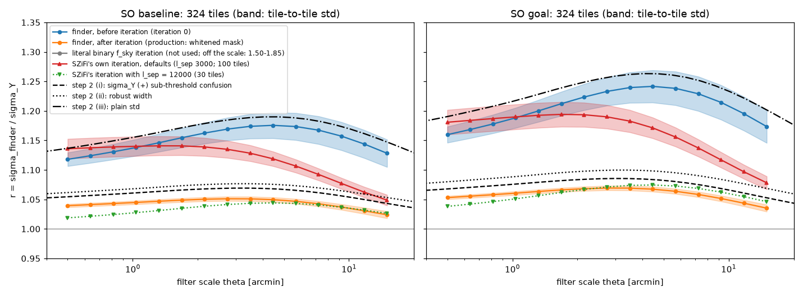
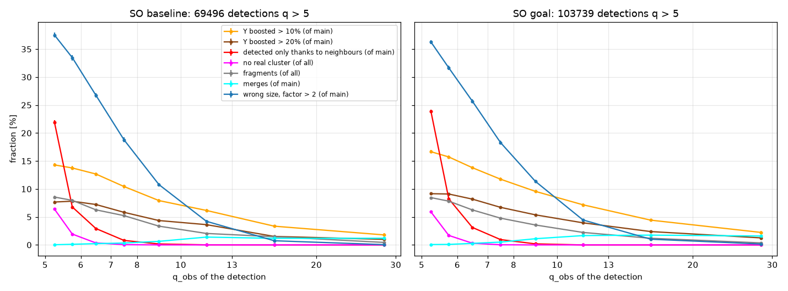
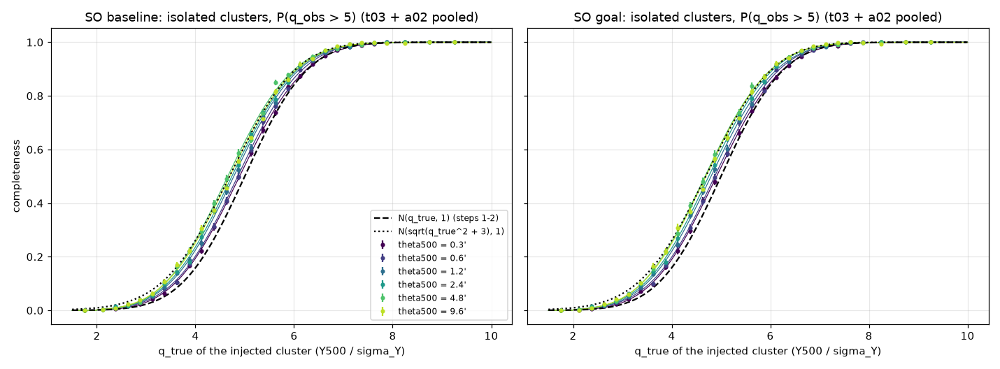
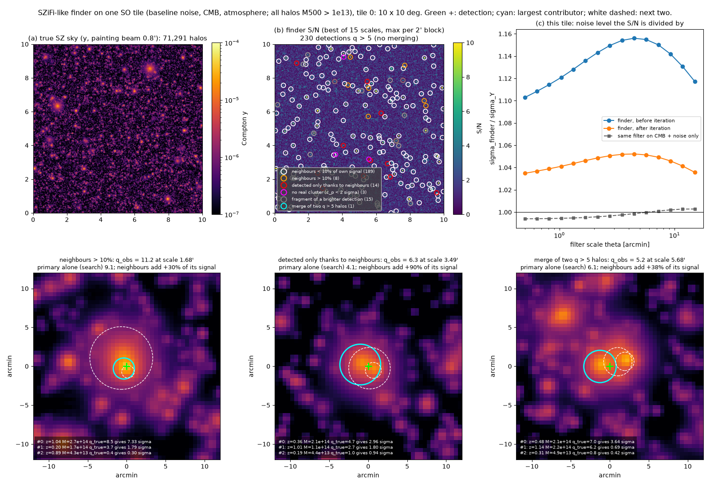

# Realistic SO LAT setup, step 3a: a SZiFi-like cluster finder on simulated SO tiles

**Status: final, 2026-11-12. Built, checked twice independently, then arbitrated.**
- **SZiFi check** (`verify_real/step3_szifi/`): read SZiFi's source line by line and emulated its conventions with its own code on the build's tiles. SZiFi itself was not run: NaMaster, pixell and scikit-learn are not installed, and importing the clone was refused by the session's permission check.
- **Independent check** (`verify_real/step3_indep/`): its own version of every step (painter, CMB and noise, covariance, matched filter, peaks, iteration, merges, decomposition). It ran on the build's tiles, on 100 new skies, 200 noise-only tiles and two sets of 270 injection tiles per noise level.
- **Arbiter** (`a01`–`a05` in this folder; reruns of `t04` with SZiFi's iteration, `t05`, `t05b`, `t06`, `t07`): targeted tests of every claim marked "partially" or "refuted", and the fixes.
- Section 0 lists what the arbitration changed. Section 9 gives every claim with its evidence and who verified it. Section 10 lists what is still open.

**What was built**
- `szsim/finder.py`: our own lean version of SZiFi's iterative multi-frequency matched filter (MMF) for periodic flat tiles, plus the tile simulator and the exact signal decomposition. SZiFi (Zubeldia et al. 2023a,b) was read to learn the algorithm. None of its code was copied. Since the arbitration it also holds an own implementation of SZiFi's masked-covariance step (`masked_cov(method="szifi")`).
- 324 simulated SO tiles of 10°×10° per noise level (32,400 deg², every stored Q2 halo patch), baseline and goal. All halos M500 > 10¹³ M☉, lensed CMB, white noise and atmosphere.
- Checks: the finder against step 1's MMF, noise-only tiles, injected isolated clusters.

**Where things are**
- Scripts and logs: this folder. Build: `t00`–`t08` (helpers `s3lib.py`). Arbiter: `a01`–`a05`, `t04_tiles_szifi.log`, `t05_analysis_szifi.log`, `t05_analysis_n100.log`. Every number below is printed in a log next to its script. The build's original outputs of the rerun scripts are kept as `*_build_original.log`.
- Data: `data_real/step3/` (tiles, truth tables, noise-only and injection runs, paint tables, `selection.npz` (t03), `selection_arbiter.npz` (t03 + a02), `tiles_szifi/`, `arbiter/`).
- Figures: `figures/realistic/step3_*.png`.

## The answer in short

- **Does the lean finder reproduce SZiFi?** Yes, where the two share conventions. Not in the masked-covariance iteration, which SZiFi does differently.
  - Same covariance and template: σ(θ) equals step 1's MMF to 3.6×10⁻⁶. The S/N maps equal an independent implementation to ≤ 2×10⁻¹³ (both checks).
  - SZiFi's own covariance estimate, templates and peak rules (emulated by the SZiFi check) give the same iteration-0 catalogue: 100% matched at q > 4.5 and q > 5, Δq = +0.01 ± 0.2.
  - **The iteration is not SZiFi's.** SZiFi uses the cluster mask only through inpainting: it fills the masked discs by diffusion, blends them back towards the original map, then divides the spectra above ℓ = 3000 by the unmasked fraction. The blend keeps 63% of the in-hole power, so the high-ℓ spectra end 14–20% above even the unmasked ones. With SZiFi's defaults, r = σ_finder/σ_Y after the iteration is 1.14 (baseline) and 1.18 (goal) at 0.5′; the build's whitened masking gives 1.04 and 1.05. The SZiFi check and the arbiter (own code, `a01`) agree on SZiFi's numbers; the independent check reproduces the build's.
- **Is the selection without neighbours understood?** Yes.
  - Noise peaks: 0.80 (baseline) and 0.85 (goal) false detections above q = 5 per 100 deg² (independent check: 0.91 and 0.875 on 200 own tiles).
  - Optimisation bias: the completeness of isolated clusters lies between N(q, 1) and N(√(q² + 3), 1). The search over position and size adds about 0.2 to q.
  - No cluster with q_true < 2 can be credited: a credited peak needs the cluster's own filtered signal ≥ 2σ. None of the 6,800 injected clusters below that limit was credited, at either noise level.
  - A 4× larger injection set (`a02`, 155,040 clusters per noise level) pins down the expected count N_exp to 0.3% (bootstrap).
- **Which noise normalisation and which attribution?**
  - Before the masking iteration the finder divides by step 2's plain std, variant (iii): r − 1 is 84–92% of (iii)'s excess.
  - After it, the answer depends on how the masked covariance is estimated. The build's leakage-free (whitened) estimate gives r = 1.02–1.07, between σ_Y and variant (i); SZiFi with ℓ_sep = 12000, as in its SO example script, lands close to it (1.02–1.07). SZiFi's defaults give about (iii) at θ ≲ 1′ (r = 1.14–1.19), falling to about (ii) at 15′.
  - Attribution: the finder credits the brighter halo and never counts a peak twice. It acts like the dominance rule with **fdom ≈ 0.7** (independent check: 0.71 ± 0.05 and 0.70 ± 0.03).
  - **Rows of step 2's analyst table.** In total counts and in redshift shape, the production finder matches the rows with **fdom 0.5–1 and variant (i)**. There, step 2 found config d +0.12σ to +0.22σ (baseline) and +0.22σ to +0.40σ (goal), and config a −0.64σ to −2.39σ and −1.00σ to −3.66σ (SO40). The build's "closest case is (iii)" came from two calibration errors (below). With SZiFi's default iteration the count change lies beyond step 2's worst row (fdom 0.5 × (iii)).
- **Blending at the detection level** (q > 5, baseline / goal; step 1's P(D) in brackets):
  - Y boosted by > 10% by neighbours: 10.6% / 12.0% (8.8% / 10.4%). Detected only thanks to neighbours: 6.0% / 6.3% (6.2% / 6.9%). Lost: 6.2% / 6.6% (4.9% / 5.4%).
  - At the true positions the finder's own filter gives step 1's numbers again. The extra comes from the search over position and size: +2.3 / +2.6 percentage points (pp) in "Y boosted > 10%", +1.4 / +1.5 pp in losses.
  - Merging: SZiFi's Planck radius of 10′ throws away 6.9–7.2% (baseline) and 10.3–11.1% (goal) of the real clusters. Merging within 1–2′ removes the fragments and only 0.1–0.2% of the real clusters.
- **Count change at q > 5** (credited halos against the finder's own no-neighbour selection with unit noise; preview, no fit):
  - **Production finder: −0.8 ± 0.4% (baseline) and −1.5 ± 0.3% (goal)**, flat in redshift. The build's −3.4% / −4.0% is withdrawn: 0.7 / 0.9 pp were a spurious selection floor far below the injected range, and 2.0 / 1.6 pp came from the calibration of its smaller injection set, which the 4× larger set does not confirm.
  - It depends on the "unit-noise" reference by about 1 pp: injection tiles give the numbers above, noise-only tiles with virtual clusters −1.6% / −2.7%.
  - Split: the noise normalisation takes −1.2% / −1.7% (−2.0% / −2.9% with the noise-only reference); neighbours and the search add +0.5% / +0.3%.
  - **SZiFi's default iteration: −4.7% (baseline) and −5.8% (goal)** (100 tiles).
- **Open for step 3b.** Fix the masked-covariance estimator (it moves r by up to 10% and the counts by 4 pp). Calibrate the selection with ≥ 10⁵ injected clusters per noise level and decide the unit-noise reference. Then build the (z, q) data vector on SO-sized areas and redo the fits.

*r(θ) = σ_finder/σ_Y before and after the masking iteration (bands: tile-to-tile scatter), for the production finder (whitened mask), SZiFi's own iteration with its defaults (100 tiles) and with ℓ_sep = 12000 (30 tiles), against step 2's three noise normalisations. The literal binary-f_sky iteration lies off the scale (1.50–1.85 baseline, 1.64–2.13 goal).*

## 0. What the arbitration changed

| # | claim or issue | raised by | arbiter test | result | who was right |
|---|---|---|---|---|---|
| 1 | B2, B3, C1, C2, R2, R6 describe SZiFi's iteration; "SZiFi avoids the problem by inpainting" | SZiFi check ("partially"; its bug 1) | `a01`: own implementation of SZiFi's masked covariance (diffusive inpainting, 100 sweeps; cosine blend; spectra above ℓ_sep divided by f) on 30 realistic, 30 noise-only and 12 injection tiles per level, four variants | SZiFi defaults: r after = 1.135 → 1.050 (0.5′ → 15′, baseline), 1.181 → 1.078 (goal); SZiFi check 1.142 → 1.049 and 1.188 → 1.077 with SZiFi's own template. Noise-only σ +2.6% / +3.4% at 0.5′ (SZiFi check +2.5% / +3.2%). Spectra above ℓ = 3000 end ×1.14–1.20. The iteration adds +2.6% / +2.8% q > 5 detections, not +26% / +33%. Without the blend r = 1.07 / 1.11; with ℓ_sep = 12000 1.02–1.04 / 1.04–1.07; without inpainting the iteration changes nothing (by reading) | SZiFi check. The build's values are right for its own (whitened) iteration, which both checks reproduce. Text and claims now say so |
| 2 | Science with SZiFi's own iteration | arbiter (new) | `t04 … tiles_szifi szifi` and `t05` on tiles 0–99 | count change −4.70 ± 0.44% / −5.75 ± 0.42%; q > 5 detections 18% / 23% fewer; class fractions within 0.1–3.8 pp of the production finder (section 6e) | new |
| 3 | N1–N3, N5, N7: the fitted selection keeps a floor far below the injected range | independent check (its bug 1) | `t05` fix: P_det = 0 below the credit limit q_inj = 2 r_inj. `a02`: 0 credited of 6,800 injected clusters per level below it | the floor added 0.67 / 0.92 pp: build's calibration −3.39 → −2.72% (baseline), −4.03 → −3.11% (goal) | independent check |
| 4 | N1, N7: the count change depends on the injection set | independent check | `a02`: a second injection set 4× the size of t03 (q_inj 1.8–8), pooled with t03 | t03 alone gives N1 2.2 / 1.8 pp below a02 alone; quarters of a02 with t03's size scatter by 0.56 / 0.35 pp. Pooled: N1 = **−0.77 ± 0.37% / −1.50 ± 0.32%**; binned table −1.16% / −1.85% | independent check. Its "≈ −3% ± 1%" rested mostly on t03 and is superseded |
| 5 | N2: the split into neighbours and normalisation | independent check ("partially") | `a03`: isolated search and credited detection on the same 63,840 injected clusters per level. `a05`: the independent check's virtual-cluster calibration redone with the build's code | the isolated search finds 0.6% more isolated clusters than the finder credits. Criterion-matched: normalisation −1.20% / −1.71% (injection tiles) or −2.01% / −2.87% (noise-only tiles; independent check −2.44% / −3.22%); neighbours and search +0.48% / +0.33% | both in part. The build's split mixed two criteria; the independent check's N1′ mixed criterion and reference. The ~1 pp reference dependence is open (section 10) |
| 6 | N3: the count falls to −12% / −11% at z = 2–3 | independent check ("refuted") | `t05` rerun | z = 2–3: −1.7 ± 4.2% / −0.3 ± 2.7%; no trend with z | independent check |
| 7 | R5: width of the CMB + noise part of the S/N maps | independent check (wording) | `a04`: pixel standard deviation on 10 tiles per level | realised 0.952–0.978 / 0.937–0.969, equal to 1/r to 0.4%; the build's analytic expectation is up to 0.012 higher at large θ | independent check. R5 now quotes the realised width |
| 8 | D3: closure residual "from the direction dependence of the binned filter's response" | independent check ("partially": re-read only) | `a04`: exact 2D lattice sums for every halo within 5′, 15′, 30′ of 114 / 118 detections, tables beyond | residual unchanged (median 2.2 → 2.0 × 10⁻² σ on this sample). The independent check's full exact synthesis closes to ≤ 6 × 10⁻⁵ σ. So the residual sits in the tables of halos beyond 30′ | build's size right; cause narrowed to distant halos. Classes use exact numbers and are unaffected |
| 9 | W1: ±3′ isolated-search window | independent check (re-read only) | `a04`: ±6′ window for 809 / 1,153 halos with q_alone > 4.5 | maximum never moves; within 1′ of the halo for 99.84% / 99.89% | build |
| 10 | S1: r(θ) changes by ≤ 2 × 10⁻⁴ with 12 or 20 scales | independent check | `t05b` rerun, end nodes | ≤ 4.5 × 10⁻⁴ (goal, 15′, 20 scales) | independent check |
| 11 | SZiFi's 'nearest' rule puts bin-edge modes into the lower bin | SZiFi check (its bug 2) | `a04` on the stored covariances of 10 tiles | 1,584 of 485,357 in-band modes (0.33%); σ +0.008% to +0.18% | SZiFi check |
| 12 | Other SZiFi conventions the build avoids: real-space sampled template, zero-padded convolution, half-pixel position | SZiFi check (its bug 3) | not re-tested | listed in section 1 | SZiFi check (by reading and emulation) |
| 13 | Headline: the finder's count change is like step 2's (iii) | build | items 3–6 | production finder −0.8% / −1.5%: step 2's rows fdom 0.5–1 × (i) (−0.3% to −1.7% / −0.4% to −2.1%). SZiFi defaults −4.7% / −5.8%: beyond fdom 0.5 × (iii) (−3.6% / −4.4%) | changed |

- Numbers that changed: every count change (N1–N3, N5, N7 and the splits), R5, S1's r bound, and the interpretation of R2 and R6.
- Unchanged and confirmed: the finder's exactness (A1–A3, D1, D4), the noise-only and injection checks for the production finder (B1–B3, C1–C4), r before and after the build's iteration (R1–R4, R6), all blending, attribution and merge fractions (F1–F6, T1–T3, N6, and the real-cluster losses of 10′ merging).

## Terms

- **Finder.** The SZiFi-like MMF of `szsim/finder.py`. It runs twice per tile: iteration 0 with the covariance of the full tile, then iteration 1 after masking its q > 4 detections. The final catalogue is iteration 1's.
- **Masked covariance.** How iteration 1 estimates the covariance from the masked tile. *Whitened* (production): the mask is applied to maps whitened by the iteration-0 covariance. *SZiFi's*: inpainting, blend and division by the unmasked fraction f above ℓ_sep (section 5). *Literal binary f_sky*: the mask applied to the raw maps (biased; not used).
- **q, q_obs.** The S/N the finder reports: Ŷ/σ_finder at the detection's pixel and scale.
- **σ_finder(θ).** The finder's noise level at filter scale θ, from its estimated covariance (as in SZiFi). **σ_Y(θ)** is step 1's analytic MMF noise (CMB + noise, no tSZ). **r(θ) = σ_finder/σ_Y.**
- **q_true.** Y500/σ_Y(θ500) of a halo. **q′** = Y500/σ_finder(θ500) of the tile, rescaled to the injection tiles (× r_inj).
- **Step 2's noise normalisations.** (i) σ_Y combined with the variance of sub-threshold confusion; (ii) the robust (16–84%) width of noise plus all-halo confusion; (iii) the plain standard deviation of the filtered map.
- **Dominance rule, fdom.** Steps 1–2 credit a blended peak to halo A only if no single neighbour adds more than fdom × q_A.
- **Decomposition of a detection.** The filtered value at the detection splits into tSZ + CMB + noise. The tSZ part splits into all halos' contributions. **Primary** p = the halo with the largest contribution c_p. **Neighbours** δ = tSZ − c_p. n = CMB + noise.
- **Classes of a q > 5 detection.** *No real cluster*: c_p < 2σ. *Fragment*: its primary is the primary of a higher-q detection. *Main*: real and not a fragment. *Y boosted by > X%*: δ > X% of c_p. *Detected only thanks to neighbours*: q_alone < 5. *Lost*: q_alone > 5 but not the primary of any q > 5 detection. *Merge*: the second contributor has q_true > 5, gives > 10% of c_p and is not detected itself. *Wrong size*: θ_det/θ500 outside [1/2, 2].
- **Isolated search, q_alone.** The maximum over 13×13 pixels (±3′) around a halo's true position and over all 15 scales of (the halo alone + CMB + noise)/σ_finder.
- **Credited halo.** The primary of at least one real q > 5 detection, counted once.
- **Credit limit.** A credited detection needs c_p ≥ 2σ, and c_p/σ can never exceed the halo's own Y500/σ_finder(θ500). So halos with q′ < 2 r_inj (about 2) are never credited.
- **Selection, P_det(q, θ).** The probability that an isolated injected cluster is credited with a q > 5 detection. **Unit-noise reference**: where P_det is measured (injection tiles, where the injected clusters themselves sit in the covariance, or noise-only tiles with virtual clusters).
- **Count change N1.** (credited halos)/N_exp − 1 with N_exp = Σ_halos P_det(q′, θ500). It measures what an analysis that models the finder with unit noise in its own S/N units gets wrong.
- **Forced photometry.** The finder's filtered maps read at a halo's true position and the scale nearest to θ500: step 1's P(D) setting with the finder's filter.
- **pp.** Percentage points.
- **Verified by.** *both* = the SZiFi check and the independent check; *szifi* or *indep* = one of them; *arbiter* = a targeted arbiter test (`a01`–`a05`, reruns); *build only* = checked by nobody; *unresolved* = open (section 10).

## 1. Choices that differ from the task text or from SZiFi

1. **Masked covariance: whitened before masking.** The task asked for pseudo-spectra of the masked tile divided by the unmasked fraction. Done literally this fails:
   - σ after the iteration is 16–33% (baseline) and 22–47% (goal) too high on noise-only tiles; r = 1.50–1.85 / 1.64–2.13 on realistic tiles (both confirmed by the independent check);
   - cause: the sharp disc edges leak the steep CMB and atmosphere power at ℓ ≈ 100–2000 into the high-ℓ bins that set σ.
   - The finder therefore whitens each Fourier mode with the iteration-0 covariance of its bin, masks the whitened maps, divides their binned spectra by f and un-whitens. Masking then changes σ by −0.3% to −0.5% on CMB + noise alone.
2. **This is not what SZiFi does** (corrected by the arbitration; `mmf.py` find_clusters, `maps.py`, `spec.py`, read by the SZiFi check and the arbiter):
   - SZiFi reaches the covariance with the cluster mask only through inpainting. Without inpainting (`inpaint = False`) the iteration re-estimates exactly the iteration-0 covariance.
   - With its defaults (`inpaint = True`, diffusive, 100 sweeps, `lsep = 3000`) it fills the holes by diffusion, blends each hole back towards the original map with weight w = (1 + cos(π r/R))/2 (r: distance to the hole's edge, R: the hole's equivalent radius), and divides the spectra above ℓ = 3000 by f.
   - The blend keeps ⟨w²⟩ = 0.63 of the in-hole power, so the division by f over-corrects: the high-ℓ spectra end 14–20% above iteration 0 (section 5). SZiFi's defaults were set for Planck (ℓ ≤ 2500), where the division never applies. Its SO example script uses `lsep = 12000` with spectra computed to ℓ = 10000, so the division never applies there either.
   - `szsim.finder.masked_cov(method="szifi")` is the arbiter's own implementation of these steps (periodic neighbours and holes here). The production finder keeps the whitened estimate.
3. **Filter template.** Step 1's template exactly (linear interpolation of the Arnaud Hankel table). The painting uses a cubic-spline interpolation of the same table. Filtering with the smooth version would change σ by up to 2.6×10⁻⁴ (independent check: same).
4. **Decomposition: radial tables plus exact lattice sums.** The four largest contributors of every detection with q ≥ 4.5 are exact 2D sums over all in-band Fourier modes; all other halos come from radial tables. The tables cannot follow the binned filter's direction-dependent response (section 4d).
5. **Merging.** SZiFi's 'closest' rule at 1′, 2′ and 10′, plus 'fof' at 10′, which is what SZiFi's Planck scripts call. As there, the q > 5 cut comes first. The independent check's own 'closest' keeps exactly the same entries; 'fof' was not compared with SZiFi (scikit-learn is missing).
6. **SZiFi conventions the build avoids** (measured by the SZiFi check by emulation, not re-tested by the arbiter):
   - SZiFi samples its template at pixel centres around a point between four pixels. Per unit Y500 this raises σ by 33% at 0.5′, 7% at 1.04′ and 0.13% at 15′; the template's flux is 20% low at θ500 = 0.5′. The S/N maps barely change: q is 0.4% lower for θ ≤ 0.8′.
   - SZiFi filters by zero-padded ('same') convolution. On a periodic tile this gives |Δq| up to 26 (baseline) and 33 (goal) within 2.5′ of the edge. Real SZiFi runs mask tile edges.
   - For an even tile size, SZiFi's S/N at pixel n belongs to position n − 1/2 but it reports pixel n: a fixed (+0.25′, +0.25′) position offset.
   - SZiFi's 'nearest' covariance lookup puts the 0.33% of modes that sit exactly on a bin edge into the lower bin; the build puts them into the upper bin. σ changes by +0.008% to +0.18% (arbiter, `a04`; SZiFi check +0.01% to +0.17%). Its edge bins also average in out-of-band modes (diluted by 0.667 and 0.783).
7. **Smaller deviations.** Periodic neighbours in the peak search (SZiFi pads tile edges). A bin's power is averaged over its in-band modes only (100 ≤ ℓ ≤ 20000). No pixel window. Gaussian beams.

## 2. Tiles

- **Halos.** Tile pid = stored Q2 patch pid: 10°×10°, periodic, 69,964–71,940 halos with M500 > 10¹³ M☉ (177 / 280 with q_true > 5, baseline / goal), θ500 = 0.26′–58′ (`t08_extra_checks.log`; independent check: same). 324 tiles per noise level.
- **Painting** (`t00_paint_tables.log`). Each halo is painted at 0.25′ with a 0.8′ painting beam as a mix of two tabulated Arnaud profiles, Fourier-cropped to the 0.5′ grid (1200²), and the painting beam is divided out.
  - A painted halo equals its exact Fourier synthesis to ≤ 2×10⁻⁸ of its peak for θ500 ≤ 2.4′ and ≤ 4.4×10⁻⁶ up to 55′.
  - The independent check's exact synthesis of the same template mixture reproduces the covariance to ≤ 1.8×10⁻⁶ and the filtered tSZ at every final detection to ≤ 6×10⁻⁵ σ.
- **Six channels.** tSZ (step 1's SED and beams) + lensed CMB (seed 300000 + pid) + white noise and atmosphere with the 0.9 in-tube correlation (seed 400000 + pid; the same unit draws for baseline and goal). The three components are kept apart.
- **Regeneration.** The tiles regenerate bit-exactly from their seeds: the arbiter's reruns give the stored σ to 3×10⁻¹⁵ and the stored catalogues to |Δq| ≤ 1.1×10⁻¹³ (`a01`, `a04`); both checks found the same.

## 3. The finder

`szsim/finder.py`, driven by `t04_tiles.py` and `s3lib.py`.

- **Covariance.** 6×6 auto and cross spectra of the tile in SZiFi's bins: width bin_fac·π/(n Δx) = 72 in ℓ for bin_fac = 4. Every Fourier mode takes its bin's value. ℓ = 100–20000.
- **Filter.** Per mode C⁻¹a with a_i = B_i f_i. For each of 15 log-spaced scales θ = 0.5′–15′ the template is step 1's unit-Y500 Arnaud transform. σ(θ) = (Σ_k τ² aᵀC⁻¹a)^(−1/2) from the estimated covariance, as in SZiFi's `get_mmf_q_map`.
- **Detections.** q > 4, strictly above the two neighbours along each map axis and a maximum along the scale axis with SZiFi's tie rules ('maxima_lomem'). Catalogue order: scale, then pixel.
- **Iteration.** Detections with q > 4 are masked with discs of radius 3 θ_est; the covariance is re-estimated (whitened, section 1); the filter is rerun once (max_it = 1). The masked fraction is 21% (baseline) and 24% (goal).
- **Speed** (`t05_analysis.log`). Per tile and noise level on one core: finder with iteration 1.0 s (2.5–3.4 s with SZiFi's inpainting), decomposition 6.4 s (baseline) and 8.6 s (goal).

## 4. Checks

### (a) With the true covariance the finder is step 1's MMF; with SZiFi's conventions it is SZiFi's at iteration 0

| test | result | verified by |
|---|---|---|
| σ(θ) at the 15 scales vs `MMFModel.sigma_Y_exact` | max \|ratio − 1\| = 3.6×10⁻⁶ (baseline), 3.0×10⁻⁶ (goal); target 10⁻⁴ | both (3.6×10⁻⁶ / 3.0×10⁻⁶) |
| same with the smooth (cubic) template | +1×10⁻⁶ to +2.6×10⁻⁴ | indep |
| S/N maps of tile 0 vs a re-implementation of v01 Part B | max \|Δq\| = 1.6×10⁻¹³ | both (SZiFi check's own MMF: maps ≤ 9×10⁻¹⁴, σ ≤ 4×10⁻¹⁵; independent check: identical catalogues, components to 10⁻¹⁴) |
| SZiFi's covariance estimate, templates and peak rules (emulated) | iteration-0 catalogue 100% matched both ways at q > 4.5 and q > 5; Δq = +0.01 ± 0.19–0.24 (half-pixel grid); θ within one scale step for 86–89%; r within +0.7% (baseline) / +1.0% (goal) at 0.5′, ≤ +0.15% above 2′ | szifi |

### (b) Noise-only tiles (`t02_noise_only.log`, `a01_szifi_iteration.log`)

100 tiles per noise level (the realistic tiles 0–99 without halos).

- **Spectra** (iteration 0) against the input model above ℓ = 500: mean ratio 0.999–1.002; pulls with mean −0.02 to +0.03 and rms 0.97–1.01; cross-spectrum pulls rms 1.00 (independent check on 200 own tiles: 0.997–1.002, rms 0.98–1.02).
- **σ(θ) against the analytic value** (mean over tiles; tile-to-tile scatter 0.2–0.5%):

  | | baseline | goal | verified by |
  |---|---|---|---|
  | iteration 0 | 0.994–0.998 | 0.995–0.998 | indep (0.993–0.998) |
  | iteration 1, whitened (production) | 0.990–0.995 | 0.990–0.995 | indep (0.988–0.995) |
  | iteration 1, literal binary f_sky | 1.16–1.32 | 1.22–1.47 | indep (1.16–1.33 / 1.22–1.47) |
  | iteration 1, SZiFi's defaults (30 tiles) | 1.026 (0.5′) … 0.987 (15′) | 1.034 … 0.990 | arbiter (`a01`) + szifi (1.025 / 1.032 at 0.5′, 6 tiles) |
  | iteration 1, SZiFi with ℓ_sep = 12000 (30 tiles) | 0.976 | 0.974 | arbiter |

- **False detections per 100 deg²** (final catalogue), q > 4 / 4.5 / 5:

  | | baseline | goal | verified by |
  |---|---|---|---|
  | production, no merge | 50.4 / 7.64 / 0.80 | 55.0 / 8.26 / 0.85 | indep (51.2 / 7.58 / 0.91; 55.6 / 8.20 / 0.875, 200 tiles) |
  | production, closest 1′ | 46.2 / 7.09 / 0.76 | 50.8 / 7.67 / 0.80 | indep (q > 5: 0.86 / 0.815) |
  | production, closest 10′ or fof 10′ | 45.3 / 7.07 / 0.76 | 49.7 / 7.65 / 0.80 | build only |
  | iteration 0 | 46.3 / 6.21 / 0.60 | 50.7 / 6.87 / 0.71 | build only |
  | SZiFi's defaults (30 tiles) | 36.5 / 5.13 / 0.50 | 37.6 / 5.30 / 0.63 | arbiter + szifi (34.3 / 4.3 / 0.33; 35.2 / 4.5 / 0.17, 6 tiles) |

  SZiFi's defaults make fewer noise peaks because their σ is too high.

### (c) Injected isolated clusters: the finder's own selection

- **Design** (`t03`). 270 tiles per noise level of fresh CMB + noise with isolated clusters of one size θ500 = 0.3′, 0.6′, 1.2′, 2.4′, 4.8′ or 9.6′, 40′–75′ apart; 38,760 clusters per level; q_true uniform in [1.5, 9.5] for 85%, else 10.5–30. A detection is credited to its nearest injected cluster if that cluster's filtered tSZ there is ≥ 2σ.
- **Second set** (`a02`, arbiter). The same design with new seeds, 1,080 tiles per level, q_true uniform in [1.8, 8]: 155,040 clusters per level. Pooled with t03 in `selection_arbiter.npz`.
- **Completeness P(q_obs > 5)** lies between N(q_true, 1), the model of steps 1–2, and the optimisation-bias model N(√(q_true² + 3), 1); close to the second for θ500 ≥ 2.4′ and to the first for 0.3′ and 0.6′.

  | q_true | 0.3′ | 0.6′ | 1.2′ | 2.4′ | 4.8′ | 9.6′ | N(q,1) | N(√(q²+3),1) |
  |---|---|---|---|---|---|---|---|---|
  | 3.0–3.5 (t03) | 0.05 | 0.07 | 0.08 | 0.08 | 0.08 | 0.09 | 0.04 | 0.10 |
  | 4.0–4.5 (t03) | 0.25 | 0.28 | 0.28 | 0.38 | 0.37 | 0.34 | 0.23 | 0.34 |
  | 5.0–5.5 (t03) | 0.62 | 0.61 | 0.65 | 0.73 | 0.70 | 0.67 | 0.60 | 0.70 |
  | 5.0–5.25 (pooled) | 0.59 | 0.60 | 0.61 | 0.66 | 0.64 | 0.65 | 0.55 | 0.66 |
  | 6.0–6.5 (t03) | 0.91 | 0.90 | 0.92 | 0.93 | 0.94 | 0.94 | 0.89 | 0.93 |

  (baseline; goal agrees to ≤ 0.02. Independent check, 270 own tiles: 0.60–0.71 at q = 5–5.5, pulls against the build bin by bin rms 0.92–0.96.)
- **The two sets agree except at 2.4′ and 4.8′** (`a02_injections_hi.log`). P(credited | q_true 4–6) from t03 minus a02: −0.9, +0.3, −0.9, +3.5, +1.6, −0.5 σ (baseline; χ² 16.7 for 6; goal 11.0). Against a02 the build's fit predicts 1–2.5% too many detections at q_true 3.5–6.
- **Credit limit.** No credited detection below q_true = 2 r_inj ≈ 2 among 6,800 such clusters per level (t03 + a02).
- **q_obs of detected clusters** (q_true = 6–9.5): q_obs − q_true has mean −0.08 (0.3′) to +0.20 (4.8′) and standard deviation 0.91–0.97 (baseline; goal −0.11 to +0.19). The search adds about 0.2: read at the true pixel and nearest scale the offset is −0.28 to −0.04. Small clusters lose S/N because the smallest scale is 0.5′. Independent check: −0.09 to +0.19, std 0.93–0.96.
- **SZiFi's default iteration** lowers q_obs of the same clusters by 0.04–0.43 (`a01`, 12 tiles; SZiFi check 0.24–0.64) and the completeness at q_true 4.5–6 by up to 0.1.
- **Size recovery.** A factor > 2 off for 7–36% at q_true = 5–7 and 0–17% above 10 (independent check 6.6–34%).
- **Position recovery.** Median offset 0.20–0.37′; 84% within 0.29–0.62′ (independent check 0.20–0.36′; SZiFi check 0.21–0.35′ after its half-pixel correction).
- **Selection model.** Per size a maximum-likelihood fit P = Φ((√(q² + b) − 5 − μ)/s), interpolated in ln θ500, with P = 0 below the credit limit. Pooled fits: s = 1.03–1.14. The pooled binned table (bins of 0.25 in q) is the robustness check.

### (d) Exactness of the decomposition

- **tSZ + CMB + noise = map value** to 3.4×10⁻¹³ (worst of 648 tile runs, relative). Independent check: CMB and noise at all final detections to 4.5×10⁻¹⁴ σ, tSZ to 6×10⁻⁵ σ.
- **The largest contributors are exact.** For every detection with q ≥ 4.5 the four largest contributions are 2D lattice sums (independent check: c_p to 2×10⁻¹² σ, the 2nd–4th to 3×10⁻¹³; primaries and classes identical on 1,607 detections). δ = tSZ − c_p is exact too, so every class is decided with exact numbers.
- **Closure of the radial tables.** With an analytic, smooth covariance the sum of all halos' table values equals the filtered tSZ to a median of 4.5×10⁻⁷ of the map value (tile 0, build only). With the finder's binned covariance: median 8.6×10⁻³ σ (baseline) and 9.7×10⁻³ σ (goal), maximum 0.066σ / 0.078σ over all q > 5 detections (re-read by the independent check).
- **Where the residual comes from** (`a04`). Replacing the tables of every halo within 5′, 15′ and 30′ by exact lattice sums leaves it unchanged (median 2.2×10⁻² → 2.0×10⁻² σ on 114 of the worst and random detections, baseline). The exact synthesis of all halos closes to ≤ 6×10⁻⁵ σ (independent check). So the residual is the sum of the table errors of the many halos beyond 30′. Most likely the radial tables miss the long-range, direction-dependent part of the binned filter's response (up to 6.7×10⁻⁴ of its peak; independent check); this was not traced halo by halo. No class depends on it.

## 5. SZiFi's own masked-covariance iteration

`a01_szifi_iteration.log` (30 realistic tiles per level, pid = 0, 11, …, 319, and the SZiFi check's 10 tiles), `t05_analysis_szifi.log` (tiles 0–99).

| | baseline | goal |
|---|---|---|
| r before the iteration (0.5′ / 4.45′ / 15′) | 1.115 / 1.170 / 1.124 | 1.156 / 1.234 / 1.167 |
| r after, production (whitened) | 1.039 / 1.050 / 1.025 | 1.053 / 1.067 / 1.035 |
| r after, SZiFi defaults (ℓ_sep 3000, blend) | **1.135 / 1.119 / 1.050** | **1.181 / 1.172 / 1.078** |
| r after, SZiFi with ℓ_sep = 12000 | 1.019 / 1.044 / 1.026 | 1.038 / 1.075 / 1.046 |
| r after, inpainting without the blend | 1.074 / 1.070 / 1.019 | 1.106 / 1.108 / 1.032 |
| SZiFi defaults: (r − 1)/(r_(iii) − 1), 0.5′ → 15′ | 0.99 → 0.34 | 0.95 → 0.39 |
| spectra after/before, ℓ 100–3000 / 3000–20000, SZiFi defaults | 0.93–0.95 / 1.14–1.17 | 0.93–0.95 / 1.16–1.20 |
| same, production | 0.98–1.00 / 0.96–1.00 | 0.97–1.00 / 0.94–0.99 |
| q > 5 detections per tile before → after: production | 171.6 → 215.6 (+25.6%) | 242.2 → 321.2 (+32.6%) |
| SZiFi defaults | 171.6 → 176.1 (+2.6%) | 242.2 → 249.0 (+2.8%) |
| mean w² of the blend over the hole pixels | 0.63 | 0.63 |

- **Why.** The blend keeps 63% of the power inside the masked discs, but the division by f assumes it keeps none. Above ℓ = 3000 the spectra therefore end 14–20% above even the unmasked ones. At small θ this outweighs the tSZ power that the masking removes.
- **On the SZiFi check's 10 tiles** the arbiter's code gives 1.132 → 1.045 (baseline) and 1.175 → 1.072 (goal); the SZiFi check found 1.142 → 1.049 and 1.188 → 1.077 with SZiFi's own pixel-sampled template, whose r is already 0.007 (baseline) and 0.010 (goal) higher before the iteration. The two implementations agree.
- **The setting matters, not the idea.** Inpainting without the blend gives r 0.02–0.05 above the production finder at θ ≤ 4′; dividing only above ℓ = 12000 gives r within 0.02 of it. Only the default combination at SO resolution drives r to (iii).

## 6. Science on the realistic tiles

324 tiles per noise level (32,400 deg²), production finder, unless stated. Errors on fractions are binomial; errors on counts come from 2,000 bootstrap resamples of the tiles and, for N1, 40 refits of the selection on bootstrap resamples of the injection tiles. Log: `t05_analysis.log`.

### (a) Which noise normalisation does the finder realise?

r(θ) = σ_finder(θ)/σ_Y(θ), mean over tiles [tile-to-tile scatter]:

| θ [′] | 0.50 | 1.04 | 2.15 | 4.45 | 9.23 | 15.0 |
|---|---|---|---|---|---|---|
| **baseline**, before iteration | 1.118 [0.011] | 1.138 [0.014] | 1.162 [0.018] | 1.176 [0.022] | 1.157 [0.024] | 1.128 [0.023] |
| after iteration (production) | **1.039** [0.003] | **1.045** [0.003] | **1.050** [0.004] | **1.050** [0.004] | **1.037** [0.005] | **1.024** [0.006] |
| after, SZiFi defaults (tiles 0–99) | 1.136 [0.017] | 1.140 [0.016] | 1.139 [0.015] | 1.119 [0.012] | 1.077 [0.009] | 1.049 [0.009] |
| analytic CMB + noise + the tile's own tSZ power | 1.120 | 1.141 | 1.166 | 1.180 | 1.163 | 1.136 |
| step 2 (i) / (ii) / (iii) | 1.055 / 1.062 / 1.137 | 1.061 / 1.068 / 1.156 | 1.068 / 1.075 / 1.179 | 1.068 / 1.076 / 1.190 | 1.056 / 1.065 / 1.174 | 1.043 / 1.053 / 1.147 |
| **goal**, before iteration | 1.160 [0.014] | 1.188 [0.017] | 1.224 [0.022] | 1.242 [0.027] | 1.214 [0.029] | 1.173 [0.028] |
| after iteration (production) | **1.053** [0.003] | **1.061** [0.003] | **1.068** [0.004] | **1.067** [0.004] | **1.052** [0.005] | **1.035** [0.006] |
| after, SZiFi defaults (tiles 0–99) | 1.181 | 1.190 | 1.194 | 1.171 | 1.117 | 1.078 |
| analytic CMB + noise + the tile's own tSZ power | 1.162 | 1.191 | 1.227 | 1.245 | 1.220 | 1.181 |
| step 2 (i) / (ii) / (iii) | 1.068 / 1.080 / 1.190 | 1.076 / 1.089 / 1.218 | 1.084 / 1.098 / 1.249 | 1.084 / 1.098 / 1.263 | 1.068 / 1.084 / 1.239 | 1.053 / 1.069 / 1.202 |

- **Before the iteration the finder realises step 2's plain std (iii).** r − 1 is 86–92% (baseline) and 84–92% (goal) of (iii)'s excess. The tile's own tSZ power explains r to 0.2–0.7%.
- **After the production iteration it realises about 0.7 of variant (i).** (r − 1)/(r_(i) − 1) = 0.55–0.74 (baseline) and 0.67–0.81 (goal). Masking with 3θ discs removes the power of the detected clusters and their surroundings; variant (i) removes only halos with q_true ≥ 5.
- **With SZiFi's defaults it realises (iii) at θ ≲ 1′** and falls to about (ii) by 15′ (section 5).
- **Width of the CMB + noise part** of the production finder's S/N maps (`a04`, 10 tiles): 0.952–0.978 (baseline) and 0.937–0.969 (goal), equal to 1/r to 0.4%. An isolated cluster sees only this noise, so the finder's S/N scatters less than unit noise. With SZiFi's defaults the width is about 1/r = 0.88–0.95 / 0.84–0.93.
- **Before vs after.** The production iteration raises the q > 5 detections from 54,337 to 69,496 (+28%, baseline) and from 77,116 to 103,739 (+35%, goal).

### (b) Blending at the detection level (q_obs > 5)

69,496 (baseline) and 103,739 (goal) detections; 64,355 and 96,544 main detections.

| fraction | baseline | goal | step 1 P(D), true position | verified by |
|---|---|---|---|---|
| no real cluster (c_p < 2σ), of all | 1.75 ± 0.05% | 1.50 ± 0.04% | – | indep (1.91 / 1.51%) |
| fragments, of all | 5.65 ± 0.09% | 5.44 ± 0.07% | – | indep (5.79 / 5.49%) |
| **Y boosted > 10%**, of main | **10.62 ± 0.12%** | **11.96 ± 0.10%** | 8.8% / 10.4% | indep (10.40 / 11.92%) |
| Y boosted > 20%, of main | 5.90 ± 0.09% | 6.80 ± 0.08% | 4.7% / 5.6% | indep (5.74 / 6.80%) |
| **detected only thanks to neighbours**, of main | **6.04 ± 0.09%** | **6.34 ± 0.08%** | 6.2% / 6.9% | indep (5.92 / 6.33%) |
| **lost**, of the halos with q_alone > 5 | **6.22 ± 0.10%** | **6.57 ± 0.08%** | 4.9% / 5.4% | indep (6.37 / 6.48%) |
| merges, of main | 0.45 ± 0.03% | 0.66 ± 0.03% | – | indep (0.46 / 0.65%) |
| wrong size, of main / clean / Y boosted > 10% | 21.9 / 20.8 / 31.3% | 20.6 / 19.3 / 30.4% | – | indep (21.2 / 20.1 / 30.8%; 20.1 / 18.7 / 30.3%) |

**The same skies at the true positions, with the finder's own filter** (forced photometry; fdom = 1 as in step 1):

| | baseline | goal | step 1 P(D) | verified by |
|---|---|---|---|---|
| Y boosted > 10% | 8.28% | 9.33% | 8.8% / 10.4% | indep (8.04 / 9.08%) |
| boosted over the threshold | 6.00% | 6.28% | 6.2% / 6.9% | indep (5.65 / 6.13%) |
| lost (of single) | 4.84% | 5.11% | 4.9% / 5.4% | indep (4.63 / 5.07%) |
| change in detections | +1.22% | +1.26% | +1.3% / +1.4% | indep (+1.07 / +1.13%) |

*Class fractions of the q > 5 detections against q_obs. Blending and wrong sizes concentrate near the threshold.*

- **At the true positions the finder's filter gives step 1's P(D) numbers** to within 0.5 pp (baseline) and 1.1 pp (goal).
- **The search over position and size adds blending.** Y boosted > 10%: +2.3 pp (baseline) and +2.6 pp (goal); the peak moves towards bright neighbours and the size grows to include them (boosted detections pick a wrong size 31% of the time). Losses: +1.4 / +1.5 pp. "Detected only thanks to neighbours" is unchanged. Independent check: +2.4 / +2.8 pp and +1.7 / +1.4 pp.
- **Finder-specific outcomes.** Fragments are 5.6% / 5.4% of the raw catalogue; merging within 1′ removes almost all of them. Peaks with no real cluster are 3.8 and 4.8 per 100 deg², against 0.80 and 0.85 from noise alone: about 80% are confusion peaks of several faint halos.
- **Wrong sizes are mostly not blending.** 21% of clean detections are a factor > 2 off, as for isolated injections near the threshold.

### (c) Effective attribution

- **Detections where a second halo contributes a lot.** 6,635 (10.3%, baseline) and 11,209 (11.6%, goal) main detections have a second contributor B with ≥ 10% of the primary A's signal (independent check: 9.9% / 11.5%). A has the larger true q in 97–98% of them for c_B/c_A < 0.5 and in 84% for 0.5–1.
- **Against the dominance rules of steps 1–2:** the rules credit B alone in ≤ 2% of these peaks; fdom = 1 credits both halos (one peak counted twice) in 25–69%, fdom = 2 in 42–100%. The finder never does.
- **Effective threshold.** Among halos the isolated search would detect, the finder credits 95–97% when the largest neighbour adds < 25% of the halo's own S/N, 67% / 64% at 0.5–0.75, 28% / 27% at 0.75–1 and ≤ 3% above 1. **The finder realises fdom ≈ 0.7** (independent check, logistic fit: 0.708 ± 0.048 and 0.697 ± 0.027). SZiFi's defaults give the same within the statistics (81% / 59% at 0.5–0.75, 20% / 37% at 0.75–1, 100 tiles).

### (d) Count change at q > 5 (preview)

Halos credited with a real q > 5 detection, against N_exp = Σ_halos P_det(q′, θ500): the finder's own selection of isolated clusters (pooled t03 + a02 fit, P = 0 below the credit limit), applied with the S/N each halo has in the finder's units. This is the convention of step 2's map-sigma variants: the S/N is divided by the level the pipeline measures, and the model uses unit noise. Six redshift bins as in step 2.

| ΔN/N, q > 5 | total | z 0.01–0.1 | 0.1–0.5 | 0.5–1 | 1–1.5 | 1.5–2 | 2–3 |
|---|---|---|---|---|---|---|---|
| **production, baseline** | **−0.77 ± 0.37%** | −1.0 ± 2.0% | −1.0 ± 0.4% | −0.7 ± 0.5% | −0.6 ± 0.8% | −0.3 ± 1.6% | −1.7 ± 4.2% |
| **production, goal** | **−1.50 ± 0.32%** | −3.0 ± 1.8% | −2.1 ± 0.4% | −0.9 ± 0.4% | −1.8 ± 0.6% | −1.9 ± 1.0% | −0.3 ± 2.7% |
| same, binned completeness table instead of the fit | −1.16% / −1.85% | | | | | | |
| build's t03 fit with the credit limit | −2.72% / −3.11% | | | | | | |
| build's t03 fit as published (no credit limit; withdrawn) | −3.39% / −4.03% | −1.4 / −3.2% | −4.2 / −4.9% | −2.9 / −2.9% | −2.4 / −4.4% | −4.4 / −7.0% | −12.3 / −10.8% |
| **SZiFi defaults, tiles 0–99** | **−4.70 ± 0.44% / −5.75 ± 0.42%** | −3.1 / −6.3% | −4.4 / −5.7% | −4.7 / −5.4% | −5.1 / −6.3% | −7.5 / −6.9% | −6.7 / −9.3% |
| production, tiles 0–99 (same skies) | −0.87 ± 0.44% / −1.27 ± 0.42% | | | | | | |
| step 2 rows, total (baseline / goal) | fdom 1: σ_Y +1.28 / +1.38%; (i) −0.33 / −0.41%; (ii) −0.50 / −0.68%; (iii) −2.44 / −3.05%. fdom 0.5: σ_Y −0.27 / −0.50%; (i) −1.72 / −2.06%; (iii) −3.63 / −4.39% | | | | | | |

- **The calibration of the selection decides the size** (`a03_selection_check.log`, baseline / goal):
  - the a02 set alone gives −0.50% / −1.27%, the pooled fit −0.77% / −1.50%, the pooled table −1.16% / −1.85%, t03 alone −2.72% / −3.11%;
  - quarters of a02 with t03's size give −0.77, −0.76, −0.81, +0.35% (baseline) and −1.27, −1.43, −1.61, −0.81% (goal): a set of t03's size scatters by 0.56 / 0.35 pp. t03 lies 2.2 / 1.8 pp from a02, four to five times that scatter. The independent check's two sets of t03's design gave −0.35% and −2.44% (with a cut at q′ = 1.4 instead of the credit limit; its `x11_split2.log`).
- **The unit-noise reference adds about 1 pp** (`a05_virtual.log`). Virtual clusters on noise-only tiles (the build's code reproduces the independent check's x10 table to 0.01–0.02 in P) expect 0.8% (baseline) and 1.2% (goal) more isolated detections than painted clusters on injection tiles. Against that reference N1 would be about −1.6% / −2.7%. The injection tiles carry their own injected tSZ in the covariance (r_inj 0.9975 vs 0.9953 at 0.5′); whether that explains the gap was not settled.
- **Split** (criterion-matched, `a03`): the isolated search and the finder's credited detection agree on the same injected clusters to 0.6% in N_exp (the search finds slightly more at q_true = 2–3).
  - Noise normalisation (isolated search on the realistic tiles vs isolated clusters): −1.20 ± 0.18% / −1.71 ± 0.15% with the injection reference; −2.01% / −2.87% with the noise-only reference (independent check −2.44% / −3.22%).
  - Neighbours and the search at fixed noise: +0.48% / +0.33%. Credited halos vs the isolated search on the same maps: −0.19 ± 0.13% / −0.24 ± 0.12%.
  - So the normalisation lowers the count (an isolated cluster sees noise of width 0.94–0.98 in the finder's units, so fewer clusters scatter over the threshold), and neighbours give a little of it back.
- **What it means for step 3b.**
  - The production finder's count change (−0.8% / −1.5%, flat in z) lies within the span of step 2's rows with fdom 0.5–1 and normalisation (i) (−0.3% to −1.7% / −0.4% to −2.1%), the rows that also match its r and attribution. Those rows gave S8 biases of config d +0.12σ to +0.22σ (baseline) and +0.22σ to +0.40σ (goal), and config a −0.64σ to −2.39σ and −1.00σ to −3.66σ (SO40; step 2 RESULTS).
  - With SZiFi's default iteration the count change (−4.7% / −5.8%) is larger than in any step-2 row; the nearest, fdom 0.5 × (iii), gave config a −4.21σ / −6.23σ and config d +0.35σ / +0.61σ.
  - These are previews from count totals and redshift shapes only. Step 3b must fit the finder's own (z, q) data vector.
- **Robustness.**
  - Renormalising the finder's S/N by σ_Y after the fact gives −0.12% / −0.37%.
  - Counting every entry of the 1′-merged catalogue and subtracting the noise-only false rate gives +0.53% / −0.39% (confusion peaks add about 1.4% / 1.2%).
- **Catalogue choices** (ΔN/N of the credited halos, baseline / goal): merging none −0.77 / −1.50%; closest 1′ −0.88 / −1.63%; closest 2′ −0.91 / −1.67%; **closest 10′ −7.58 / −11.66%; fof 10′ −7.93 / −12.42%**. The 10′ rules throw away 6.9% / 10.3% (closest) and 7.2% / 11.1% (fof) of the real clusters, because at SO depth clusters are often within 10′ of each other (independent check on its own skies: 6.9 / 7.4% and 10.3 / 11.2%). 1–2′ merging removes 0.11–0.14% (baseline) and 0.14–0.17% (goal). With SZiFi's defaults 10′ merging removes 5.8–6.0% / 8.1–8.5%.

### (e) SZiFi's default iteration on the same skies (tiles 0–99)

`t05_analysis_szifi.log` vs `t05_analysis_n100.log`, baseline / goal:

| | production | SZiFi defaults |
|---|---|---|
| q > 5 detections per tile | 214.0 / 320.8 | 174.4 / 246.8 |
| no real cluster, of all | 1.66 / 1.41% | 0.95 / 0.59% |
| fragments, of all | 5.91 / 5.56% | 5.22 / 4.74% |
| Y boosted > 10%, of main | 10.70 / 12.30% | 9.57 / 10.64% |
| detected only thanks to neighbours | 6.00 / 6.65% | 5.83 / 6.01% |
| lost | 6.24 / 6.65% | 5.41 / 5.23% |
| merges, of main | 0.53 / 0.67% | 0.66 / 0.86% |
| wrong size, of main | 21.8 / 20.7% | 18.8 / 16.9% |
| forced photometry: Y > 10%; boosted over threshold | 8.32, 6.00% / 9.58, 6.54% | 7.43, 5.38% / 8.21, 5.68% |
| count change N1 | −0.87 / −1.27% | −4.70 / −5.75% |

The higher σ selects brighter clusters: most blending fractions drop by 0.2–1.7 pp (merges rise by 0.1–0.2 pp, wrong sizes drop by 3–4 pp); the count change grows fourfold.

### (f) Number of filter scales (`t05b_scales.log`)

The same 40 tiles with 12, 15 and 20 log-spaced scales: credited halos change by ≤ 0.16%, q > 5 detections by ≤ 0.36%, every class fraction by ≤ 0.3 pp, ΔN/N by ≤ 0.15 pp (−0.89 / −0.84 / −0.82% for baseline), and r(θ) by ≤ 4.5×10⁻⁴ (goal, 15′, 20 scales). Independent check on 30 own tiles: ≤ 0.20%, ≤ 0.30 pp, ≤ 2.6×10⁻⁴.

## 7. Figures

*Completeness of isolated injected clusters (points: pooled t03 + a02 bins; lines: the pooled fits, zero below the credit limit) against N(q_true, 1), which steps 1–2 use, and N(√(q_true² + 3), 1).*

*One tile (pid 0, baseline). (a) True y. (b) Finder S/N with the q > 5 detections and their classes. (c) r(θ) of this tile. Bottom: three blended detections with their three largest contributors (cyan: primary).*

## 8. Caveats

1. **The masked covariance decides r after the iteration.** The production finder's whitened estimate is nearly unbiased on noise-only tiles (σ −0.5% to −1.0%). SZiFi's defaults at SO resolution are not (+2.6% / +3.4% at 0.5′). Its SO script's ℓ_sep = 12000 lands near the production finder in r but makes σ 2.5% low on noise-only tiles. A real SO pipeline may use yet another inpainting (SZiFi's SO script uses orphics' gap filling, not emulated here).
2. **The count change is a preview at the 1% level.** It rests on the selection of isolated clusters, which is known to about 0.4% statistically but depends on the injection set and on the unit-noise reference by up to about 1–2 pp. Only a fit of the finder's own data vector with a selection calibrated the same way gives the cosmology bias.
3. **"Lost" and "detected only thanks to neighbours"** use the isolated search, a window maximum. On isolated clusters it agrees with the finder's credited detection to 0.6% in N_exp; its ±3′ window is large enough (section 0, item 9).
4. **Forced photometry** covers halos with q_true > 2 and every detection's primary; step 1's P(D) also includes primaries with q_true = 0.5–2.
5. **Same physics as steps 1–2.** No CIB, radio or kSZ residuals, no clustering, Gaussian beams, no bandpasses, no masks, and a halo population with 2.65× SPT's tSZ power. All of these would change the numbers.
6. **Not computed:** the iteration-0 decomposition; more than one masking iteration; anisotropic covariances; SZiFi's science runs on all 324 tiles (100 were run).

## 9. Claims, evidence and verification

Paths relative to this folder; "indep" = `verify_real/step3_indep/`, "szifi" = `verify_real/step3_szifi/`. Values are baseline / goal unless stated.

| id | claim | final value | evidence | verified by |
|---|---|---|---|---|
| T0 | tiles: halos per tile; θ500 range; q_true > 5 per tile | 69,964–71,940; 0.26′–58′; 177 / 280 | `t08_extra_checks.log` (1) | indep (same) |
| A1 | finder σ(θ) with the analytic covariance vs step 1's MMF | ≤ 3.6×10⁻⁶ / 3.0×10⁻⁶ | `t01_check_a.log` (a1) | both (szifi `v07_extra.log`; indep `x01_check_a.log`) |
| A2 | finder S/N maps vs a re-implementation | 1.6×10⁻¹³ | `t01_check_a.log` (a2) | both (szifi ≤ 9×10⁻¹⁴, `v02_sigma.log`; indep identical catalogues, `x01`, `x07`) |
| A3 | smooth-template σ would differ by | ≤ 2.6×10⁻⁴ | `t01_check_a.log` (a1) | indep |
| A4 | SZiFi's conventions (emulated): iteration-0 catalogue matched; r before the iteration | 100% at q > 4.5 and 5; within +0.7% / +1.0% at 0.5′ | szifi `v06_compare_per.log` | szifi |
| P1 | painted halo vs exact Fourier synthesis; tables rebuilt identical | ≤ 2×10⁻⁸ (θ ≤ 2.4′), ≤ 4.4×10⁻⁶ (≤ 55′); identical | `t00_paint_tables.log` | indep (synthesis to 6×10⁻⁵ σ; rebuild not checked) |
| B1 | noise-only spectra / model, ℓ > 500 | 0.999–1.002; pulls rms 0.97–1.01 | `t02_noise_only.log` (1) | indep |
| B2 | noise-only σ / analytic: iteration 0; production iteration 1; literal binary | 0.994–0.998; 0.990–0.995; 1.16–1.32 / 1.22–1.47 | `t02_noise_only.log` (2) | indep (0.993–0.998; 0.988–0.995; 1.16–1.33 / 1.22–1.47) |
| B2s | same, SZiFi's default iteration, 0.5′ → 15′ | 1.026 → 0.987 / 1.034 → 0.990 | `a01_szifi_iteration.log` (4) | arbiter + szifi (1.025 / 1.032 at 0.5′) |
| B3 | false detections per 100 deg², q > 4 / 4.5 / 5, production | 50.4 / 7.64 / 0.80; 55.0 / 8.26 / 0.85 | `t02_noise_only.log` (3) | indep (51.2 / 7.58 / 0.91; 55.6 / 8.20 / 0.875) |
| B3s | same, SZiFi's defaults | 36.5 / 5.13 / 0.50; 37.6 / 5.30 / 0.63 | `a01_szifi_iteration.log` (4) | arbiter + szifi (34.3 / 4.3 / 0.33; 35.2 / 4.5 / 0.17) |
| C1 | completeness of isolated clusters at q_true 5–5.5 (t03) | 0.61–0.73 (models 0.60, 0.70) | `t03_injections.log` | indep (0.60–0.71 / 0.57–0.69) |
| C1b | t03 vs the 4× larger a02 set, P(q_true 4–6) per size | −0.9 to +3.5σ, χ² 16.7 / 11.0 for 6; build's fit 1–2.5% high at q 3.5–6 | `a02_injections_hi.log` (1), (2) | arbiter |
| C2 | q_obs − q_true (q_true 6–9.5), production | −0.08 to +0.20, std 0.91–0.97 | `t03_injections.log` | indep (−0.09 to +0.19, std 0.93–0.96) |
| C2s | q_obs(SZiFi defaults) − q_obs(production), same clusters | −0.04 to −0.43 | `a01_szifi_iteration.log` (5) | arbiter + szifi (−0.24 to −0.64) |
| C3 | position recovery, median / 84% | 0.20–0.37′ / 0.29–0.62′ | `t03_injections.log` | both (indep 0.20–0.36′; szifi 0.21–0.35′) |
| C4 | wrong size of isolated clusters at q_true 5–7 | 7–36% | `t03_injections.log` | indep (6.6–34%) |
| C5 | credited clusters below the credit limit q_true = 2 r_inj | 0 of 6,800 per level | `a02_injections_hi.log` (3) | arbiter |
| D1 | tSZ + CMB + noise = map value | ≤ 3.4×10⁻¹³ (relative) | `t05_analysis.log` (4b) | indep (≤ 4.5×10⁻¹⁴ σ) |
| D2 | per-halo closure, analytic filter (tile 0) | median 4.5×10⁻⁷, max 2.8×10⁻⁵ of the map value | `t01_check_a.log` (d2) | build only |
| D3 | per-halo table closure, finder's filter, q > 5 | median 8.6×10⁻³ σ / 9.7×10⁻³ σ; max 0.066σ / 0.078σ; from halos beyond 30′ | `t05_analysis.log` (4b); `a04_checks.log` (D3) | indep (re-read) + arbiter (cause) |
| D4 | direction dependence of the binned filter's response | ≤ 6×10⁻⁴ of the peak | `t01_check_a.log` (d1) | indep (6.7×10⁻⁴) |
| R1 | r before the iteration; fraction of (iii)'s excess | 1.118–1.176 / 1.160–1.242; 86–92% / 84–92% | `t05_analysis.log` (4a) | both (indep 1.120–1.179 / 1.162–1.246; szifi within +0.7% / +1.0%) |
| R2 | r after the production iteration; fraction of (i)'s excess | 1.024–1.051 / 1.035–1.069; 55–74% / 67–81% | `t05_analysis.log` (4a) | indep (1.024–1.052 / 1.035–1.070) |
| R2s | r after SZiFi's default iteration, 0.5′ → 15′ | 1.135 → 1.050 / 1.181 → 1.078; (iii)'s excess 0.99 → 0.34 / 0.95 → 0.39 | `a01_szifi_iteration.log` (1); `t05_analysis_szifi.log` | arbiter + szifi (1.142 → 1.049 / 1.188 → 1.077) |
| R2l | r after SZiFi's iteration with ℓ_sep = 12000 | 1.019–1.044 / 1.038–1.075 | `a01_szifi_iteration.log` (1) | arbiter + szifi (1.03–1.05 / 1.06–1.09) |
| R3 | r with the literal binary f_sky | 1.50–1.85 / 1.64–2.13 | `t05_analysis.log` (4a) | indep (1.50–1.85 / 1.65–2.13) |
| R4 | analytic + tile tSZ power vs r before the iteration | within 0.2–0.7% | `t05_analysis.log` (4a) | indep |
| R5 | width of the CMB + noise part of the S/N maps (realised pixel std) | 0.952–0.978 / 0.937–0.969, = 1/r to 0.4% | `a04_checks.log` (R5) | indep (0.952–0.977 / 0.937–0.968) + arbiter |
| R6 | q > 5 detections before → after the production iteration | 54,337 → 69,496 (+28%) / 77,116 → 103,739 (+35%) | `t05_analysis.log` (4d) | indep (+28.8 / +35.8% on own skies) |
| R6s | same, SZiFi's defaults | +2.6% / +2.8% (30 tiles); +4.1% / +3.5% (tiles 0–99) | `a01_szifi_iteration.log` (3); `t05_analysis_szifi.log` | arbiter + szifi (+0.8 / +2.1%, 10 tiles) |
| F1 | Y boosted > 10% / > 20%, of main | 10.62 / 5.90%; 11.96 / 6.80% | `t05_analysis.log` (4b) | indep (10.40 / 5.74%; 11.92 / 6.80%) |
| F2 | only thanks to neighbours; lost | 6.04, 6.22% / 6.34, 6.57% | `t05_analysis.log` (4b) | indep (5.92, 6.37% / 6.33, 6.48%) |
| F3 | no real cluster; fragments; merges | 1.75, 5.65, 0.45% / 1.50, 5.44, 0.66% | `t05_analysis.log` (4b) | indep (1.91, 5.79, 0.46% / 1.51, 5.49, 0.65%) |
| F4 | wrong size: all / clean / boosted > 10% | 21.9 / 20.8 / 31.3%; 20.6 / 19.3 / 30.4% | `t05_analysis.log` (4b) | indep (0.5–0.7 pp lower, 2σ) |
| F5 | forced photometry: Y > 10%, boosted over threshold, lost, change | 8.28, 6.00, 4.84%, +1.22% / 9.33, 6.28, 5.11%, +1.26% | `t05_analysis.log` (4b) | indep (8.04, 5.65, 4.63%, +1.07% / 9.08, 6.13, 5.07%, +1.13%) |
| F6 | extra from the search: Y > 10%; lost | +2.3 / +2.6 pp; +1.4 / +1.5 pp | `t05_analysis.log` (4b) | indep (+2.4 / +2.8 pp; +1.7 / +1.4 pp) |
| F7 | classes with SZiFi's default iteration (tiles 0–99) | Y > 10% 9.57 / 10.64%; lost 5.41 / 5.23%; wrong size 18.8 / 16.9% | `t05_analysis_szifi.log` (4b) | arbiter |
| T1 | contested detections; A has the larger true q | 10.3% / 11.6% of main; 97–98% (c_B/c_A < 0.5), 84% (0.5–1) | `t05_analysis.log` (4c) | indep (9.9 / 11.5%; 97–98%, 85%) |
| T2 | rules credit B alone; fdom 1 / 2 credit both | ≤ 2%; 25–69%; 42–100% | `t05_analysis.log` (4c) | indep (≤ 1%; 25–70%; 39–100%) |
| T3 | credited fraction at x_max/q 0.5–0.75 / 0.75–1 / > 1; fdom | 66.9 / 27.9 / ≤ 3.3%; 63.9 / 27.2 / 0%; fdom ≈ 0.7 | `t05_analysis.log` (4c) | indep (logistic 0.708 ± 0.048 / 0.697 ± 0.027) |
| N1 | count change, production finder, pooled selection | **−0.77 ± 0.37% / −1.50 ± 0.32%** (table −1.16 / −1.85%) | `t05_analysis.log` (4d) | arbiter (calibration: `a02`, `a03`); the build's −3.39 / −4.03% withdrawn; indep found the tail and the set dependence |
| N1r | same against the noise-only unit-noise reference | about −1.6% / −2.7% | `a05_virtual.log` | unresolved (reference choice) |
| N1s | count change with SZiFi's default iteration (tiles 0–99) | −4.70 ± 0.44% / −5.75 ± 0.42% (table −5.09 / −6.11%) | `t05_analysis_szifi.log` (4d) | arbiter |
| N2 | split: normalisation; neighbours and search (criterion-matched) | −1.20 ± 0.18 / −1.71 ± 0.15% (−2.01 / −2.87% noise-only reference); +0.48 / +0.33% | `a03_selection_check.log` (3), `a05_virtual.log` | arbiter + indep (normalisation −2.44 / −3.22% with its noise-only reference) |
| N2b | credited vs isolated search on the same maps | −0.19 ± 0.13% / −0.24 ± 0.12% | `t05_analysis.log` (4d) | indep (−0.19 / −0.24% from the build's arrays; −0.48 / −0.15% own skies) |
| N3 | count change at z = 2–3 | −1.7 ± 4.2% / −0.3 ± 2.7%; no trend with z | `t05_analysis.log` (4d) | arbiter + indep (build's −12.3 / −10.8% refuted) |
| N4 | step 2's Δ/N: σ_Y / (i) / (ii) / (iii), fdom 1 | +1.28 / −0.33 / −0.50 / −2.44%; +1.38 / −0.41 / −0.68 / −3.05% | `t05_analysis.log` (4d), `data_real/step2/truth_*.npz` | indep (read) |
| N5 | 10′ merging: real clusters removed (closest / fof); ΔN/N | 6.9 / 7.2%, 10.3 / 11.1%; −7.58 / −7.93%, −11.66 / −12.42% | `t05_analysis.log` (4d) | indep (removed: 6.9 / 7.4%, 10.3 / 11.2% own skies) |
| N6 | real clusters removed by 1–2′ merging | 0.11–0.14% / 0.14–0.17% | `t05_analysis.log` (4d) | indep (0.06–0.08% / 0.12–0.14% own skies) |
| N7 | calibration spread of N1: t03 alone; a02 alone; a02 quarters; pooled table | −2.72 / −3.11%; −0.50 / −1.27%; scatter 0.56 / 0.35 pp; −1.16 / −1.85% | `a03_selection_check.log` (2) | arbiter |
| S1 | 12 or 20 instead of 15 scales: credited halos; class fractions; r; ΔN/N | ≤ 0.16%; ≤ 0.3 pp; ≤ 4.5×10⁻⁴; ≤ 0.15 pp | `t05b_scales.log` | indep (≤ 0.20%, ≤ 0.30 pp, ≤ 2.6×10⁻⁴) + arbiter (r bound) |
| W1 | isolated-search maximum within 1′ of the halo (q_alone > 5); ±6′ window changes nothing | 99.5% / 99.7% (all tiles); 99.84% / 99.89% (3 tiles) | `t08_extra_checks.log` (2); `a04_checks.log` (W1) | arbiter + indep (re-read) |
| W2 | isolated search vs credited detection on the same isolated clusters | Σ P_alone / Σ P_cred − 1 = +0.67% / +0.57% | `a03_selection_check.log` (1), (3) | arbiter |
| TR | SZiFi's 'nearest' tie rule: modes on bin edges; σ change | 0.33%; +0.008% to +0.18% | `a04_checks.log` (tie) | arbiter + szifi (0.32%; +0.01% to +0.17%) |
| K1 | speed per tile and noise level: finder; decomposition | 1.0 s; 6.4 / 8.6 s | `t05_analysis.log` | build only |
| K2 | compute: build; arbiter | 0.84 h wall, 2.83 CPU-h; 0.78 h wall, 2.60 CPU-h | `t07_compute.log` | indep (arithmetic of the build's part) |

## 10. Unresolved

1. **Which masked-covariance estimate a real SO pipeline uses.** It moves r after the iteration from 1.02 to 1.14 at 0.5′ (baseline) and the count change from −0.8% to −4.7%. SZiFi itself could not be run (NaMaster, pixell and scikit-learn are missing; importing the clone was refused). Its SO script's orphics gap filling and its spectra truncated at ℓ = 10000 were not emulated.
2. **The unit-noise reference of the selection.** Injection tiles and noise-only tiles with virtual clusters differ by 0.8% (baseline) and 1.2% (goal) in N_exp, more than the pooled calibration's bootstrap error (0.3%). The injected clusters' own tSZ raises σ_finder by 0.2% on injection tiles; that alone seems too small to explain the gap. The count change is therefore −0.8% to −1.6% (baseline) and −1.5% to −2.7% (goal).
3. **Scatter between injection sets.** Sets of 38,760 clusters scatter by 0.35–0.56 pp in N1 within one design (a02 quarters), but t03 lies 2.2 / 1.8 pp from a02, and the independent check's two sets of t03's design differ by 2.1 pp from each other. The t03-vs-a02 χ² of 16.7 and 11.0 for 6 says the bootstrap errors are 1.4–1.7× too small, or the injection design (15% bright clusters in t03, none in a02) matters. Step 3b should calibrate with one large set of its final design.
4. **Count change by redshift.** The pooled calibration gives no trend, but the errors at z > 1.5 are 1–4 pp.
5. **Closure of the radial tables with the binned covariance** (median 8.6×10⁻³ σ) is not reduced by exact sums within 30′; it was not traced halo by halo beyond that. It affects no class.
6. **SZiFi conventions measured only by the SZiFi check**: template sampling (+33% σ per unit Y500 at 0.5′), zero-padded convolution edge artefacts, half-pixel positions. 'fof' merging was not compared with SZiFi's scikit-learn version.
7. **Physics not modelled** (section 8, item 5).

## 11. Compute used

Machine: Apple M1 Pro, shared. Budget: build and arbiter ≤ 6 processes and ≤ 8 GB; each check ≤ 4 processes and ≤ 5 GB. Each log ends with `/usr/bin/time -l`; pooled scripts print their workers' peak memory. `t07_compute.log` collects them.

| part | runs | wall | CPU | largest concurrent memory bound |
|---|---|---|---|---|
| build | t00–t08 (table in `t07_compute.log`) | 0.84 h (sum of runs) | 2.83 CPU-h | 7.8 GB (t04 with t01 beside it) |
| SZiFi check | v00–v07 | about 20 min | about 0.5 CPU-h | 5.0–5.2 GB |
| independent check | x01–x13 | 1.14 h | 2.64 CPU-h | 4.5 GB |
| arbiter | a01 (4 processes), a02 (5), t04 SZiFi (4) with t05 (1), a03 (4) with two t05 runs (1), a04 (3) with t05b (1), a05 (4), t06, t07 | 0.78 h (sum of runs) | 2.60 CPU-h | 6.6 GB (t04 SZiFi 5.9 GB + t05 0.7 GB) |

- The arbiter never ran more than 5 processes at once. Each pooled run's bound is (workers) × (largest worker peak) + 0.1 GB.
- The npz trap of step 2 was avoided: every file is read once, or only the keys needed are read.
- `data_real/step3/` holds 1.4 GB after the arbitration (1.3 GB from the build; the arbiter added 0.14 GB: `arbiter/`, `injections_hi/`, `tiles_szifi/`, `selection_arbiter.npz`).
