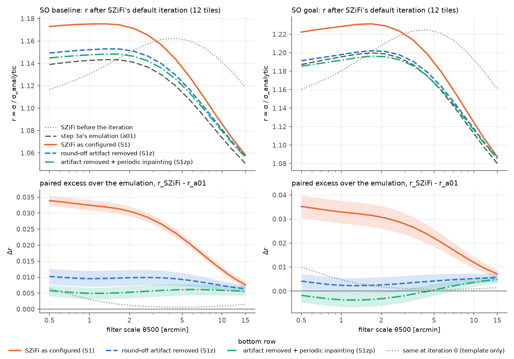
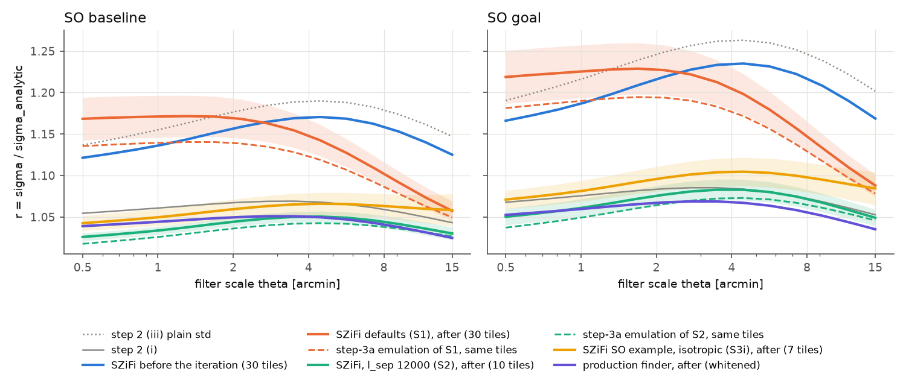
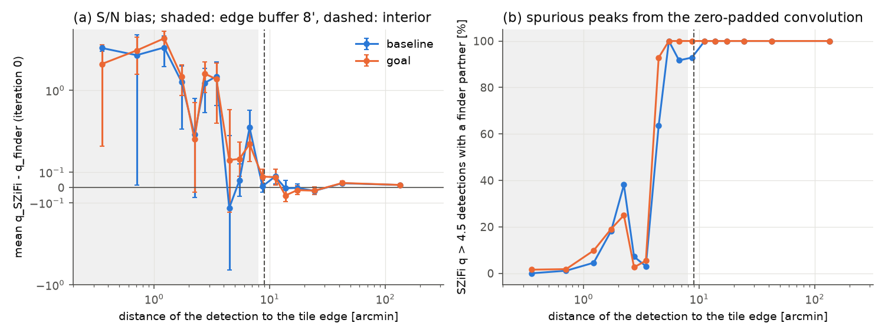
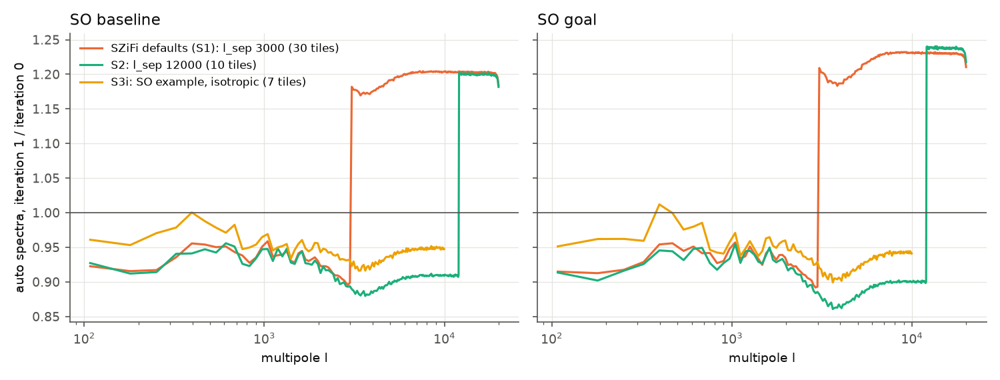

# Step 3a's SZiFi claims, tested with SZiFi itself

**Status: final, 2026-11-12. Built, checked twice independently, then arbitrated.**

- **Build** (`z00`–`z12` in this folder): ran SZiFi itself (github.com/inigozubeldia/szifi, commit 73626fb, unchanged) on step 3a's simulated SO tiles and tested step 3a's seven SZiFi claims.
- **Config check** (`verify_real/step3_szifi_real_config/`): its own survey file and driver. It reproduced 10 of the build's runs bit for bit, traced every setting, injected clusters, and found a round-off artifact caused by the build's l range.
- **Independent check** (`verify_real/step3_szifi_real_indep/`): its own survey file, driver and analysis. It reproduced the build's numbers, ran 6 new tiles, redid the merging, and found an edge effect of running SZiFi on bare periodic tiles.
- **Arbiter** (`zA00`–`zA07` in this folder): ran SZiFi itself with the artifact and the edge effect switched off, one at a time and together, on 12 tiles per noise level. It also settled the bin count of S0's spectra with exact integers and fixed an interior bug in `z08`.
- Section 0 lists what the arbitration changed. Section 10 gives every claim with its evidence and who verified it. Section 11 lists what is still open.

Step 3a (`analysis/realistic/step3/RESULTS.md`) could not run SZiFi. Its SZiFi check and its arbiter *emulated* SZiFi with their own code. Here SZiFi itself runs on the same tiles.

## The answer in short

- **Claim 1, iteration 0: confirmed.** Before masking, SZiFi itself and the production finder find the same objects.
  - 99.97–99.99% are matched both ways at q > 4.5 and q > 5 (step 3a: 100%). Δq = +0.01 ± 0.20–0.25 (step 3a: +0.01 ± 0.19–0.24). 87–89% also agree within one scale step.
  - SZiFi's pixel-sampled template raises r at 0.5′ by +0.0068 (baseline) and +0.0104 (goal), and by ≤ 0.14% above 2′ (step 3a: +0.007 / +0.010, ≤ 0.15%).
  - SZiFi reports the pixel half a pixel after the cluster: exactly (+0.5, +0.5) pixels for 92–100% of injected clusters.
  - Zero-padded filtering makes spurious peaks up to q = 24 (baseline) and 30 (goal) within 2.5′ of a periodic tile's edge (step 3a: Δq up to 26 / 33). There are none beyond 8′.
- **Claim 2, no inpainting: confirmed bit for bit.** With inpaint = False, SZiFi's second iteration repeats the first exactly.
- **Claim 3, SZiFi's default iteration: confirmed for SZiFi's method.** The build's "SZiFi is worse than the emulation" comes mostly from a round-off artifact of its l range, not from SZiFi's method.
  - As the build configured it (l range 100–20000), SZiFi ends higher than step 3a said: r after = 1.168 / 1.142 / 1.057 at 0.5′ / 4.45′ / 15′ (baseline) and 1.219 / 1.198 / 1.088 (goal), 30 tiles. Both checks reproduce this.
  - Of the excess over step 3a's emulation at 0.5′ (+0.034 / +0.035 on 12 tiles), the round-off artifact of the l range makes 70% (baseline) and 88% (goal); the bare tile edges make 13% / 17% (16% / 26% with the artifact present); the rest (+0.006 / −0.002) is SZiFi's sharper template, which raises r by +0.0065 / +0.010 already before the iteration, offset at goal by a slightly smaller mask (section 4b).
  - With the artifact removed and the inpainting made periodic, SZiFi's default iteration gives **r after = 1.145 / 1.126 / 1.056 (baseline) and 1.185 / 1.175 / 1.085 (goal)** on 12 tiles. Step 3a's emulation gives 1.139 / 1.120 / 1.051 and 1.187 / 1.175 / 1.080 on the same tiles; step 3a claimed 1.135 / 1.119 / 1.050 and 1.181 / 1.172 / 1.078 on 30 tiles.
  - Then the spectra above l = 3000 end 15–19% above iteration 0 (step 3a: 14–20%), and the q > 5 count changes by −0.6 ± 1.4% (baseline) and +1.1 ± 1.8% (goal) through the iteration (the emulation on the same tiles: +0.7% / +0.7%; the build's −5.8% / −5.1% came from the artifact).
  - On noise-only tiles σ ends 2.5% (baseline) and 3.4% (goal) too high at 0.5′ and 1% low at 15′ (1.025 → 0.990, 1.034 → 0.992; 5 tiles), as step 3a said (1.026 → 0.987, 1.034 → 0.990); as configured 4.0% / 5.9% too high (10 tiles).
  - SZiFi's defaults find **22% (baseline) and 24% (goal) fewer q > 5 clusters than the production finder** without the artifact (12 tiles; as configured: 23% / 27% on 30 tiles). Step 3a's emulation finds 20% / 24% fewer on the same 12 tiles (whole periodic tiles; `verify_real/step3_szifi_real_report/r01_spot.log` (7)); step 3a quoted 18% / 23% for tiles 0–99.
- **Claim 4, l_sep = 12000: confirmed** within 0.003–0.013 in r. As configured: r after = 1.026 / 1.051 / 1.030 (baseline) and 1.050 / 1.083 / 1.049 (goal) (step 3a: 1.019 / 1.044 / 1.026 and 1.038 / 1.075 / 1.046). Noise-only σ/analytic = 0.975 and 0.978–0.981 (step 3a: 0.976 / 0.974). Without the artifact and with periodic inpainting (7 tiles): 1.026 / 1.050 / 1.034 and 1.048 / 1.081 / 1.054, +0.007 to +0.012 above the emulation on the same tiles, most of it SZiFi's template.
- **Claim 5, the production finder:** its stored r after the iteration is 1.039 / 1.050 / 1.025 (baseline) and 1.053 / 1.067 / 1.035 (goal) on these tiles, as step 3a said. With l_sep = 12000, SZiFi counts the same q > 5 clusters within 2% (1.021 / 0.988).
- **Claim 6, SZiFi's SO example settings (never emulated):**
  - As shipped, with cov_type 'mixed_gaussian', SZiFi breaks down on our tiles: from 0 to 133,309 peaks with q > 4 per tile, median q 84–874, and σ = NaN in some runs. It also breaks down with SZiFi's own four SO channels.
  - With an isotropic covariance instead (S3i), the rest of the SO example works: r after = 1.043 / 1.066 / 1.058 (baseline) and 1.071 / 1.105 / 1.085 (goal); noise-only σ/analytic = 0.993–1.003 (unbiased); false detections at q > 5: 0 and 0.35 per 100 deg² (3 tiles); final q > 5 count 0.965 (baseline) and 0.923 (goal) of the production finder's.
- **Claim 7, merging: confirmed with SZiFi's own catalogue tools.** 10′ merging removes 6.9% (baseline) and 10.4% (goal) of the real clusters ('closest'), 7.2% / 11.4% ('fof'); 1′ merging removes 0.11–0.14%. Compared with SZiFi's own code ('closest' and 'fof', 1′ and 10′): same kept entries as `szsim.finder` in 438 of 480 tile runs ('fof' alone: 219 of 240), all differences from pairs at R ± 0.4%.
- **Problems in SZiFi found along the way** (Environment): σ at the first scale is reported as 0; the default parameter dictionary misspells a key; the merging fails with current numpy and scikit-learn; 'mixed_gaussian' builds invalid covariances on our tiles; and **an l range that leaves grid modes out of band makes SZiFi amplify round-off** (new; config check and arbiter).

*Top: r(θ) = σ/σ_analytic after SZiFi's default noise iteration, mean of the arbiter's 12 tiles per noise level. Orange: SZiFi as the build configured it. Blue dashed: the same with SZiFi's inverse covariance set to 0 outside its l range (round-off artifact removed). Green dash-dot: also with periodic inpainting. Dark grey dashed: step 3a's emulation (a01) on the same tiles. Grey dotted: SZiFi before the iteration. Bottom: the paired excess over the emulation, with the error of the mean (bands); grey dotted: the same difference before the iteration, which is SZiFi's template alone.*

*The build's figure: r(θ) before (blue) and after SZiFi's noise iteration, for SZiFi as configured with its defaults (S1, orange), with l_sep = 12000 (S2, green) and with its SO example settings but an isotropic covariance (S3i, yellow); dashed: step 3a's emulation of S1 and S2 on the same tiles; violet: the production finder. Bands: tile-to-tile scatter. Grey: step 2's noise normalisations (i) and (iii). The orange curve includes the round-off artifact (section 4b).*

## 0. What the arbitration changed

| # | claim or issue | raised by | arbiter test | result | who was right |
|---|---|---|---|---|---|
| 1 | Claim 3 (C3a–C3f, Cd1): "SZiFi itself is worse than the emulation, because its catalogue masks more of the tile" | config check ("partially": a round-off artifact of the l range); independent check ("partially" on the cause: an edge effect) | `zA03`/`zA05`: SZiFi itself as configured (S1), with its inverse covariance zeroed outside the l range (S1z), with periodic inpainting (S1p) and with both (S1zp), 12 realistic tiles per level; `zA02`: the mechanism | Of S1's excess over a01 at 0.5′ (+0.034 / +0.035, 12 tiles): the artifact +0.024 / +0.031 (70% / 88%); the edges +0.004 / +0.006 without the artifact (+0.006 / +0.009 with it); the rest +0.006 / −0.002, against SZiFi's template offset of +0.0065 / +0.010 before the iteration. S1zp: r after 1.145 / 1.126 / 1.056 and 1.185 / 1.175 / 1.085, a01 on the same tiles 1.139 / 1.120 / 1.051 and 1.187 / 1.175 / 1.080; the iteration's inflation at 0.64′ equals a01's at baseline (+0.000 ± 0.002) and is 0.009 ± 0.002 smaller at goal. The config check's runs with every mode in band (S1wg) equal S1z to 4 decimals | config check, mainly. The independent check is right that edges add, but they make 13% / 17% of the excess (16% / 26% with the artifact), not 40–45%. The build's chain (more large-scale entries → smaller f → more inflation) is right; its cause is the artifact, not SZiFi's method |
| 2 | S0cov: how many bins of SZiFi's spectra differ from the binned periodogram (126 or 44), and by how much at l = 1000–3000 | config check ("partially") | `zA01`: exact-integer periodogram of the same float32 map; NaMaster's assignment of the modes on bin edges found bin by bin | NaMaster's spectra are the binned periodogram, with 45 of the 506 groups of edge modes (27 edges) placed in the bin below; then all 277 in-band bins agree to 1.0×10⁻¹⁴. Against the exact rule l0 ≤ l < lf, 44 bins differ: 2 below l = 1000 (up to 4.8%), 2 at 1000–3000 (l0 = 1800, 1872; up to 1.6%), 40 above 3000 (≤ 0.40%). The build's 126 bins are reproduced against its own floating-point reference, which misplaces other edge modes | config check on the count (44 bins). At l = 1000–3000 the largest deviation is 1.6%, close to the build's 1.4%; the config check's 'up to about 5%' is the largest of its four bins below 3000, which lies below l = 1000. The build's description was right; its counts were relative to its own reference |
| 3 | The interior is one pixel narrower for SZiFi than for the finder | independent check (its bug 2) | `z08` fixed (equal-area half-open window) and rerun | SZiFi / production q > 5 counts 0.772 → 0.774 (baseline), 0.732 → 0.733 (goal); counts per tile up by ≤ 0.5; matches unchanged at the quoted precision | independent check |
| 4 | S3's description too narrow | independent check (its bug 3); config check (four channels) | re-read of both checks' logs | 0 to 133,309 q > 4 peaks per tile; σ = NaN at 14 of 15 scales in one run; also breaks down with SZiFi's own four SO channels | both checks |
| 5 | New SZiFi issue E4: round-off amplified outside the l range | config check | `zA02`, `zA05` (1), (2), (5) | confirmed: SZiFi's inverse covariance above l = 20000 is 8×10¹³ times its in-band value; up to 20% of a 15′ filter's energy sits outside the band; 38–46% of iteration-0 (pixel, scale) entries change when it is removed; without it a last-bit change of the 15 scales changes nothing (max |Δq| 0 at iteration 0, 1×10⁻⁶ at iteration 1), against up to 0.1 with it (config check) | config check |
| 6 | C1c caveat: SZiFi's scale assignment is fragile | config check | `zA05` (1) | caused by E4: without it, SZiFi → finder matches within one scale step rise from 84.4% to 88.2% (baseline) and 86.1% to 88.4% (goal); finder → SZiFi unchanged (87.9 → 87.8%, 87.8 → 88.4%) | config check |
| 7 | C4a: "in S2 the edge term dominates the excess over the emulation" | independent check (note on C4a) | `zA05` (4b): S2z and S2zp on 7 tiles per level | S2 − a01 at 0.5′ = +0.009 / +0.014: artifact −0.002, edges +0.002 / +0.004, rest +0.009 / +0.012, mostly SZiFi's template (+0.0065 / +0.010). S2zp: r after 1.026 / 1.050 / 1.034 and 1.048 / 1.081 / 1.054 | build and config check (claim 4 confirmed); the edges are about a quarter of the small excess |

- Numbers that changed: the cause of claim 3's excess and every claim-3 comparison with step 3a (C3a–C3f, Cd1 now also given without the artifact), S0cov, the count ratios (interior fix), S3's description.
- Unchanged and confirmed: claims 1, 2, 4, 5, 7, S3i (claim 6), E1–E3, and all of the build's numbers for SZiFi as configured.

## Where things are

- Scripts and logs: this folder. Each script has a `.log` of its output next to it.
  - Build: `z00`–`z12` (driver `z_szlib.py`, survey file `z_survey.py`). `z08_analysis.py` was rerun by the arbiter with the interior fix; the build's output is kept as `z08_analysis_build_original.log`.
  - Arbiter: `zA_lib.py` (driver: the build's `z_szlib.py` plus two optional interventions), `zA00_maps.py` (tiles regenerated), `zA01_bins.py` (S0cov), `zA02_checks.py` (checks of the interventions and the mechanism), `zA03_queue.py` (runs; logs `zA03_queue_w*.log`, `zA03_queueB_*.log`, `zA03_queueC_*.log`), `zA04_memwatch.py`, `zA05_analysis.py`, `zA06_figure.py`, `zA07_copycheck.py`.
- Data: `data_real/step3_szifi_real/`. `runs/` holds the build's SZiFi runs, `arbiter/runs/` the arbiter's. The regenerated maps were scratch and are deleted; they come back bit for bit from the seeds (`z01_maps.py`, `zA00_maps.py`).
- Figures: `figures/realistic/step3_szifi_real_*.png`.

## Terms

- **SZiFi itself.** The clone at `/Users/boris/GitHub/szifi`, imported unchanged and run through its own `input_data` and `cluster_finder.find_clusters` (two noise iterations).
- **Emulation.** Step 3a's own code that reproduces SZiFi:
  - the SZiFi check's `verify_real/step3_szifi/vsz_lib.py`, runs `v04_*`, with SZiFi's template; 'periodic' or zero-padded ('linear') filtering;
  - the arbiter's `szsim.finder.masked_cov(method="szifi")`, runs `a01_*` and `tiles_szifi/`, with the finder's template on periodic tiles. "a01" below.
- **Production finder.** `szsim/finder.py` with its whitened masked covariance (step 3a's final catalogues).
- **Iteration 0 / 1.** SZiFi's noise iterations.
  - Iteration 0 uses the covariance of the whole tile.
  - Iteration 1 re-estimates it after masking the q > 4 detections of iteration 0 with discs of radius 3θ. It gives the final catalogue.
- **σ(θ), r(θ).** σ is the filter's noise at scale θ. **r = σ / σ_analytic**, where σ_analytic is the same filter's noise with the true CMB + noise covariance of our skies.
  - Each filter keeps its own template: SZiFi's pixel-sampled template (σ_analytic from `z04`), step 1's template for the production finder and a01 (σ_analytic = σ_Y).
  - On noise-only tiles r is called σ/analytic.
- **l range, out of band.** SZiFi's `lrange`: it zeroes the Fourier modes outside it in every map. With [100, 20000] on our 0.5′ grid, 32.7% of the modes (up to l = 30,547 in the corners) are out of band.
- **Round-off artifact (E4).** SZiFi still bins its spectra up to l = 21,600, so the 22 bins above l = 20,016 hold only float32 round-off. Its inverse covariance there is about 10¹⁴ times too large, and round-off leaks through it into the filters (section 4b).
- **Edge effect.** SZiFi's inpainting and blend stop at the tile edge, while its spectra are FFTs that treat the tile as periodic. Holes that touch the edge are filled from one side only, which leaves a jump across the periodic boundary.
- **Configurations.**
  - S0: no inpainting. S1: SZiFi's defaults for the iteration. S2: S1 with l_sep = 12000. S3: SZiFi's SO example settings. S3i: S3 with an isotropic covariance. S3it0: S3, iteration 0 only.
  - **Arbiter variants** (in-process interventions, `zA_lib.py`; SZiFi's files untouched): **S1z** = S1 with SZiFi's inverse covariance set to 0 at every mode outside the l range (the modes SZiFi zeroes in the maps; in exact arithmetic this changes nothing); **S1p** = S1 with SZiFi's own inpainting and blend run on the tile padded periodically by 200 pixels; **S1zp** = both; S2z, S2zp the same for S2; S1zL = S1z with the scales built as exp(linspace) instead of geomspace (values differ in the last bit).
  - **S1wg**: the config check's runs with l range [100, 30600] (every mode in band; tiles 0–55).
- **Edge buffer b, interior.**
  - SZiFi treats our periodic tiles as ordinary flat tiles and filters them by zero-padded convolution.
  - Its peak-finding and selection masks therefore leave out pixels within b = 8′ of the edge (chosen in section 1).
  - All counts and matches use the **interior**: objects at least 9′ (b + 1′) from the edges, 94.1 deg² per tile, as an equal-area half-open window for both position grids (arbiter fix).
- **Position.** SZiFi reports the pixel half a pixel after the cluster (section 1). Its positions are shifted by −1/2 pixel before matching.
- **Match.** An object is matched if the other catalogue has a detection within 1′, at any scale (step 3a's definition) or, where stated, also within one scale step. Δq = q_SZiFi − q_other.
- **Unmasked fraction f.** The fraction of the tile outside the iteration-1 cluster mask. **Edge coverage**: the fraction of the tile's boundary pixels inside it.
- **l_sep.** SZiFi divides the spectra of the inpainted maps by f only in the bins above l_sep.
- **Verified by.** *both* = the config check and the independent check; *config* or *indep* = one of them; *arbiter* = a targeted arbiter test (`zA*`); *unresolved* = open (section 11).

## Environment

- **Python for SZiFi:** `/Users/boris/GitHub/szifi-venv/bin/python`, Python 3.12.9 (`z00b_env.log`): numpy 2.5.4, scipy 1.18.1, astropy 8.0.2, healpy 1.20.1, numba 0.68.1 (llvmlite 0.50.0), matplotlib 3.11.2, pixell 0.32.9, pymaster 3.0.1 (NaMaster), scikit-learn 1.9.1, setuptools 80.10.2, orphics 0.1 (git d062f39), six 1.17.0, h5py 3.16.0, PyYAML 6.0.3 (SZiFi's `sphere.py` imports yaml), ducc0 0.42.0.
- **Nothing was installed** by the build, the checks or the arbiter. Where SZiFi calls a function that newer packages changed, the drivers adapt the call instead.
- **How SZiFi ran.**
  - Started as `python -I -B` with `sys.dont_write_bytecode = True` and the clone put on `sys.path` explicitly.
  - `NUMBA_CACHE_DIR` pointed to an `out/` folder of ours (SZiFi's one numba function is not cached anyway), and OMP, OpenBLAS, vecLib and numba each had one thread.
  - Production runs set `MallocLargeCache=0` (see Compute).
  - The clone is untouched: `git -C /Users/boris/GitHub/szifi status --short` prints nothing, and there is no `__pycache__` in it (`zA07_copycheck.log`).
- **The tiles.** Regenerated from their seeds with the project's `.venv` exactly as step 3a did (`z01_maps.py`, `zA00_maps.py`, through `s3lib.py`), written as float32 maps in μK (1200 × 1200 × 6).
  - Rerunning the production finder on all 80 regenerated tiles of the build and the 34 of the arbiter gives the stored σ and catalogues **bit for bit**. The arbiter's rerun of the build's S1 run of tile 0 (baseline) is identical in all 27 output arrays (`zA05_analysis.log` (0)).
  - The float32 maps differ from the float64 ones by ≤ 2.9×10⁻⁷ of their standard deviation.
- **Our code around SZiFi** (own code; no SZiFi code is copied: of SZiFi's 2,567 distinct source lines with ≥ 30 characters, the only ones that also occur in this repository are two generic imports, `from multiprocessing import Pool` and `from scipy.ndimage import gaussian_filter`, in 28 older files; `zA07_copycheck.log`):
  - `z_survey.py`, our survey file. It hands SZiFi each tile with all masks set to ones, except the peak-finding and selection masks, which leave out the 8′ edge buffer. It builds SZiFi's `SOgoal_simple` experiment and replaces `nu_eff`, `FWHM`, `noise_levels` and `tsz_sed` with ours.
  - `z_szlib.py`: thin wrappers record what passes through four SZiFi functions and pass the results on unchanged.
  - `zA_lib.py` (arbiter): `z_szlib.py` plus two optional interventions, used only as diagnostics (S1z, S1p and their combinations, Terms).
- **Interventions of the build that change no result:**
  - **Memory.** At iteration 1 the wrapper drops SZiFi's two references to the old inverse covariance just before SZiFi overwrites them. Bit-identical in all 36 output arrays (`z02b_memcheck_S1.log`).
  - **scikit-learn.** In `szifi.cat`'s namespace, AgglomerativeClustering becomes a factory that passes SZiFi's `affinity=` on as `metric=`.
  - **healpy and numpy.** SZiFi's merging stores healpy's one-pair angular distance (an array of length 1) into a scalar; a wrapper returns that one value as a scalar.
- **Problems found in SZiFi** (not fixed; handled in the drivers):
  1. **E1.** With `detection_method = 'maxima_lomem'`, `filter_maps.find_clusters` moves on to the next scale before storing σ of the first, so the reported σ at 0.5′ is 0 (in every run). σ(0.5′) = y0/q of any detection at that scale; at the other 14 scales this rule reproduces SZiFi's σ to ≤ 3×10⁻⁸.
  2. **E2.** SZiFi's default dictionary spells the key 'snr_weigthing', but `cluster_finder` reads 'snr_weighting': KeyError at `mmf.py` line 95 with the defaults alone. We set 'snr_weighting' = False, as SZiFi's SO script does.
  3. **E3.** Its merging fails with the installed packages: 'closest' with numpy 2.5.4 ("setting an array element with a sequence"), 'fof' with scikit-learn 1.9.1 (no `affinity`), then on the same numpy problem.
  4. **E4 (new).** An l range that leaves grid modes out of band makes SZiFi amplify round-off (section 4b). The fix is an l range that covers every mode, as SZiFi's SO example script has ([1, 300000]).
  5. **E5.** `cov_type = 'mixed_gaussian'`, the SO script's choice, builds invalid covariances on our tiles (section 7).

## Configurations

Every SZiFi parameter that differs from its default dictionary (`z00b_env.log`). The full dictionary of each configuration is printed in its run logs.

| parameter | SZiFi default | S0 'no inpaint' | S1 'defaults' | S2 'l_sep 12000' | S3 'SO example' | S3i |
|---|---|---|---|---|---|---|
| theta_500_vec_arcmin | 0.5′, 15′ | 15 scales 0.5′–15′ (step 3a's) | same | same | same | same |
| beam | real | gaussian | gaussian | gaussian | gaussian | gaussian |
| integrate_bandpass | True | False | False | False | False | False |
| get_lonlat | True | False | False | False | False | False |
| save_and_load_template | True | False | False | False | False | False |
| snr_weighting | (missing; see E2) | False | False | False | False | False |
| lrange | [100, 2500] | [100, 20000] | [100, 20000] | [100, 20000] | [1, 300000] | [1, 300000] |
| decouple_type | master | none | none | none | master | master |
| coupling_matrix_needed | True | False | False | False | True | True |
| save_coupling_matrix | False | – | – | – | True | True |
| inpaint | True | **False** | True | True | True | True |
| inpaint_type, n_inpaint | diffusive, 100 | – | diffusive, 100 | diffusive, 100 | orphics, −1 | orphics, −1 |
| lsep | 3000 | – | 3000 | **12000** | 12000 | 12000 |
| min_radius_mask_arcmin | 0 | 0 | 0 | 0 | 1 | 1 |
| cov_type, cov_kernel_shape | isotropic, [4, 4] | isotropic | isotropic | isotropic | **mixed_gaussian, [10, 10]** | isotropic, [10, 10] |
| powspec_lmax1d | None | None | None | None | 10000 | 10000 |
| survey_file, path, path_data, path_template | the author's paths | ours | ours | ours | ours | ours |

- **Left at SZiFi's defaults:** q_th 4, q_th_noise 4, mask_radius 3, iterative True, max_it 1, detection_method 'maxima_lomem', extraction_mode 'find', powspec_bin_fac 4, interp_type 'nearest', apod_type 'old', norm_type 'centre', mmf_type 'standard', map_dtype float32, tile_type 'healpix' (a flat tile in SZiFi's own coordinates), tilemask_mode 'field'.
- **Why l range [100, 20000] in S0–S2:** step 3a's band. It is also what triggers E4 (section 4b); S3 and S3i cover every mode.
- **Instrument** (all configurations): SZiFi's `SOgoal_simple` object with our `nu_eff` (27, 39, 93, 145, 225, 280 GHz), FWHM (SZiFi's), `tsz_sed` = `szsim.instrument.tsz_f_uK` (SZiFi's values differ by ≤ 2.5×10⁻⁵) and the white levels of the noise level.
- **Masks:** power spectrum, map apodisation and point sources are ones. Peak finding and selection leave out the 8′ edge buffer, except in S0, which ran without a buffer so that section 1 could see the edges.
- **S3 coupling matrix.** Computed by SZiFi once for our ones mask on the l_max,1d grid (556 × 556, 139 bins), stored as `coupling_ones_bin04_lmax10000.fits`; the independent check's own computation is byte-identical.
- **SO-script settings that could not apply to our flat tiles:** tile_type 'car' and tilemask_mode 'catalogue' need a pixell WCS and a separate tile mask; its apodised 'Smooth' power-spectrum mask and 2′ selection buffer were replaced by a ones mask and our edge buffer; its four channels, q_th 4.5, θ = 2′ and 3′ and get_lonlat True by our six channels, 4, our 15 scales and False; its cosmology 'Websky' by Planck15.
- **Tiles.**
  - S1: the 30 tiles of step 3a's a01 run (pid = 0, 11, …, 319) per noise level, plus noise-only versions of 10 of them (pid 0, 11, …, 99).
  - S2: 10 realistic tiles per level (pid 0–99), noise-only tiles 0–55 (6 per level) plus tile 66 (baseline).
  - S3i: 7 realistic (pid 0–66) and 3 noise-only (pid 0–22) tiles per level. S3it0: 2 realistic (33, 66) and 2 noise-only (0, 33). S0: 6 realistic (0, 33, …, 165).
  - Arbiter: realistic pid 0, 11, 22, 33, 44, 55, 88, 132, 176, 220, 264, 308 (12 of the 30 S1 tiles, chosen before any run) with S1z, S1p, S1zp; S2z and S2zp on the 7 of them with S2 runs; noise-only pid 0, 22, 44, 66, 88 with S1z and S1zp.

## 1. Edges, the buffer and SZiFi's position offset (test f; `z07_edges.log`)

S0 without an edge buffer (iteration 0, 6 realistic tiles per level), against the production finder's stored iteration 0. The finder is periodic, so it has no edges.

- **Position offset.** In the deep interior (≥ 60′ from the edges), the nearest SZiFi detection to each finder detection with q > 6 lies (+0.54, +0.53) pixels away (baseline) and (+0.50, +0.54) (goal). The independent check finds (+0.49, +0.48) and (+0.49, +0.49) on S1's 30 tiles. For injected clusters at known positions SZiFi reports exactly (+0.5, +0.5) pixels in 92–100% of cases (config check). **SZiFi reports the pixel half a pixel after the cluster.**
- **Spurious edge peaks.** Zero-padded filtering of a periodic tile creates peaks at its edges:

  | distance to the edge | 0–2.5′ | 2.5–5′ | 5–8′ | 8–60′ |
  |---|---|---|---|---|
  | SZiFi q > 4.5 peaks per 100 deg² of the band, baseline / goal | 11,488 / 12,392 | 3,129 / 5,327 | 196 / 315 | 242 / 318 |
  | of them without a finder detection within 1′ | 98% / 97% | 94% / 94% | 9% / 0% | 0% / 0% |
  | highest q of a spurious peak | 24.3 / 30.1 | 7.6 / 9.3 | 4.6 / – | – |

  The independent check, measuring the edge distance its own way, finds 11,277 / 12,030 peaks per 100 deg² within 2.5′, 98% without a finder partner, highest q 24.3 / 30.1.
- **Buffer b = 8′.** The smallest b such that, from b to 60′, the match fractions both ways stay within 2σ of the interior's and the bin means of Δq agree with the interior mean (χ² p > 0.05, for all detections and for θ > 2′). p = 0.21 / 0.09 (θ > 2′: 0.59 / 0.15). The independent check's own test gives p = 0.53 / 0.21 (0.69 / 0.08) at 8′ and rejects 6′ for goal (p = 0.03). The analysis interior starts at 9′.

*Section 1: (a) mean Δq of matched iteration-0 detections against the distance to the tile edge; (b) the fraction of SZiFi's q > 4.5 peaks that have a finder detection within 1′. Shaded: the 8′ edge buffer; dashed: the interior (9′).*

## 2. Iteration 0 (test a; claims 1 and 2; `z08_analysis.log` (a))

S1's iteration 0, 30 realistic tiles per level, against the production finder's stored iteration 0 on the same tiles. Interior only.

| | baseline | goal | step 3a (emulated) |
|---|---|---|---|
| r_SZiFi − r_finder at 0.5′ (tile sd) | **+0.0068** (0.0009) | **+0.0104** (0.0012) | +0.007 / +0.010 |
| r_SZiFi / r_finder − 1, largest above 2′ | **+0.14%** | **+0.14%** | ≤ 0.15% |
| r before the iteration at 0.5′ / 4.45′ / 15′: SZiFi | 1.121 / 1.171 / 1.125 | 1.166 / 1.235 / 1.169 | – |
| same, production finder | 1.115 / 1.170 / 1.124 | 1.156 / 1.234 / 1.167 | 1.115 / 1.170 / 1.124; 1.156 / 1.234 / 1.167 |
| matched within 1′, q > 4.5 (finder → SZiFi / SZiFi → finder) | 99.98 / 99.99% | 99.97 / 99.98% | 100% |
| matched within 1′, q > 5 | 99.98 / 99.98% | 99.99 / 99.97% | 100% |
| also within one scale step, q > 4.5 / q > 5 (finder → SZiFi) | 87.8 / 89.2% | 86.9 / 88.2% | 86–89% |
| same, SZiFi → finder | 84.8 / 87.3% | 85.4 / 87.1% | – |
| Δq, q > 4.5 / q > 5 | +0.012 ± 0.197 / +0.014 ± 0.209 | +0.011 ± 0.234 / +0.012 ± 0.249 | +0.01 ± 0.19–0.24 |

- **The template effect is as claimed.** SZiFi's pixel-sampled template raises r by +0.007 / +0.010 at 0.5′ and by 0.06–0.14% above 2′. The round-off artifact does not touch σ (S1z / S1 − 1 ≤ 3×10⁻⁸).
- **Against the SZiFi check's emulation** (`v04_lin`, 10 tiles per level): σ agrees to ≤ 3.4×10⁻⁴ (baseline) and 3.0×10⁻⁴ (goal), the analytic σ of the two templates to 3.7×10⁻⁶; the catalogues match 100% both ways with Δq ± 0.03.
- **The artifact changes iteration 0 at the level of single entries** (`zA05_analysis.log` (1), 12 tiles). Without it (S1z), 46% (baseline) and 38% (goal) of SZiFi's (pixel, scale) entries change, with |Δq| ≤ 0.21 on the entries that stay. Matching at any scale is unchanged (100% / 99.96–100%). The entries at θ ≥ 7.24′ drop from 23.6 to 15.4 per tile (baseline; the finder has 14.2) and from 23.1 to 15.0 (goal; finder 16.5); "stacked" ones, a second scale-axis maximum within 2 pixels of a smaller-scale entry, drop from 10.4 to 2.2 and from 9.7 to 1.8.
- **Claim 2: confirmed bit for bit.** With inpaint = False (S0), iteration 1 has exactly the spectra, σ and catalogue of iteration 0 in 6 of 6 tiles per level, and in the config check's and the independent check's own S0 runs. SZiFi uses the cluster mask only through inpainting.

## 3. S0's covariance estimate (`z03_decouple.log`, `zA01_bins.log`; tile 0, baseline)

- decouple 'fsky' equals 'none' exactly for a ones mask.
- 'master', with the coupling matrix SZiFi computed for the ones mask on S3's 556 × 556 grid, equals 'none' to 1.5×10⁻⁷. A full-resolution coupling matrix was not computed.
- SZiFi's 'none' spectra are the spectra its S0 run recorded, exactly.
- **They are the binned periodogram of the band-limited float32 maps, except for modes that lie exactly on a bin edge** (l = 72k, i.e. kx² + ky² = 4k²).
  - Exact test (`zA01_bins.log`): the mode (kx, ky) has l = 36 √(kx² + ky²) exactly, and SZiFi's bins are [72k, 72(k+1)), so a mode lies on an edge when kx² + ky² = 4k². 3,174 modes (0.22% of the grid) do, in 506 groups of equal |kx|, |ky|.
  - NaMaster places 45 of these groups (27 of the 299 on the axes, 18 of the 207 off them), on 27 edges between l = 936 and 15,912, in the bin below the edge. With that placement, all 277 in-band bins equal the periodogram to 1.0×10⁻¹⁴.
  - Against the exact rule l0 ≤ l < lf, **44 in-band bins differ** by more than 10⁻⁶: 2 below l = 1000 (l0 = 864, 936; up to 4.8%), 2 between 1000 and 3000 (l0 = 1800, 1872; up to 1.6%) and 40 above 3000 (≤ 0.40%). The config check found the same 44 bins.
  - The build's count of 126 bins (up to 8.1% / 1.4% / 1.1%) is reproduced exactly against its own reference, floor(l / 72) with floating-point l, which puts other edge modes in other bins. Its description, a binned periodogram up to the edge modes, was right.
  - This is the same kind of effect as SZiFi's 'nearest' tie rule, which step 3a measured at +0.008% to +0.18% in σ. σ computed from an exact periodogram is within 1.8×10⁻⁴ of SZiFi's (config check).
- **Band-edge bins.** SZiFi averages a bin over all its modes, so the two bins that straddle l = 100 and 20000 are diluted by exactly 0.6667 (24 of 36 modes in band) and 0.7832 (5476 of 6992) relative to the finder, which averages over in-band modes only (step 3a: 0.667 and 0.783).

## 4. Iteration 1 with SZiFi's defaults (S1) and with l_sep = 12000 (S2) (test b; claims 3 and 4)

### (a) SZiFi as configured (the build's runs; `z08_analysis.log` (b))

Interior only. "a01" is step 3a's arbiter emulation on the same tiles (finder template, periodic tiles); the claims are its 30-tile means.

| | S1 baseline | S1 goal | S2 baseline | S2 goal |
|---|---|---|---|---|
| realistic tiles | 30 | 30 | 10 | 10 |
| **r after, SZiFi as configured, 0.5′ / 4.45′ / 15′** | **1.168 / 1.142 / 1.057** | **1.219 / 1.198 / 1.088** | **1.026 / 1.051 / 1.030** | **1.050 / 1.083 / 1.049** |
| error of the mean | 0.005 / 0.003 / 0.002 | 0.006 / 0.004 / 0.002 | 0.001 / 0.002 / 0.002 | 0.003 / 0.004 / 0.003 |
| step 3a's claim | 1.135 / 1.119 / 1.050 | 1.181 / 1.172 / 1.078 | 1.019 / 1.044 / 1.026 | 1.038 / 1.075 / 1.046 |
| SZiFi − a01, paired | +0.033 / +0.024 / +0.008 | +0.038 / +0.027 / +0.010 | +0.008 / +0.008 / +0.003 | +0.013 / +0.010 / +0.003 |
| auto spectra after / before, l 100–3000 / 3000–20000 | 0.928 / 1.199 | 0.928 / 1.225 | 0.925 / 1.043 | 0.922 / 1.054 |
| unmasked fraction f: SZiFi / a01 | 0.757 / 0.788 | 0.736 / 0.757 | 0.759 / 0.788 | 0.728 / 0.753 |
| q > 4 detections with θ ≥ 7.2′ per tile, iteration 0: SZiFi / finder | 22.1 / 14.0 | 21.3 / 15.4 | 21.6 / 13.2 | 22.4 / 15.9 |
| q > 5 detections per tile, before → after | 166.7 → 157.0 (−5.8 ± 1.0%) | 233.1 → 221.1 (−5.1 ± 1.3%) | 172.4 → 213.3 (+23.7 ± 1.9%) | 236.9 → 306.4 (+29.3 ± 2.4%) |
| a01, whole periodic tile | 171.6 → 176.1 (+2.6%) | 242.2 → 249.0 (+2.8%) | 177.2 → 228.3 (+28.8%) | 245.7 → 334.7 (+36.2%) |

- Both checks reproduce these numbers; the independent check's 6 new tiles agree within 1.2σ.
- As configured, SZiFi's spectra above l = 3000 end 20–23% above iteration 0, its r is 0.03–0.04 higher at small θ, its iteration costs 5–6% of the q > 5 detections, and it masks more of the tile (f 0.03 / 0.02 smaller).
- **Why** is section (b): these differences come from the round-off artifact and, to a smaller part, from the tile edges.

### (b) Why SZiFi as configured ends above the emulation (arbiter; `zA02_checks.log`, `zA05_analysis.log`)

**The mechanism of the artifact (E4)** (`zA02_checks.log` (2), tile 0 baseline, iteration 0):
- SZiFi zeroes the modes outside [100, 20000] in every map, but bins its spectra up to l = 21,600. The bins above 20,016 hold only float32 round-off (10⁻¹⁶–10⁻¹⁴ of the in-band level; config check).
- So SZiFi's inverse covariance there is 8×10¹³ times its value at l = 15,000–20,000 (145 GHz).
- SZiFi's band-limited templates are not exactly zero there: their energy outside the band is 2×10⁻³² of the in-band energy (float64 round-off). Multiplied by that inverse covariance, the filters put 7×10⁻⁴ (0.5′) to 20% (15′) of their energy outside the band.
- That part of each filter is round-off noise. It enters SZiFi's zero-padded float32 convolution and moves q by up to 0.2. It creates and removes marginal maxima, mostly along the scale axis at large θ.
- Setting the inverse covariance to 0 outside the band (S1z) leaves σ unchanged (≤ 3×10⁻⁸) and removes all of this. The config check's runs with every mode in band (S1wg) give **the same** results as S1z to 4 decimals on its 6 tiles per level (`zA05_analysis.log` (5)).
- **Last-bit test.** As configured, changing 6 of the 15 scale values in the last bit moves q by up to 0.1 and 6% of the detections to another scale (config check). With the artifact removed (S1zL vs S1z, tile 0 baseline, `zA05_analysis.log` (2)), both iterations give identical catalogues (max |Δq| 0 at iteration 0, 9.5×10⁻⁷ at iteration 1) and the same f.
- With float64 maps the same mechanism breaks SZiFi outright: 2.1 million detections (config check).

**The edge effect** (`zA02_checks.log` (1), the tile with the largest edge coverage, goal 132):
- With SZiFi's inpainting, the mean squared jump across the periodic boundary is 5.5 and 5.7 times that inside the tile at 93 and 145 GHz (1.0–1.15 with periodic inpainting).
- The periodic wrappers change only the holes that touch the edge: other holes and unmasked pixels are identical before SZiFi's final l filter, and pads of 200 and 300 pixels give identical maps.

**SZiFi itself with each effect switched off** (12 realistic tiles per level, paired with a01 on the same tiles; `zA05_analysis.log` (3), (4)):

| | S1: as configured | S1p: periodic inpainting | S1z: artifact removed | S1zp: both | a01 (emulation) |
|---|---|---|---|---|---|
| **baseline**: r after, 0.5′ / 4.45′ / 15′ | 1.173 / 1.144 / 1.058 | 1.167 / 1.140 / 1.057 | 1.149 / 1.130 / 1.057 | **1.145 / 1.126 / 1.056** | 1.139 / 1.120 / 1.051 |
| r after − a01 at 0.5′ (paired) | +0.034 ± 0.002 | +0.028 ± 0.002 | +0.010 ± 0.002 | +0.006 ± 0.002 | – |
| σ after / before at 0.64′ (− a01's) | 1.047 (+0.025) | 1.042 (+0.020) | 1.026 (+0.004) | 1.022 (+0.000) | 1.022 |
| unmasked fraction f | 0.744 | 0.744 | 0.782 | 0.782 | 0.778 |
| boundary pixels inside the mask | 0.098 | 0.098 | 0.074 | 0.074 | – |
| q > 4 entries at θ ≥ 7.24′ per tile, iteration 0 | 23.6 | 23.6 | 15.4 | 15.4 | 14.2 (finder) |
| spectra after / before, l 3000–6000 / 6000–12000 / 12000–20000 | 1.199 / 1.216 / 1.215 | 1.198 / 1.220 / 1.220 | 1.153 / 1.172 / 1.171 | 1.151 / 1.174 / 1.174 | 1.153 / 1.178 / 1.178 |
| q > 5 per tile through the iteration | −8.1 ± 1.5% | −6.7 ± 1.4% | −0.9 ± 1.5% | −0.6 ± 1.4% | +0.7 ± 1.7% (whole tile) |
| final q > 5 / production finder | 0.756 ± 0.010 | 0.767 ± 0.009 | 0.782 ± 0.011 | 0.784 ± 0.009 | – |
| **goal**: r after, 0.5′ / 4.45′ / 15′ | 1.222 / 1.199 / 1.087 | 1.213 / 1.192 / 1.086 | 1.191 / 1.179 / 1.086 | **1.185 / 1.175 / 1.085** | 1.187 / 1.175 / 1.080 |
| r after − a01 at 0.5′ (paired) | +0.035 ± 0.005 | +0.026 ± 0.004 | +0.004 ± 0.003 | −0.002 ± 0.003 | – |
| σ after / before at 0.64′ (− a01's) | 1.050 (+0.022) | 1.042 (+0.014) | 1.023 (−0.004) | 1.018 (−0.009) | 1.028 |
| unmasked fraction f | 0.722 | 0.722 | 0.766 | 0.766 | 0.747 |
| boundary pixels inside the mask | 0.094 | 0.094 | 0.072 | 0.072 | – |
| q > 4 entries at θ ≥ 7.24′ per tile, iteration 0 | 23.1 | 23.1 | 15.0 | 15.0 | 16.5 (finder) |
| spectra after / before, l 3000–6000 / 6000–12000 / 12000–20000 | 1.215 / 1.242 / 1.241 | 1.211 / 1.245 / 1.246 | 1.160 / 1.190 / 1.190 | 1.157 / 1.192 / 1.193 | 1.177 / 1.213 / 1.215 |
| q > 5 per tile through the iteration | −6.9 ± 2.0% | −5.5 ± 1.5% | +0.1 ± 1.9% | +1.1 ± 1.8% | +0.7 ± 1.8% (whole tile) |
| final q > 5 / production finder | 0.723 ± 0.015 | 0.734 ± 0.012 | 0.755 ± 0.016 | 0.763 ± 0.015 | – |

- Errors: error of the mean over the 12 tiles (paired where stated); count ratios from 2000 tile-bootstrap resamples.
- S1 here is the build's stored runs of these 12 tiles; their means lie within 0.005 of the build's 30-tile means.
- S1p and S1zp share S1's and S1z's iteration 0 and cluster mask bit for bit (24 of 24 tile runs each): the periodic wrappers act only on the iteration-1 noise maps.

**Decomposition of SZiFi's excess over a01** (r units, paired, mean ± error of the mean; `zA05_analysis.log` (4)):

| part of the excess (r units, paired, 12 tiles) | baseline: 0.5′ / 4.45′ / 15′ | goal: 0.5′ / 4.45′ / 15′ |
|---|---|---|
| total: S1 − a01 | +0.034 ± 0.002 / +0.024 ± 0.001 / +0.008 ± 0.001 | +0.035 ± 0.005 / +0.024 ± 0.004 / +0.007 ± 0.002 |
| round-off artifact: S1 − S1z | **+0.024 ± 0.003** / +0.014 ± 0.002 / +0.001 ± 0.001 | **+0.031 ± 0.003** / +0.020 ± 0.003 / +0.002 ± 0.001 |
| edges, without the artifact: S1z − S1zp | +0.004 ± 0.002 / +0.004 ± 0.001 / +0.001 ± 0.001 | +0.006 ± 0.002 / +0.004 ± 0.002 / +0.001 ± 0.001 |
| rest: S1zp − a01 | +0.006 ± 0.002 / +0.006 ± 0.002 / +0.006 ± 0.001 | −0.002 ± 0.003 / −0.000 ± 0.003 / +0.005 ± 0.002 |
| of which SZiFi's template, before the iteration | +0.0065 / +0.0006 / +0.0015 | +0.0100 / +0.0008 / +0.0015 |
| rest minus the template | −0.001 ± 0.002 / +0.005 ± 0.002 / +0.004 ± 0.001 | −0.012 ± 0.003 / −0.001 ± 0.003 / +0.003 ± 0.002 |
| for comparison: edges with the artifact, S1 − S1p | +0.006 ± 0.002 / +0.004 ± 0.002 / +0.001 ± 0.001 | +0.009 ± 0.002 / +0.007 ± 0.002 / +0.001 ± 0.001 |

- **The artifact makes most of the excess**: 70% (baseline) and 88% (goal) at 0.5′, 60% / 83% at 4.45′. It acts through the iteration-0 catalogue. Its spurious large-scale entries (23–24 per tile at θ ≥ 7.24′ instead of 15) mask more of the tile (f 0.744 instead of 0.782 at baseline), and SZiFi divides the spectra above l_sep by f. It also lowers the count of q > 5 detections through the iteration (−8.1% instead of −0.9%).
- **The edges add a smaller part**: 13% / 17% of the excess (16% / 26% with the artifact, whose extra large masks reach the edge more often). Per tile the edge term follows the boundary coverage of the mask (correlation +0.67 / +0.63). It has a tail: with the artifact present, the largest terms are +0.015 (baseline, tile 220) and +0.024 (goal, tile 132); without it, +0.015 and +0.017 (both tile 132; `verify_real/step3_szifi_real_report/r01_spot.log` (8)). The independent check's tile 41 (+5.1% in σ) belongs to the tail. The independent check's regression over tiles gave 40–45%; the direct test gives less.
- **The rest is SZiFi's template.** Before the iteration SZiFi's r is already +0.0065 / +0.010 higher at 0.5′ (section 2). What the iteration adds on top is the same as in the emulation at baseline (−0.001 ± 0.002 at 0.5′; inflation at 0.64′ +0.000 ± 0.002). At goal it is 0.012 ± 0.003 smaller at 0.5′. There SZiFi masks 1.9% less of the tile than a01: it never masks clusters in its 8′ buffer, and it finds fewer large-scale entries than the finder (15.0 vs 16.5 per tile). This was not traced further (section 11).
- **Without the artifact and the edges, step 3a's claim 3 holds for SZiFi itself**: r after within +0.006 (baseline) and −0.002 (goal) of the emulation at 0.5′ on the same tiles, the spectra above l = 3000 at 1.15–1.19, the count change through the iteration within 1σ of the emulation's.
- **The build's chain of causes is right, its root cause is not.** As configured SZiFi does put more entries at large θ, masks more and inflates more. The extra entries are round-off maxima, not a property of SZiFi's method.

### (c) l_sep = 12000 without the artifact (S2z, S2zp; `zA05_analysis.log` (4b))

7 realistic tiles per level (the arbiter's tiles that have S2 runs: pid 0, 11, 22, 33, 44, 55, 88), paired with a01's 'szifi_l12000' emulation on the same tiles.

| | S2: as configured | S2z: artifact removed | S2zp: also periodic | a01 (emulation) |
|---|---|---|---|---|
| **baseline**: r after, 0.5′ / 4.45′ / 15′ | 1.026 / 1.051 / 1.031 | 1.028 / 1.052 / 1.035 | **1.026 / 1.050 / 1.034** | 1.017 / 1.042 / 1.027 |
| r after − a01 at 0.5′ / 4.45′ / 15′ (paired) | +0.009 / +0.009 / +0.004 (± 0.002) | +0.011 / +0.010 / +0.008 (± 0.002) | +0.009 / +0.008 / +0.007 (± 0.001) | – |
| unmasked fraction f | 0.748 | 0.791 | 0.791 | 0.785 |
| final q > 5 / production finder | 1.023 ± 0.015 | 1.009 ± 0.013 | 1.015 ± 0.012 | – |
| **goal**: r after, 0.5′ / 4.45′ / 15′ | 1.050 / 1.084 / 1.051 | 1.052 / 1.085 / 1.056 | **1.048 / 1.081 / 1.054** | 1.036 / 1.072 / 1.046 |
| r after − a01 (paired) | +0.014 / +0.012 / +0.004 (± 0.003) | +0.016 / +0.013 / +0.009 (± 0.003) | +0.012 / +0.009 / +0.008 (± 0.002) | – |
| unmasked fraction f | 0.723 | 0.766 | 0.766 | 0.746 |
| final q > 5 / production finder | 0.982 ± 0.007 | 0.969 ± 0.009 | 0.982 ± 0.010 | – |

- **Here the artifact works the other way, and weakly**: removing it raises r by +0.002 at 0.5′ and +0.004 / +0.005 at 15′. With l_sep = 12000 the division by f touches only l > 12000, so the extra masking from the artifact's spurious entries mostly removes more tSZ power.
- **The edges add +0.002 (baseline) and +0.004 (goal)** at 0.5′, about a quarter of the excess over a01. The independent check's "the edge term dominates S2's excess" is not borne out.
- **The rest is mostly SZiFi's template** (+0.0065 / +0.010 at 0.5′ before the iteration). At 15′ SZiFi ends +0.007 / +0.008 above a01, of which the template makes +0.0015.
- So **claim 4 holds for SZiFi's method as well**: within +0.009 / +0.012 of the emulation on the same tiles at 0.5′, most of it the template, and SZiFi still counts the same q > 5 clusters as the production finder within 2–3%.

*SZiFi's own auto spectra after / before the iteration as configured (mean over the six channels and the tiles). S1 divides by f above l_sep = 3000, S2 above 12000; S3i stops at l_max,1d = 10000, below its l_sep of 12000, so it never divides. The S1 and S2 curves include the round-off artifact.*

## 5. Noise-only tiles (test c; `z08_analysis.log` (c), `zA05_analysis.log` (6))

The same CMB and noise without halos. False detections are the final catalogue's, per 100 deg² of interior (counts in brackets).

| | S1 baseline | S1 goal | S2 baseline | S2 goal | S3i baseline | S3i goal | production, same 10 tiles, baseline / goal |
|---|---|---|---|---|---|---|---|
| tiles | 10 | 10 | 7 | 6 | 3 | 3 | 10 / 10 |
| σ/analytic after, 0.5′ / 4.45′ / 15′ | **1.040 / 1.020 / 0.991** | **1.059 / 1.036 / 0.998** | 0.975 / 0.975 / 0.975 | 0.981 / 0.981 / 0.978 | 0.993 / 0.995 / 1.000 | 1.000 / 1.001 / 1.003 | 0.994 / 0.992 / 0.991; 0.994 / 0.992 / 0.990 |
| step 3a's claim (a01, 30 tiles) | 1.026 … 0.987 | 1.034 … 0.990 | 0.976 | 0.974 | – | – | t02: 0.990–0.995 |
| a01 on the same 10 tiles | 1.026 / 1.008 / 0.988 | 1.035 / 1.015 / 0.990 | 0.976 / 0.975 / 0.977 | 0.974 / 0.973 / 0.974 | – | – | – |
| false detections q > 4 / 4.5 / 5 | 34.5 / 4.0 / 0.64 (325 / 38 / 6) | 32.5 / 5.2 / 0.43 (306 / 49 / 4) | 67.6 / 10.0 / 1.21 (445 / 66 / 8) | 71.6 / 11.3 / 1.06 (404 / 64 / 6) | 50.7 / 7.8 / 0 (143 / 22 / 0) | 52.1 / 12.4 / 0.35 (147 / 35 / 1) | 49.7 / 7.3 / 0.96; 54.9 / 8.8 / 0.85 |
| step 3a's claim | 36.5 / 5.13 / 0.50 | 37.6 / 5.30 / 0.63 | – | – | – | – | t02: 50.4 / 7.64 / 0.80; 55.0 / 8.26 / 0.85 |

**Without the artifact and the edges** (`zA05_analysis.log` (6); 5 noise-only tiles per level, pid 0, 22, 44, 66, 88):

| | baseline: σ/analytic after, 0.5′ / 4.45′ / 15′ | goal | false detections q > 4 / 4.5 / 5 per 100 deg², baseline; goal |
|---|---|---|---|
| S1 as configured (these 5 tiles) | 1.042 / 1.021 / 0.993 | 1.062 / 1.039 / 1.001 | 35.9 / 3.6 / 0.21 [169 / 17 / 1]; 32.1 / 6.0 / 0.43 [151 / 28 / 2] |
| S1z: artifact removed | 1.034 / 1.017 / 0.994 | 1.053 / 1.033 / 1.000 | 35.7 / 4.3 / 0.21 [168 / 20 / 1]; 32.3 / 5.7 / 0.43 [152 / 27 / 2] |
| **S1zp: also periodic** | **1.025 / 1.008 / 0.990** | **1.034 / 1.015 / 0.992** | 39.5 / 4.5 / 0.21 [186 / 21 / 1]; 40.0 / 6.6 / 0.64 [188 / 31 / 3] |
| a01, same 5 tiles | 1.029 / 1.010 / 0.988 | 1.040 / 1.018 / 0.990 | – |

- **Step 3a's noise-only claim holds for SZiFi itself** once the artifact and the edges are removed: σ is 2.5% (baseline) and 3.4% (goal) too high at 0.5′ and about 1% low at 15′ (step 3a: 2.6% / 3.4% high at 0.5′, 1.3% / 1.0% low at 15′).
- On these tiles the edges matter more than the artifact (+0.009 / +0.019 against +0.008 / +0.009 at 0.5′). Few clusters are masked here (f = 0.87–0.89), but the masks of false large-scale detections still reach the edge.
- **SZiFi's defaults make fewer false detections than the production finder** because their σ is too high; the rates agree with step 3a within their Poisson errors, which rest on 1–8 detections at q > 5.
- **l_sep = 12000 is biased low**, as claimed: 2.5% (baseline) and 1.9–2.2% (goal) low at every scale (step 3a: 2.4% / 2.6%).

## 6. Paired counts (test d; `z08_analysis.log` (d), `zA05_analysis.log` (3))

N(q > 5) in the final catalogue, interior (equal-area window), summed over the same tiles. Errors from 2000 tile-bootstrap resamples.

| ratio | baseline | goal |
|---|---|---|
| S1 as configured / production finder (30 tiles) | **0.774 ± 0.009** (4709 / 6087) | **0.733 ± 0.010** (6632 / 9050) |
| S1 as configured / production (the arbiter's 12 tiles) | 0.756 ± 0.010 | 0.723 ± 0.015 |
| S1z (artifact removed) / production (12 tiles) | 0.782 ± 0.011 | 0.755 ± 0.016 |
| S1zp (also periodic) / production (12 tiles) | **0.784 ± 0.009** | **0.763 ± 0.015** |
| S2 (l_sep 12000) / production (10 tiles) | 1.021 ± 0.011 | 0.988 ± 0.009 |
| S3i / production (7 tiles) | 0.965 ± 0.014 | 0.923 ± 0.016 |
| S3i / S2 (7 tiles) | 0.947 ± 0.006 | 0.931 ± 0.011 |
| S2 / S1 (10 tiles) | 1.305 ± 0.027 | 1.352 ± 0.030 |

- With SZiFi's defaults, SZiFi itself finds 22% (baseline) and 24% (goal) fewer q > 5 detections than the production finder without the artifact, and 23% / 27% fewer as configured. Step 3a's emulation finds 20% / 24% fewer on the same 12 tiles (whole periodic tiles; `verify_real/step3_szifi_real_report/r01_spot.log` (7)); step 3a quoted 18% / 23% for tiles 0–99. The cause is the larger σ of SZiFi's default iteration.
- With l_sep = 12000, SZiFi and the production finder count the same within 2%.
- The arbiter's interior fix (section 0, item 3) raised the as-configured ratios by 0.1–0.2%.

## 7. SZiFi's SO example settings on our skies (S3, S3i; claim 6)

**S3 as configured breaks down.** At iteration 0 SZiFi finds tens of thousands of peaks per tile, nearly all with q > 5:

- Tile 0 baseline, both iterations (`z02_smoke_S3.log`): 32,331 peaks with q > 4 at iteration 0, median q 84; iteration 1 masks 89% of the tile and finds 47,672 peaks; 685 s.
- Iteration 0 only (S3it0, interior, per tile; `z08_analysis.log`): realistic tiles 33 and 66: 66,164 (baseline) and 33,657 (goal) peaks with q > 4, median q 874 / 116; noise-only tiles 0 and 33: 47,758 / 28,358, median q 679 / 179. The breakdown does not need halos.
- **The outcome varies widely** (both checks): the independent check finds 0 to 133,309 q > 4 peaks per tile in 12 iteration-0 runs on its new tiles; one run (goal, tile 34) has σ = NaN at 14 of 15 scales and finds nothing. The config check finds 42,794–62,661 peaks on injected noise-only tiles and σ(0.64′) = NaN on a fourth; injected clusters, when found, have q 3–78 times too high.
- **It also breaks down with SZiFi's own four SO channels** (93–280 GHz; config check): 131,412 and 41,753 peaks.

**Cause: the 'mixed_gaussian' covariance** (`z06_s3diag.log`, tile 0 baseline, iteration 0, one S3 setting changed at a time):

| variant | q > 4 / q > 5 peaks | median q of the peaks | σ / S0's σ at 0.5′ / 4.45′ / 15′ |
|---|---|---|---|
| S0 | 327 / 167 | 5.1 | 1 / 1 / 1 |
| S3 as configured | 32,331 / 32,294 | 83.6 | 0.991 / 0.943 / 1.004 |
| S3, l range 100–20000 | 38,794 / 38,737 | 84.7 | 1.069 / 1.099 / 1.100 |
| S3, decouple 'none' | 32,332 / 32,297 | 83.6 | 0.991 / 0.943 / 1.004 |
| S3, full-resolution spectra (no l_max,1d; decouple 'none') | 52,640 / 52,303 | 81.4 | 0.993 / 1.012 / 1.041 |
| S3, cov_type isotropic (= S3i) | 320 / 165 | 5.1 | 1.005 / 1.000 / 1.000 |
| S3, isotropic, l range 100–20000, full resolution, decouple 'none' | 339 / 172 | 5.0 | 1.000 / 1.000 / 1.000 |

- Only the covariance type matters.
- **Why** (`z06b_mixed.log`). SZiFi builds the mixed covariance one channel pair at a time: it divides each 2D cross-periodogram by the isotropic cross-spectrum, smooths that ratio with a Gaussian of 10 pixels, and multiplies back. The result is not a valid covariance matrix:
  - in 45.5% of the 2D modes the 6 × 6 matrix has a non-positive eigenvalue (independent check, tile 9: 48.0% / 25.0%; isotropic: 0%);
  - 4.1% of its correlation coefficients lie outside [−1, 1];
  - the per-mode MMF weight aᵀC⁻¹a is negative in 6.1% of the modes (independent check: 10.3% / 5.0%). When the sum goes negative, σ is NaN.
- **Scope.** Six or four SO channels, a ones mask and periodic 10° tiles. SZiFi's SO example uses apodised CAR tiles; whether that avoids the problem was not tested.

**S3i: the rest of the SO example works.** S3i is S3 with an isotropic covariance: orphics inpainting, l_sep 12000 with spectra cut at l_max,1d = 10000, l range 1–300000 (every mode in band, so no round-off artifact), 1′ minimum mask radius. Realistic tiles: 7 per level; noise-only: 3.

- r after the iteration: **1.043 / 1.066 / 1.058** (baseline) and **1.071 / 1.105 / 1.085** (goal); tile sd 0.009–0.019 / 0.011–0.020. The independent check's 2 new tiles per level agree within 1.8σ.
- r before: 1.115 / 1.158 / 1.115 and 1.160 / 1.219 / 1.155. Its own analytic σ is 0.4% / 0.55% above S0's at 0.5′, because the l_max,1d cut drops the modes above 10000.
- The spectra after / before: 0.952 (l 100–3000) and 0.941 (3000–10000) for baseline; 0.953 / 0.930 for goal. The division by f never applies (all bins below l_sep).
- On noise-only tiles σ/analytic = 0.993–1.000 (baseline) and 1.000–1.003 (goal): unbiased within 1–2% tile scatter on 3 tiles. False detections at q > 4 / 4.5 / 5: 50.7 / 7.8 / 0 and 52.1 / 12.4 / 0.35 per 100 deg².
- Injected clusters (config check): q − q_exp = −0.12 ± 0.07 (iteration 0) and −0.05 ± 0.08 (iteration 1); positions exactly +0.5 pixel.
- q > 5 detections rise by 25.0 ± 2.4% (baseline) and 24.3 ± 2.7% (goal) through the iteration. The final count is 0.965 / 0.923 of the production finder's and 0.947 / 0.931 of S2's.
- So, on our skies, SZiFi's SO example with an isotropic covariance gives r 0.004–0.05 above the production finder's and S2's, and far below SZiFi's defaults at small θ. It finds 3.5% (baseline) and 7.7% (goal) fewer q > 5 clusters than the production finder.

## 8. Merging with SZiFi's own tools (test e; claim 7; `z09_merge_szifi.log`, `z10_merge_compare.log`)

- **What ran.** SZiFi's `get_catalogue_q_th(cat, 5)` then `merge_detections(cat, radius_arcmin=R, return_merge_flag=True, mode=M)`, as in its Planck script, for M = 'closest' and 'fof' and R = 1′ and 10′, on the interior of SZiFi's S1 final catalogues and of the production finder's final catalogues (30 tiles per level). Sky positions from SZiFi's own `get_lonlat`. Both modes need the two adapters (E3).
- **Against `szsim.finder` on the same inputs:** the kept entries are identical in 438 of 480 tile runs.

  | input | rule | tiles identical (baseline / goal) | entries differing (baseline / goal) |
  |---|---|---|---|
  | production | closest 1′ / fof 1′ | 30, 30 / 29, 30 | 0, 0 / 1, 0 |
  | production | closest 10′ / fof 10′ | 25, 25 / 21, 20 | 6, 5 / 13, 12 |
  | SZiFi S1 | closest 1′ / fof 1′ | 30, 30 / 30, 30 | 0, 0 / 0, 0 |
  | SZiFi S1 | closest 10′ / fof 10′ | 29, 29 / 25, 25 | 1, 1 / 5, 5 |

  - All 42 tile runs that differ contain a pair whose flat distance lies within 0.4% of R; `szsim` keeps a pair at exactly R apart, while SZiFi's sphere distance for an east–west pair falls just below R. 39 of the 49 differing entries belong to such a pair; the other 10 follow from it through the merge order.
  - The independent check's own SZiFi merge calls (its own adapters) give exactly the build's kept entries in 16 of 16 runs.
- **Real clusters removed** (production catalogue, interior, step 3a's definitions):

  | rule | SZiFi's merge, baseline / goal | szsim's merge | step 3a (all 324 tiles) |
  |---|---|---|---|
  | closest 1′ | 0.11% / 0.13% | 0.11% / 0.13% | 0.11–0.14% / 0.14–0.17% (1–2′) |
  | fof 1′ | 0.11% / 0.14% | 0.11% / 0.14% | – |
  | closest 10′ | **6.88% / 10.44%** | 6.80% / 10.35% | 6.9% / 10.3% |
  | fof 10′ | **7.22% / 11.39%** | 7.15% / 11.26% | 7.2% / 11.1% |

## 9. Compute and memory

- **Per tile run, two noise iterations, SZiFi itself, one thread** (`z12_compute.log`, `z08_analysis.log` (g); arbiter `zA05_analysis.log` (7)):

  | configuration | runs | mean wall time |
  |---|---|---|
  | S0 / S1 / S2 / S3i (build) | 12 / 80 / 33 / 20 | 128 / 113 / 125 / 119 s |
  | S3it0 (iteration 0 only) / S3 (both iterations) | 8 / 1 | 53 / 685 s |
  | S1z / S1p / S1zp (arbiter) | 34 / 24 / 34 | 97 / 112 / 105 s |
  | S2z / S2zp / S1zL / S1 (arbiter) | 14 / 14 / 1 / 1 | 99 / 111 / 96 / 104 s |

  - Most of the time goes into SZiFi's real-space template and zero-padded convolution at 15 scales: about 3 s per scale and iteration.
- **Memory per process.** 1.7–2.3 GB RSS with macOS's default allocator; 1.4–1.72 GB with `MallocLargeCache=0` (used by every production run of the build and the arbiter).
- **Build.** SZiFi runs 07:50–10:38 (2.81 h of wall time), 5.35 CPU-h in all. From 08:35 to 09:06 three SZiFi processes ran, and their summed RSS reached **4.34 GB**, above the 4 GB cap (`z05_memwatch_b.log`); from 09:06 two (maximum 3.26 GB).
- **Checks.** Config check: 43 SZiFi runs, 1.2 h, one process at a time; one diagnostic float64 run peaked at 2.19 GB over its 2 GB cap. Independent check: 68 runs, 1.89 h, one at a time, ≤ 1.86 GB.
- **Arbiter.** 122 SZiFi runs (3.52 h summed over runs; plus two iteration-0 runs in `zA02`), two worker processes from 13:39 to 15:26 (1.8 h of wall time) with `MallocLargeCache=0`, peak RSS ≤ 1.73 GB per process. The summed RSS of the arbiter's processes, sampled every 2 s, reached 3.33 GB (`zA04_memwatch.log`), within the 4 GB cap. Beside the two workers ran the memory watcher (0.02 GB) and, a few times for a few seconds, a light analysis script (≤ 0.2 GB). Tile regeneration (`zA00`) 54 s and 0.91 GB; the bin test (`zA01`) 76 s and 0.61 GB, alone. The 1.18 GB of regenerated maps were deleted after use.

## 10. Claims ledger (final)

Values are baseline / goal unless stated. "Log" names the log in this folder that prints the number; "config" and "indep" refer to the checks' folders.

| id | claim | final value | evidence | verified by |
|---|---|---|---|---|
| buffer | edge buffer of SZiFi's peak-finding and selection masks; analysis interior | b = 8′ (χ² p = 0.21 / 0.09; θ > 2′: 0.59 / 0.15); interior ≥ 9′ from the edges, 94.1 deg² per tile | `z07_edges.log` | indep (own test: p = 0.53 / 0.21 at 8′; 6′ fails for goal) |
| C1a | iteration 0: SZiFi vs production finder, matched within 1′ both ways (step 3a: 100%) | 99.98 / 99.99% (q > 4.5), 99.98 / 99.98% (q > 5) baseline; 99.97 / 99.98%, 99.99 / 99.97% goal; 30 tiles | `z08_analysis.log` (a) | indep (new tiles 99.94–100%); arbiter: unchanged without the artifact |
| C1b | iteration-0 Δq = q_SZiFi − q_finder (step 3a: +0.01 ± 0.19–0.24) | +0.012 ± 0.197 / +0.014 ± 0.209 (q > 4.5 / 5, baseline); +0.011 ± 0.234 / +0.012 ± 0.249 (goal) | `z08_analysis.log` (a) | indep |
| C1c | matches also within one scale step (step 3a: 86–89%) | finder → SZiFi 87.8 / 89.2% (baseline), 86.9 / 88.2% (goal); SZiFi → finder 84.8 / 87.3% and 85.4 / 87.1%; on the arbiter's 12 tiles 84.4 / 87.2% and 86.1 / 88.1% as configured become 88.2 / 90.0% and 88.4 / 89.9% without the artifact | `z08_analysis.log` (a); `zA05_analysis.log` (1) | indep + arbiter |
| C1d | SZiFi's template raises r at iteration 0 (step 3a: +0.007 / +0.010 at 0.5′, ≤ 0.15% above 2′) | +0.0068 (sd 0.0009) / +0.0104 (sd 0.0012) at 0.5′; ≤ 0.14% above 2′; untouched by the artifact (σ to 3×10⁻⁸) | `z08_analysis.log` (a); `zA05_analysis.log` (1) | indep |
| C1e | SZiFi reports the pixel half a pixel after the cluster | injected clusters: exactly (+0.5, +0.5) pixels in 92–100%; measured means 0.48–0.54 pixels | `z07_edges.log` (1); config `c07_inject.log`; indep `j04_analysis.log` | both |
| C1f | zero-padded convolution makes spurious peaks near a periodic tile's edge (step 3a: Δq up to 26 / 33 within 2.5′) | 11,488 / 12,392 q > 4.5 peaks per 100 deg² within 2.5′, 97–98% spurious, highest q 24.3 / 30.1; none spurious beyond 8′ | `z07_edges.log` (2) | indep |
| C1g | the step-3a SZiFi check's emulation reproduces SZiFi's iteration 0 | σ to ≤ 3.4×10⁻⁴ / 3.0×10⁻⁴; analytic σ to 3.7×10⁻⁶; catalogues 100% matched, Δq sd 0.011–0.028 | `z08_analysis.log` (a) | indep |
| C2 | without inpainting, iteration 1 = iteration 0 | bit-identical spectra, σ and catalogue in 6 of 6 tiles per level | `z08_analysis.log` (a) | both |
| S0cov | S0's spectra: binned periodogram up to the modes on bin edges; band-edge bins | binned periodogram with 45 of 506 edge-mode groups in the bin below: all 277 in-band bins to 1.0×10⁻¹⁴; against l0 ≤ l < lf, 44 bins differ (up to 4.8% below l = 1000, 1.6% at 1000–3000, 0.40% above); band-edge bins 0.6667 and 0.7832 | `z03_decouple.log`; `zA01_bins.log` | arbiter (band-edge factors: config) |
| C3a | spectra after / before, l > 3000 (step 3a: 1.14–1.20) | as configured 1.199 / 1.225 (l 3000–20000, 30 tiles); without the artifact and with periodic inpainting (S1zp) 1.15–1.17 / 1.16–1.19 in three l ranges (a01 on the same 12 tiles 1.15–1.18 / 1.18–1.22) | `z08_analysis.log` (b); `zA05_analysis.log` (3) | arbiter (as configured: both) |
| C3b | r after, SZiFi's defaults, 0.5′ / 4.45′ / 15′ (step 3a: 1.135 / 1.119 / 1.050; 1.181 / 1.172 / 1.078) | **S1zp: 1.145 / 1.126 / 1.056; 1.185 / 1.175 / 1.085** (12 tiles; a01 same tiles 1.139 / 1.120 / 1.051; 1.187 / 1.175 / 1.080). As configured: 1.168 / 1.142 / 1.057; 1.219 / 1.198 / 1.088 (30 tiles) | `zA05_analysis.log` (3); `z08_analysis.log` (b) | arbiter (as configured: both) |
| C3c | noise-only σ/analytic after, 0.5′ → 15′ (step 3a: 1.026 → 0.987; 1.034 → 0.990) | **S1zp: 1.025 → 0.990; 1.034 → 0.992** (5 tiles; a01 same tiles 1.029 → 0.988; 1.040 → 0.990). As configured 1.040 → 0.991; 1.059 → 0.998 (10 tiles); S1z (artifact removed only) 1.034 → 0.994; 1.053 → 1.000 | `z08_analysis.log` (c); `zA05_analysis.log` (6) | indep (as configured) + arbiter |
| C3d | false detections per 100 deg² at q > 4 / 4.5 / 5 (step 3a: 36.5 / 5.13 / 0.50; 37.6 / 5.30 / 0.63) | as configured 34.5 / 4.0 / 0.64 [325 / 38 / 6]; 32.5 / 5.2 / 0.43 [306 / 49 / 4] (10 tiles); S1zp 39.5 / 4.5 / 0.21 [186 / 21 / 1]; 40.0 / 6.6 / 0.64 [188 / 31 / 3] (5 tiles) | `z08_analysis.log` (c); `zA05_analysis.log` (6) | indep (+ arbiter) |
| C3e | q > 5 detections through the iteration (step 3a: +2.6% / +2.8%) | S1zp −0.6 ± 1.4% / +1.1 ± 1.8% (12 tiles; a01 same tiles +0.7% / +0.7%). As configured −5.8 ± 1.0% / −5.1 ± 1.3% (30 tiles) | `zA05_analysis.log` (3); `z08_analysis.log` (b) | arbiter |
| C3f | why SZiFi as configured ends above the emulation | round-off artifact of the l range (E4): 70% / 88% of the excess at 0.5′; bare tile edges 13% / 17%; the rest is SZiFi's template | `zA05_analysis.log` (4), `zA02_checks.log` | arbiter |
| Cd1 | final q > 5 count / production finder (same tiles, interior) | S1zp 0.784 ± 0.009 / 0.763 ± 0.015 (12 tiles); as configured 0.774 ± 0.009 / 0.733 ± 0.010 (30 tiles, equal-area interior) | `zA05_analysis.log` (3); `z08_analysis.log` (d) | arbiter + indep (0.7733 / 0.7327) |
| C4a | r after, l_sep 12000 (step 3a: 1.019 / 1.044 / 1.026; 1.038 / 1.075 / 1.046) | as configured 1.026 / 1.051 / 1.030; 1.050 / 1.083 / 1.049 (10 tiles); S2zp (7 tiles) 1.026 / 1.050 / 1.034; 1.048 / 1.081 / 1.054 (a01 on the same tiles 1.017 / 1.042 / 1.027; 1.036 / 1.072 / 1.046) | `z08_analysis.log` (b); `zA05_analysis.log` (4b) | both (+ arbiter) |
| C4b | noise-only σ/analytic, l_sep 12000 (step 3a: 0.976 / 0.974) | 0.975 (7 tiles) / 0.978–0.981 (6 tiles) | `z08_analysis.log` (c) | indep |
| C5 | production finder's r after; S2 / production q > 5 counts | 1.039 / 1.050 / 1.025; 1.053 / 1.067 / 1.035; 1.021 ± 0.011 / 0.988 ± 0.009 | `z08_analysis.log` (b), (d) | indep |
| C6a | SZiFi's SO example settings (mixed_gaussian) | break down: 0 to 133,309 q > 4 peaks per tile, median q 84–874, σ = NaN in some runs; the mixed covariance is not positive definite in 25–48% of the modes; also with SZiFi's own four SO channels | `z02_smoke_S3.log`, `z06_s3diag.log`, `z06b_mixed.log`, `z08_analysis.log`; config `c04`, `c07`; indep `j04`, `j10` | both |
| C6b | SO example with an isotropic covariance (S3i) | r after 1.043 / 1.066 / 1.058; 1.071 / 1.105 / 1.085; noise-only σ/analytic 0.993–1.003; false q > 5 0 / 0.35 per 100 deg² (3 tiles); final q > 5 0.965 ± 0.014 / 0.923 ± 0.016 of production | `z08_analysis.log` (b)–(d) | both |
| C7a | SZiFi's own merge_detections ('closest', 'fof', 1′ and 10′) vs szsim.finder | identical kept entries in 438 of 480 tile runs; all 42 differing runs contain a pair within 0.4% of R | `z09_merge_szifi.log`, `z10_merge_compare.log` | indep |
| C7b | real clusters removed by merging (step 3a: 6.9 / 7.2%, 10.3 / 11.1%; 0.1–0.2% at 1–2′) | closest 10′ 6.88% / 10.44%; fof 10′ 7.22% / 11.39%; 1′ 0.11% / 0.13–0.14% | `z10_merge_compare.log` (2) | indep |
| E1 | SZiFi reports σ = 0 at the first scale ('maxima_lomem') | in every run; y0/q recovers it, to ≤ 3×10⁻⁸ at the other scales | `z02_smoke_*.log` | both |
| E2 | SZiFi's default dictionary misspells 'snr_weighting' | KeyError at `mmf.py` line 95 | `z02c_defaults_key.log` | both |
| E3 | SZiFi's merging fails with numpy 2.5.4 and scikit-learn 1.9.1 | runs with two in-process adapters | `z09_merge_szifi.log` | indep |
| E4 | an l range that leaves grid modes out of band makes SZiFi amplify round-off | C⁻¹ above l = 20000 8×10¹³ times its in-band value; 7×10⁻⁴–20% of each filter's energy out of band; 38–46% of iteration-0 (pixel, scale) entries change without it; with float64 maps 2.1 million detections | `zA02_checks.log` (2), `zA05_analysis.log` (1), (2); config `c04_compare.log` | config + arbiter |
| EDGE | from the test set-up (bare periodic tiles; SZiFi's own set-up, with apodised tiles cut from a larger map, was not tested): holes at the edge are inpainted from one side | jump across the periodic boundary up to 5.7 times the normal one; +0.004–0.006 in r at 0.5′ on average; on the arbiter's 12 tiles up to +0.017 (+0.024 with the artifact present); on the independent check's tile 41, with the artifact, +5.1% in σ (about +0.06 in r) | `zA02_checks.log` (1), `zA05_analysis.log` (4); `verify_real/step3_szifi_real_report/r01_spot.log` (8); indep `j12`, `j13` | indep + arbiter |
| G1 | compute per SZiFi run (two iterations, one thread) | S1 113 s, S2 125 s, S0 128 s, S3i 119 s, S3it0 53 s, S3 685 s (build); 1.4–1.73 GB with MallocLargeCache=0 | `z12_compute.log`, `z08_analysis.log` (g), `zA05_analysis.log` (7) | both |
| G2 | the build's total compute and concurrent memory | SZiFi runs 2.81 h; 5.35 CPU-h; 4.34 GB with 3 workers (above the 4 GB cap), 3.26 GB with 2 | `z12_compute.log`, `z05_memwatch_b.log`, `z05_memwatch_c.log` | indep (read the logs) |

## 11. Unresolved

1. **Goal: SZiFi's iteration inflates σ slightly less than the emulation once the artifact and the edges are removed** (−0.012 ± 0.003 in r at 0.5′, −0.009 ± 0.002 in σ after / before at 0.64′; baseline: no difference). SZiFi then masks 1.9% less of the tile than a01. Candidates: the clusters in SZiFi's 8′ buffer, which it never masks; its discs, which do not wrap around the periodic tile; fewer large-scale entries than the finder at goal (15.0 vs 16.5). Not traced.
2. **At 15′ SZiFi ends 0.003–0.004 above the emulation** after the iteration on realistic tiles, beyond its template's +0.0015 (noise-only tiles: +0.002). Not traced.
3. **The edge effect has a tail** (+0.017 in r on one of our tiles without the artifact, +0.024 with it; +5.1% in σ on the independent check's tile 41). A real SZiFi run embeds each tile in a larger field with apodised masks and catalogue tiles; that set-up was not tested.
4. **Small samples for the arbiter's variants:** 12 realistic tiles per level (S1z, S1p, S1zp), 7 (S2z, S2zp), 5 noise-only (S1z, S1zp). The false-detection rates rest on 1–8 detections at q > 5.
5. **'mixed_gaussian' on SZiFi's own SO set-up** (apodised CAR tiles, catalogue tile mode) was not tested; it breaks down on our tiles with six and with four channels.
6. **S3i's count change through the iteration** differs between the build's 7 tiles (+25%) and the independent check's 2 new tiles (+34% / +40%), with f 0.787 vs 0.819. S3i's orphics inpainting at the tile edge was not tested.
7. **S0cov's full-resolution 'master' coupling matrix** was not computed (only the 556² grid).
8. **Not done:** the count change N1 and the blending classes for SZiFi itself (they need the decomposition and a selection calibrated with SZiFi); more than one masking iteration.
9. **Memory caps.** The build exceeded the 4 GB cap at one 2-second sample (4.34 GB, three workers); one config-check diagnostic exceeded its 2 GB cap (2.19 GB for 70 s). The arbiter stayed within its caps (3.33 GB, at most two SZiFi processes).
