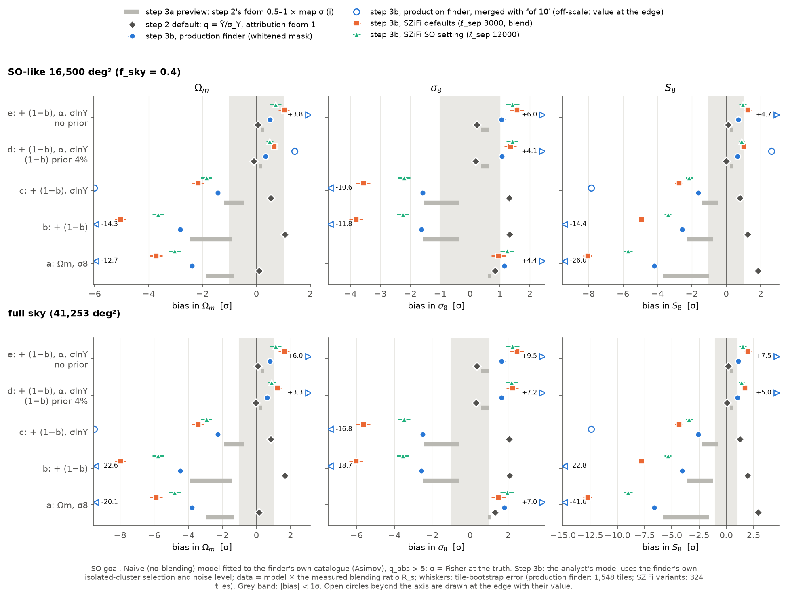
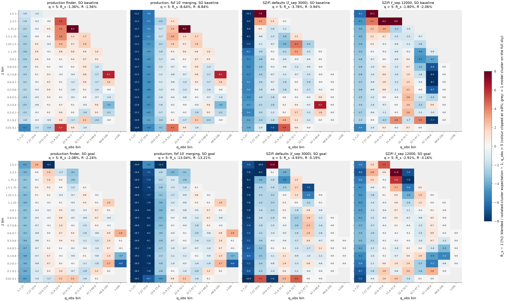

# Realistic SO LAT setup, step 3b: cosmology bias for the SZiFi-like finder's own catalogue

**Status: final, 2026-11-12. Built, checked twice independently, then arbitrated.**
- **Fits check** (`verify_real/step3b_fits/`): rebuilt the data vector from the build's per-halo tables with its own binning, kernel interpolation and its own pooled estimator (top-hat cells); re-measured the kernel on 28 halo-free tiles with exactly painted clusters; refitted everything with its own count model and fitter.
- **Sims check** (`verify_real/step3b_sims/`): its own pipeline (halo sampler per tile, NUFFT painter, CMB and noise, finder, credit rule, virtual kernel, data vector, fits) on 400 fresh tiles per noise level, plus its own sparse and dense injections.
- **Arbiter** (`a01`–`a14` in this folder, helper `arblib.py`; data in `data_real/step3b/arbiter/`): targeted tests of every claim marked "partially" or "refuted". Among them: the build's code run on the sims check's own maps and on 400 more tiles made with its generators, and the final headline fitted on every production tile.
- Section 0 lists what the arbitration changed. Section 9 lists what is still open. Section 10 gives every claim with its final value, its evidence and who verified it.

**Question.** Step 3a measured what the SZiFi-like finder does with blended peaks, but read its cosmology off step 2's table. Here the finder's own catalogue is fitted. The analyst models the finder as if every cluster were isolated: the finder's own selection of isolated clusters and its own noise level, the best a no-blending analysis can do. How far off are Ωm, σ8 and S8, for the production finder and for SZiFi's own masked-covariance settings?

**What was built**
- The two SZiFi variants of the masked covariance on all 324 realistic tiles per noise level, with step 3a's decomposition and credit rule (`b01`), and per-halo tables for all three variants (`b02`).
- The analyst's no-blending kernel K(θ500, q′; e) for each variant and noise level, from 1.3 million virtual isolated clusters on the halo-free versions of the 324 tiles (`b03`, `b05`).
- Its validation with step 3a's injection tiles, with 22,680 new sparse injections per noise level run end to end, and with a paired dense-injection experiment (`b03`, `b04`, `b06`).
- 1,224 new Poisson tiles from 34 new full-sky skies, cut like the Q2 patches, through the production finder (`b14`, `b15`).
- Data vectors in step 2's 16 z × 9 q_obs bins with three estimators of the blending ratio and a 2,000-resample tile bootstrap (`b07`); the analyst's count model (`s3bcosmo.py`, checks `b08`); fits (`b09`, `b09b`); the analytic analyst (`b10`); figures (`b11`), tables (`b13`), compute (`b12`).
- Arbiter: the build's pipeline on the sims check's maps (`a02`, `a03`, `a12`), 400 more tiles with the sims check's generators (`a02`, `a11`), the pooled headline (`a10`, `a13`), and tests of the estimators, fits, kernel and injections (`a01`, `a04`–`a09`, `a14`).

**Where things are**
- Scripts and logs: this folder. Build: `b01`–`b15` (helpers `s3blib.py`, `s3bcosmo.py`). Arbiter: `a01`–`a14` (helper `arblib.py`). Every number below is printed in a log next to its script, or in a check's log (named where used).
- Data: `data_real/step3b/` (Appendix A); the arbiter's outputs are in `data_real/step3b/arbiter/`.
- Figures: `figures/realistic/step3b_*.png`. They show the build's 1,548 tiles; the final headline differs from them by ≤ 0.17σ at SO40 and ≤ 0.27σ on the full sky (section 6).

## The answer in short

- **The finder's own catalogue biases S8 even when the scaling relation is fitted.** Production finder, merge none, q_obs > 5, fitted with the finder's own isolated-cluster selection and noise level. All production tiles: 2,348 (baseline) and 1,948 (goal) tiles of 100 deg².
  - **Config d** (Ωm, σ8, (1−b) with a 4% prior, α, σlnY): **S8 +0.32 ± 0.04σ (SO baseline) and +0.68 ± 0.06σ (SO goal)** for an SO-like survey (f_sky = 0.4, "SO40"); +0.50σ and +1.06σ on the full sky. It is carried by σ8 (+0.50σ / +1.09σ); Ωm moves by +0.16σ / +0.35σ.
  - **Config e** (no prior on (1−b)): +0.38σ / +0.72σ (SO40), +0.60σ / +1.15σ (full sky).
  - **Config a** (only Ωm and σ8 free): **−2.33σ / −4.23σ** (SO40), −3.68σ / −6.69σ (full sky); Ωm −1.33σ / −2.43σ, σ8 +0.62σ / +1.17σ. Config b: −1.53σ / −2.62σ; config c: −0.91σ / −1.65σ.
  - **q_obs > 6:** config d +0.10σ / +0.23σ, config e +0.13σ / +0.25σ, config a −0.88σ / −1.56σ (SO40). The higher cut removes most of the bias.
  - The ± is the error from the finite simulations (tile bootstrap). The choice of estimator adds ≤ 0.04σ at SO40. A goodness-of-fit test would not notice: power ≤ 0.21 at SO40 and ≤ 0.62 on the full sky (config a, goal); 0.05 means none.
- **The count change.** The catalogue holds **1.46 ± 0.05% (baseline) and 2.10 ± 0.05% (goal) fewer clusters at q > 5** than the analyst expects. The loss sits at q = 5–7.3 (−2.4% / −3.5%). Over redshift it is flat (−1.4% to −1.6% / −2.0% to −2.8%), except −2.5 ± 0.4% at z < 0.1 for baseline.
  - Cause: the finder divides by σ_finder = 1.02–1.07 σ_Y (confusion from all halos), while an isolated cluster's own noise is only CMB and instrument. So fewer faint clusters scatter over the threshold, and neighbours give back only part of it.
  - The fit absorbs this q-shaped loss by raising α (+1.1σ / +2.0σ), which drags σ8 up.
- **What the arbitration changed in the headline.** The build's 1,548 tiles gave config d +0.36σ, config e +0.47σ, config a −2.16σ and a count change of −1.36% at baseline. The sims check's 400 tiles gave −1.71%. The arbiter showed that both codes give the same credited clusters on the same maps, so it pooled all tiles. Two tile sets made with different sky generators still differ at 2.6σ at baseline; this is open (section 9). The goal values moved by ≤ 0.06σ at SO40 (≤ 0.09σ on the full sky).
- **The masked-noise estimate matters, most at goal depth.**
  - Config d at goal: +0.68σ (production), +0.90σ (ℓ_sep 12000, SZiFi's SO script), +1.02σ (SZiFi's defaults). Config a: −4.2σ, −5.7σ, −8.0σ. Count change: −2.1%, −2.9%, −4.9%.
  - At baseline config d is +0.32σ, +0.31σ and about 0.0 ± 0.15σ for SZiFi's defaults (unsmoothed estimator; the pooled estimator gives +0.17σ but over-smooths for this variant). Config a: −2.3σ, −2.7σ, −4.8σ.
- **The merge rule.** Merging within 1′ changes config d by ≤ 0.03σ. Merging within 10′ (fof, SZiFi's Planck scripts) removes another 7.4% / 11.2% of real clusters: config d +1.04σ / about +2.6σ to +2.8σ, config a −13σ / −26σ. A fit would flag that (power 1.00 in config a). Counting the "no real cluster" entries cancels most of the deficit (config d −0.04σ / +0.17σ).
- **Which reference?** Calibrate the selection on isolated clusters on halo-free skies (the virtual kernel). Sparse injections run end to end reproduce it (+0.00 ± 0.27% / +0.27 ± 0.28% at q > 5), and painted and virtual copies agree to 0.1%. Dense injection tiles select differently only near the detection threshold q = 4, not at q > 5. Calibrating on them would move config d by ≤ 0.06σ but config a by up to 1.5σ.
- **Against step 2 and step 3a's preview.** Config d lies 0.10σ (baseline) and 0.28σ (goal) above the preview's upper end (+0.22σ / +0.40σ, step 2's fdom 0.5–1 × map σ (i)). It matches step 2's fdom 0.5 × plain-std row (+0.35σ / +0.61σ). Step 2's default analyst had −0.01σ / +0.01σ in config d and +1.33σ / +1.85σ in config a, the opposite sign. Config a lies inside the preview's range at baseline and 0.6σ beyond it at goal.
- **An analytic selection Φ(√(q′² + k) − e)** (zero below q′ = 2) sees almost the same blending: within 0.23σ of the measured-kernel analyst in configs a and d. But its own kernel error dominates for k = 0 (+15.6σ / +17.8σ in config a) and k = 3 (−6.3σ / −8.9σ). k = 2 comes closest (+1.8σ / +0.9σ in config a); in config d its kernel error (−0.48σ / −0.77σ) nearly cancels the blending (+0.35σ / +0.61σ). Without the zero below q′ = 2, the k = 2 and 3 fits break down.

*Bias in Ωm, σ8, S8 per fit configuration, q_obs > 5, SO goal, from the build's 1,548 tiles (the baseline figure is `step3b_bias_bars_baseline.png`). Diamonds: step 2's default analyst. Grey bars: the step-3a preview. Coloured: step 3b's fits of the finder's own catalogue, whiskers = tile-bootstrap error. Blue: production finder (filled: merge none; open: fof 10′). Orange: SZiFi's defaults. Aqua: ℓ_sep 12000. Grey band: |bias| < 1σ. The final headline (all tiles) differs from the blue filled points by ≤ 0.06σ (SO40) at goal and by ≤ 0.17σ (SO40) at baseline (section 6).*

## 0. What the arbitration changed

| # | claim or issue | raised by | arbiter test | result | who was right |
|---|---|---|---|---|---|
| 1 | N1, N2, B1–B3, B9 at baseline: the sims check's 400 tiles give R_p −1.71 ± 0.13% (build −1.36 ± 0.06%) and biases 1.4–1.9σ lower | sims ("partially") | `a01`: both data sets through one code. `a02`/`a03`: the build's code on 60 of the sims check's own maps. `a12`: the build's painter on 24 of them. `a02`/`a11`: 400 new tiles with the sims check's generators through the build's code. `a10`/`a13`: data vector and fits on all tiles | Same maps give the same credited halos (11,911 of 11,912) and copies (12,122 of 12,122); the painter changes 1 of 4,743. New tiles: −1.56 ± 0.12%. The sims check's generators (800 tiles) vs the build's (1,548): −1.64 ± 0.09% vs −1.36 ± 0.06% (2.6σ). All 2,348 tiles: −1.46 ± 0.05%; config d +0.32σ (was +0.36σ), e +0.38σ (+0.47σ), a −2.33σ (−2.16σ) | both in part. The codes agree; the tile samples differ. The pooled values are final; the 2.6σ is open |
| 2 | N3: −3.2 ± 0.5% at z < 0.1 (baseline) | sims ("refuted": +0.0 ± 1.0%) | `a10`, `a11`, `a13` | the arbiter's 400 tiles: −1.6 ± 0.9%; all tiles: −2.5 ± 0.4% against −1.4% to −1.6% in the other z bins | both in part. An extra low-z deficit exists, smaller than the build's |
| 3 | R_s depends on its discretisation (top-hat cells − tents +0.04σ in config d) | fits (its bug 1) | `a04`: R_s − R_p paired over the build's 2,000 resamples; R_s rebuilt with q′ nodes and θ nodes twice as fine and twice as coarse, 20-group jackknife | Production: R_s − R_p = +0.00 ± 0.03σ / −0.01 ± 0.03σ (config d, SO40), ≤ 0.07σ in every config and survey; finer tents move config d by ≤ 0.015σ (SO40) | build. The tents agree with the unsmoothed R_p; the top-hat offset is the top-hat's own. An estimator systematic of ≤ 0.04σ (SO40) is now quoted |
| 4 | SZiFi's defaults at baseline: R_s and R_p disagree in config d (+0.21 ± 0.08σ) | fits (its bug 2) | `a04` | R_s − R_p = +0.19 ± 0.07σ (2.9σ); θ nodes twice as fine remove 0.07 ± 0.03σ of it | fits check. The tents over-smooth in θ for this variant, whose r(θ) is steep. Config d is quoted from R_p: −0.04 ± 0.15σ |
| 5 | fof 10′, goal: fits end at the σlnY bound; full-sky config e +7.49σ (build) vs +6.32σ (fits check); K15's "2.4×" | fits (its bug 3) | `a06`: f_sky invariance on all 128 prior-free fit pairs; careful re-optimisation. `a06b`: the other fof 10′ fits | SO40 and full-sky ML points coincide (invariance holds), so +6.32σ is not a maximum (the check's own SO40 value implies +7.5σ). But the build's optimiser stopped short near the bound (ΔlnL 0.05–0.26): best found SO40 d +2.79σ (was +2.62σ), e +4.71σ (+4.74σ); full d +4.93σ (+4.95σ), e +7.44σ (+7.49σ). The likelihood is flat there (full e +7.06σ at ΔlnL 0.001) | both in part. These ML values are uncertain by ±0.2σ (SO40) / ±0.4σ (full sky); the ML/linear ratio of up to 2.4 holds |
| 6 | K18: "≤ 0.05σ in configs a and d (SO40 and full sky)" | fits (its bug 4) | `b13_tables.log` (6) re-read | full-sky config-d half-kernel differences are 0.085σ and 0.087σ | fits check; wording fixed |
| 7 | P3: ML / linearised scatter 1.16 / 1.18 in config e vs the fits check's 1.07 / 1.06 | fits (its bug 5) | `a05`: the build's own ML fits on the same 12 resamples; `a06`: re-optimisation of the headline | The build's fits are at their maximum (ΔlnL ≤ 2×10⁻⁶; S8 moves ≤ 0.004σ). On the same 12 resamples the build's ratio is 1.15 / 1.20: the two count models differ, not the samples (ML differs by +0.018σ / +0.034σ per resample; linearised by ≤ 0.007σ) | both. The ratio depends on the count model by ~10%; config e's ML carries a count-model uncertainty of ~0.03σ |
| 8 | S5: the kernel's error 0.21–0.23% vs an even/odd split of −1.08% | fits ("partially") | `a08`: 40 random half splits, 100 more bootstrap resamples | half-split scatter 0.44 ± 0.05% / 0.50 ± 0.06%, i.e. kernel error 0.22% / 0.25%; bootstrap 0.20% / 0.22%; the even/odd split was a 2.5σ draw | build |
| 9 | V4: dense tiles select fewer clusters because their SZ raises σ_finder | sims (its bug 4) | `a07`: the build's own sparse injections, painted vs virtual, paired, per threshold | sparse tiles (σ +0.008%) lose 0.53 ± 0.06% / 0.48 ± 0.06% above q = 4 too, and ≤ 0.11% (within the errors) above q = 4.5 | sims check. The q > 4 loss comes from the injection tile's filter at the threshold, not from dense SZ in σ. Above q = 5 no design changes the selection; step 3a's gap was mostly statistical |
| 10 | fof 10′ at baseline: removal 7.63% (sims) vs 7.22%; config a 3.8σ apart | sims | `a09`, `a11` | removal: Q2 tiles 7.22%, the build's new tiles 7.45%, the sims check's tiles 7.63%, the arbiter's 7.41%, all 7.44% | as item 1 |
| 11 | F1, S3, S6 (ℓ_sep 12000), N4 (ℓ_sep 12000, closest 1′, no-real), C1: checked by nobody or in part | – | `a09` | F1: Δ = 0. S3: 4.1 / 5.0 × 10⁻⁴ on another tile. S6: rerun r = stored r; means 0.976 / 0.974. N4: R_p −1.81 / −2.91%, −1.47 / −2.21%, +0.51 / −0.54%. C1: sums reproduced | build |

- **Numbers that changed:** the headline count change and biases (N1–N3, B1–B4, B7–B9, P1, P4), the SZiFi-defaults baseline config d (B5), the fof 10′ goal fits (B5, B6, K15), V4's mechanism, K18's wording, P3's reading.
- **Unchanged and confirmed:** the finder runs (F1–F4), the kernel (S1–S6), the injections (V1–V3, V5, V6), N4–N6, the build's own biases on its tiles, the estimator agreement for the production finder, A1–A6, K12, K14, K16.

## Terms

- **Finder variants.** The same SZiFi-like finder (`szsim/finder.py`, step 3a) with three ways to estimate the noise covariance at its one masking iteration:
  - *production*: the whitened mask (step 3a's finder);
  - *SZiFi defaults*: SZiFi's own estimate with its defaults (inpainting, cosine blend, spectra above ℓ_sep = 3000 divided by the unmasked fraction);
  - *ℓ_sep 12000*: the same with the setting of SZiFi's SO example script.
- **σ_Y, σ_finder, r.** σ_Y(θ) is step 1's noise of the filter for CMB and instrument noise only; σ_finder(θ) is the noise level the finder estimates on a tile; r = σ_finder/σ_Y.
- **q′.** A halo's S/N in the finder's own units: Y500 / σ_finder(θ500) on the halo's own tile (r linear in ln θ between the 15 filter sizes, constant beyond).
- **Credited halo.** A halo that is the largest contributor ("primary") of at least one detection with q > 5 where its own signal is ≥ 2σ (step 3a's rule). Each halo counts once, at the q_obs of its highest such detection, at its true z. **Credit limit:** a halo with q′ < 2 can never be credited.
- **No-blending kernel K(θ500, q′; e).** The probability that an isolated cluster of size θ500 and S/N q′ is credited with q_obs > e. Measured with *virtual clusters*: the cluster's filtered signal is added to the S/N maps of the same tile without halos (same CMB and noise), after the finder's full run; the finder's peak rules are applied around it; a peak is credited if the cluster's own signal there is ≥ 2σ.
- **Isolated copy.** A realistic halo inserted alone, at its true position and with the same q′, into the halo-free version of its own tile.
- **Analyst's naive model.** Step 2's count model (HMF grid, lognormal Y–M scatter, step 2's bins) with σ_eff = r̄ σ_Y (r̄ = the variant's mean r over the tiles) and the variant's kernel K in place of Φ(q − e).
- **R(z, q), the blending ratio.** What the finder's catalogue holds over what the naive model expects, per (z, q_obs) bin. Data = naive model at the truth × R (Asimov). Three estimators:
  - *R* = N_det / N_exp per bin, the task's definition: credited halos over the sum of K over the same halos;
  - *R_p* = N_det / N_iso per bin: credited halos over credited isolated copies. Paired: the same noise decides both. No smoothing;
  - *R_s*, pooled paired: on a Poisson sky a halo's neighbours do not depend on its redshift, so blending changes the selection as a function of (θ500, q′) only. The change ΔK is averaged over all halos with bilinear "tent" weights on the kernel's 25 θ500 nodes and 108 q′ nodes, then applied to the count model. **R_s is the headline estimator.**
- **Tile sets.** *Build's tiles*: the 324 Q2 tiles plus 1,224 new tiles, cut from full-sky Poisson catalogues. *Generator tiles*: tiles whose halos, CMB and noise come from the sims check's own generators (per-tile Poisson draws): the sims check's 400 (its own pipeline) and the arbiter's 400 (the build's pipeline). *All tiles (pooled)*: 2,348 at baseline and 1,948 at goal.
- **Tile bootstrap.** Resamples of the tiles, the same resamples for every estimator (2,000 for the build's tiles, 1,000 for all tiles).
- **Bias in σ.** (best fit − truth) / Fisher error at the truth. *ML*: maximum-likelihood fit. *Linearised:* F⁻¹ Jᵀ (R − 1), used for the bootstrap errors and the split into amplitude, z tilt and q shape (step 2's p06b).
- **Configs, surveys, power.** As step 2:
  - a: Ωm, σ8; b: + (1−b); c: + (1−b), σlnY; d: + (1−b) with a 4% prior, α, σlnY (d3, d5: 3% and 5% priors); e: as d without the prior.
  - Surveys: SO40 (f_sky = 0.4) and full sky. q_cut 5 and 6.
  - Power: the probability that a 95% goodness-of-fit test flags the misfit; 0.05 means none.
- **pp.** Percentage points.
- **Verified by.** *fits* or *sims* = one of the two checks; *both* = both checks; *arbiter* = a targeted arbiter test (`a01`–`a14`); *build only* = checked by nobody; *unresolved* = open (section 9).

## 1. Choices that differ from the task text

1. **Three estimators of the blending ratio; R_s for the headline.** The task's R is computed, fitted and reported throughout. Its bootstrap error on the config-d S8 bias was 0.23σ with the 324 tiles, mostly the luck of which halo crosses a q-bin edge. R_p and R_s have the same expectation with less noise (section 5). R also carries the kernel's Monte Carlo noise per bin, which its bootstrap does not include (check K16).
2. **New tiles.** With R_s and the 324 Q2 tiles the target was still missed. 1,224 tiles from 34 new full-sky Poisson skies (seeds 10–43) were added, drawn with `szsim.sampler.draw_catalog` and cut into 36 equatorial patches each, like the Q2 patches 108–323 (`b14`, `b15`). They enter the production setups only.
3. **All tiles for the headline (arbiter).** The sims check's 400 tiles and the arbiter's 400 tiles (the sims check's generators, the build's pipeline, baseline only) are further production tiles: `a02`/`a03` show that both codes credit the same halos on the same maps. The final production headline (merge none) uses all of them. The other setups keep the build's tiles.
4. **Virtual response with lattice harmonics.** On the square Fourier lattice the response has cos 4φ, cos 8φ and cos 12φ terms (up to 3.6×10⁻³ of the peak). They are added from exact lattice sums (`s3blib.aniso_tables`), which brings every size to ≤ 5.7×10⁻⁴.
5. **Window.** Half width max(6′, 1.25 r₀.₁ + 2′), where r₀.₁ is the radius beyond which every scale's own response is below 10% of the peak: 6′ up to θ500 ≈ 25′, 11.8′ at 61′. Doubling it changes nothing (K5).
6. **Kernel above q′ = 27.5** from an efficiency model (section 3) instead of discrete nodes.
7. **One isolated kernel for all merge rules.** Merging changes the outcome of 0–2 of 22,680 isolated clusters.
8. **Sparse injections on the halo-free skies** of the 324 tiles (7 sets of ≤ 10 clusters each, ≥ 100′ apart), so that each injected cluster can be compared with its own virtual copy on the same noise.
9. **The analytic analyst uses the variant's σ_eff = r̄ σ_Y**, like the virtual-kernel analyst, so the two differ only in the kernel. A second version sets the analytic kernel to zero below the credit limit (section 6).

## 2. Finder runs on the realistic tiles

`b01_tiles_szifi.log`, `b02_halos.log`. Step 3a's tiles: 324 per noise level (32,400 deg²), all halos M500 > 10¹³ M☉, lensed CMB, white noise and atmosphere.

- **Runs.** The two SZiFi variants on all 324 tiles per noise level; the production runs are step 3a's `t04`. Step 3a's SZiFi-defaults run of tiles 0–99 is reused. Tile 0 rerun gives an identical catalogue and σ (build: also exact contributions; arbiter `a09` (1): Δ = 0).
- **Per-halo tables** (`data_real/step3b/halos_*.npz`): 420,832 (baseline) and 618,269 (goal) rows with q_true ≥ 1.5. No credited halo lies below the credit limit q′ = 2, for any variant.

| 324 Q2 tiles, baseline / goal | production | SZiFi defaults | ℓ_sep 12000 | verified by |
|---|---|---|---|---|
| r after the iteration, 0.5′ / 4.45′ / 15′, baseline | 1.039 / 1.050 / 1.024 | 1.136 / 1.119 / 1.049 | 1.019 / 1.045 / 1.026 | both (ℓ_sep 12000: fits) |
| same, goal | 1.053 / 1.067 / 1.035 | 1.180 / 1.171 / 1.079 | 1.039 / 1.076 / 1.047 | both (ℓ_sep 12000: fits) |
| catalogue entries q > 5 | 69,496 / 103,739 | 56,645 / 80,138 | 71,535 / 104,543 | fits |
| "no real cluster" entries, of all | 1.75% / 1.50% | 0.91% / 0.63% | 1.96% / 1.57% | both (ℓ_sep 12000: fits) |
| credited halos, merge none | 64,355 / 96,544 | 53,247 / 75,941 | 66,133 / 97,413 | both (ℓ_sep 12000: fits) |
| closest 1′ | 64,283 / 96,409 | 53,208 / 75,875 | 66,076 / 97,283 | fits |
| fof 10′ | 59,710 / 85,833 | 50,115 / 69,572 | 61,253 / 86,544 | fits |

The sims check's own finder on 400 fresh tiles gives r within 0.002 and 198.4 / 298.2 credited halos per tile (build 198.6 / 298.0).

## 3. The analyst's no-blending kernel

`b03_virtual_*.log`, `b05_kernel.log`, `b05_kernel_szifi12000.log`; arbiter `a08_kernel_mc.log`, `a09_misc.log`.

**How it is measured.** Per variant and noise level the finder runs on the halo-free version of each of the 324 tiles (same CMB and noise), both iterations included. On its final S/N maps 4,000 virtual clusters per tile are inserted one at a time: the cluster's filtered signal at all 15 scales is added in a window around it; the finder's peak rules are applied; a peak is credited if the cluster's own signal there is ≥ 2σ.

**Grid.** θ500: 25 nodes, 0.238′–61′ (every injected size of step 3a is a node). q′: nodes 1–27.5 (step 0.125 at 2–10), plus log-uniform q′ = 25–400. 1,296,000 clusters per variant and level; 435–617 per node at q′ = 2–10.

**Table.** K is tabulated at step 2's 19 bin edges: the measured fraction at the nodes, made monotone in q′ (moves N_exp by ≤ 0.016%); above q′ = 27.5 from the bright clusters' efficiency λ (0.97–0.99 for θ500 ≤ 15′, 0.81 at 61′) and noise ε (mean +0.04, std 1.0); K = 0 below q′ = 2.

**Checks** (baseline / goal):

| check | production | SZiFi defaults | ℓ_sep 12000 | verified by |
|---|---|---|---|---|
| virtual vs exact filtered response, max / peak | 4.9 / 5.7 × 10⁻⁴ | 5.0 / 5.2 × 10⁻⁴ | 4.9 / 5.6 × 10⁻⁴ | arbiter (tile 7: 4.1 / 5.0 × 10⁻⁴); sims (its own tables without harmonics ≤ 2.2 × 10⁻³) |
| same, angle-averaged tables alone | 3.6 / 3.5 × 10⁻³ | 3.7 / 3.5 × 10⁻³ | 3.6 / 3.4 × 10⁻³ | arbiter (3.6 / 3.5 × 10⁻³) |
| window doubled | identical (32,000 clusters) | identical | identical | sims (own kernel) |
| clusters credited below q′ = 2 | 0 of ~40,000 | 0 | 0 | sims (0 of 5.6 million) |
| kernel's error on N_exp (q > 5) | 0.22 / 0.21% (60 bootstrap resamples) | 0.22 / 0.23% | 0.22 / 0.22% | arbiter: 40 random half splits give 0.22 / 0.25%, 100 bootstrap resamples 0.20 / 0.22% |
| σ_finder/σ_Y on halo-free tiles at 0.5′ | 0.995 / 0.995 | 1.025 / 1.032 | 0.976 / 0.974 | both (ℓ_sep 12000: arbiter rerun) |
| noise peaks above q = 5 per 100 deg² | 0.82 / 0.87 | 0.52 / 0.55 | 1.23 / 1.36 | build only |

- The variants' own noise biases on skies without halos sit in their kernels: SZiFi's defaults overestimate σ by 2.5% / 3.2% at 0.5′; ℓ_sep 12000 underestimates it by 2.4% / 2.6%. So they are not counted as blending.
- **Independent kernel.** The sims check's kernel (800,000 placements per level, each on 368 q′ values) holds the same counts (χ² 1,408 for 1,418 nodes and 1,526 for 1,414 at e = 5). N_exp(q > 5) with the build's kernel is 0.30% / 0.32% higher than with its own (combined Monte Carlo error ±0.25%).
- **The even/odd half split** (−1.08% at baseline) is a 2.5σ draw of the split distribution (`a08`; largest of 40 random splits 1.20%).

## 4. Is the kernel right? Injections and the reference question

`b06_validate.log`, production finder; arbiter `a07_sparse_dense.log`. Observed / expected − 1, "expected" = K summed over the same clusters, each in its own tile's units.

| test clusters | clusters per level | q_obs > 5: baseline | goal | N_exp-weighted, baseline | goal | verified by |
|---|---|---|---|---|---|---|
| t03 injection tiles | 38,760 | +0.19 ± 0.21% | +0.13 ± 0.22% | +2.6 ± 1.4% | +1.4 ± 1.3% | sims |
| a02 injection tiles | 155,040 | −0.41 ± 0.15% | −0.44 ± 0.14% | −0.8 ± 0.5% | −1.3 ± 0.5% | sims |
| t03 + a02 pooled | 193,800 | −0.27 ± 0.12% | −0.30 ± 0.12% | −0.3 ± 0.5% | −0.9 ± 0.4% | sims (with its own kernel −0.30 / −0.40%; −0.1 / −1.1%) |
| **new sparse injections, end to end** | 22,680 | **+0.00 ± 0.27%** | **+0.27 ± 0.28%** | +2.3 ± 1.9% | +2.0 ± 2.0% | sims (its own 12,000: −0.14 ± 0.37 / −0.60 ± 0.43%) |

- **The virtual clusters are what the finder does at q > 5.** Painted into the halo-free skies and found by the full finder, the sparse clusters agree with their own virtual copies cluster by cluster: q > 5 counts 14,419 vs 14,409 (baseline) and 14,433 vs 14,444 (goal); Δq = −0.003 ± 0.036 at q = 4–6. Merging changes 0–2 of 22,680 isolated clusters. (Sims check: the same.)
- **Near the threshold q = 4 any injection tile selects fewer clusters** (corrected by the arbitration):
  - Dense tiles (a02's design, 21,280 clusters on 120 halo-free skies) raise σ_finder by 0.27% / 0.23% (sims check: 0.23% / 0.21%). In the finder's units their filter credits 0.67 ± 0.09% / 0.53 ± 0.08% fewer clusters above q = 4 than the halo-free filter, and 0.09 ± 0.11% / 0.15 ± 0.09% fewer above q = 5 (sims check: 0.43% / 0.38% fewer above q = 4; +0.00% / +0.05% above q = 5).
  - Sparse tiles show the same loss without a σ change: painted vs virtual −0.53 ± 0.06% (baseline) and −0.48 ± 0.06% (goal) above q = 4 with σ +0.008%, and ≤ 0.11% (within the errors) above q = 4.5 (`a07`). The sims check shows that a virtual copy through the injection tile's own filter reproduces the painted cluster. So the loss comes from the injection tile's filter at the detection threshold (the injected clusters are masked at the iteration), **not** from the injected SZ raising σ as the build had said.
  - Above q = 5 neither design changes the selection. Weighted like the realistic halos the dense effect is −0.2 ± 0.3% / −0.6 ± 0.4% (build) and +0.7 ± 0.5% / +0.1 ± 0.3% (sims check): consistent with zero.
- **Answer to step 3a's open question** (a 0.8% / 1.2% gap in N_exp between injection tiles and noise-only virtual clusters): it was mostly statistical, plus step 3a's different criterion (the window maximum). With the credit criterion and each tile's own q′, the pooled t03 + a02 sets lie −0.3 ± 0.5% / −0.9 ± 0.4% from the virtual kernel in N_exp.
- **Which reference the analyst should use:** the isolated one, the halo-free virtual kernel, which the sparse end-to-end injections reproduce. The injection-tile reference is carried as a sensitivity (section 6).

## 5. The finder's data vector

`b07_datavec.log`; arbiter `a01_paired_compare.log`, `a03_cross_compare.log`, `a10_pooled.log`, `a11_new_tiles.log`, `a13_pooled_fits.log`. Step 2's bins: 16 z bins (0.01–3) × 9 q_obs bins from q_cut upwards, the last one q > 100.

### The baseline tension and the final headline

The sims check's 400 tiles gave a larger baseline count change than the build's 1,548. The arbiter's tests:
- **Same maps, same answer.** The build's code on 60 of the sims check's own maps reproduces its per-halo results: 11,911 of 11,912 credited halos and 12,122 of 12,122 credited copies at q > 5; q_obs to 2×10⁻⁶; σ to 10⁻¹⁴ (`a03`). Painting the same halos with the build's painter instead of the sims check's NUFFT changes 1 credited halo of 4,743 (`a12`).
- **More tiles from the sims check's generators.** 400 new tiles (halo seeds 9,310,400–9,310,799) through the build's code (`a02`, `a11`):

| tile set (baseline, q > 5) | tiles | R_p − 1 | z < 0.1 | fof 10′ removes | per tile N_iso − N_det |
|---|---|---|---|---|---|
| build's Q2 tiles | 324 | −1.31 ± 0.13% | −2.4 ± 1.3% | 7.22% | 2.63 ± 0.26 |
| build's new tiles | 1,224 | −1.38 ± 0.07% | −3.5 ± 0.7% | 7.45% | 2.77 ± 0.14 |
| sims check's tiles (its pipeline) | 400 | −1.71 ± 0.13% | −0.1 ± 1.2% | 7.63% | 3.46 ± 0.26 |
| arbiter's tiles (sims check's generators) | 400 | −1.56 ± 0.12% | −1.5 ± 1.2% | 7.41% | 3.15 ± 0.25 |
| **all** | **2,348** | **−1.46 ± 0.05%** | **−2.4 ± 0.5%** | 7.44% | 2.93 ± 0.10 |

- Within each generator the sets agree. Between them: −1.64 ± 0.09% (800 generator tiles) vs −1.36 ± 0.06% (1,548 build tiles), 2.6σ. At goal the sims check's 400 tiles agree with the build (−2.18 ± 0.10% vs −2.08 ± 0.05%, 0.9σ).
- No cause was found: same pipeline, same painter, same halo model, the CMB drawn the same way from the same spectrum, noise with the same covariance, and the same r after the iteration (to 10⁻⁴). The difference is treated as a 2.6σ fluctuation and all tiles are pooled; it stays open (section 9).

### Count change against the analyst's isolated-cluster expectation, q > 5

| setup | tiles | R: N_det/N_exp − 1 | R_p − 1 | R_s − 1 | verified by |
|---|---|---|---|---|---|
| **production, merge none, all tiles (final)** | 2,348 / 1,948 | – | −1.46 ± 0.05 / −2.10 ± 0.05% | **−1.46 ± 0.05 / −2.10 ± 0.05%** | arbiter |
| production, merge none, build's tiles | 1,548 | −1.56 ± 0.09 / −2.24 ± 0.07% | −1.36 ± 0.06 / −2.08 ± 0.05% | −1.36 ± 0.06 / −2.08 ± 0.05% | fits (sims: tension, above) |
| same, 324 Q2 tiles only | 324 | −1.52 ± 0.19 / −2.47 ± 0.16% | −1.31 ± 0.13 / −2.21 ± 0.12% | −1.31 ± 0.13 / −2.21 ± 0.12% | fits |
| production, closest 1′ (build's tiles) | 1,548 | −1.67 / −2.37% | −1.47 / −2.21% | −1.47 ± 0.06 / −2.21 ± 0.05% | arbiter (R_p) |
| production, fof 10′ (build's tiles) | 1,548 | −8.84 / −13.21% | −8.66 / −13.06% | −8.64 ± 0.07 / −13.04 ± 0.07% | fits |
| production + "no real cluster" entries | 1,548 | +0.32 / −0.71% | +0.51 / −0.54% | +0.51 ± 0.07 / −0.54 ± 0.06% | arbiter (R_p) |
| SZiFi defaults | 324 | −3.94 ± 0.21 / −5.19 ± 0.17% | −3.79 / −4.94% | −3.78 ± 0.15 / −4.93 ± 0.14% | both |
| ℓ_sep 12000 | 324 | −2.06 ± 0.19 / −3.16 ± 0.15% | −1.81 / −2.91% | −1.80 ± 0.14 / −2.91 ± 0.12% | arbiter (R_p) |

- **By S/N** (R_s, all tiles; q = 5–7.3, 7.3–10.6, 10.6–15.4, 15.4–22.4, 22.4–32.5, 32.5–47.3): baseline −2.4 ± 0.1, −0.2 ± 0.1, +0.2 ± 0.2, +0.2 ± 0.2, −0.3 ± 0.3, +0.0 ± 0.4%; goal −3.5 ± 0.1, −0.6 ± 0.1, +0.1 ± 0.2, +0.5 ± 0.2, −0.5 ± 0.3, −0.1 ± 0.4%. The deficit sits in the first bin; this q shape is what config d responds to.
- **By redshift** (R_s, all tiles; z = 0.01–0.1, 0.1–0.5, 0.5–1, 1–1.5, 1.5–2, 2–3): baseline −2.5 ± 0.4, −1.4 ± 0.1, −1.4 ± 0.1, −1.6 ± 0.1, −1.6 ± 0.2, −1.4 ± 0.6%; goal −2.9 ± 0.5, −2.1 ± 0.1, −2.0 ± 0.1, −2.2 ± 0.1, −2.2 ± 0.2, −2.8 ± 0.5%. The low-z excess is smaller than on the build's tiles (−3.2 ± 0.5%). Large nearby clusters lose more (−10 ± 2% at θ500 = 8–16′, q′ = 4–5 on the build's tiles); this was not traced further.
- **SZiFi defaults:** −5.3% / −7.3% at q = 5–7.3, growing with z (−3.1% at z < 0.1 to −7.6% at z = 2–3, baseline). **ℓ_sep 12000:** −2.7% / −4.4% at q = 5–7.3.
- **Merging at 10′** removes another 7.4% / 11.2% of the credited halos, concentrated at q < 10 (−12.5% / −18.8% at q = 5–7.3) and growing with z.
- **Keeping the "no real cluster" entries** turns the deficit at q = 5–7.3 into +0.9% / −0.7%, rising with z (+6.6% / +2.5% at z = 2–3).
- **The three estimators.** N_iso/N_exp − 1 = −0.20 ± 0.09% / −0.17 ± 0.07% (build's tiles), within the kernel's 0.2%; R and R_p differ by this. Bin by bin, R_p against R_s gives χ² 87 for 99 bins (baseline) and 150 for 106 (goal; fits check 156); R against R_s 126 / 209, from the kernel's noise in N_exp.
- **Step 3a's preview, recomputed on the same halos with step 3a's selection, is reproduced exactly:** production −0.77 ± 0.20% / −1.50 ± 0.16%; SZiFi defaults (tiles 0–99) −4.70 ± 0.34% / −5.75 ± 0.30%. The change of kernel moves the production numbers to −1.52% / −2.47% on the same tiles (the isolated kernel expects 0.75% / 0.99% more clusters than step 3a's injection fit).

*R_s − 1 in each (z, q_obs) bin, q > 5, on the build's tiles: production finder (merge none and fof 10′; 1,548 tiles), SZiFi's defaults and ℓ_sep 12000 (324 tiles), both noise levels. Grey: bins with fewer than one model cluster on the full sky.*

## 6. Cosmology bias

Asimov: the analyst's naive model fitted to data = model at the truth × R. ML fits with R_s; ± = tile-bootstrap error of the linearised bias.

### Final headline: production finder, merge none, all tiles

`a13_pooled_fits.log` (2,348 tiles at baseline, 1,948 at goal). S8 bias in σ, SO40 | full sky:

| q_cut | noise | a | b | c | d | d3 | d5 | e |
|---|---|---|---|---|---|---|---|---|
| 5 | baseline | −2.33±0.09 \| −3.68±0.15 | −1.53±0.08 \| −2.42±0.13 | −0.91±0.08 \| −1.43±0.13 | **+0.32±0.04** \| +0.50±0.08 | +0.34±0.05 \| +0.50±0.07 | +0.32±0.04 \| +0.52±0.08 | +0.38±0.07 \| +0.60±0.11 |
| 5 | goal | −4.23±0.10 \| −6.69±0.16 | −2.62±0.09 \| −4.14±0.14 | −1.65±0.09 \| −2.62±0.14 | **+0.68±0.06** \| +1.06±0.11 | +0.71±0.06 \| +1.06±0.10 | +0.67±0.06 \| +1.07±0.12 | +0.72±0.09 \| +1.15±0.14 |
| 6 | baseline | −0.88±0.09 \| −1.39±0.14 | −0.36±0.08 \| −0.57±0.13 | −0.23±0.08 \| −0.36±0.12 | +0.10±0.04 \| +0.16±0.07 | +0.10±0.05 \| +0.16±0.07 | +0.10±0.04 \| +0.17±0.08 | +0.13±0.07 \| +0.20±0.11 |
| 6 | goal | −1.56±0.10 \| −2.46±0.15 | −0.96±0.08 \| −1.52±0.13 | −0.60±0.09 \| −0.95±0.14 | +0.23±0.05 \| +0.36±0.09 | +0.25±0.05 \| +0.36±0.08 | +0.23±0.05 \| +0.36±0.09 | +0.25±0.08 \| +0.40±0.12 |

- **Ωm and σ8** (q_cut 5, SO40 | full): config a Ωm −1.33 | −2.11σ / −2.43 | −3.85σ, σ8 +0.62 | +0.99σ / +1.17 | +1.85σ; config d Ωm +0.16 | +0.31σ / +0.35 | +0.64σ, σ8 +0.50 | +0.77σ / +1.09 | +1.69σ; config e Ωm +0.30 | +0.47σ / +0.52 | +0.82σ, σ8 +0.52 | +0.83σ / +1.08 | +1.71σ (baseline / goal).
- **Goodness of fit:** power ≤ 0.09 (baseline) and ≤ 0.21 (goal, config a) at SO40; ≤ 0.19 / ≤ 0.62 on the full sky. Config d: χ²_min 2.6 / 6.2 (SO40), power 0.07 / 0.10. All 56 fits converge inside the bounds.
- **Errors not in the ±:**
  - the estimator (R_s vs the unsmoothed R_p; finer or coarser tents): ≤ 0.02σ in config d, ≤ 0.04σ in config e at SO40; ≤ 0.07σ on the full sky (`a04`; on all tiles R_p gives d +0.29σ / +0.63σ, e +0.32σ / +0.61σ, linearised);
  - the kernel's Monte Carlo noise through the model: the even- and odd-tile half kernels move config d by ≤ 0.05σ (SO40) and ≤ 0.09σ (full sky), config e by ≤ 0.08σ / ≤ 0.13σ (K18), so the full kernel by about half of that;
  - the count model's numerics in config e: the fits check's model gives ML values 0.02σ / 0.03σ lower at the same data (linearised equal; `a05`, `a06`);
  - the baseline tile-set tension (section 5, open): on the build's 1,548 tiles config d is +0.34σ, on the 800 generator tiles +0.23σ (linearised; config a −2.14σ vs −2.63σ, config e +0.39σ vs +0.17σ).

### Every setup (the build's tiles)

`b09_fits.log`, `b13_tables.log` (1): production on the build's 1,548 tiles, SZiFi variants on the 324 Q2 tiles. S8 bias (ML, R_s), q_cut 5, SO40 | full sky:

| setup | noise | a | b | c | d | d3 | d5 | e |
|---|---|---|---|---|---|---|---|---|
| production, merge none | baseline | −2.16±0.11 \| −3.41±0.17 | −1.46±0.10 \| −2.31±0.16 | −0.84±0.10 \| −1.33±0.16 | +0.36±0.05 \| +0.58±0.10 | +0.37±0.06 \| +0.57±0.09 | +0.36±0.06 \| +0.61±0.10 | +0.47±0.09 \| +0.74±0.14 |
| production, merge none | goal | −4.18±0.12 \| −6.60±0.19 | −2.57±0.10 \| −4.06±0.16 | −1.62±0.10 \| −2.56±0.16 | +0.66±0.07 \| +1.03±0.12 | +0.69±0.07 \| +1.03±0.11 | +0.65±0.07 \| +1.05±0.13 | +0.71±0.10 \| +1.12±0.16 |
| production, closest 1′ | baseline | −2.31±0.11 \| −3.65±0.17 | −1.57±0.10 \| −2.49±0.16 | −0.91±0.10 \| −1.44±0.16 | +0.37±0.05 \| +0.60±0.10 | +0.38±0.06 \| +0.58±0.09 | +0.37±0.06 \| +0.62±0.10 | +0.47±0.09 \| +0.74±0.14 |
| production, closest 1′ | goal | −4.41±0.12 \| −6.98±0.19 | −2.72±0.10 \| −4.30±0.16 | −1.72±0.10 \| −2.71±0.16 | +0.69±0.07 \| +1.09±0.12 | +0.73±0.07 \| +1.08±0.11 | +0.68±0.07 \| +1.10±0.13 | +0.74±0.10 \| +1.18±0.16 |
| production, fof 10′ | baseline | −13.25±0.13 \| −20.96±0.21 | −7.94±0.11 \| −12.56±0.17 | −4.26±0.12 \| −6.73±0.18 | +1.04±0.06 \| +1.82±0.11 | +1.04±0.07 \| +1.68±0.10 | +1.07±0.07 \| +1.95±0.12 | +1.59±0.10 \| +2.51±0.16 |
| production, fof 10′ | goal | −25.95±0.15 \| −41.04±0.24 | −14.41±0.12 \| −22.79±0.18 | −7.83±0.12 \| −12.39±0.19 | +2.79±0.08¹ \| +4.93±0.15¹ | +2.65±0.08 \| +4.55±0.14 | +2.86±0.09 \| +6.37±0.16 | +4.71±0.12¹ \| +7.44±0.19¹ |
| production + "no real cluster" entries | baseline | +0.26±0.12 \| +0.42±0.18 | +0.90±0.11 \| +1.42±0.17 | +0.86±0.11 \| +1.36±0.18 | −0.04±0.06 \| +0.14±0.10 | −0.13±0.06 \| +0.01±0.10 | +0.02±0.06 \| +0.22±0.11 | +0.31±0.10 \| +0.49±0.15 |
| production + "no real cluster" entries | goal | −1.57±0.13 \| −2.49±0.20 | −0.26±0.10 \| −0.41±0.17 | −0.05±0.11 \| −0.08±0.18 | +0.17±0.07 \| +0.37±0.13 | +0.13±0.07 \| +0.31±0.12 | +0.20±0.08 \| +0.41±0.14 | +0.33±0.11 \| +0.53±0.17 |
| SZiFi defaults | baseline | −4.83±0.26 \| −7.64±0.41 | −3.25±0.22 \| −5.14±0.34 | −1.88±0.21 \| −2.97±0.34 | +0.17±0.13² \| +0.14±0.21² | +0.22±0.13 \| +0.22±0.20 | +0.13±0.13 \| +0.10±0.23 | −0.03±0.19² \| −0.05±0.30² |
| SZiFi defaults | goal | −8.05±0.26 \| −12.73±0.41 | −4.93±0.21 \| −7.79±0.33 | −2.76±0.23 \| −4.36±0.36 | +1.02±0.14 \| +1.70±0.25 | +1.03±0.14 \| +1.63±0.23 | +1.03±0.15 \| +1.76±0.27 | +1.25±0.21 \| +1.97±0.33 |
| ℓ_sep 12000 | baseline | −2.73±0.25 \| −4.31±0.39 | −1.76±0.21 \| −2.78±0.33 | −1.01±0.20 \| −1.60±0.32 | +0.31±0.12 \| +0.50±0.21 | +0.33±0.12 \| +0.49±0.19 | +0.31±0.12 \| +0.51±0.22 | +0.39±0.18 \| +0.61±0.29 |
| ℓ_sep 12000 | goal | −5.71±0.26 \| −9.03±0.41 | −3.39±0.20 \| −5.35±0.32 | −2.15±0.20 \| −3.40±0.32 | +0.90±0.14³ \| +1.42±0.26 | +0.94±0.14 \| +1.41±0.24 | +0.89±0.15 \| +1.44±0.28 | +0.97±0.21 \| +1.54±0.33 |

¹ Fits that end at the σlnY bound, re-optimised by the arbiter (`a06`, `a06b`; the build had +2.62, +4.95, +4.74, +7.49). The likelihood is nearly flat there, so these values are uncertain by about ±0.2σ (SO40) and ±0.4σ (full sky): e.g. full-sky config e gives +7.06σ at a log-likelihood only 0.001 lower, config d at SO40 +2.43σ at 0.04 lower. The d3 and d5 fits of this row were not re-optimised.
² R_s over-smooths in θ for SZiFi's defaults at baseline (section 0, item 4). The unsmoothed R_p gives (linearised) config a −4.75 ± 0.26 | −7.50 ± 0.41, config d **−0.04 ± 0.15** | −0.24 ± 0.27, config e −0.37 ± 0.27 | −0.59 ± 0.42; R_s with θ nodes twice as fine gives d +0.08 | −0.01 (`a04`).
³ R_p gives +0.88 (linearised; R_s +0.83); R_s with finer θ nodes +0.88.

- **The production setups at baseline would move like the headline** with all tiles (config d −0.04σ, e −0.09σ, a −0.17σ at SO40); this was computed only for merge none.
- **q_cut = 6** (build's tiles, SO40 | full): production config a −0.73 | −1.16σ / −1.57 | −2.48σ; config d +0.05 | +0.10σ / +0.26 | +0.40σ. Every setup is in `b13_tables.log` (1).
- **Goodness of fit** (`b13_tables.log` (4)): SZiFi defaults at goal power 0.73 (config a, SO40) and 1.00 (full sky); fof 10′ power 1.00 in config a and 0.58–1.00 in config d (χ²_min 34–258); "no real cluster" entries kept ≤ 0.07 (SO40).

### Comparison with step 2 and with step 3a's preview (S8, q_cut 5, SO40 | full sky)

| analyst | config a | config d | config e |
|---|---|---|---|
| step 2 default (σ_Y, fdom 1), baseline / goal | +1.33 \| +2.11 / +1.85 \| +2.92 | −0.01 \| +0.04 / +0.01 \| +0.08 | +0.07 \| +0.12 / +0.11 \| +0.17 |
| step 3a preview: step 2's fdom 0.5–1 × map σ (i), baseline | −2.39 to −0.64 \| −3.79 to −1.02 | +0.12 to +0.22 \| +0.17 to +0.30 | +0.11 to +0.18 \| +0.17 to +0.28 |
| same, goal | −3.66 to −1.00 \| −5.79 to −1.58 | +0.22 to +0.40 \| +0.34 to +0.61 | +0.24 to +0.41 \| +0.38 to +0.65 |
| step 2's fdom 0.5 × plain std (iii), baseline / goal | −4.21 \| −6.65 / −6.23 \| −9.86 | +0.35 \| +0.46 / +0.61 \| +0.89 | +0.26 \| +0.41 / +0.60 \| +0.96 |
| **step 3b, production finder, all tiles, baseline** | **−2.33 \| −3.68** | **+0.32 \| +0.50** | **+0.38 \| +0.60** |
| **step 3b, production finder, all tiles, goal** | **−4.23 \| −6.69** | **+0.68 \| +1.06** | **+0.72 \| +1.15** |
| step 3b, SZiFi defaults, baseline / goal | −4.75 (R_p) \| −7.50 / −8.05 \| −12.73 | −0.04 (R_p) \| −0.24 / +1.02 \| +1.70 | −0.37 (R_p) \| −0.59 / +1.25 \| +1.97 |

- **The preview had the right sign but too small a config-d bias.** Config d lies 0.10σ (baseline) and 0.28σ (goal) above the preview's upper end, close to step 2's fdom 0.5 × plain-std row, the row that matches the finder's q-shaped deficit rather than its total and z shape.
- **Config a** is inside the preview range at baseline (near its lower end) and 0.57σ beyond it at goal.
- **SZiFi's defaults** were previewed with the production finder's selection (step 3a: −4.70% / −5.75%). With their own kernel the count change is −3.8% / −4.9%.

### Why config d moves: the q shape

Linearised S8 bias split into a uniform count change ("amplitude"), its redshift dependence ("z tilt") and the rest ("q shape"), as step 2's p06b. R_s, q_cut 5, SO40 | full:

| setup | config | amplitude | z tilt | q shape | sum (linear) | ML |
|---|---|---|---|---|---|---|
| production, all tiles, baseline | a | −2.07 \| −3.27 | +0.04 \| +0.06 | −0.29 \| −0.45 | −2.31 \| −3.66 | −2.33 \| −3.68 |
| production, all tiles, baseline | d | −0.11 \| −0.10 | +0.09 \| +0.16 | +0.32 \| +0.41 | +0.31 \| +0.47 | +0.32 \| +0.50 |
| production, all tiles, goal | a | −3.76 \| −5.94 | +0.02 \| +0.03 | −0.45 \| −0.72 | −4.19 \| −6.63 | −4.23 \| −6.69 |
| production, all tiles, goal | d | −0.14 \| −0.12 | +0.11 \| +0.15 | +0.66 \| +0.91 | +0.62 \| +0.94 | +0.68 \| +1.06 |
| production, build's tiles, baseline | d | −0.10 \| −0.10 | +0.14 \| +0.24 | +0.31 \| +0.40 | +0.34 \| +0.54 | +0.36 \| +0.58 |
| fof 10′ (build's tiles), goal | d | −0.87 \| −0.77 | +0.09 \| +0.07 | +2.68 \| +3.63 | +1.90 \| +2.94 | +2.79 \| +4.93 |

- **Config a** follows the total: only Ωm and σ8 can absorb a 1.5% / 2.1% deficit, so S8 goes down. Step 2's default analyst had a +1.3% excess and the opposite sign.
- **Config d** follows the q shape. The fit raises α by +1.08σ (baseline) and +1.99σ (goal) at SO40 ((1−b) −0.11σ / −0.22σ, σlnY −0.22σ / −0.70σ) to mimic the loss at q = 5–7, and that drags σ8 up. The build's tiles gave a larger z tilt at baseline (+0.14σ), from their larger z < 0.1 deficit.

### Estimators, precision and the injection reference

- **The estimators agree for the production finder** (linearised, SO40; `a04`, `b13_tables.log` (2)):
  - build's tiles, config d: R +0.43 ± 0.10, R_p +0.34 ± 0.06, R_s +0.34 ± 0.06 (baseline); +0.81 ± 0.10, +0.62 ± 0.08, +0.61 ± 0.07 (goal). R_s − R_p paired: +0.00 ± 0.03σ / −0.01 ± 0.03σ.
  - config e: R_s − R_p −0.04 ± 0.05σ / −0.03 ± 0.05σ; config a: +0.01 ± 0.01σ / −0.00 ± 0.01σ.
  - R is higher by 1–3 of its errors in configs d and e: its N_exp carries the kernel's noise per bin, which the bootstrap does not see.
  - Refining the tents (q′ or θ nodes twice as fine) moves config d by ≤ 0.015σ and config e by ≤ 0.022σ (SO40). The fits check's top-hat cells give +0.04σ more in config d; that is the top-hat's own discretisation (its finer and coarser grids move by ±0.03σ).
  - For the SZiFi variants the tents smooth too much in θ: SZiFi defaults at baseline R_s − R_p = +0.19 ± 0.07σ (config d), of which finer θ nodes remove 0.07σ; ℓ_sep 12000 at goal −0.05σ, removed by finer θ nodes. These tables carry footnotes.
- **Precision** (bootstrap error of the S8 bias, SO40, q_cut 5; target ≤ 0.1σ in configs d and e):

  | config, noise | R, 324 tiles | R_s, 324 tiles | R, 1,548 | R_p, 1,548 | R_s, 1,548 | **R_s, all tiles** | ML / linearised scatter |
  |---|---|---|---|---|---|---|---|
  | d, baseline | 0.226 | 0.115 | 0.097 | 0.063 | 0.055 | **0.044** | 1.05 |
  | d, goal | 0.223 | 0.144 | 0.104 | 0.078 | 0.068 | **0.059** | 1.09 |
  | e, baseline | 0.399 | 0.189 | 0.171 | 0.112 | 0.088 | **0.068** | 1.16 |
  | e, goal | 0.371 | 0.218 | 0.168 | 0.126 | 0.102 | **0.089** | 1.18 |

  - **Met** for config d at both levels and for config e at baseline (ML about 0.05σ / 0.06σ and 0.08σ).
  - **At the limit for config e at goal:** 0.089σ linearised, about 0.105σ for ML with the build's ratio (0.094σ with the fits check's ratio of 1.06).
  - The ML / linearised ratios come from 60 ML fits per row (`b09b`) with the build's count model; the fits check's model gives 1.04–1.07 on the same resamples (`a05`).
- **The injection-tile reference** (pooled t03 + a02: N_exp lower by 0.26% / 0.85%, section 4) would change the build's headline (linearised, SO40): config d +0.34 → +0.36 (baseline), +0.61 → +0.67 (goal); config e by ≤ 0.01; config a −2.14 → −1.78 ± 0.64 and −4.14 → −2.63 ± 0.78. The sims check reproduces these shifts. The isolated reference is the right one (section 4), so this is a sensitivity, not an error bar.

### The analytic analyst

`b10_analytic.log`, `b10_analytic_cl.log`, `b13_tables.log` (5), (5b); build's tiles. The analyst replaces the measured kernel by Φ(√(q′² + k) − e) with σ_eff = r̄ σ_Y. k = 0 is steps 1–2's model; k = 2 and 3 are the optimisation-bias corrections of ACT/SPT/SZiFi-type selections. It is fitted to (i) the finder's catalogue and (ii) the isolated-cluster expectation without blending. (ii) is the error of the analytic kernel itself; (i) − (ii) is blending as this analyst sees it.

**With the credit limit** (kernel zero below q′ = 2). S8 bias [σ], SO40, q_cut 5: (i) = (ii) + blending. The bootstrap error of (i) is ≤ 0.13σ (production) and ≤ 0.27σ (SZiFi defaults).

| finder | kernel | noise | config a | config d | config e |
|---|---|---|---|---|---|
| production | k = 0 | baseline | +13.57 = +15.61 − 2.05 | −0.93 = −1.19 + 0.26 | −0.55 = −0.73 + 0.18 |
| | | goal | +13.80 = +17.78 − 3.98 | −1.42 = −1.85 + 0.43 | −1.28 = −1.52 + 0.24 |
| | k = 2 | baseline | −0.33 = +1.82 − 2.15 | −0.13 = −0.48 + 0.35 | −0.21 = −0.55 + 0.34 |
| | | goal | −3.23 = +0.94 − 4.17 | −0.16 = −0.77 + 0.61 | −0.50 = −1.01 + 0.51 |
| | k = 3 | baseline | −8.45 = −6.25 − 2.20 | +0.47 = +0.06 + 0.40 | +0.38 = −0.17 + 0.56 |
| | | goal | −13.15 = −8.89 − 4.26 | +0.82 = +0.06 + 0.76 | +0.55 = −0.38 + 0.93 |
| | measured kernel | baseline | −2.16 | +0.36 | +0.47 |
| | | goal | −4.18 | +0.66 | +0.71 |
| SZiFi defaults | k = 0 | baseline | +8.39 = +13.02 − 4.63 | −0.98 = −1.11 + 0.12 | −0.97 = −0.85 − 0.12 |
| | | goal | +6.64 = +14.37 − 7.73 | −0.89 = −1.57 + 0.68 | −0.95 = −1.37 + 0.41 |
| | k = 2 | baseline | −4.76 = +0.09 − 4.85 | −0.25 = −0.45 + 0.21 | −0.72 = −0.71 − 0.02 |
| | | goal | −9.18 = −1.10 − 8.08 | +0.38 = −0.59 + 0.97 | +0.04 = −0.92 + 0.96 |
| | k = 3 | baseline | −12.45 = −7.49 − 4.96 | +0.29 = +0.04 + 0.25 | −0.31 = −0.39 + 0.08 |
| | | goal | −18.40 = −10.14 − 8.27 | +1.31 = +0.16 + 1.14 | +1.29 = −0.35 + 1.63 |
| | measured kernel | baseline | −4.83 | +0.17 | −0.03 |
| | | goal | −8.05 | +1.02 | +1.25 |

- **Blending looks almost the same through any of these kernels.** In configs a and d the blending part is within 0.23σ of the measured-kernel analyst's bias for k = 0, 2 and 3 (production; sims check on its own tiles: ≤ 0.21σ), and within 0.34σ for SZiFi's defaults (build only). Config e depends more on k: up to 0.47σ off (production; sims check 0.40σ) and 0.83σ (SZiFi defaults). k = 2 comes closest. With all tiles the production values would move like the headline (about −0.04σ in config d and −0.17σ in config a at baseline).
- **The analytic kernel's own error, (ii), is the larger problem for k = 0 and 3.** k = 0 ignores the lift that the finder's search over position and scale gives faint clusters: config a +15.61σ / +17.78σ. k = 3 goes the other way: −6.25σ / −8.89σ. k = 2: +1.82σ / +0.94σ. Configs d and e absorb most of it into (1−b), α and σlnY: (ii) in config d is −1.19σ / −1.85σ (k = 0), −0.48σ / −0.77σ (k = 2), +0.06σ / +0.06σ (k = 3). The sims check finds (ii) in config a within 0.2–0.4σ of these with its own kernel.
- **Would a fit notice?** Power of (i), production, SO40: k = 0: 1.00 in config a, 0.59 / 0.72 in config d; k = 2: ≤ 0.10 in configs a, d and e; k = 3: 0.67 / 0.98 in config a, 0.22 / 0.49 in config d. So the k = 2 analyst gets a good fit with S8 off by −0.33σ / −3.2σ in config a and −0.13σ / −0.16σ in config d.
- **Without the credit limit**, the analytic kernel gives a halo with q′ → 0 a detection probability Φ(√k − 5) at e = 5: 1.7×10⁻⁴ (k = 2), 5.4×10⁻⁴ (k = 3), against 2.9×10⁻⁷ for k = 0. Summed over the many faint halos this floor adds clusters the finder never credits: S8 off by −4.6σ to −28σ for k = 2 and 3 (production, SO40), 32 of 144 fits at a parameter bound, ML polish shifts up to 15.5σ. With the limit: 0 of 144 at a bound, shifts ≤ 0.002σ.

## 7. All checks

| # | check | result | log | verified by |
|---|---|---|---|---|
| K1 | SZiFi-defaults run of tile 0 against step 3a's file | catalogue and σ identical (Δ = 0); build: also the exact contributions | `b01_tiles_szifi.log`, `a09_misc.log` (1) | arbiter |
| K2 | credited halos (production) against step 3a's `t05` | 64,355 / 96,544 (none), 64,283 / 96,409 (closest 1′), 59,710 / 85,833 (fof 10′): identical | `b02_halos.log` | fits |
| K3 | credit limit | no credited realistic halo or virtual cluster below q′ = 2 | `b02_halos.log`, `b05_*.log` | both |
| K4 | virtual vs exact response | ≤ 5.7×10⁻⁴ with the lattice harmonics, 3.4–3.7×10⁻³ without | `b05_*.log`, `a09_misc.log` (3) | arbiter (4.1 / 5.0×10⁻⁴ on tile 7) + sims (angle-averaged part) |
| K5 | window doubled | 32,000 of 32,000 identical | `b05_*.log` | sims (own kernel) |
| K6 | kernel Monte Carlo error on N_exp | 0.22 / 0.25% from 40 random half splits; 0.20–0.23% from bootstraps; the even/odd split a 2.5σ draw | `b05_*.log`, `a08_kernel_mc.log` | arbiter |
| K7 | monotone fix; bright-end model | N_exp moves ≤ 0.016%; model vs its own clusters rms 0.002 | `b05_*.log` | sims (bright end) |
| K8 | kernel vs end-to-end sparse injections | +0.00 ± 0.27% / +0.27 ± 0.28% at q > 5; painted vs virtual to 0.1% | `b06_validate.log` | sims |
| K9 | kernel vs step 3a's injection tiles | pooled −0.27 / −0.30% (q > 5) | `b06_validate.log` | sims |
| K10 | isolated copies vs the kernel | N_iso/N_exp − 1 = −0.20 ± 0.09% / −0.17 ± 0.07% (build's tiles) | `b07_datavec.log` | fits; sims (+0.31 ± 0.17% / +0.03 ± 0.14% with its kernel) |
| K11 | count machinery: K = Φ(q′ − e) against step 2's σ_eff model | ≤ 6.3×10⁻⁵ per bin | `b08_model_checks.log` | build only |
| K12 | the naive model with K reproduces the tiles' N_exp | −0.03% / −0.02% (−0.16 / −0.15 Poisson σ), per-z χ² 7.1 / 7.4 for 16 bins | `b08_model_checks.log` | both |
| K13 | r̄ in the model vs each tile's r | ≤ 0.03% in N_exp | `b08_model_checks.log` | fits (r̄ choice moves counts 0.011%) |
| K14 | naive model fitted to its own expectation | truth to ≤ 6×10⁻¹⁰σ (168 fits) | `b09_fits.log` | sims |
| K15 | ML vs linearised | within 10% for configs a–c and for d–e at ≲ 0.5σ; ML 10–20% larger for larger d–e biases; up to 2.4× for fof 10′ config e at goal. The build's fits are at their maximum, except the fof 10′ goal fits at the σlnY bound (table footnote 1) | `b09_fits.log`, `a06_fit_checks.log`, `a06b_fit_checks_fof.log` | arbiter |
| K16 | the three estimators bin by bin | R_p vs R_s χ² 87 / 150 for 99 / 106 bins; R vs R_s 126 / 209; biases of R_p and R_s within 0.04σ (SO40) | `b07_datavec.log`, `b13_tables.log` (7), `a04_estimators.log` | fits; the high goal χ² is unresolved (section 9) |
| K17 | tent grid of R_s | every other q′ node: ≤ 0.008σ; q′ or θ nodes twice as fine: ≤ 0.015σ (config d) and ≤ 0.022σ (config e) for production, up to 0.07σ (config d) for SZiFi defaults at baseline | `b07_datavec.log`, `a04_estimators.log` | arbiter |
| K18 | kernel Monte Carlo noise in the biases (even- / odd-tile half kernels) | R_s: ≤ 0.05σ (configs a, d) and ≤ 0.08σ (e) at SO40; ≤ 0.09σ (a, d) and ≤ 0.13σ (e) on the full sky. R (Q2 tiles): 0.07–0.30σ (d), 0.07–0.54σ (e), 0.8–1.6σ (a) | `b13_tables.log` (6) | fits (wording corrected) |
| K19 | step 3a's preview with step 3a's selection | −0.77 / −1.50% (production), −4.70 / −5.75% (SZiFi defaults, tiles 0–99): reproduced | `b07_datavec.log` | sims (−0.93 / −1.46% on its own tiles) |
| K20 | new tiles | 71,003.6 ± 7.7 halos per tile vs 71,014.3 expected | `b14_newtiles_cut.log` | sims (expectation) |
| K21 | ML bootstrap of the headline's config d and e | ML / linearised scatter 1.05 / 1.09 (d), 1.16 / 1.18 (e) with the build's model; 1.04–1.07 with the fits check's model | `b09b_mlboot.log`, `a05_mlboot_check.log` | arbiter |
| K22 | analytic-analyst fits converge | with the credit limit 0 of 144 at a bound; without it 32 of 144 | `b10_analytic_cl.log`, `b13_tables.log` (5b) | sims (7 of 24 without, 0 of 36 with) |
| K23 | compute limits | section 11 | `b12_compute.log`, `a14_compute.log` | arbiter (sums re-read) |
| K24 | the two codes on the same maps | 60 of the sims check's tiles: 11,911 of 11,912 credited halos and 12,122 of 12,122 copies identical | `a03_cross_compare.log` | arbiter |
| K25 | the painter | the build's painter instead of the NUFFT one on 24 tiles: 4,742 of 4,743 credited halos identical, q_obs rms 2×10⁻³ | `a12_painter_check.log` | arbiter |

## 8. Caveats

1. **Same physics as steps 1–3a.** No CIB, radio or kSZ, Gaussian beams, no masks, Poisson halos without clustering, and a population with 2.65× SPT's tSZ power. All of these change the numbers.
2. **R_s assumes a Poisson sky.** It pools blending over redshift. With clustered halos (Websky) this fails, and R or R_p would be needed with many more tiles. On these tiles R_p agrees with R_s to ≤ 0.04σ for the production finder.
3. **Asimov data at the fiducial cosmology only.** How the blending ratio changes with cosmology is not modelled.
4. **This analyst knows the finder's noise level and its isolated-cluster selection exactly.** A real analysis that calibrates its selection by injecting clusters into the real maps would fold part of the confusion into its kernel (section 4).
5. **The kernel's Monte Carlo error** (0.2% on N_exp) is not in the tile-bootstrap errors. It cancels to first order in R_p and R_s, not in R (K16, K18).
6. **SZiFi itself was not run.** Its masked covariance is step 3a's own implementation (`masked_cov(method="szifi")`); orphics' gap filling of SZiFi's SO script is not emulated.
7. **The SZiFi variants use the 324 Q2 tiles only**, so their errors are 2–3 times the headline's, and R_s over-smooths for them in θ (section 6).
8. **Nonlinearity.** The tables quote ML fits; the bootstrap errors are linearised. For configs d and e the ML scatter is 5–18% larger (K21).
9. **The new tiles' decomposition** keeps only the credit-relevant part (exact contributions of the 4 largest contributors at q > 5).

## 9. Unresolved

1. **Two tile sets differ at baseline.** The build's 1,548 tiles and the 800 tiles made with the sims check's generators give R_p −1.36 ± 0.06% and −1.64 ± 0.09% (2.6σ), and z < 0.1 deficits of −3.3 ± 0.6% and −0.8 ± 0.9%. The pipelines and painters agree on the same maps; the halo model, CMB and noise covariance are the same. No cause was found, and at goal the sets agree (0.9σ). The headline pools all tiles. If the difference were real, the baseline biases would carry about ±0.05σ (config d), ±0.25σ (config a) and ±0.11σ (config e) more.
2. **Which masked-noise estimate an SO pipeline will use.** At goal depth config d is +0.68σ (production), +0.90σ (ℓ_sep 12000) and +1.02σ (SZiFi defaults); config a −4.2σ to −8.0σ. SZiFi itself was not run.
3. **The precision target for config e at goal** is at the limit: 0.089σ linearised, about 0.105σ for ML.
4. **R_s for the SZiFi variants.** The tents over-smooth in θ (SZiFi defaults at baseline: R_s − R_p = +0.19 ± 0.07σ in config d; finer θ nodes remove a third). The tables give R_p alongside; a finer θ grid for the kernel and the count model was not built.
5. **fof 10′ at goal.** The fits run into the σlnY ≥ 0 bound, where the likelihood is flat: the ML S8 is uncertain by ±0.2σ (SO40) and ±0.4σ (full sky). The misfit is obvious anyway (power 1.00).
6. **The goal R_p-vs-R_s χ²** (150 for 106 bins) is high, although the biases agree to ≤ 0.03σ (config d).
7. **The redshift dependence at z < 0.1.** All tiles give −2.5 ± 0.4% (baseline) and −2.9 ± 0.5% (goal) against about −1.5% and −2.1% elsewhere. Large nearby clusters lose more, but this was not traced halo by halo.
8. **Why injection tiles lose clusters right at q = 4.** The loss comes from the injection tile's filter (the injected clusters' masks at the iteration); the exact mechanism was not traced. It does not reach q > 5.
9. **Physics not modelled** (section 8, item 1).

## 10. Claims ledger

Paths relative to this folder; "fits" = `verify_real/step3b_fits/`, "sims" = `verify_real/step3b_sims/`. Values are baseline / goal unless stated. Ids follow the build's claims (F finder runs, S selection kernel, V validation, N counts, B biases, P precision, A analytic analyst, K checks, C compute); X = new arbiter results.

| id | claim | final value | evidence | verified by |
|---|---|---|---|---|
| F1 | SZiFi-defaults rerun of tile 0 identical to step 3a's | Δ = 0 | `b01_tiles_szifi.log`; `a09_misc.log` (1) | arbiter |
| F2 | r after the iteration at 0.5′ / 4.45′ / 15′: production; SZiFi defaults; ℓ_sep 12000 | 1.039 / 1.050 / 1.024, 1.053 / 1.067 / 1.035; 1.136 / 1.119 / 1.049, 1.180 / 1.171 / 1.079; 1.019 / 1.045 / 1.026, 1.039 / 1.076 / 1.047 | `b02_halos.log`; fits `f08_misc.log`; sims `y06_datavec_*.log` | both (ℓ_sep 12000: fits) |
| F3 | credited halos, merge none (Q2 tiles): production; SZiFi defaults; ℓ_sep 12000 | 64,355 / 96,544; 53,247 / 75,941; 66,133 / 97,413 | `b02_halos.log`; fits `f08_misc.log` | both (ℓ_sep 12000: fits) |
| F4 | "no real cluster" entries, of all q > 5 entries | 1.75 / 1.50%; 0.91 / 0.63%; 1.96 / 1.57% | `b02_halos.log`; fits `f08_misc.log` | both (ℓ_sep 12000: fits) |
| S1 | virtual clusters per variant and level; grid | 1,296,000; 25 θ500 nodes 0.238′–61′; 435–617 per node at q′ 2–10 | `b05_*.log`; sims `y05_kernel_whitened.log` | sims |
| S2 | virtual clusters credited below q′ = 2 | 0 of ~40,000 per variant and level | `b05_*.log`; sims (0 of 5.6 million) | both |
| S3 | virtual vs exact response, max / peak (tables alone) | ≤ 5.7×10⁻⁴ (≤ 3.7×10⁻³) | `b05_*.log`; `a09_misc.log` (3) | arbiter + sims |
| S4 | doubled window: clusters changed | 0 of 32,000 | `b05_*.log`; sims `y05_kernel_whitened.log` | sims |
| S5 | kernel's Monte Carlo error on N_exp | 0.20–0.25% | `b05_*.log`; `a08_kernel_mc.log` | arbiter |
| S6 | σ_finder/σ_Y on halo-free tiles at 0.5′: production; SZiFi defaults; ℓ_sep 12000 | 0.995 / 0.995; 1.025 / 1.032; 0.976 / 0.974 | `b05_*.log`; `a09_misc.log` (2); sims `y05_*.log` | both (ℓ_sep 12000: arbiter) |
| V1 | sparse end-to-end injections vs kernel, q > 5 | +0.00 ± 0.27% / +0.27 ± 0.28% | `b06_validate.log`; sims `y08_validate.log` | sims |
| V2 | painted vs virtual, same clusters and noise: q > 5 counts | 14,419 vs 14,409 / 14,433 vs 14,444 | `b06_validate.log` | sims |
| V3 | t03 + a02 pooled vs kernel: q > 5; N_exp-weighted | −0.27 ± 0.12% / −0.30 ± 0.12%; −0.3 ± 0.5% / −0.9 ± 0.4% | `b06_validate.log` | sims |
| V4 | dense vs halo-free filter: σ − 1 at 0.5′; selection above q = 4, q = 5 (finder units); cause | +0.27 / +0.23%; −0.67 ± 0.09 / −0.53 ± 0.08%; −0.09 ± 0.11 / −0.15 ± 0.09%. Sparse tiles lose −0.53 ± 0.06 / −0.48 ± 0.06% above q = 4 with σ +0.008%: the injection tile's filter at the threshold, not dense SZ in σ | `b06_validate.log`; `a07_sparse_dense.log`; sims `y12_q4check_0_30.log` | arbiter + sims (mechanism changed) |
| V5 | reference: isolated (virtual) kernel; injection reference as sensitivity: config d / config a (build's tiles, linearised, SO40) | d +0.34 → +0.36 / +0.61 → +0.67; a −2.14 → −1.78 / −4.14 → −2.63 | `b09_fits.log`; sims `y11_extra.log` | sims |
| V6 | merging changes the outcome of isolated clusters | 0–2 of 22,680 | `b06_validate.log` | sims |
| N1 | headline count change at q > 5, all tiles (R_s; R_p); build's tiles (R_s; R; R_p) | −1.46 ± 0.05 / −2.10 ± 0.05%; same. Build's: −1.36 ± 0.06 / −2.08 ± 0.05%; −1.56 ± 0.09 / −2.24 ± 0.07%; −1.36 ± 0.06 / −2.08 ± 0.05% | `a13_pooled_fits.log`, `a10_pooled.log`; `b07_datavec.log` | arbiter (pooled); fits (build's tiles); tile-set tension unresolved |
| N2 | deficit in the first q bin (q = 5–7.3), R_s | −2.4 ± 0.1 / −3.5 ± 0.1% (build's tiles −2.3 / −3.4%) | `a13_pooled_fits.log`; `b07_datavec.log` | arbiter; fits (build's) |
| N3 | count change at z < 0.1 (R_s) vs the other coarse z bins | −2.5 ± 0.4% vs −1.4% to −1.6% (baseline); −2.9 ± 0.5% vs −2.0% to −2.8% (goal). Build's tiles −3.2 ± 0.5% | `a13_pooled_fits.log`; `a11_new_tiles.log` | arbiter (build's −3.2% partly refuted) |
| N4 | count change at q > 5 (R_s): SZiFi defaults; ℓ_sep 12000; fof 10′; + no-real; closest 1′ | −3.78 / −4.93%; −1.80 / −2.91%; −8.64 / −13.04%; +0.51 / −0.54%; −1.47 / −2.21% | `b07_datavec.log`; `a09_misc.log` (4) | both (SZiFi defaults); fits (fof 10′); arbiter (rest) |
| N5 | step 3a's preview with its selection; with the new kernel | −0.77 ± 0.20 / −1.50 ± 0.16%, SZiFi defaults −4.70 / −5.75%; −1.52 / −2.47% | `b07_datavec.log` | sims |
| N6 | new tiles: number; halos per tile | 1,224; 71,003.6 ± 7.7 vs 71,014.3 expected | `b14_newtiles_cut.log` | sims (expectation) |
| B1 | headline S8 bias, config d, SO40 \| full (ML, R_s, all tiles) | +0.32 ± 0.04 \| +0.50 ± 0.08 / +0.68 ± 0.06 \| +1.06 ± 0.11 (build's tiles +0.36 \| +0.58 / +0.66 \| +1.03) | `a13_pooled_fits.log`; `b09_fits.log` | arbiter; fits (build's) |
| B2 | config e, SO40 \| full | +0.38 ± 0.07 \| +0.60 ± 0.11 / +0.72 ± 0.09 \| +1.15 ± 0.14 | `a13_pooled_fits.log` | arbiter; fits (build's) |
| B3 | config a, SO40 \| full | −2.33 ± 0.09 \| −3.68 ± 0.15 / −4.23 ± 0.10 \| −6.69 ± 0.16 | `a13_pooled_fits.log` | arbiter; fits (build's) |
| B4 | q_cut 6, SO40: config a; config d | −0.88 / −1.56; +0.10 / +0.23 (build's tiles −0.73 / −1.57; +0.05 / +0.26) | `a13_pooled_fits.log` | arbiter; both (build's) |
| B5 | config d, SO40: SZiFi defaults; ℓ_sep 12000; fof 10′; + no-real; closest 1′ | −0.04 ± 0.15 (R_p; R_s +0.17) / +1.02; +0.31 / +0.90; +1.04 / +2.79 (at the σlnY bound, ±0.2); −0.04 / +0.17; +0.37 / +0.69 | `b13_tables.log` (1); `a04_estimators.log`; `a06b_fit_checks_fof.log` | both (SZiFi goal, fof baseline, closest 1′); arbiter (SZiFi baseline, fof goal); build only (ℓ_sep 12000, no-real) |
| B6 | config a, SO40: SZiFi defaults; ℓ_sep 12000; fof 10′ | −4.83 / −8.05; −2.73 / −5.71; −13.25 / −25.95 | `b13_tables.log` (1) | both (SZiFi defaults); fits (fof 10′); build only (ℓ_sep 12000) |
| B7 | config-d split (all tiles, SO40): q shape; α shift | +0.32 / +0.66; +1.08σ / +1.99σ | `a13_pooled_fits.log` | arbiter; both (build's tiles) |
| B8 | goodness-of-fit power, headline, configs a–e: SO40; full sky | ≤ 0.09 / ≤ 0.21; ≤ 0.19 / ≤ 0.62 | `a13_pooled_fits.log`; `b13_tables.log` (4) | both + arbiter |
| B9 | against the previews (SO40): config d above the step 3a preview's upper end; step 2 default d and a; step 2 fdom 0.5 × plain std d | 0.10σ / 0.28σ above (+0.22 / +0.40); −0.01 / +0.01, +1.33 / +1.85; +0.35 / +0.61 | `a13_pooled_fits.log`; `b13_tables.log` (3) | arbiter |
| P1 | bootstrap error of the S8 bias, SO40, R_s: config d; config e | all tiles 0.044 / 0.059; 0.068 / 0.089 (build's 1,548: 0.055 / 0.068; 0.088 / 0.102) | `a13_pooled_fits.log`; `b09_fits.log` | arbiter; both (build's) |
| P2 | same with R (1,548 tiles), d; e; and with R on the 324 Q2 tiles (d) | 0.097 / 0.104; 0.171 / 0.168; 0.226 / 0.223 | `b09_fits.log` | both |
| P3 | ML / linearised bootstrap scatter: config d; config e | 1.05 / 1.09; 1.16 / 1.18 (build's model; the fits check's 1.04–1.07) | `b09b_mlboot.log`; `a05_mlboot_check.log`, `a06_fit_checks.log` | arbiter (model-dependent) |
| P4 | precision target (≤ 0.1σ, SO40, configs d, e) | met for d and for e at baseline; e at goal at the limit (0.089 linearised, ~0.105 ML) | `a13_pooled_fits.log` | arbiter |
| A1 | analytic analyst (credit limit), production, SO40, (i) for k = 0; 2; 3: config a; config d | +13.57 / +13.80; −0.33 / −3.23; −8.45 / −13.15; −0.93 / −1.42; −0.13 / −0.16; +0.47 / +0.82 (build's tiles) | `b10_analytic_cl.log` | fits (k = 3); sims (k = 0, 2, 3 within 0.2σ in d; a follows its count change) |
| A2 | blending part (i) − (ii), k = 0 / 2 / 3 vs the measured-kernel analyst: a; d | −2.05 / −2.15 / −2.20 vs −2.16, −3.98 / −4.17 / −4.26 vs −4.18; +0.26 / +0.35 / +0.40 vs +0.36, +0.43 / +0.61 / +0.76 vs +0.66 | `b13_tables.log` (5b) | sims; fits (k = 3) |
| A3 | largest gap of the blending part from the measured-kernel bias (a, d; e): production; SZiFi defaults | 0.23σ, 0.47σ; 0.34σ, 0.83σ | `b13_tables.log` (5b) | sims (production: 0.21σ, 0.40σ); build only (SZiFi defaults) |
| A4 | the analytic kernel's own error (ii), config a: k = 0; 2; 3 | +15.61 / +17.78; +1.82 / +0.94; −6.25 / −8.89 | `b10_analytic_cl.log` | sims; fits (k = 3) |
| A5 | power of (i), k = 2, production, SO40, configs a, d, e | ≤ 0.07 / ≤ 0.10 | `b10_analytic_cl.log` | sims |
| A6 | without the zero below q′ = 2: floors Φ(√k − 5); S8 bias for k = 2, 3; fits at a bound | 1.7×10⁻⁴, 5.4×10⁻⁴; −4.58σ to −28.26σ; 32 of 144 (0 with the zero) | `b13_tables.log` (5), (5b) | sims; fits (floors) |
| K12 | the naive model reproduces the tiles' N_exp | −0.03% / −0.02%; per-z χ² 7.1 / 7.4 for 16 | `b08_model_checks.log` | both |
| K14 | the naive model fitted to its own expectation returns the truth | ≤ 6×10⁻¹⁰σ (168 fits) | `b09_fits.log` | sims |
| K15 | ML vs linearised | see section 7 | `b09_fits.log`, `a06*_fit_checks*.log` | arbiter |
| K16 | the estimators bin by bin | see section 7 | `b13_tables.log` (7) | fits |
| K18 | kernel noise in the biases (half kernels) | see section 7 (wording corrected) | `b13_tables.log` (6) | fits |
| C1 | build compute: sum of walls; span; CPU | 18,410 s (5.11 h); 4.35 h; 76,064 s (21.1 CPU-h) | `b12_compute.log`; `a09_misc.log` (5) | arbiter (re-read) |
| C2 | build: largest process; most processes at once; largest sum processes × peak | 4.92 GB; 6; 7.80 GB (upper bound) | `b12_compute.log` | build only |
| X1 | the build's code on the sims check's maps | same credited halos (11,911 of 11,912) and copies (12,122 of 12,122) on 60 tiles | `a03_cross_compare.log` | arbiter |
| X2 | the painter does not matter | 4,742 of 4,743 credited halos identical on 24 tiles | `a12_painter_check.log` | arbiter |
| X3 | tile sets at baseline: build's 1,548 vs sims-generator 800 | R_p −1.36 ± 0.06% vs −1.64 ± 0.09% (2.6σ); goal 0.9σ | `a11_new_tiles.log`, `a10_pooled.log` | unresolved |
| X4 | R_s vs R_p and the tent grid | production ≤ 0.04σ (SO40); SZiFi defaults baseline +0.19 ± 0.07σ (config d) | `a04_estimators.log` | arbiter |
| X5 | fof 10′ goal fits at the σlnY bound | best found SO40 d +2.79, e +4.71; full d +4.93, e +7.44; ±0.2σ / ±0.4σ | `a06_fit_checks.log`, `a06b_fit_checks_fof.log` | arbiter |

## 11. Compute used

Machine: Apple M1 Pro, 10 cores, 16 GB, shared. Budget: build and arbiter ≤ 6 processes and ≤ 8 GB; each check ≤ 4 processes and ≤ 5 GB. Each log ends with `/usr/bin/time -l`.

| part | runs | wall (sum of runs) | CPU | most processes | largest per-process peak | largest concurrent bound |
|---|---|---|---|---|---|---|
| build | `b01`–`b15`, 25 logs | 5.11 h (span 4.35 h) | 21.1 CPU-h | 6 | 4.92 GB (`b07`) | 7.80 GB (`b15b`; superseded `b09` run 7.81 GB) |
| fits check | `f01`–`f11`, 13 time blocks | 1.89 h | 3.76 CPU-h | 4 | 3.74 GB | ≤ 4.5 GB (its report) |
| sims check | `y01`–`y12` | 2.32 h | 5.83 CPU-h | 4 | 3.26 GB | 6.7 GB and 8.3 GB during two short overlaps (its report; above its 5 GB) |
| arbiter | `a01`–`a13`, 15 logs (`a14_compute.log`) | 0.93 h (span 0.71 h) | 2.01 CPU-h | 5 | 4.61 GB (`a10`) | 10.2 GB, about one minute (`a10` beside `a12` and `a06b`) |

- **Build** (`b12_compute.log`, sums re-read by `a09`): `s3blib.threads(1)` sets the thread variables before numpy loads in the pool workers; in single-process runs they are set after numpy loads, but CPU / wall stays ≤ 1.04 per process. The timing of four superseded runs comes from the session's command history. During its last hour another job, not part of step 3b, ran 2 processes.
- **Arbiter** (`a14_compute.log`): every run had the thread variables set in the shell before Python started. The largest bound, 10.2 GB, is the sum of per-process peaks of `a10` (4.61 GB), `a12` (2 × 1.43 GB) and `a06b` (2 × 1.37 GB), which overlapped for about one minute (13:15–13:16); `a10` reached its peak late in its 73 s, so the actual total was most likely lower, but it was not measured. This is above the 8 GB budget as a bound. No run swapped. Another agent's job (not step 3b) ran one process on the machine during the arbitration.
- `data_real/step3b/arbiter/` holds 21 MB (the arbiter's 460 cross-pipeline tile files, pooled data vectors and fit results).

## Appendix A. Data layout (`data_real/step3b/`)

- `halos_MODE.npz`: one row per halo with q_true ≥ 1.5 in the 324 Q2 tiles. Columns: `pid` (tile), `hidx` (row in `data_real/step3/truth/truth_PID.npz`), `z`, `theta500` [′], `Y500` [arcmin², scatter included], `M500`, `x`, `y` [′], `q_true` (Y500/σ_Y).
- `halos_VARIANT_MODE.npz` (same rows), one per finder variant: `qp` (q′); `qobs_none`, `qobs_closest1`, `qobs_fof10` (q_obs of the halo's highest credited q > 5 detection; −∞ if not credited); `r1`, `sig1` (324 × 15); `nr_*` (the "no real cluster" entries); `n5`.
- `tiles_szifi3000/`, `tiles_szifi12000/`: finder outputs per tile in step 3a's `t04` layout.
- `virtual/VARIANT/v_MODE_PID.npz`, per halo-free tile: `sig`, `r`, `noise_n`; kernel clusters `k_*`; isolated copies `iso_row`, `iso_qobs`; window check `wc_qobs` (tiles 0–7); accuracy `acc_err` (tile 0); production only, sparse injections `sp_*`.
- `dense/d_MODE_PID.npz`: b04's clusters, `sig_d`, `sig_n`, and q_obs `P`, `Vd`, `Vn`.
- `kernel_VARIANT_MODE.npz`: `th`, `QA`, `K` (25 × QA × 19 edges `EDGES`), `Kraw`, `K_err`, `n`, `nodes`, `K_even`, `K_odd`, efficiency diagnostics. Read with `s3blib.Kernel.load`.
- `truth_new/truth_PID.npz` (PID 324–1547) and `newtiles/n_PID.npz`: the new tiles and their finder outputs.
- `datavec_SETUP_MODE.npz`: per q_cut `Ndet`, `Nexp`, `Niso`, `mu`, `R`, `Rp`, `Rs`, bootstrap resamples and errors; `dK`, `Wcell`, `ntiles`.
- `fits.json`, `lin.json`, `lin_convergence.json`, `mlboot.json`, `fits_analytic.json`, `fits_analytic_cl.json`, `validate.json`.
- **Arbiter** (`arbiter/`):
  - `xpipe/x_baseline_TTTT.npz`: the build's pipeline on tiles made with the sims check's generators (T = 0–59 for the comparison, 400–799 new): `rows` (halo index in `vlib3b.draw_tile_halos(9_310_000 + T)`), `qp`, `qobs_*`, `qiso`, `sig1`, `sig_free`, the q > 5 detections' primaries and c_p/σ;
  - `datavec_pooled_MODE.npz`: R_p, R_s, model counts and bootstrap resamples on all tiles;
  - `fits_pooled.json` (ML fits of the final headline), `a06_fit_checks.json`, `a06b_fit_checks_fof.json`.
